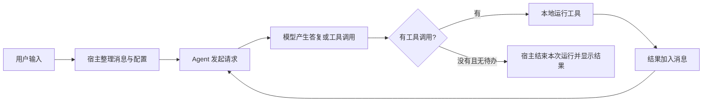

# 01 · 从零建立读源码所需的知识

[返回总目录](README.md) · [下一章：全仓库地图](02-全仓库地图.md)

## 1. 读懂 Pi 到底意味着什么

假设用户输入：“找到配置加载的错误，修复它，并解释原因。”读懂 Pi 意味着能回答：

1. 输入先交给哪个对象？什么时候成为一条消息？
2. 哪些历史、项目说明和工具声明被发送给模型？
3. 模型返回 `read` 调用时，谁读取本地文件？
4. 工具结果为什么会引发下一次模型请求？
5. 屏幕上的流式文字、内存里的消息和磁盘上的记录何时更新？
6. 输入过长、网络失败、用户取消、切换会话分别由谁处理？

先把这条链路走通，再看主题、快捷键、模型路由、远程执行等细节。文件数量很多，但多数文件都能放进这六个问题中的某一处。

## 2. 先区分模型、Agent 和宿主

**模型**接收请求，产生文本、思考内容或工具调用。它不能仅凭输出一个工具名字就修改你的磁盘。

**Agent 循环**接收模型输出，查找并执行工具，把结果放回消息序列，根据是否还有工作决定继续请求还是结束。

**宿主**负责现实中的应用体验：输入、配置、认证、文件工具、会话保存、压缩、扩展以及 UI。Pi 的 `coding-agent` 就是这样的宿主；`agent` 包提供更通用的循环。



这个图是基本路径。真实实现还有队列、扩展边界和恢复循环，后续章节逐步补上。

## 3. TypeScript 文件顶部为什么这么写

打开 [SDK 装配入口](https://github.com/earendil-works/pi/blob/6fb2e7815167e6b19006fc526d1a5d0f5f998787/packages/coding-agent/src/core/sdk.ts)。顶部会同时出现三种导入：

```ts
import { join } from "node:path";
import { Agent, type AgentMessage } from "@earendil-works/pi-agent-core";
import { AgentSession } from "./agent-session.ts";
```

| 写法 | 含义 | 阅读时该想到什么 |
|---|---|---|
| `node:path` | Node 自带模块 | 文件路径属于运行环境能力 |
| `@earendil-works/...` | 包的公开入口 | 当前模块依赖另一个包的职责 |
| `./agent-session.ts` | 本包相邻模块 | 继续追踪内部实现 |
| `type AgentMessage` | 编译期类型 | 描述数据形状，本身不是运行时对象 |

Pi 主要是 TypeScript，不是 C/C++。这里没有对应 C 语言 `.h` 文件的统一“头文件层”。顶部 imports 声明依赖，`types.ts` 集中数据结构，`index.ts` 集中公开导出，它们承担一部分接口组织职责。

相对路径保留 `.ts` 与仓库采用 Node 原生 TypeScript 类型擦除的约束有关。根目录 [AGENTS.md](https://github.com/earendil-works/pi/blob/6fb2e7815167e6b19006fc526d1a5d0f5f998787/AGENTS.md) 和 [package.json](https://github.com/earendil-works/pi/blob/6fb2e7815167e6b19006fc526d1a5d0f5f998787/package.json) 明确规定了运行环境与可使用的语法。不要擅自把所有后缀改成 `.js` 来套用其他项目的习惯。

`index.ts` 中的 `export` 主要告诉使用者“从包外能访问哪些能力”。它不代表这些能力都在启动时执行；执行时机要继续看导入目标、模块顶层代码和函数调用位置。

## 4. 类型：先看字段承担什么职责

读 [消息类型](https://github.com/earendil-works/pi/blob/6fb2e7815167e6b19006fc526d1a5d0f5f998787/packages/ai/src/types.ts) 时，会看到联合类型：一个消息可能是 system、user、assistant 或 toolResult。

```ts
// 阅读示意：突出判别字段，不是完整源码定义。
if (message.role === "toolResult") {
  // 这个分支中可以理解 toolCallId 的意义：它指向之前的工具调用。
}
```

`role` 或 `type` 是“判别字段”：让同一个变量在不同分支中具有不同结构。例如 assistant 的内容可以包括 `toolCall`，而 toolResult 需要标识它在回答哪次调用。

以下语法出现频率很高：

| 语法 | 白话解释 | Pi 中常见用途 |
|---|---|---|
| `field?: T` | 字段可能没有提供 | CLI 参数、可选设置、扩展返回值 |
| `T \| undefined` | 结果可能不存在 | 查不到模型、没有压缩候选 |
| `Record<string, T>` | 字符串键到值的映射 | 系统提示词 sections、工具表 |
| `Map<K, V>` | 有明确键类型的映射容器 | entry ID 查找、事件处理器 |
| `Set<T>` | 去重集合 | 工具集合、文件操作集合 |
| `Promise<T>` | 将来才能得到 T | HTTP、工具执行、异步加载 |
| `Extract<U, {type: ...}>` | 从联合类型筛出某一支 | 特定事件处理函数 |
| `as const` | 保留字面量类型 | 默认配置和固定枚举值 |

泛型 `T` 的价值是把“同一结构中的某部分数据由调用者决定”表达出来。例如工具参数 schema 不同，工具执行函数的参数类型也随之不同。第一遍阅读无需展开每一个泛型，先看实际传入的值。

类型检查发生在开发阶段；模型返回的 JSON、用户配置和网络数据仍需要运行时解析和校验。看到 schema 时，要追问它是用于生成模型工具声明，还是用于检查运行时参数，或两者都有。

## 5. `async/await` 不等于自动并行

读这一节时，先分清三个动作：**定义函数、调用函数、等待结果**。调用函数靠 `()`；`async` 和 `await` 分别影响返回值与等待方式。

### 5.1 普通函数、`async` 和 Promise 各自是什么

普通函数可以直接返回一个值：

```js
function add(a, b) {
  return a + b;
}

const result = add(1, 2);
console.log(result); // 3
```

加上 `async` 后，函数始终返回 Promise。Promise 是一个表示操作结果的对象：结果可能尚未确定，也可能已经成功或失败。

| Promise 状态 | 含义 |
|---|---|
| `pending` | 结果尚未确定 |
| `fulfilled` | 成功完成，保存成功结果 |
| `rejected` | 失败完成，保存失败原因 |

```js
async function add(a, b) {
  return a + b;
}

const resultPromise = add(1, 2);
// resultPromise 是 Promise，里面的成功结果为 3。

async function main() {
  const result = await resultPromise;
  console.log(result); // 3
}

main().catch(console.error);
```

即使函数内部写的是 `return 3`，`async` 也会通过 Promise 交付这个结果。若内部返回另一个 Promise，外层 Promise 会跟随它的最终结果；不是让调用者一层一层地拆 Promise。`async` 函数内抛出的错误则会使返回的 Promise 失败。

`main` 在 JavaScript 中只是一个普通函数名，并没有“程序必须从这里开始”的语法地位。真正启动上面流程的是 `main()`。

### 5.2 `await` 是等待结果，不是调用函数的专用语法

下面几种写法承担不同职责：

| 写法 | 作用 |
|---|---|
| `async function task() { ... }` | 定义返回 Promise、函数体中允许使用 `await` 的函数 |
| `task()` | 调用函数，拿到它返回的 Promise |
| `await task()` | 先调用，再等待这个 Promise，取得成功结果 |
| `await promise` | 等待已经保存好的 Promise，不会重新调用产生它的函数 |

对于 `await loadA()`，先求值的是 `loadA()`。函数调用会开始执行函数中的代码；随后 `await` 等待返回的结果。Promise 也不是“必须等人 `await` 才开始工作”的开关。

在函数内部使用 `await`，包含这条语句的函数必须声明为 `async`：

```js
// 错误语法：普通函数体中不能使用 await。
function main() {
  const result = await Promise.resolve(3);
}
```

正确写法是：

```js
async function main() {
  const result = await Promise.resolve(3);
  console.log(result); // 3
}

main().catch(console.error);
```

这里 `Promise.resolve(3)` 创建一个成功结果为 `3` 的 Promise。`await` 取得的是 `3`。

规则有一个重要例外：**ES 模块的顶层也允许使用 `await`**，例如 Node 中的 `.mjs` 文件。普通脚本顶层不能直接照搬；TypeScript 还要看模块配置与运行环境。第一遍读 Pi 时，先辨认当前语句是在 `async` 函数体里，还是模块顶层。

`async` 函数内部也可以调用普通同步函数，不需要给每个调用都加上 `await`。是否等待某个异步调用，取决于后续步骤是否需要它的结果或完成状态。

### 5.3 为什么要等待：拿到数据并保持依赖顺序

假设要先获取用户，再用用户 ID 查询订单。直接调用获取用户的异步函数，拿到的是 Promise；加上 `await` 才能获得成功返回的用户对象。

下面是调用关系示意，`getCurrentUser`、`getOrders` 和 `renderOrders` 分别代表获取用户、查询订单和显示订单的函数：

```js
async function showOrders() {
  const user = await getCurrentUser();
  const orders = await getOrders(user.id);
  renderOrders(orders);
}
```

第二行依赖第一行得到的 `user.id`，第三行依赖第二行得到的订单。依赖链必须保持顺序。`await` 的作用是让这段异步流程像普通顺序代码一样清晰，同时允许程序在等待期间处理其他工作。

不加 `await` 并不会自动获得最终结果：

```js
// 调用关系示意：getCurrentUser 返回 Promise。
const userPromise = getCurrentUser();
// 此时不能把 userPromise 当成最终用户对象来读取 userPromise.id。
```

### 5.4 `await` 暂停当前函数，不会跳过 B 去执行 C

```js
// 调用关系示意：A、B 成功完成后，流程才继续。
async function task() {
  await loadA();
  await loadB();
  loadC();
  console.log("task 中 C 后面的语句");
}
```

执行顺序是：

```text
调用 loadA()
    ↓
task 暂停，等待 A 成功完成
    ↓
调用 loadB()
    ↓
task 暂停，等待 B 成功完成
    ↓
调用 loadC()
    ↓
执行 task 中 C 后面的语句
```

第一个 `await` 后面的 B、C 和 `console.log` 都属于当前函数的后续代码，因此都要等 A 成功完成。不会越过 B 去执行 C，再回来补做 B。

C 前面没有 `await`。如果 C 返回一个尚未完成的 Promise，调用 C 后就继续执行后面的语句，不等它的异步结果。但 C 在返回 Promise 之前执行的同步代码仍然要先执行完。如果 A 或 B 失败且没有在这里捕获错误，`task` 会失败，后面的正常步骤也不会继续执行。

### 5.5 函数暂停后，外面的代码为什么可以执行

以下完整例子用定时器模拟等待，可以单独运行。定时器不是网络请求，但足以观察函数内部与外部的执行顺序。

```js
function delay(ms) {
  return new Promise((resolve) => {
    setTimeout(resolve, ms);
  });
}

async function loadA() {
  await delay(1000);
  return "A 的结果";
}

async function loadB() {
  await delay(1000);
  return "B 的结果";
}

async function loadC() {
  await delay(1000);
  console.log("7：C 的异步等待完成");
}

async function task() {
  console.log("1：准备启动 A");
  const a = await loadA();

  console.log("4：拿到", a, "，准备启动 B");
  const b = await loadB();

  console.log("5：拿到", b, "，准备启动 C");
  // C 的结果不参与后续步骤，但仍处理它可能产生的失败。
  loadC().catch(console.error);
  console.log("6：C 已启动，task 继续往下执行");
}

task().catch(console.error);

console.log("2：外部第一条语句");
console.log("3：外部第二条语句");
```

成功运行时输出顺序为：

```text
1：准备启动 A
2：外部第一条语句
3：外部第二条语句
大约一秒后 → 4：拿到 A 的结果 ，准备启动 B
再过大约一秒 → 5：拿到 B 的结果 ，准备启动 C
紧接着 → 6：C 已启动，task 继续往下执行
再过大约一秒 → 7：C 的异步等待完成
```

其中时间提示用于解释顺序，不是代码实际打印的文字；定时器也不保证精确到指定毫秒执行。

调用 `task()` 后，函数先执行开头的同步代码，打印 1 并启动 A。到第一个 `await` 时，`task` 暂停后续执行，把 Promise 返回给调用者。外层没有等待整个 `task`，于是继续打印 2 和 3。

**“等待时可以执行其他代码”，不代表自动执行当前函数里更下面的代码。** 本例能运行的是外层的 2、3；`task` 内部的 4、5、6 仍受各自前面的 `await` 约束。

外层的 `task().catch(console.error)` 为整个 task 的失败注册处理函数；它不会让外层同步代码等待 task 完成。

### 5.6 A 已完成，但外面的同步代码还没执行完怎么办

在同一个 JavaScript 执行线程上，一段正在执行的同步代码通常会执行到底，不会在中间被 Promise 的后续代码抢占。

事件循环负责安排已经就绪的工作；`await` 的恢复属于微任务。可以先把微任务理解成“当前同步调用栈清空后处理的一类后续工作”。若 A 在外层同步代码执行期间完成，`task` 的恢复也要等当前同步代码执行完，取得执行机会后才继续。

例如外层依次执行三个 `console.log`，不会打印到第二个的一半就跳回 `task`。`console.log` 的 JavaScript 调用是同步的；控制台实际绘制文字可能稍晚，但 `task` 不需要等待屏幕绘制完成。

即使等待的 Promise 已经成功完成，`await` 后的语句也不会在当前同步调用栈中直接执行：

```js
async function task() {
  console.log("1：进入 task");
  await Promise.resolve("已经完成的结果");
  console.log("3：恢复 task");
}

task().catch(console.error);
console.log("2：外层同步代码");
```

这个例子的顺序仍然是 1、2、3。恢复时是接收已完成的结果，再继续 `await` 后面的代码；不会重新调用已经执行过的函数，也不需要自己反复查询 Promise 状态。

如果外层发起的是另一个异步操作，不能因此推断它的整个异步过程也必须先完成。这里要等的是当前同步代码结束，不是等待所有其他异步任务。

### 5.7 等待 B 时，外面的 `log` 不会重新执行

第 5.5 节中的外层 2、3 在等待 A 时已经执行完。A 完成后，`task` 恢复，取得 A 的结果，再启动 B。第二次暂停不会让外层倒回去重新打印 2、3。

```text
task 内部：启动 A → 等 A → 启动 B → 等 B → 启动 C → 继续
外层代码：调用 task → 打印 2 → 打印 3 → 执行结束
```

每条流程都有自己的执行进度。等待 B 时，程序可以处理当时已经就绪的点击事件、定时器回调或其他异步任务的后续代码；如果没有可执行的工作，就等待。

如果外层还有同步语句，它们会沿原顺序继续执行，并通常在 `task` 第一次恢复之前就执行完。不是“等待 A 执行第一条外部语句，等待 B 再执行第二条”。

### 5.8 先启动再等待，以及 `Promise.all()` 并发

假设 A、B 是彼此独立的网络操作，分别需要约两秒和三秒。顺序调用并等待时，总时间约五秒：

```js
// 调用关系示意，位于 async 函数内。
const a = await loadA();
const b = await loadB();
```

如果先启动两个操作，再统一等待，网络等待可以重叠，总时间可能接近较慢的三秒：

```js
// 调用关系示意，位于 async 函数内。
const promiseA = loadA();
const promiseB = loadB();

const [a, b] = await Promise.all([promiseA, promiseB]);
```

也可以合写：

```js
// 调用关系示意，位于 async 函数内。
const [a, b] = await Promise.all([loadA(), loadB()]);
```

数组中的调用表达式仍然先后求值：先调用 A，再调用 B。如果 A 很快返回一个尚未完成的 Promise，B 就能在 A 的异步操作结束前启动。让两个操作启动的是函数调用；`Promise.all` 汇总结果，`await` 等待汇总后的成功结果。结果数组按输入顺序排列，与谁先完成无关。

这叫并发：多个操作的进行时间重叠。不必意味着两个函数的 JavaScript 代码在不同 CPU 线程上同时运行。如果 A 在返回 Promise 之前进行大量同步计算，B 仍要等这段同步计算结束后才能被调用。

`async` 不会自动创建后台线程，也不会把重计算变成不阻塞的操作。真正把 JavaScript 重计算移到另一个线程，通常需要 Worker 等机制。`await` 的意义是有序地等待异步结果，而不是让任何计算自动变快。

### 5.9 不等待结果，也要理解完成和失败的边界

`await` 会在 Promise 失败时抛出对应的失败原因，可以用 `try/catch` 处理：

```js
async function main() {
  try {
    const result = await Promise.reject(new Error("请求失败"));
    console.log(result); // 失败时不会执行。
  } catch (error) {
    console.error("获取结果失败：", error);
  }
}

main().catch(console.error);
```

不写 `await` 时，当前流程不会等待这个 Promise，也不会自动观察它的错误。可以保存 Promise 稍后等待，或像第 5.5 节的 C 一样注册 `.catch(...)` 处理失败。若调用者需要知道所有子操作都已完成，就应等待它们，不能仅注册错误处理后便把当前函数完成视为整个任务完成。

普通 `try/catch` 不能捕获一个未等待的 Promise 日后产生的拒绝；它只能捕获当前同步执行中的抛错。对于 Promise 的失败，要通过 `await` 配合 `try/catch`，或通过 `.catch(...)` 等方式处理。

`Promise.all` 只有在所有输入都成功时才交付结果；任何一个失败，就会使汇总 Promise 失败。它不会自动取消其他已经启动的操作，取消仍需要操作本身支持的机制。

### 5.10 将这些规则用于阅读 Pi

阅读 Pi 的工具执行和扩展事件时，逐项辨认：

1. **谁调用函数？** 标了 `async` 的函数不会自行开始执行，仍要找到调用处。
2. **调用拿到什么？** 区分 Promise 和等待后的实际结果，例如 `Promise<ToolResult>` 与 `ToolResult`。
3. **谁等待谁？** `await tool.execute(...)` 表示当前流程等这次工具执行的结果，再继续后续步骤。
4. **是否已经启动其他操作？** 不能只看某个 `await`，还要看此前是否调用了其他异步函数，以及是否使用 `Promise.all` 等组织方式。
5. **返回代表哪个完成边界？** 函数返回的 Promise 成功，不保证内部未被等待的其他异步操作也已完成。
6. **错误在哪里被处理？** 看 `try/catch`、`.catch(...)` 或向上层传递错误的路径。

不能因为函数标了 `async` 就认为工具并行，也不能因为文件按顺序排列就认为它们串行。执行顺序由实际调用、等待位置和数据依赖决定。

## 6. 回调和事件：谁调用谁

**回调函数就是把一个函数交给其他代码，让对方在需要时调用它。** 先理解函数怎样作为参数传递，再看 Pi 怎样保存和通知这些函数。

### 6.1 函数本身和调用函数，是两件事

```js
function sayHello() {
  console.log("你好");
}

const anotherName = sayHello;
anotherName(); // 输出：你好
```

`sayHello` 指向函数，可以像数字、字符串一样赋给变量。`sayHello()` 则是现在调用函数，执行函数体。上面的赋值没有输出；调用 `anotherName()` 时才输出。

| 写法 | 含义 |
|---|---|
| `sayHello` | 这个函数本身 |
| `sayHello()` | 调用这个函数，取得返回值 |
| `const fn = sayHello` | 让另一个变量指向同一个函数 |
| `fn()` | 通过这个变量调用函数 |

### 6.2 函数作为参数传入后，就能被对方调用

```js
function sayHello() {
  console.log("你好");
}

function run(callback) {
  callback();
}

run(sayHello);
```

执行顺序是：

```text
调用 run(sayHello)
    ↓
参数 callback 接收到 sayHello 这个函数
    ↓
run 执行 callback()，相当于调用 sayHello()
    ↓
输出“你好”，sayHello 返回
    ↓
run 继续，随后返回
```

这里 `sayHello` 是回调函数。“回调”描述使用方式，没有专门的回调语法。`callback` 也只是参数名字，改成 `fn` 后执行 `fn()`，效果相同。

不要把传入函数写成传入它的返回值：

```js
// 对照示意，沿用上面的 run 和 sayHello。
run(sayHello);   // 把函数交给 run，由 run 调用。
run(sayHello()); // 先调用 sayHello，再把返回值交给 run。
```

第二种先输出“你好”。因为 `sayHello` 没写 `return`，它返回 `undefined`，接下来相当于 `run(undefined)`；`run` 执行 `callback()` 就会报错。若某个函数本来就返回另一个函数，调用后再传入也可能正确，但不能据此忽略函数和返回值的区别。

### 6.3 回调的参数由调用它的代码提供

回调允许外面决定“拿到结果后做什么”：

```js
function calculate(a, b, handleResult) {
  const result = a + b;
  handleResult(result);
}

function printResult(value) {
  console.log("计算结果是：", value);
}

calculate(2, 3, printResult); // 输出：计算结果是：5
```

这里有两次不同的传参：

1. `calculate(2, 3, printResult)` 把函数传给 `handleResult`。
2. `handleResult(result)` 调用这个函数，把数字 `5` 传给它的参数 `value`。

`handleResult` 和 `value` 不必同名；它们分别属于两个函数。`calculate` 负责计算，传进来的回调决定如何处理结果。换成检查大小、更新界面等回调，计算步骤可以保持不变。

### 6.4 匿名函数和箭头函数也可以作为回调

不必每次都先给回调起名字。下面是第 6.3 节调用的两种等价写法：

```js
// 对照示意，沿用上面的 calculate。
calculate(2, 3, function (value) {
  console.log("计算结果是：", value);
});

calculate(2, 3, (value) => {
  console.log("计算结果是：", value);
});
```

`function (value) { ... }` 是没有名字的函数；`(value) => { ... }` 是箭头函数。此处都表示“接收一个 value，并输出它”的回调。

把箭头函数写在参数位置，只是创建函数并交出去，**不会因此立即执行函数体**。`calculate` 执行 `handleResult(result)` 时，里面的 `console.log` 才运行。箭头函数和普通函数还有 `this` 等差异，这个例子没有使用那些特性。

### 6.5 回调不一定异步，也不一定只执行一次

同步回调可以直接执行，执行结束后调用者才继续：

```js
function run(callback) {
  console.log("2：进入 run");
  callback();
  console.log("4：回调执行结束");
}

console.log("1：准备调用 run");
run(() => {
  console.log("3：执行回调");
});
console.log("5：run 执行结束");
```

输出顺序是 1、2、3、4、5。调用回调就是一次普通函数调用，不会自动切换到后台线程。

异步回调的调用时机不同：

```js
console.log("1：开始");

setTimeout(() => {
  console.log("3：执行定时器回调");
}, 1000);

console.log("2：定时器已安排，继续执行");
```

先输出 1、2，大约一秒后才输出 3。`setTimeout` 安排定时任务后返回，之后由运行环境安排调用回调。时间条件满足不保证立刻执行，仍要等待 JavaScript 取得执行机会。

回调也可以执行多次，例如浏览器的按钮监听：

```js
// 浏览器调用关系示意：button 是已经取得的按钮元素。
button.addEventListener("click", () => {
  console.log("按钮被点击了");
});
```

登记时不会输出，之后每点击一次就调用一次。是否调用、何时调用、调用几次，由接收回调的代码和实际事件决定。

### 6.6 回调中的 return 不会替外层函数返回

```js
function calculate(a, b, callback) {
  const result = a + b;
  callback(result);
}

const answer = calculate(2, 3, (value) => {
  return value * 2;
});

console.log(answer); // undefined
```

回调返回的 `10` 交回调用它的 `callback(result)` 这一行。但 `calculate` 没有使用这个值，也没有自己写 `return`，所以它返回 `undefined`。

如果需要把回调结果继续返回出去，应把那一行写成 `return callback(result)`。这时 `calculate` 才会返回 `10`。注意，只有接收回调的接口确实使用返回值，回调的返回值才有相应作用。

对于稍后调用的回调，不能用它的 `return` 改变已经返回的外层结果：

```js
function getValue() {
  setTimeout(() => {
    return 123;
  }, 1000);
}

console.log(getValue()); // undefined
```

`getValue()` 安排定时任务后就返回了。稍后的 `return 123` 只结束定时器回调，不能让之前的 `getValue()` 重新返回一次。

### 6.7 回调与 Promise、await 怎样配合

回调式接口可以这样交付结果：

```js
function loadA(onFinished) {
  setTimeout(() => {
    onFinished("A 的结果");
  }, 1000);
}

loadA((result) => {
  console.log(result);
});
console.log("外面的代码继续执行");
```

先输出“外面的代码继续执行”，大约一秒后调用 `onFinished`，输出“A 的结果”。如果下一步依赖 A 的结果，可以放在这个回调里面；连续多步依赖容易形成多层嵌套。

不能给这个接口简单加上 `await`，就让它等待回调：

```js
// 调用关系示意，位于 async 函数内，沿用上面的回调版 loadA。
await loadA((result) => {
  console.log(result);
});
console.log("这行不需要等定时器回调执行");
```

回调版 `loadA` 返回的是 `undefined`。这个 `await` 会让当前函数暂时让出执行，但没有一个表示定时任务完成的 Promise 可供等待，因此不会等到一秒后的回调完成。

如果改成返回 Promise，就能用 `await` 等待结果：

```js
function loadA() {
  return new Promise((resolve) => {
    setTimeout(() => {
      resolve("A 的结果");
    }, 1000);
  });
}

async function main() {
  const result = await loadA();
  console.log(result);
}

main().catch(console.error);
```

`new Promise` 接收的函数会立即执行，安排定时任务；定时器接收的回调稍后执行。`resolve` 是 Promise 提供的函数，调用 `resolve("A 的结果")` 让 Promise 成功完成。随后 `await` 后面的代码恢复，取得这个结果。这段代码同时使用了回调、Promise 和 `await`。

### 6.8 async 回调不代表调用者自动等待

```js
function run(callback) {
  callback();
  console.log("run 继续执行");
}

run(async () => {
  await new Promise((resolve) => {
    setTimeout(resolve, 1000);
  });
  console.log("回调的异步操作完成");
});
```

先输出“run 继续执行”，大约一秒后输出“回调的异步操作完成”。回调返回 Promise，但 `run` 没有等待它。

若调用者需要等待，可将上面的 `run` 改为：

```js
async function run(callback) {
  await callback();
  console.log("回调完成，run 继续执行");
}
```

这时 `run` 自己也返回 Promise，外层若需要等待整个过程，还要处理这个 Promise。回调的异步失败也应由等待它的调用者捕获，或通过返回 Promise 的 `.catch(...)` 处理；普通同步 `try/catch` 不能捕获未等待的 Promise 日后产生的拒绝。

### 6.9 listener、subscribe、emit、unsubscribe 分别做什么

Pi 的事件订阅也是回调的应用。先用一份简化的“函数名单”理解四个名字：

| 名字 | 功能 |
|---|---|
| `listener` | 收到通知后执行的回调函数，也叫监听器 |
| `subscribe(listener)` | 把监听器登记起来，之后有事件再通知它 |
| `emit(event)` | 发出事件，调用已登记的监听器，把事件交给它 |
| `unsubscribe()` | 移除对应监听器，以后不再通知它 |

这些都不是 JavaScript 关键字。尤其 `unsubscribe` 通常是保存取消订阅函数的变量名，不是必须存在的固定方法。

下面是完整教学例子，可以单独运行。它展示保存、调用和移除函数的基本机制，不是 Pi 的完整实现：

```js
const listeners = new Set();

function subscribe(listener) {
  // 登记时只保存函数，暂时不调用它。
  listeners.add(listener);

  return () => {
    listeners.delete(listener);
  };
}

function emit(event) {
  for (const listener of listeners) {
    listener(event);
  }
}

function showEvent(event) {
  console.log("收到通知：", event.type);
}

const unsubscribe = subscribe(showEvent);

emit({ type: "agent_start" });
emit({ type: "message_end" });

unsubscribe();

emit({ type: "agent_end" });
```

输出只有：

```text
收到通知：agent_start
收到通知：message_end
```

逐步看每次调用：

1. `subscribe(showEvent)` 保存函数，不打印内容。
2. `subscribe` 返回一个取消登记的函数，赋给变量 `unsubscribe`；这一步没有执行取消。
3. `emit({ type: "agent_start" })` 取出 `showEvent`，调用 `showEvent(event)`，打印第一行。
4. 再次 `emit`，再次调用它，打印第二行。
5. `unsubscribe()` 才执行删除，名单中不再有 `showEvent`。
6. 最后一次 `emit` 找不到这个监听器，所以没有输出。

`event` 是描述发生了什么的数据。例如 `{ type: "agent_start" }` 表示 Agent 开始运行；它不是监听器函数。`emit` 把对象作为参数传入，监听器自己决定怎样处理。

取消函数中的 `listener` 仍指向当初登记的函数，这叫闭包：返回的函数能继续访问创建它时外层的变量，所以知道该删除谁。这里删除的是同一个函数对象，不能重新写一个看起来一样的箭头函数当作原函数。

取消订阅不会撤销已经执行的回调，也不会终止它已经启动的异步工作。它只负责移除监听器，不负责停止 Agent。多个监听器可以各自登记和取消；没有额外重放逻辑时，刚登记的监听器也不会自动收到订阅之前的事件。

### 6.10 对照 Pi：Agent 保存监听器，循环通过 emit 通知

在 [agent.ts](https://github.com/earendil-works/pi/blob/6fb2e7815167e6b19006fc526d1a5d0f5f998787/packages/agent/src/agent.ts) 中找 `subscribe`，核心是：

```ts
// 源码核心片段：省略方法签名和注释。
this.listeners.add(listener);
return () => this.listeners.delete(listener);
```

因此，下面用法中的箭头函数就是监听器：

```js
// 调用关系示意：agent 是已经创建的 Agent 实例。
const unsubscribe = agent.subscribe((event) => {
  console.log(event.type);
});
```

`Agent.subscribe` 的监听器还会接收当前运行的 `AbortSignal`，用于观察取消；上面的回调没有使用第二个参数，可以省略。它使用 `Set` 保存监听器，同一个函数对象重复添加不会形成两份登记。

在 [agent-loop.ts](https://github.com/earendil-works/pi/blob/6fb2e7815167e6b19006fc526d1a5d0f5f998787/packages/agent/src/agent-loop.ts) 中，`runAgentLoop` 接收 `emit` 参数，并在适当位置执行：

```ts
await emit({ type: "agent_start" });
await emit({ type: "turn_start" });
```

这里的 `emit` 本身也是回调参数。Agent 调用循环时，传入的是 `(event) => this.processEvents(event)`。所以循环执行 `emit(event)`，会进入 Agent 的 `processEvents(event)`。

`processEvents` 先根据事件更新状态，再通知监听器。例如 `message_end` 会把完成的消息放进 Agent 历史。通知部分是：

```ts
for (const listener of this.listeners) {
  await listener(event, signal);
}
```

对于正常完成的通知，它按订阅顺序等待各监听器返回的结果。第一个监听器返回的 Promise 完成后，才调用第二个；不是自动并发。监听器抛错或返回失败的 Promise，会使这次处理失败，不能假定后面的监听器仍会正常执行。

```text
提前：agent.subscribe(回调) → Agent 保存回调

事件发生时：
Agent 循环调用 await emit(event)
    ↓
Agent.processEvents(event) 更新状态
    ↓
逐个 await listener(event, signal)
    ↓
通知成功完成，循环继续
```

监听器必须返回或等待它希望 Agent 等待的异步工作。如果它只启动异步操作后立即返回，Agent 仍无法等待那个操作的完成。

### 6.11 对照 Pi：AgentSession 与界面再接一层

[AgentSession](https://github.com/earendil-works/pi/blob/6fb2e7815167e6b19006fc526d1a5d0f5f998787/packages/coding-agent/src/core/agent-session.ts) 初始化时，登记自己的事件处理函数：

```ts
this._unsubscribeAgent = this.agent.subscribe(this._handleAgentEvent);
```

含义是：底层 Agent 有事件时，请调用本会话的 `_handleAgentEvent`。返回的取消函数保存到 `_unsubscribeAgent`，断开连接时再调用。

Session 的 `_handleAgentEvent` 先等待相应扩展事件处理，再通知 Session 的公开监听器，并继续会话保存等处理。交互界面通过 Session 的 `subscribe` 登记自己的回调，入口见 [interactive-mode.ts](https://github.com/earendil-works/pi/blob/6fb2e7815167e6b19006fc526d1a5d0f5f998787/packages/coding-agent/src/modes/interactive/interactive-mode.ts) 的 `subscribeToAgent`。

```text
Agent 循环产生事件
    ↓
Agent 更新状态并调用自己的监听器
    ↓
AgentSession._handleAgentEvent
    ↓
等待相应扩展处理，再通知 Session 监听器
    ↓
交互界面 handleEvent 处理事件并安排刷新
```

但 Session 的 `_emit` 与底层 Agent 不同：

```ts
private _emit(event: AgentSessionEvent): void {
  for (const l of this._eventListeners) {
    l(event);
  }
}
```

`l` 只是监听器变量的短名字。这里没有 `await`，不会等待监听器返回的 Promise。

| 通知位置 | 对异步监听器的处理 |
|---|---|
| `Agent.processEvents` | 逐个等待监听器返回的 Promise |
| `AgentSession._emit` | 逐个调用，不等待监听器返回的 Promise |

即使 Session 的监听器写成 `async (event) => { await handleEvent(event); }`，也只表示这个回调内部等待 `handleEvent`，不能让外面的 `_emit` 自动等待它。同步部分仍会执行，回调到 `await` 暂停后，外层可以继续通知其他监听器。界面安排刷新也不等于屏幕已经绘制完成。

Session 的 `subscribe` 用数组保存监听器，返回的函数从数组中移除对应监听器。不要把它与 Agent 的 `Set` 实现混为一谈，也不要反复登记同一个监听器后假定会自动去重。

### 6.12 同名 emit 的区别与事件完成边界

Pi 中并非所有 `emit` 都走同一套代码：

| 位置 | 如何登记 | 如何通知 |
|---|---|---|
| 底层 Agent | `agent.subscribe(listener)` | 循环调用传入的 `emit`，Agent 更新状态并等待监听器 |
| AgentSession | `session.subscribe(listener)` | `_emit(event)` 调用监听器，不等待异步结果 |
| 扩展运行器 | 扩展通过 `pi.on(...)` 登记处理器 | runner 的 `emit(event)` 查找对应处理器，普通事件逐个等待 |
| 扩展事件总线 | `on(channel, handler)` | `emit(channel, data)` 按频道通知，不等待异步处理完成 |

扩展运行器还会处理某些事件的返回值，例如取消请求；不能认为每个回调的返回值都被忽略。相关入口见 [extensions/runner.ts](https://github.com/earendil-works/pi/blob/6fb2e7815167e6b19006fc526d1a5d0f5f998787/packages/coding-agent/src/core/extensions/runner.ts) 和 [event-bus.ts](https://github.com/earendil-works/pi/blob/6fb2e7815167e6b19006fc526d1a5d0f5f998787/packages/coding-agent/src/core/event-bus.ts)。

`message_update` 通常代表流式中间状态；`message_end` 代表消息定稿；`turn_end` 表示这一轮的 assistant 和工具结果已形成完整边界。底层的 `agent_end` 是本次运行最后一个循环事件，但 Agent 仍要等其监听器处理结束才进入空闲状态。会话层还有 `agent_settled`，用于表达重试、压缩等后续处理结束。这些不是同一个“完成”，收到通知也不能直接推断消息已经落盘或界面已经画完。

阅读回调与事件代码时，依次回答：

1. 哪个参数接收函数，登记时是否调用它？
2. 函数保存在哪个集合里，谁在什么时候调用它？
3. 调用时传了什么数据，回调怎样使用这些参数？
4. 调用者是否使用返回值，是否等待返回的 Promise？
5. 返回的取消函数保存在哪里，什么时候被调用？

先把“传入函数、保存函数、调用函数、移除函数”分清，再沿实际调用链看等待和错误路径。

## 7. 异步流：为什么答案能一点点显示

普通 Promise 只能最终返回一次结果。模型流会不断产出事件，消费者通过 `for await ... of` 逐个处理。

```ts
// 阅读示意，不指定某家 Provider 的协议字段。
for await (const event of stream) {
  // 处理文本增量、工具参数增量、结束或错误。
}
```

需要区分三个对象：网络收到的原始片段、pi-ai 归一化后的事件、最终 AssistantMessage。屏幕可以先显示增量，而会话持久化通常等消息完成。不能拿任意一次 partial 内容当最终历史。

入口见 [event-stream.ts](https://github.com/earendil-works/pi/blob/6fb2e7815167e6b19006fc526d1a5d0f5f998787/packages/ai/src/utils/event-stream.ts)，循环消费者见 [agent-loop.ts](https://github.com/earendil-works/pi/blob/6fb2e7815167e6b19006fc526d1a5d0f5f998787/packages/agent/src/agent-loop.ts)。

## 8. 取消是沿调用链传播的信号

`AbortController` 发出取消，`AbortSignal` 被传给模型请求、工具或其他异步任务。信号不是撤销已经发生的文件修改，也不自动杀死所有任意子进程：每一层都要实现具体取消行为。

读取消分支时记录：谁创建 controller、谁调用 abort、谁读取 signal、finally 如何释放资源、历史里保留什么。这样才能解释“按了取消后为什么仍有一条 aborted 消息”。

## 9. 对象身份、状态和闭包

同一条消息对象可能同时被 Agent state 和事件持有。修改这个对象与创建一个新对象替换数组元素，影响范围不同。`AgentSession._replaceMessageInPlace()` 专门处理这类同步问题。

闭包会捕获外层变量。SDK 中的 `extensionRunnerRef.current` 让较早创建的请求函数访问后来装配、或重载后的 runner。它表达生命周期关系，不能简单当作“多余的一层对象”。

另一个常见模式是注入：`createAgentSession()` 可以接收自定义 SessionManager、SettingsManager 和 ModelRuntime。这允许 SDK 宿主控制存储、配置和模型入口，而无需复制 CLI 主程序。

## 10. 读函数时固定记录六件事

以 `AgentSession.prompt()` 为例：

| 问题 | 应当找什么 |
|---|---|
| 输入是什么 | text、images、source、streamingBehavior |
| 读什么状态 | 是否 streaming、是否压缩、当前模型和认证 |
| 改什么状态 | 队列、消息、提示词和工具装载 |
| 调谁 | 扩展、模板、压缩检查、Agent |
| 返回意味着什么 | 已处理、已排队，或已等待本次 prompt 路径完成 |
| 失败如何表现 | throw、错误事件、模型 stopReason、取消标记 |

遇到大文件时先画这个表，再沿一个场景追踪。一次试图记住所有私有字段，通常只会记住名字，无法解释行为。

## 11. 第一轮阅读练习

打开下面三个文件，只完成对应问题：

1. [sdk.ts](https://github.com/earendil-works/pi/blob/6fb2e7815167e6b19006fc526d1a5d0f5f998787/packages/coding-agent/src/core/sdk.ts)：找到 `new Agent` 和 `new AgentSession`，说明两者不是同一个对象。
2. [agent-loop.ts](https://github.com/earendil-works/pi/blob/6fb2e7815167e6b19006fc526d1a5d0f5f998787/packages/agent/src/agent-loop.ts)：找到模型请求、工具执行和下一轮判断。
3. [session-manager.ts](https://github.com/earendil-works/pi/blob/6fb2e7815167e6b19006fc526d1a5d0f5f998787/packages/coding-agent/src/core/session-manager.ts)：区分 `appendMessage` 和 `buildSessionProjection`。

能解释“谁执行、谁协调、谁保存、谁投影”，就可以进入全仓库地图。
