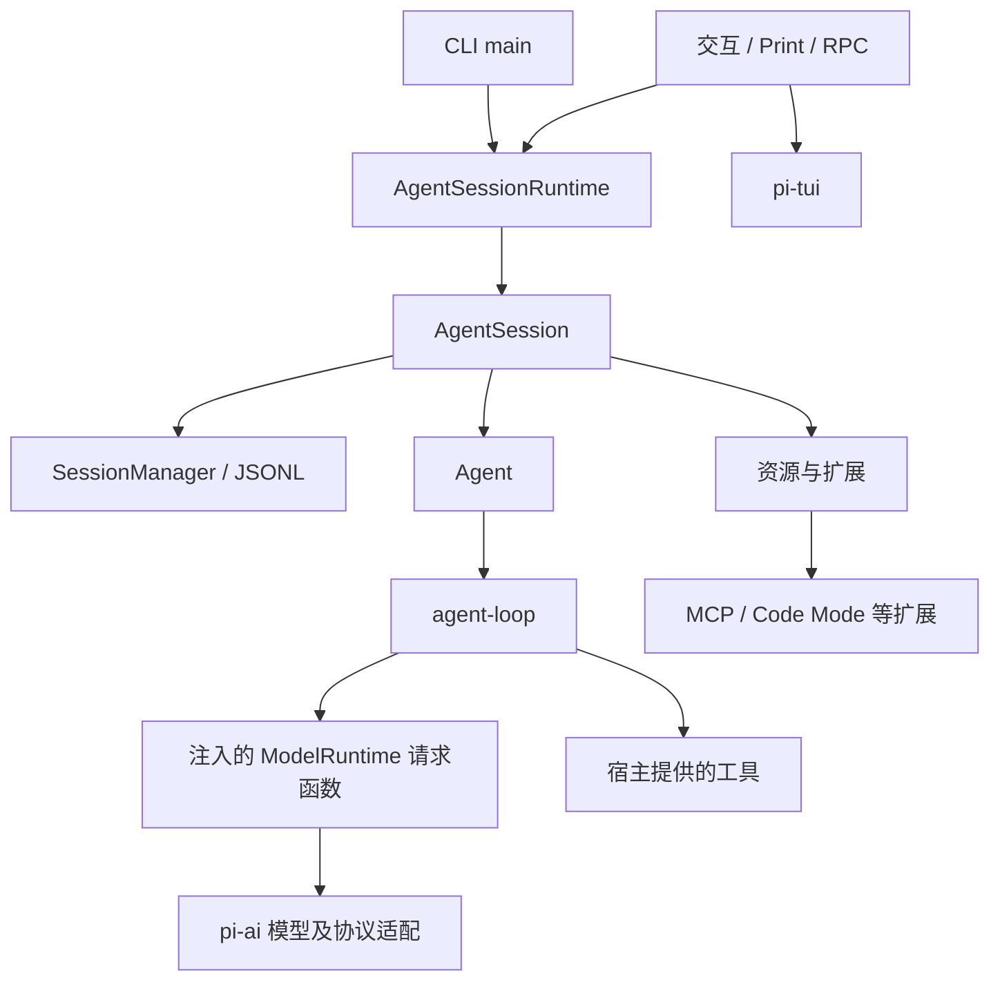

# 02 · 全仓库地图与分层职责

[返回总目录](README.md) · [上一章](01-阅读准备.md) · [下一章](03-启动与初始化.md)

## 1. 一个仓库，十四个包

Monorepo 表示多个相关包放在同一个 Git 仓库中。根 [package.json](https://github.com/earendil-works/pi/blob/6fb2e7815167e6b19006fc526d1a5d0f5f998787/package.json) 的 workspaces 管理这些包，包内的 package.json 定义各自入口和依赖。

不要把整个仓库都称为“Agent 循环”。此版本 `agent/src` 只有六个文件；文件数量较多的是产品宿主、模型适配和支撑设施。

| 包 | 核心职责 | 优先阅读位置 | 对默认 CLI 的理解价值 |
|---|---|---|---|
| `coding-agent` | CLI、会话、工具、扩展、配置和模式 | [src/main.ts](https://github.com/earendil-works/pi/blob/6fb2e7815167e6b19006fc526d1a5d0f5f998787/packages/coding-agent/src/main.ts) | 主线 |
| `agent` | 通用消息循环、队列、工具调度 | [src/agent-loop.ts](https://github.com/earendil-works/pi/blob/6fb2e7815167e6b19006fc526d1a5d0f5f998787/packages/agent/src/agent-loop.ts) | 主线 |
| `ai` | 模型、Provider、认证、协议适配和流 | [src/types.ts](https://github.com/earendil-works/pi/blob/6fb2e7815167e6b19006fc526d1a5d0f5f998787/packages/ai/src/types.ts) | 主线 |
| `tui` | 终端输入、布局、渲染和组件 | [src/tui.ts](https://github.com/earendil-works/pi/blob/6fb2e7815167e6b19006fc526d1a5d0f5f998787/packages/tui/src/tui.ts) | 交互主线 |
| `mcp` | 独立 MCP 客户端 | [README](https://github.com/earendil-works/pi/blob/6fb2e7815167e6b19006fc526d1a5d0f5f998787/packages/mcp/README.md) | 接入外部工具时深入 |
| `codemode` | 受限 JavaScript 执行及注入工具调用 | [README](https://github.com/earendil-works/pi/blob/6fb2e7815167e6b19006fc526d1a5d0f5f998787/packages/codemode/README.md) | 理解组合工具执行 |
| `durable` | 可持久化会话、任务、文档和 Harness | [README](https://github.com/earendil-works/pi/blob/6fb2e7815167e6b19006fc526d1a5d0f5f998787/packages/durable/README.md) | 独立进阶体系 |
| `chord` | 服务、复制状态、RPC 和插件组合 | [README](https://github.com/earendil-works/pi/blob/6fb2e7815167e6b19006fc526d1a5d0f5f998787/packages/chord/README.md) | 远程体系基础 |
| `env` | 远程执行环境和 daemon | [README](https://github.com/earendil-works/pi/blob/6fb2e7815167e6b19006fc526d1a5d0f5f998787/packages/env/README.md) | 远程工具执行 |
| `protocol` | 远程 Pi 的 CBOR 协议 | [README](https://github.com/earendil-works/pi/blob/6fb2e7815167e6b19006fc526d1a5d0f5f998787/packages/protocol/README.md) | 远程通信 |
| `client` | 远程会话客户端 | [README](https://github.com/earendil-works/pi/blob/6fb2e7815167e6b19006fc526d1a5d0f5f998787/packages/client/README.md) | 远程通信 |
| `server` | 实验性远程服务 | [README](https://github.com/earendil-works/pi/blob/6fb2e7815167e6b19006fc526d1a5d0f5f998787/packages/server/README.md) | 实验功能 |
| `telemetry` | 遥测接口、适配器及 schema | [README](https://github.com/earendil-works/pi/blob/6fb2e7815167e6b19006fc526d1a5d0f5f998787/packages/telemetry/README.md) | 可观察性 |
| `evals` | 行为评测 | [README](https://github.com/earendil-works/pi/blob/6fb2e7815167e6b19006fc526d1a5d0f5f998787/packages/evals/README.md) | 质量与效果评估 |

表中“独立进阶体系”不表示完全没有依赖关系，而是不要把该包的全部持久化机制自动视为传统 CLI 的默认运行路径。

## 2. 先画职责图，再追 imports

这张图表达调用职责，不是完整 npm 依赖图。特别是 `agent` 接收宿主传入的请求函数，不能因为图上出现 ModelRuntime，就认为 agent-core 直接依赖 coding-agent。

## 3. coding-agent 内部的地图

| 路径 | 放什么 | 遇到什么问题从这里开始 |
|---|---|---|
| `src/cli.ts`、`src/main.ts` | 进程入口与启动编排 | 参数、模式、启动失败 |
| `src/cli/` | 参数、文件输入、会话选择、认证、信任 | `@file`、恢复会话、登录 |
| `src/core/sdk.ts` | 创建 AgentSession | SDK 自定义装配 |
| `src/core/agent-session.ts` | 会话级协调 | 输入、重试、压缩、扩展事件 |
| `src/core/agent-session-runtime.ts` | 当前会话及其服务的替换 | `/new`、`/resume`、跨项目切换 |
| `src/core/agent-session-services.ts` | 配置、模型、资源服务装配 | 启动和重载的依赖顺序 |
| `src/core/session-manager.ts` | JSONL 与树、投影 | 历史、分支、context edit |
| `src/core/compaction/` | 压缩及分支摘要算法 | 长上下文与分支迁移 |
| `src/core/tools/` | 内置工具及输出处理 | 文件、shell、搜索 |
| `src/core/extensions/` | 扩展类型、加载、运行 | 事件和自定义能力 |
| `src/extensions/` | 随产品分发的具体扩展 | MCP、Code Mode、llama、工具搜索 |
| `src/modes/` | 输入输出适配 | TUI、print、RPC |
| `src/experimental/` | 其他运行体系 | durable、远程 worker、服务 |
| `src/utils/` | 辅助算法与平台能力 | 图片、剪贴板、路径、网络 |

`core/extensions` 是扩展机制；`extensions` 是使用这套机制实现的具体功能。二者文件夹名称相近，职责不同。

## 4. 五个容易混淆的对象

| 对象 | 拥有什么 | 不应混淆的职责 |
|---|---|---|
| `Agent` | 当前循环状态、消息、工具、队列、取消 | 不负责默认 JSONL 格式和终端 UI |
| `AgentSession` | Agent 与项目能力的协调 | 不等同于磁盘会话文件 |
| `SessionManager` | 原始 entry、树位置、存储、上下文投影 | 不执行模型 HTTP 请求 |
| `ModelRuntime` | 模型及认证相关请求入口 | 不决定用户何时切换会话 |
| `AgentSessionRuntime` | 当前 Session 与 cwd 相关服务的整体生命周期 | 不是底层模型 Runtime |

一个常见错误是看到 `session` 就认为它是消息数组。实际上，有时是宿主对象，有时是持久化记录，有时是远程会话。读函数参数类型比猜变量名可靠。

## 5. 数据经过哪些表示

“保存了”不等于“发送了”。一个 usage entry 可计入费用统计但不进入模型上下文；一条被 context edit 省略的失败答复仍存在于原始记录；系统消息补丁要重放才能得到当前完整提示词。

## 6. 源码之外的目录怎么用

- `packages/*/test`：边界行为的可执行例子。先读场景、输入和断言，再回源码找原因。
- `packages/coding-agent/examples/sdk`：如何从宿主使用 API。
- `packages/coding-agent/examples/extensions`：扩展能力如何组合；示例存在不代表默认启用。
- `packages/coding-agent/docs`：用户行为、配置与公开接口说明。
- `scripts`：开发、打包、模型数据和发布工具。
- `packages/ai/src/models.generated.ts`：生成结果。追来源时应看生成脚本与模型目录机制。

例如子代理、计划模式和 sandbox 示例可以作为扩展学习材料，但不能据此声称“Agent 核心默认带有所有这些机制”。

## 7. 区分四种证据

| 证据 | 适合回答 | 局限 |
|---|---|---|
| 当前实现 | 这一版本真正怎么运行 | 仍需检查调用路径和条件 |
| 类型定义 | 输入输出约定 | 不能代替运行时实现 |
| 测试 | 哪个边界被明确验证 | 未覆盖行为不能凭空推断 |
| 文档/示例 | 用户如何使用、设计意图 | 个别示例可能与接口发生漂移 |

如果文档示例中的参数在当前 interface 中找不到，先查真实类型和调用者，不要照抄成新手教程。比如 SDK 的会话恢复应从明确的 SessionManager 与运行时接口理解。

## 8. 最短主线路径

按顺序读这些文件，第一次只追普通输入：

1. [cli.ts](https://github.com/earendil-works/pi/blob/6fb2e7815167e6b19006fc526d1a5d0f5f998787/packages/coding-agent/src/cli.ts)：进程入口如何进入 main。
2. [main.ts](https://github.com/earendil-works/pi/blob/6fb2e7815167e6b19006fc526d1a5d0f5f998787/packages/coding-agent/src/main.ts)：模式和服务如何建立。
3. [sdk.ts](https://github.com/earendil-works/pi/blob/6fb2e7815167e6b19006fc526d1a5d0f5f998787/packages/coding-agent/src/core/sdk.ts)：Agent、请求函数、Session 如何连接。
4. [agent-session.ts](https://github.com/earendil-works/pi/blob/6fb2e7815167e6b19006fc526d1a5d0f5f998787/packages/coding-agent/src/core/agent-session.ts)：`prompt()` 的前置处理。
5. [agent.ts](https://github.com/earendil-works/pi/blob/6fb2e7815167e6b19006fc526d1a5d0f5f998787/packages/agent/src/agent.ts)：状态与队列。
6. [agent-loop.ts](https://github.com/earendil-works/pi/blob/6fb2e7815167e6b19006fc526d1a5d0f5f998787/packages/agent/src/agent-loop.ts)：请求、工具、继续判断。
7. [model-runtime.ts](https://github.com/earendil-works/pi/blob/6fb2e7815167e6b19006fc526d1a5d0f5f998787/packages/coding-agent/src/core/model-runtime.ts)：实际模型请求入口。
8. [session-manager.ts](https://github.com/earendil-works/pi/blob/6fb2e7815167e6b19006fc526d1a5d0f5f998787/packages/coding-agent/src/core/session-manager.ts)：定稿消息如何保存和恢复。

第二遍再沿错误、取消、压缩和切换会话的路径读。第三遍进入扩展和远程体系。
