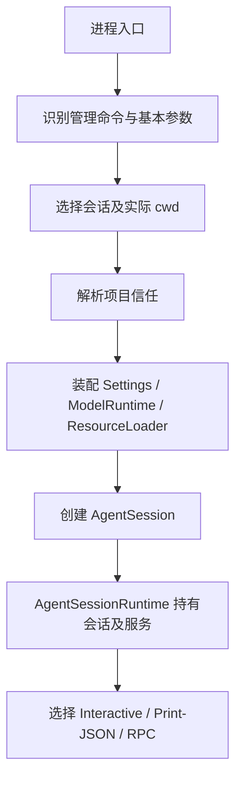

# 03 · 从进程启动到可用会话

[返回总目录](README.md) · [上一章](02-全仓库地图.md) · [下一章](04-一条请求的完整旅程.md)

## 1. 启动首先是装配依赖

模型请求之前，Pi 必须知道：工作目录、配置来源、会话位置、信任决定、可用资源、模型和认证、工具集合以及交互模式。

主入口：[cli.ts](https://github.com/earendil-works/pi/blob/6fb2e7815167e6b19006fc526d1a5d0f5f998787/packages/coding-agent/src/cli.ts) → [main.ts](https://github.com/earendil-works/pi/blob/6fb2e7815167e6b19006fc526d1a5d0f5f998787/packages/coding-agent/src/main.ts) 的 `main()`。另有 [rpc-entry.ts](https://github.com/earendil-works/pi/blob/6fb2e7815167e6b19006fc526d1a5d0f5f998787/packages/coding-agent/src/rpc-entry.ts) 和 Bun 相关入口，应按 package exports/bin 与具体启动命令判断自己走的是哪条路径。

## 2. 并非所有 CLI 调用都启动模型

`main()` 先处理认证、包管理、配置、MCP 管理等命令。`--version`、导出等路径也会提前结束。

因此，分析 `pi update` 或 `pi --export` 时不能从 `Agent.prompt()` 开始；它们首先属于命令分派。入口附近的 early return 是功能边界，不是无关样板代码。

[cli/args.ts](https://github.com/earendil-works/pi/blob/6fb2e7815167e6b19006fc526d1a5d0f5f998787/packages/coding-agent/src/cli/args.ts) 解析内置参数并保留扩展旗标。解析诊断会显示为错误或警告，错误阻止启动。

## 3. 为什么先选择会话，再创建项目服务

假设当前终端位于项目 A，但 `--session` 指向项目 B 的历史。模型需要使用 B 的 cwd、项目设置和资源。如果先用 A 的目录构造资源加载器，再只换消息，就会串用两个项目的上下文。

`main()` 因而先调用 `createSessionManager()`，从选中的会话确定实际 cwd，再创建与该 cwd 绑定的服务。

会话目录设置在启动代码中的优先次序是：显式 `--session-dir`、对应环境变量、设置中的 sessionDir；未指定时由会话管理器的默认路径规则处理。

`session-cwd.ts` 处理历史所指目录已经不存在的情况。交互模式可让用户选择替代目录；非交互模式不能随意猜测，需报告错误。它解决的是执行文件工具的位置问题。

## 4. 项目信任为什么发生在资源加载之前

项目目录里的配置、扩展和资源可能影响进程行为。启动先用尚未信任项目的 SettingsManager 读取全局网络设置，再按目标项目解析信任。

这里有三个不同的设置实例：`bootstrapSettingsManager` 明确按 `projectTrusted: false` 创建，用于早期全局网络设置；`startupSettingsManager` 用于选择会话等启动工作，创建时使用默认信任参数；最终 `runtimeSettingsManager` 按选中会话的 cwd 和实际信任结果重新创建。不能把第一个实例的限制推断成所有启动阶段都完全不读取项目设置。

主要文件：

- [cli/project-trust.ts](https://github.com/earendil-works/pi/blob/6fb2e7815167e6b19006fc526d1a5d0f5f998787/packages/coding-agent/src/cli/project-trust.ts)：启动交互与决定。
- [core/project-trust.ts](https://github.com/earendil-works/pi/blob/6fb2e7815167e6b19006fc526d1a5d0f5f998787/packages/coding-agent/src/core/project-trust.ts)：信任上下文及相关规则。
- [core/trust-manager.ts](https://github.com/earendil-works/pi/blob/6fb2e7815167e6b19006fc526d1a5d0f5f998787/packages/coding-agent/src/core/trust-manager.ts)：信任记录。
- [core/resource-loader.ts](https://github.com/earendil-works/pi/blob/6fb2e7815167e6b19006fc526d1a5d0f5f998787/packages/coding-agent/src/core/resource-loader.ts)：按决定加载资源。

这个机制限制项目资源加载。已启用的文件和进程工具仍使用 Pi 进程的操作系统权限；它并不建立文件系统沙箱。具体权限边界见 [security.md](https://github.com/earendil-works/pi/blob/6fb2e7815167e6b19006fc526d1a5d0f5f998787/packages/coding-agent/docs/security.md)。

## 5. Services、Session、Runtime 各解决一个问题

`createAgentSessionServices()` 装配 SettingsManager、ModelRuntime、ResourceLoader 及诊断。它让模型注册、资源发现和会话配置来自同一组服务。

`createAgentSessionFromServices()` 用这些依赖创建会话；底层的 `createAgentSession()` 位于 SDK 文件。

`createAgentSessionRuntime()` 则包装当前会话与服务。以后 `/resume`、`/new`、fork 等动作需要整体更换这些对象，因此模式层持有 runtime，而不应该永久缓存启动时的旧 session。

阅读顺序：

1. [agent-session-services.ts](https://github.com/earendil-works/pi/blob/6fb2e7815167e6b19006fc526d1a5d0f5f998787/packages/coding-agent/src/core/agent-session-services.ts)
2. [sdk.ts](https://github.com/earendil-works/pi/blob/6fb2e7815167e6b19006fc526d1a5d0f5f998787/packages/coding-agent/src/core/sdk.ts)
3. [agent-session-runtime.ts](https://github.com/earendil-works/pi/blob/6fb2e7815167e6b19006fc526d1a5d0f5f998787/packages/coding-agent/src/core/agent-session-runtime.ts)

## 6. SDK 创建会话时的细节

### 6.1 注入参数优先

显式传入的 ModelRuntime、SessionManager、SettingsManager、ResourceLoader 会被采用；未提供部分才创建默认实现。cwd 可以来自显式选项、会话管理器或当前进程目录。

这意味着 SDK 不必启动 TUI，也可以使用内存会话。它仍需正确配置模型和认证，才能发起真实请求。

### 6.2 恢复的是投影消息

SDK 调用 `sessionManager.buildSessionContext()`，拿到经过分支、压缩与编辑后的消息，随后恢复 Agent state。它不会直接把 JSONL 所有行塞给模型。

### 6.3 恢复模型要考虑虚拟选择

`getBranchSelection()` 读取分支上的模型选择。assistant 消息记录实际作答的物理模型；若选择的是仍已注册的虚拟模型，不能因为最后一条 assistant 来自某个物理模型就丢掉路由器选择。

若保存的模型不能恢复，代码通过默认模型解析流程继续选择并返回 `modelFallbackMessage`，让调用者知道发生了替换。

### 6.4 thinking 不只是一个全局默认值

显式 thinking 参数优先。已有会话若记录过 thinking 变化，恢复该设置；有历史但无相应条目时使用全局设置或默认值。仍未确定时才考虑每模型配置、全局配置和默认值，最后按模型能力裁剪。

不能把这条链简单总结为“永远是模型配置覆盖全局配置”，因为恢复会话有自己的分支。

### 6.5 工具选择与注册分开

SDK 处理工具 allowlist、`+name/-name` 增减形式、excludeTools 和 noTools。某工具可以已注册、可通过组合工具调用，却没有直接作为本轮模型声明暴露。MCP 和 Code Mode 尤其需要分清这一点。

详见 [工具系统](07-工具系统.md) 与 [MCP 与 Code Mode](12-MCP与CodeMode.md)。

## 7. 为什么请求配置通过函数读取

SDK 注入的请求函数会在请求时读取超时、重试、扩展请求头等配置。运行中修改设置可以影响后续请求，不必重建整个进程。

它还通过 `extensionRunnerRef` 联系后来创建的 runner。阅读这类闭包时，注意“构造时存在什么”与“真正调用时读取什么”的区别。

图片阻止设置也在转换时检查：工具或历史里出现图片，不等于最后一定把图片发给 Provider。

## 8. 标准输入与输出为什么特殊处理

非交互模式需要可靠的机器输出。`main()` 使用输出接管机制，避免扩展普通打印污染 JSON/RPC 数据流，相关实现见 [output-guard.ts](https://github.com/earendil-works/pi/blob/6fb2e7815167e6b19006fc526d1a5d0f5f998787/packages/coding-agent/src/core/output-guard.ts)。

RPC 的 stdin 是持续到来的命令流，因此启动不能把它一次读完当作提示词。其他模式可以读取管道输入，并由 [initial-message.ts](https://github.com/earendil-works/pi/blob/6fb2e7815167e6b19006fc526d1a5d0f5f998787/packages/coding-agent/src/cli/initial-message.ts) 和 [file-processor.ts](https://github.com/earendil-works/pi/blob/6fb2e7815167e6b19006fc526d1a5d0f5f998787/packages/coding-agent/src/cli/file-processor.ts) 整理文本与附件。

`@file`、管道内容、命令行消息最终都要形成明确的初始输入；它们不是独立的 Agent 循环。

## 9. 切换会话时不是简单赋值

`AgentSessionRuntime` 的生命周期顺序值得单独记住：

1. 调用切换或分叉前置事件，扩展可以取消。
2. 校验目标会话与 cwd。
3. 中止并等待旧会话当前响应，保证取消结果能进入旧历史。
4. 发出 session_shutdown，清理宿主 UI，dispose 旧会话。
5. 创建目标 cwd 的新服务与会话。
6. 重新绑定模式层订阅，再提供新上下文给回调。

如果新运行时创建失败，错误向调用者传播。旧实例已经清理时，不能假设失败后仍有一个完整可用的旧运行时。这是阅读 UI 错误处理和宿主集成时的重要边界。

## 10. 启动问题定位表

| 现象 | 第一检查点 | 接着追踪 |
|---|---|---|
| 参数报错 | `parseArgs()` 的 diagnostics | 内置参数与扩展旗标 |
| 恢复后 cwd 错 | `createSessionManager()` | session header、runtime factory |
| 扩展未加载 | ResourceLoader 诊断 | 信任、路径、包资源、加载错误 |
| 模型列表为空 | ModelRuntime 与认证 | registry、配置与 provider discovery |
| 请求无认证 | SDK prompt 检查 | runtime key、auth store、环境变量 |
| JSON 输出混入文字 | 输出接管 | 扩展日志和 stdout/stderr 使用 |
| 切换后 UI 仍看旧消息 | `setRebindSession()` | 旧订阅解除与新订阅安装 |

## 11. 阅读练习

在 [运行时测试](https://github.com/earendil-works/pi/blob/6fb2e7815167e6b19006fc526d1a5d0f5f998787/packages/coding-agent/test/suite/agent-session-runtime.test.ts) 中寻找会话替换场景；再读 [启动重绑回归测试](https://github.com/earendil-works/pi/blob/6fb2e7815167e6b19006fc526d1a5d0f5f998787/packages/coding-agent/test/suite/regressions/startup-session-rebind-duplicate-subscription.test.ts)。回答：为什么一次切换可能导致事件被显示两次？是哪一层负责避免继续订阅旧实例？
