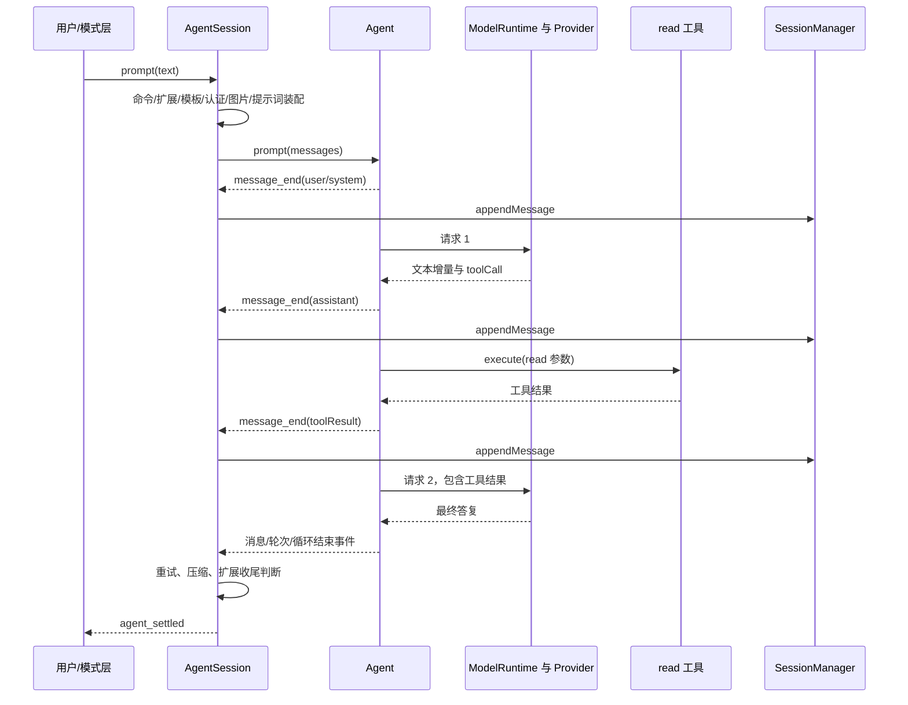

# 04 · 一条请求的完整旅程

[返回总目录](README.md) · [上一章](03-启动与初始化.md) · [下一章](05-Agent核心循环.md)

## 1. 用一个任务串起所有层

下面使用教学场景：“读取 `package.json`，告诉我启动命令是什么。”假设模型先调用 read，再根据结果回答。工具选择由模型实际输出决定，这里用固定轨迹方便追踪。

此图省略了部分事件和条件，只展示一次正常调用。关键是：一个用户任务可以包含多次模型请求，不能把一次按回车等同于一次 HTTP 调用。

## 2. 输入在什么时候可能不进入模型

入口是 [AgentSession.prompt()](https://github.com/earendil-works/pi/blob/6fb2e7815167e6b19006fc526d1a5d0f5f998787/packages/coding-agent/src/core/agent-session.ts)。顺序很重要：

1. 已注册的扩展命令可能先处理 `/xxx`。
2. 正在手动压缩时，直接提交 prompt 会报错；模式层可以另行管理等待输入。
3. `input` 事件可返回 handled、transform 或继续。
4. `/skill:name` 与模板被展开。
5. 已有运行时，根据 streamingBehavior 排入 steering 或 follow-up；未说明行为则报错。
6. 空闲时检查模型和认证，必要时做发送前压缩检查。
7. `before_agent_start` 可以改变模型、提示词选项和附加消息。
8. 按有效模型限制规范化图片，准备系统提示词/工具更新与用户消息。
9. 进入 `_runAgentPrompt()`。

如果扩展已经 handled 输入，最终不会再自动把同一输入发给模型。这解释了为何某些斜杠命令只打开菜单或执行本地动作。

## 3. 用户消息不是只有字符串

消息可以携带文本与图片内容块。图片处理可能转换格式、调整尺寸或产生提示文字；这些步骤发生在前置扩展有机会改变模型之后，以便使用正确的输入限制。

源头见 [image-process.ts](https://github.com/earendil-works/pi/blob/6fb2e7815167e6b19006fc526d1a5d0f5f998787/packages/coding-agent/src/utils/image-process.ts) 与 `AgentSession._normalizePromptImages()`。

若有等待到下一轮的自定义消息，它们也会在这个阶段加入。系统提示词更新则可能插在用户消息前，确保这次请求看到正确的规则与工具声明。

## 4. 系统提示词怎样随请求进入历史

当前版本通过 system 消息记录提示词 sections 和工具增删。初次请求声明完整状态，后续只在需要时追加变化。

例如第一次声明 read、bash，后面启用 grep，则 transcript 可以保存 toolsAdded 的差异。Provider 在准备请求时得到重放后的有效工具集合，而不是把所有旧声明无条件累加。

对应函数：`_preparePromptAndToolLoadout()`、`buildSystemPromptState()`、`diffSystemPromptSections()`；详见 [提示词与扩展机制](10-提示词与扩展机制.md)。

## 5. 请求边界：真正发出的是什么

Agent 的上下文转换先处理宿主消息，再进入模型请求函数。coding-agent 的 `convertToLlm()` 负责把 bashExecution、custom、branchSummary、compactionSummary 等宿主类型转换或过滤。

当前系统消息也在 transcript 中，因此“模型输入”不应再被画成只有 user/assistant 数组。Provider 适配器需读取系统状态、工具声明及普通对话，并转换成具体 API 的请求结构。

文件入口：

- [messages.ts](https://github.com/earendil-works/pi/blob/6fb2e7815167e6b19006fc526d1a5d0f5f998787/packages/coding-agent/src/core/messages.ts)：宿主消息转换。
- [agent-loop.ts](https://github.com/earendil-works/pi/blob/6fb2e7815167e6b19006fc526d1a5d0f5f998787/packages/agent/src/agent-loop.ts)：转换与请求时机。
- [model-runtime.ts](https://github.com/earendil-works/pi/blob/6fb2e7815167e6b19006fc526d1a5d0f5f998787/packages/coding-agent/src/core/model-runtime.ts)：模型请求装配。
- [ai/transcript.ts](https://github.com/earendil-works/pi/blob/6fb2e7815167e6b19006fc526d1a5d0f5f998787/packages/ai/src/utils/transcript.ts)：系统状态与工具声明重放。

要查某个字段是否发给模型，应追到具体 `api/` 适配器构造请求的位置。只看到 Agent state 中有该字段，还不能得出已发送的结论。

## 6. 模型说“调用 read”之后发生什么

模型返回的是结构化意图，包括调用 ID、工具名字和参数。Agent 查找宿主提供的工具、校验参数、执行函数，并产生工具执行事件。

read 工具接触文件系统并返回内容；结果携带同一个 toolCallId，供下一次请求把结果与原调用对应。

这里有两种数据：给模型继续推理的 `content`，以及供 UI 或宿主使用的 `details`。显示层可能借助 details 展示行数、截断、diff 等，不能默认所有 details 都作为文本送给模型。

工具返回错误结果仍是有效的对话事件：模型可能根据错误调整下一步。网络请求失败与工具失败的恢复路径不同。

## 7. 流式显示、定稿和持久化的先后

`_handleAgentEvent()` 处理事件时，先通知扩展，再通知公开监听者；对 message_end，随后追加最终消息到 SessionManager。

因此：

- message_update 可以驱动 UI，但不表示一条完整消息已经落盘。
- message_end 监听者不应假设该消息对应的 entry ID 已经可查。
- turn_end 阶段，assistant 和这一轮工具结果已被追加，适合需要完整轮次及 entry ID 的扩展操作。
- `entry_appended` 是某些会话层追加动作的明确通知，不应与底层 message_update 混用。

这类时序对于自定义日志、上下文编辑和宿主 UI 很重要。

## 8. 为什么模型请求还会继续

在示例里，第一轮得到工具结果，所以需要第二次请求，让模型解释读取的文件。

除此之外，steering、follow-up 或扩展 continuation 也可能带来后续工作。队列的投递时机不同；扩展要求继续时，还需要一个合法可继续的上下文，不能从完整 assistant 结尾毫无输入地无限续跑。

详细循环分支见 [Agent 核心循环](05-Agent核心循环.md)。

## 9. 为什么 `agent_end` 后界面还可能忙

底层循环结束之后，AgentSession 仍可能：

- 对暂时性错误进行退避重试；
- 压缩上下文并恢复溢出请求；
- 处理等待输入；
- 执行收尾边界扩展。

`agent_settled` 才表达会话层当前这批工作的收尾状态。`waitForIdle()` 也应按会话的空闲条件判断，不能简单绑定某一次底层 agent_end。

## 10. 四种变体

| 场景 | 流程变化 | 对历史的影响 |
|---|---|---|
| 模型直接回答 | 没有工具执行和第二次请求 | 保存用户与最终答复等消息 |
| read 找不到文件 | 产生工具错误结果，模型可能继续尝试 | 错误结果仍可成为上下文 |
| 网络暂时失败 | 会话层可能重试 | 失败尝试保留原始历史，并可能通过 context edit 省略 |
| 用户取消 | signal 传播到请求/工具，进入收尾 | 保留已形成的记录；不自动撤销文件副作用 |

## 11. 用测试复述链路

读 [prompt 测试](https://github.com/earendil-works/pi/blob/6fb2e7815167e6b19006fc526d1a5d0f5f998787/packages/coding-agent/test/suite/agent-session-prompt.test.ts)、[工具编排测试](https://github.com/earendil-works/pi/blob/6fb2e7815167e6b19006fc526d1a5d0f5f998787/packages/coding-agent/test/suite/agent-session-tool-orchestration.test.ts) 和 [边界测试](https://github.com/earendil-works/pi/blob/6fb2e7815167e6b19006fc526d1a5d0f5f998787/packages/coding-agent/test/suite/agent-session-boundaries.test.ts)。

建议画两条时间线：一条是模型请求与工具执行；另一条是 message/turn/agent/session 事件。将每个持久化动作标到两条线之间。完成后，你就能解释“模型已经答完”和“应用已经处理完”为什么不是一回事。
