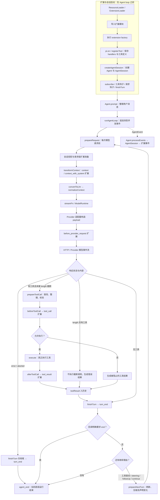
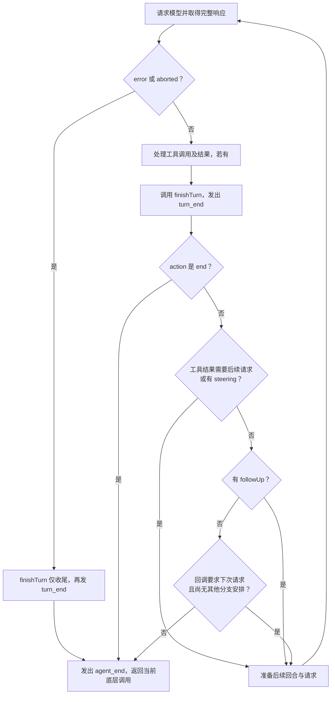
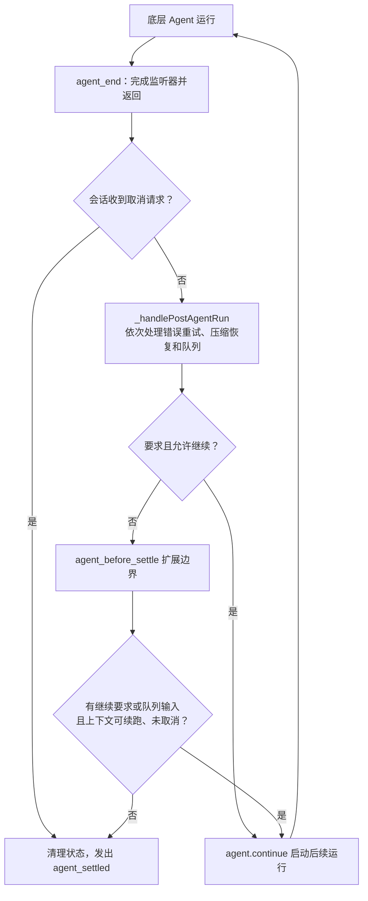

# 05｜Agent 核心循环：一次提问如何变成多轮请求

[返回总目录](README.md) · [上一章](04-一条请求的完整旅程.md) · [下一章](06-模型与Provider.md)

本章以当前源码（`6fb2e7815167`）为准。
读它时先记住两个层次：`Agent` 是持有历史与队列的对象，`agent-loop.ts` 是推进一次运行的控制流。
模型协议、认证和 HTTP 实现在别的包。
这里的“一轮”指一次 assistant 响应及其工具结果；一次用户提问可能包含多轮。

## 先看一个可跟踪的例子

用户说“读 `package.json`，再告诉我脚本”。
第一次模型请求返回 `toolCall(read)`，运行时执行读取，写入一条与调用 ID 对应的 `toolResult`，随后发第二次模型请求，模型才给出最终文字。
若模型直接回答，则没有工具结果，也没有自然触发的第二次请求。
若用户在读取期间调用 `steer()`，消息会等这一批工具结束后注入，避免请求历史中出现未配对的工具调用。
[循环源码](https://github.com/earendil-works/pi/blob/6fb2e7815167e6b19006fc526d1a5d0f5f998787/packages/agent/src/agent-loop.ts)



这张图把两个容易混淆的阶段放在了一起：上半部分是**扩展和会话的启动接线**，下半部分才是**一次 Agent 运行的循环**。扩展 factory 在循环开始前执行，`pi.on()` 和 `registerTool()` 只保存处理器与工具定义；真正调用这些函数要等 loop 到达对应节点。

其中实线表示会影响主控制流的调用，虚线表示事件通知路径。图中的 `error/aborted` 分支优先，只有未进入该分支的响应才检查工具。`beforeToolCall` 返回 block 会阻止 `execute`；`afterToolCall` 可以整理已执行结果，包括改变后续请求的终止提示。`Agent.processEvents` 把 `message_*`、`turn_*`、`tool_execution_*` 等事件转给会话与扩展；这些事件不是一律通向结束的指令。扩展要通过受支持的回调结果、上下文修改或消息队列影响后续调度。

图中的“工具驱动”是指这一批工具结果需要交给模型处理；所有已完成工具结果都明确要求 `terminate:true` 时，这个继续理由可以被取消。结束判断的优先级、其他继续理由与会话层续跑，在后面的“Loop 到底满足什么条件才结束”及“底层退出后，会话层还会不会继续”中展开。

扩展加载的代码路径是 `ResourceLoader`/`ExtensionLoader` 导入模块并执行 factory，factory 中的 `pi.on()` 和 `pi.registerTool()` 把内容存入 Runner；随后 `AgentSession` 通过 `subscribe()` 和一组 `_install...` 方法把这些能力接到 Agent。没有扩展时，后半部分仍然可以运行，只是相应 handler 集合为空。[扩展加载](https://github.com/earendil-works/pi/blob/6fb2e7815167e6b19006fc526d1a5d0f5f998787/packages/coding-agent/src/core/extensions/loader.ts) · [会话接线](https://github.com/earendil-works/pi/blob/6fb2e7815167e6b19006fc526d1a5d0f5f998787/packages/coding-agent/src/core/agent-session.ts) · [事件派发](https://github.com/earendil-works/pi/blob/6fb2e7815167e6b19006fc526d1a5d0f5f998787/packages/coding-agent/src/core/extensions/runner.ts)

## 六个源码文件各负责什么

| 文件 | 读它要解决的问题 |
|---|---|
| [types.ts](https://github.com/earendil-works/pi/blob/6fb2e7815167e6b19006fc526d1a5d0f5f998787/packages/agent/src/types.ts) | 消息、工具、事件、钩子和配置的类型契约。 |
| [agent.ts](https://github.com/earendil-works/pi/blob/6fb2e7815167e6b19006fc526d1a5d0f5f998787/packages/agent/src/agent.ts) | 有状态实例怎样接收输入、保存稳定历史、管理队列、取消和订阅者。 |
| [agent-loop.ts](https://github.com/earendil-works/pi/blob/6fb2e7815167e6b19006fc526d1a5d0f5f998787/packages/agent/src/agent-loop.ts) | 每次请求、工具执行和继续/停止的真实调度。 |
| [stream-fn.ts](https://github.com/earendil-works/pi/blob/6fb2e7815167e6b19006fc526d1a5d0f5f998787/packages/agent/src/stream-fn.ts) | 宿主可安装默认 `StreamFn`；核心包不自行挑 Provider。 |
| [proxy.ts](https://github.com/earendil-works/pi/blob/6fb2e7815167e6b19006fc526d1a5d0f5f998787/packages/agent/src/proxy.ts) | 远端代理事件流如何转为本地 `AssistantMessageEventStream`，属于可选传输路径。 |
| [index.ts](https://github.com/earendil-works/pi/blob/6fb2e7815167e6b19006fc526d1a5d0f5f998787/packages/agent/src/index.ts) | 公共导出入口，本身不会启动循环。 |

`AgentMessage` 是 `pi-ai` 的四种模型消息与应用自定义消息的联合。
自定义通知可以存在于应用历史，但默认 `convertToLlm` 只保留 `system`、`user`、`assistant`、`toolResult`。
应用如果要让自定义消息影响模型，必须自己转换；若只是 UI 通知，应过滤。
[消息类型](https://github.com/earendil-works/pi/blob/6fb2e7815167e6b19006fc526d1a5d0f5f998787/packages/agent/src/types.ts) · [默认转换](https://github.com/earendil-works/pi/blob/6fb2e7815167e6b19006fc526d1a5d0f5f998787/packages/agent/src/agent.ts)

`AgentContext` 只含 `messages` 和可执行的 `tools`。
当前设计把 system prompt 与模型可见工具声明存进 transcript 的 `SystemMessage`，不是每轮另传一组三元字段。
`AgentState.systemPrompt` 是对消息历史回放的只读视图；`state.tools` 是运行时可执行集合。
两者不同步时，循环会生成 `toolsAdded` / `toolsRemoved` 的 system 消息；下一次请求携带这些声明，Provider 协议适配根据 transcript 重放有效工具集合。
[上下文类型](https://github.com/earendil-works/pi/blob/6fb2e7815167e6b19006fc526d1a5d0f5f998787/packages/agent/src/types.ts) · [声明差量](https://github.com/earendil-works/pi/blob/6fb2e7815167e6b19006fc526d1a5d0f5f998787/packages/agent/src/agent-loop.ts) · [回放实现](https://github.com/earendil-works/pi/blob/6fb2e7815167e6b19006fc526d1a5d0f5f998787/packages/ai/src/utils/transcript.ts)

## 从 `prompt()` 到第一条请求

`new Agent(options)` 安装模型、`streamFn`、钩子和队列模式；它不会发请求。
`initialState.systemPrompt` 与工具会被 `createInitialSystemMessage()` 放入历史开头，前提是调用者没有已提供的首条 system 消息。
`prompt()` 将字符串包装成带文本块及可选图片块的 `user` 消息，或直接接受消息对象/数组。
同一个 Agent 正在运行时再调用 `prompt()` 会报错；需要中途加输入时使用 `steer()` 或 `followUp()`。
[构造和输入](https://github.com/earendil-works/pi/blob/6fb2e7815167e6b19006fc526d1a5d0f5f998787/packages/agent/src/agent.ts)

`runPromptMessages()` 创建上下文浅快照与循环配置。
浅快照复制顶层数组，消息对象仍可能共享引用；循环追加消息不会直接 `push` 到公开 `state.messages`。
公开稳定历史是在 `processEvents()` 收到 `message_end` 时归并。
这个区别解释了为什么流式 `message_update` 可实时显示，但不会把每个 delta 存成独立历史消息。
[快照和事件归并](https://github.com/earendil-works/pi/blob/6fb2e7815167e6b19006fc526d1a5d0f5f998787/packages/agent/src/agent.ts)

`runAgentLoop()` 先调用 `declareToolChanges()`，把可执行工具与 transcript 已声明工具的差写入 system 消息；再发 `agent_start`、`turn_start` 和初始消息的 `message_start/end`，随后进入 `runLoop()`。
续跑入口 `runAgentLoopContinue()` 不追加新的用户消息，因此适合“消息已在历史中，只需继续发请求”的情况；历史为空或最后是 assistant 时拒绝直接续跑。
[两个入口](https://github.com/earendil-works/pi/blob/6fb2e7815167e6b19006fc526d1a5d0f5f998787/packages/agent/src/agent-loop.ts)

## 内外两层循环

`runLoop()` 的内层循环处理模型回复、工具结果与 steering；当它本应停止，外层才检查 follow-up。
`hasMoreToolCalls` 表示刚结束的工具批次是否要求下一次请求，`pendingMessages` 保存待注入的消息。
`finishTurn()` 在当前响应及其工具结果处理后运行，可返回 `{action:"end"}` 结束当前底层运行，或 `{action:"continue"}` 要求下一次模型请求；工具结果、steering 或 follow-up 触发的请求可以同时满足这个要求。
`error` 与 `aborted` 响应是硬退出，不能被 `finishTurn` 续跑。
[调度实现](https://github.com/earendil-works/pi/blob/6fb2e7815167e6b19006fc526d1a5d0f5f998787/packages/agent/src/agent-loop.ts)

`prepareNextTurn` 只在后续回合执行，可替换上下文、模型、思考等级或插入消息，适合压缩历史等回合间工作。
`prepareRequest` 则在**每次真实 Provider 请求前**执行，包括第一次；它接收当前上下文、模型和思考等级，可替换本次及后续请求的运行状态。
等待较久的 `prepareNextTurn` 结束后，循环会再次检查期间到达的 steering；已有待处理 steering 时不会多取一条，以保持 `one-at-a-time` 语义。
[钩子契约](https://github.com/earendil-works/pi/blob/6fb2e7815167e6b19006fc526d1a5d0f5f998787/packages/agent/src/types.ts) · [调用时机](https://github.com/earendil-works/pi/blob/6fb2e7815167e6b19006fc526d1a5d0f5f998787/packages/agent/src/agent-loop.ts)

`steer()` 和 `followUp()` 只是入队。
默认队列模式为 `one-at-a-time`，可改成 `all`。
steering 在当前 assistant 回合与工具批次结束后注入；follow-up 在循环原本要停止时才进入。
`peekQueuedMessages()` 先预览 steering，再预览 follow-up，但不消费。
`continue()` 遇到 assistant 结尾时先消费可用队列作为新输入，否则报错；遇到用户或工具结果结尾时走真正续跑。
[队列实现](https://github.com/earendil-works/pi/blob/6fb2e7815167e6b19006fc526d1a5d0f5f998787/packages/agent/src/agent.ts)

## Loop 到底满足什么条件才结束

先限定讨论对象：这里的“Loop 结束”指 `runLoop()` 的本次调用结束，并发出 `agent_end`，不表示关闭 Pi 进程、删除会话，也不保证用户交代的事情全部做完。`AgentSession` 还可能处理重试、恢复与后续输入。

### 三类正常控制流出口：出口之间是“或者”

```text
结束当前底层 Loop
= 响应 stopReason 是 error 或 aborted
  或者 finishTurn 明确返回 action: end
  或者所有继续运行的理由都不存在
```

第一类是失败或取消收尾，第二类是程序明确结束，第三类是自然收尾；“正常控制流”只表示源码有明确分支处理，不代表业务成功。

| 出口 | 判断位置与条件 | 是否继续检查当前 Loop 的队列 |
|---|---|---|
| 错误或取消 | 收到完整响应后，`stopReason === "error"` 或 `stopReason === "aborted"` | 否。调用 `finishTurn` 供收尾，但忽略其继续决定，发出 `turn_end`、`agent_end` 后返回 |
| 回调明确结束 | 工具结果处理后，`finishTurn` 返回 `{ action: "end" }` | 否。发出 `turn_end` 后结束，不会重新执行或撤销已处理的工具 |
| 没有继续理由 | 工具驱动、steering、followUp 和显式继续均未安排下一次请求 | 相关继续检查均已完成，发出 `agent_end` 后返回 |

第三类出口需要下面四个条件**同时成立**：

```text
hasMoreToolCalls === false
并且没有取到待处理的 steering 消息
并且没有取到待处理的 followUp 消息
并且没有需要单独兑现的 explicitContinuation
```

因此，“没有 toolCall 就结束”只是最常见场景的简写。没有工具调用时，有新消息或回调要求继续，仍然会再次请求模型。这里判断的是各消费点取到的消息；若消息在 `agent_end` 回调期间才入队，会话层可以在底层返回后安排新运行。[实际分支：`runLoop`](https://github.com/earendil-works/pi/blob/6fb2e7815167e6b19006fc526d1a5d0f5f998787/packages/agent/src/agent-loop.ts)

### 按源码顺序读结束判断



这张图没有“`stopReason === stop` 就直接结束”的菱形，因为当前循环没有这样的独立退出分支。`stop` 说明本次生成正常结束；继续还是退出，还要走其后的工具、回调和队列判断。

### 工具结束、工具失败与终止提示

`hasMoreToolCalls` 不是“还有工具没执行完”。当前批次处理完成后，普通工具路径会把它设为 `true`，表示需要下一次模型请求来读取结果：

```text
模型响应①：请求 read
→ Pi 执行 read，得到 toolResult
→ hasMoreToolCalls = true
→ 模型请求②：模型读取结果，再决定回答或继续调用工具
```

工具返回的 `terminate:true` 是另一种控制提示。`shouldTerminateToolBatch()` 要求**本批至少有一个已完成结果，而且所有已完成结果都明确设置该值**，才让 `hasMoreToolCalls` 变成 `false`。若其他结果没有设置，单个工具不能独自取消整批的后续请求。这只取消工具驱动的请求，steering、followUp 或显式继续仍然可以使循环继续。

普通工具业务错误通常也需要模型处理。例如 `read` 发现文件不存在，会产生 `isError:true` 的工具结果，模型可据此改路径或解释失败。它不同于 assistant 的 `stopReason:"error"`，不会仅因工具报错就走第一类退出分支。[工具执行与批次规则](https://github.com/earendil-works/pi/blob/6fb2e7815167e6b19006fc526d1a5d0f5f998787/packages/agent/src/agent-loop.ts)

若准备请求、转换上下文或某个未捕获的应用回调直接抛异常，调用也会中断。使用有状态 `Agent` 时，`runWithLifecycle()` 捕获异常，生成可见的错误/取消消息并清理状态；这是异常退出，不应解释成任务完成。直接使用低层循环的调用方需要按其接口契约处理异常。[异常收尾](https://github.com/earendil-works/pi/blob/6fb2e7815167e6b19006fc526d1a5d0f5f998787/packages/agent/src/agent.ts)

## stopReason 从哪里来，Pi 如何使用它

### Provider 原始字段与 Pi 统一字段

结束原因通常来自模型服务的 API 响应元数据。Pi 不需要通过提示词要求模型在正文里写 `stopReason`；适配器将不同协议的原始状态转成 Pi 的统一字段。

| 含义 | OpenAI Chat Completions 的 `finish_reason` | Anthropic 的 `stop_reason` | Pi 的 `stopReason` |
|---|---|---|---|
| 正常结束 | `stop` | `end_turn` | `stop` |
| 请求调用工具 | `tool_calls` | `tool_use` | `toolUse` |
| 达到输出长度限制 | `length` | `max_tokens` | `length` |

这张表描述当前两个适配器的主要映射，不是全部 Provider 状态。完整联合类型还包括流式处理中间状态等值。[OpenAI 适配器：`mapStopReason`](https://github.com/earendil-works/pi/blob/6fb2e7815167e6b19006fc526d1a5d0f5f998787/packages/ai/src/api/openai-completions.ts) · [Anthropic 适配器：`mapStopReason`](https://github.com/earendil-works/pi/blob/6fb2e7815167e6b19006fc526d1a5d0f5f998787/packages/ai/src/api/anthropic-messages.ts) · [统一类型](https://github.com/earendil-works/pi/blob/6fb2e7815167e6b19006fc526d1a5d0f5f998787/packages/ai/src/types.ts)

下面是响应字段的教学片段，省略了 ID、时间戳、usage 等其他字段，也不是实测抓包。先以非流式响应形状展示字段的层级：

```json
{
  "choices": [
    {
      "message": {
        "role": "assistant",
        "content": "文件内容是 hello。"
      },
      "finish_reason": "stop"
    }
  ]
}
```

`content` 是回答正文，`finish_reason` 是正文之外的协议状态。Pi 的该适配器实际消费流式 chunk，从 `choice.finish_reason` 读取同名字段，再把最终响应整理成下列内部字段：

```json
{
  "role": "assistant",
  "content": [
    {
      "type": "text",
      "text": "文件内容是 hello。"
    }
  ],
  "stopReason": "stop",
  "rawStopReason": "stop"
}
```

`rawStopReason` 保存 Provider 原值，`stopReason` 保存统一后的值。若原值是 Anthropic 的 `end_turn`，二者就分别是 `end_turn` 和 `stop`。用户取消或网络故障时，Pi 还会自行设置 `aborted` 或 `error`，因此这个统一字段不一定来自服务端原值。

`endTurn` 是另外一个可选字段，用于保留部分 Provider 的显式回合结束信息。当前类型注释明确说明它用于调试，不参与 Agent 控制流；不能把它与会话层的任务完成判断混为一谈。[字段定义](https://github.com/earendil-works/pi/blob/6fb2e7815167e6b19006fc526d1a5d0f5f998787/packages/ai/src/types.ts)

### stopReason 会被检查，但不是唯一结束条件

| 状态或情况 | 当前底层 Loop 如何处理 |
|---|---|
| `error` / `aborted` | 优先走直接退出分支，不执行该响应里残留的工具调用 |
| `length` 且有工具调用 | 不执行这些可能参数不完整的调用，写入错误工具结果；该批次不要求终止，正常情况下再请求模型重发完整调用 |
| `length` 且无工具调用 | 没有强制退出或强制继续的专用分支，继续检查回调和队列；底层退出后会话层可能尝试有限恢复 |
| `toolUse` | 仍从响应 `content` 中提取真正的 `toolCall`；循环并非只看这个状态就凭空执行工具 |
| `stop` | 继续检查响应中的工具、回调与队列，没有“看到 stop 立即 return”的分支 |

工具提取的实际条件是：

```ts
const toolCalls = message.content.filter((c) => c.type === "toolCall");
```

它没有附加 `stopReason === "toolUse"`。模型说“接下来我会读取文件”但未给结构化工具调用，Pi 不会仅凭文字执行 `read`；模型说“已经完成”但仍给出工具调用，也不会仅凭这句话停止。[循环与截断调用处理](https://github.com/earendil-works/pi/blob/6fb2e7815167e6b19006fc526d1a5d0f5f998787/packages/agent/src/agent-loop.ts)

会话层还会结合 `stopReason` 判断恢复策略。例如成功响应用量超过配置窗口时，`willRetry = assistantMessage.stopReason !== "stop"` 为 `false`，表示压缩供后续请求使用，不重新生成已完成答复。详见 [第 09 章](09-压缩与错误恢复.md)。这些处理判断的是请求状态与运行策略，不会自动验证用户要求是否全部实现。

## action: continue 的作用、来源与请求次数

### 它要求下一次模型请求，不代表还有工具没执行

`finishTurn` 在当前 assistant 响应及其工具结果处理之后被调用。它返回的对象是程序侧调度决定：

| 返回值 | 对当前底层循环的要求 |
|---|---|
| `undefined` | 使用普通工具和队列调度规则 |
| `{ action: "end" }` | 结束当前底层运行，不再消费本次循环的队列 |
| `{ action: "continue" }` | 在非 error/aborted 的正常响应路径上，要求至少再发起一次模型请求；已有后续请求可以满足它 |

`action` 只是对象字段名，不是工具名称。它不包含工具参数，不会重新执行上一批工具，也不会自动往提示词中添加“请确认任务是否结束”。

### 谁提出继续要求

主要有两种接入方式：

1. 使用通用 `Agent` 的应用开发者提供 `finishTurn` 回调，由该函数返回 `{ action: "continue" }`。
2. Coding-agent 扩展在 `turn_end` 处理器返回 `{ continue: true }`。Runner 汇总处理器结果，AgentSession 提交条目并检查上下文可续跑性，再由 `_installAgentBoundaryHooks()` 安装的 `finishTurn` 转为底层调度决定。

```text
loop 调用 config.finishTurn(...)
  → AgentSession 安装的回调
  → 派发 turn_end 扩展边界
  → 扩展返回条目及 continue: true（如果需要）
  → 提交条目、确认有可继续的上下文
  → 合并此前应用提供的 finishTurn 决定
  → 返回 { action: "continue" } 给 loop
```

此前应用回调若明确返回 `end`，其结束决定优先。没有扩展要求继续、应用回调也没有要求时，返回 `undefined`；Pi 不会自动补一条 `continue`。另外，`agent_before_settle` 扩展也能请求继续，但那发生在底层 Loop 返回之后，由会话层另行安排，见后面的会话收尾流程。[接入与校验](https://github.com/earendil-works/pi/blob/6fb2e7815167e6b19006fc526d1a5d0f5f998787/packages/coding-agent/src/core/agent-session.ts) · [扩展边界派发](https://github.com/earendil-works/pi/blob/6fb2e7815167e6b19006fc526d1a5d0f5f998787/packages/coding-agent/src/core/extensions/runner.ts)

继续的用途可以是由扩展补足遗漏步骤。下面是假设自己编写了“必须运行测试”的扩展，**不是 Pi 默认具有的完成检查**：

```text
用户要求修改功能并运行测试
→ 模型调用工具修改文件，随后只回答“修改完成”
→ 扩展检查记录，发现没有运行测试
→ 扩展追加模型可见的补充消息：“还需运行测试，请继续”
→ 扩展请求 continue: true
→ Pi 再次请求模型
→ 模型根据补充要求决定后续行动
```

补充消息说明“做什么”，`continue` 决定“再请求一次”。后续能否正确执行测试仍取决于模型与工具的实际结果。会话层的扩展不能仅在完整 assistant 答复后无条件返回 `continue:true`；它需要可运行的上下文，例如追加可转换为用户内容的自定义消息、排队输入，或适当地编辑现有上下文。通用 Agent 的回调接口与 Coding-agent 的扩展校验是两个层次。[上下文预览与 `canContinue`](https://github.com/earendil-works/pi/blob/6fb2e7815167e6b19006fc526d1a5d0f5f998787/packages/coding-agent/src/core/agent-session.ts)

### 三条时间线：什么时候只有两次请求，什么时候出现第三次

以下请求编号只计算正常 Agent 对模型的请求，不包含重试、摘要或其他后台请求；没有额外队列消息。

**情况 A：没有显式 continue，普通工具流程共两次请求。**

```text
用户：读取 a.txt，告诉我内容
→ 请求①：模型返回 toolCall(read)
→ Pi 执行 read，结果为 hello
→ finishTurn 没有要求继续或结束
→ 普通工具流程触发请求②：模型读取结果，回答“文件内容是 hello”
→ 没有新的工具调用，finishTurn 仍无决定
→ Loop 结束
```

工具执行结束时，模型还没看见本次结果，所以需要请求②。模型在请求②读完结果并回答后，默认没有请求③，更没有固定的“确认一下你是否完成”步骤。

**情况 B：在 read 处理完后提出一次 continue，仍只有两次请求。**

```text
请求①：模型返回 toolCall(read)
→ Pi 执行 read
→ finishTurn 返回 { action: "continue" }
→ 请求②：模型读取工具结果并回答
→ finishTurn 这次返回 undefined
→ Loop 结束
```

请求②同时满足“读取工具结果”和“回调要求下一次请求”。它们是同一次请求的两个理由，不会累加成两次请求。这个行为在 `lets a natural tool-result request satisfy continuation` 测试中有对应断言。[请求次数测试](https://github.com/earendil-works/pi/blob/6fb2e7815167e6b19006fc526d1a5d0f5f998787/packages/agent/test/agent-loop.test.ts)

**情况 C：请求②之后又提出新的 continue，才安排请求③。**

```text
请求①：模型要求 read → Pi 读取文件
→ 请求②：模型读完结果并给出文字回答
→ 扩展在此时补充尚未处理的要求，产生新的继续决定
→ 请求③：模型处理补充要求
→ 此后是否继续，重新取决于新的响应、队列和回调决定
```

请求③来自请求②之后的新决定，不是之前那条 continue 留下的“欠账”。实际任务可能因此出现更多工具调用；请求③不天然等于最终一次。

### explicitContinuation 为什么会被设为 true，又马上清掉

下面是 `runLoop()` 的相关代码片段，它们在源码中分处内层回合末尾与外层循环收尾处：

```ts
explicitContinuation = decision?.action === "continue";
pendingMessages = (await config.getSteeringMessages?.()) || [];
if (hasMoreToolCalls || pendingMessages.length > 0) {
  explicitContinuation = false;
}
```

当工具结果或 steering 已经会触发下一次请求，清除标志表示无需再为同一条决定单独安排一次。内层循环停下后，如果取到 followUp，也会清掉标志并处理该消息。

只有上述分支都没有安排下一次请求时，才执行：

```ts
if (explicitContinuation) {
  explicitContinuation = false;
  continue;
}
```

这里的 `continue;` 回到外层 `while (true)` 开头，那里会重新令 `hasMoreToolCalls = true`，让内层执行下一轮。这个初始值用于启动模型请求，不表示凭空出现了新工具。后续仍会经过 `prepareNextTurn`、`prepareRequest` 等准备过程。

因此，这个判断应读作“回调要求下次请求，而且其他分支尚未安排”，不要读成“还有未执行的工具 action”。每条继续决定只要求一次后续请求；如果回调每次都无条件返回 continue，就会不断产生新的继续决定。[标志设置与清除](https://github.com/earendil-works/pi/blob/6fb2e7815167e6b19006fc526d1a5d0f5f998787/packages/agent/src/agent-loop.ts)

### 三个名字相似但层次不同的 continue

| 写法 | 是什么 | 何时使用 |
|---|---|---|
| `{ action: "continue" }` | 回调返回的调度数据 | 当前 Loop 的回合末尾，要求下一次模型请求 |
| `continue;` | JavaScript 循环控制语句 | 跳回它所属的循环开头；本段源码中用于进入下一次外层循环 |
| `agent.continue()` | Agent 对象的方法调用 | 底层运行已结束后，调用者要求基于已有历史或排队消息继续运行 |

前两者可以在同一次 `runLoop()` 内起作用，不会因每次 continue 就先发一次 `agent_end`。第三种会经过 Agent 的运行入口和前置检查；不能在同一实例仍忙时随意并发调用。原始低层续跑入口还拒绝空历史或 assistant 结尾，不能与正在执行的 loop 内部继续混为一谈。[Agent 方法](https://github.com/earendil-works/pi/blob/6fb2e7815167e6b19006fc526d1a5d0f5f998787/packages/agent/src/agent.ts) · [循环入口与控制流](https://github.com/earendil-works/pi/blob/6fb2e7815167e6b19006fc526d1a5d0f5f998787/packages/agent/src/agent-loop.ts)

## 请求边界：哪些消息真的发给模型

`streamAssistantResponse()` 依次调用 `transformContext(AgentMessage[])`、`convertToLlm(AgentMessage[]) → Message[]`、`normalizeContext({messages})`，最后才用 `streamFunction(model, transcript, options)`。
`normalizeContext()` 只把公开入口的独立 `systemPrompt/tools` 快捷字段（若有）折入首条 system 消息，形成 TranscriptContext；它不会自动合并已有 system patch。这里传入的只有 messages，现有 transcript 保持原样。后续适配器根据协议能力使用 `resolveTranscript()`、`getCurrentSystemMessage()`、`getCurrentTools()` 等重放或折叠状态。[重放工具](https://github.com/earendil-works/pi/blob/6fb2e7815167e6b19006fc526d1a5d0f5f998787/packages/ai/src/utils/transcript.ts)
`getApiKey` 每次请求前运行，以便长时间工具执行后重新取得已刷新的凭证。
[请求边界](https://github.com/earendil-works/pi/blob/6fb2e7815167e6b19006fc526d1a5d0f5f998787/packages/agent/src/agent-loop.ts) · [StreamFn 契约](https://github.com/earendil-works/pi/blob/6fb2e7815167e6b19006fc526d1a5d0f5f998787/packages/agent/src/types.ts)

模型流的 `start` 事件创建部分 assistant；文本、思考和工具调用 delta 更新同一条部分消息并发出 `message_update`。
`done` 或 `error` 取流的最终 `result()`，替换部分消息，然后发 `message_end`。
最终 assistant 会记录本次要求的 `thinkingLevel`。
应用订阅的 `AgentEvent` 与 Provider 的 `AssistantMessageEvent` 是两层：前者还有回合、工具执行和会话结束事件。
[流式事件桥接](https://github.com/earendil-works/pi/blob/6fb2e7815167e6b19006fc526d1a5d0f5f998787/packages/agent/src/agent-loop.ts) · [事件类型](https://github.com/earendil-works/pi/blob/6fb2e7815167e6b19006fc526d1a5d0f5f998787/packages/agent/src/types.ts)

`StreamFn` 的契约要求请求或运行时故障通过返回的流及 `stopReason="error"/"aborted"` 表达，而不是拒绝 Promise。
若宿主钩子或循环代码真的抛异常，有状态 `Agent.runWithLifecycle()` 会生成可见的失败 assistant，并补齐消息、回合和结束事件；低层流式入口本身依赖其调用契约。
[故障归并](https://github.com/earendil-works/pi/blob/6fb2e7815167e6b19006fc526d1a5d0f5f998787/packages/agent/src/agent.ts) · [接口说明](https://github.com/earendil-works/pi/blob/6fb2e7815167e6b19006fc526d1a5d0f5f998787/packages/agent/src/types.ts)

## 工具批次如何运行

模型回复中的每个 `toolCall` 按名称查找工具，先运行可选 `prepareArguments`，再用 schema 校验，接着调用 `beforeToolCall`。
阻止、未知工具、参数错误或取消都会变成错误工具结果，不会进入 `execute`。
执行完成后 `afterToolCall` 可以逐字段替换结果；替换了 `content` 却未给新的 `structuredContent` 时旧结构化内容被清除，防止二者不一致。
[准备与收尾](https://github.com/earendil-works/pi/blob/6fb2e7815167e6b19006fc526d1a5d0f5f998787/packages/agent/src/agent-loop.ts)

默认 `toolExecution="parallel"`。
并行模式仍**依序准备**所有调用，之后让获准的执行函数并发；`tool_execution_end` 随完成顺序到达，写回历史的 `toolResult` 则按 assistant 原始调用顺序排列。
若配置指定串行，或批中任一工具声明 `executionMode="sequential"`，整批串行。
工具结果的 `toolCallId` 与发起调用配对。
[并发与串行路径](https://github.com/earendil-works/pi/blob/6fb2e7815167e6b19006fc526d1a5d0f5f998787/packages/agent/src/agent-loop.ts)

如果 assistant 的 `stopReason="length"`，可能有被截断但碰巧能解析的参数。
循环不执行该响应中的任何工具调用，逐个返回要求重发的错误结果。
若每个最终工具结果都设 `terminate=true`，本批之后不再因工具结果自动发起请求；单个结果不能单独终止混合批次。
取消信号是协作式的：工具自己要检查 signal，Agent 的 `abort()` 只触发信号，`waitForIdle()` 才等待订阅者与收尾结束。
[截断处理](https://github.com/earendil-works/pi/blob/6fb2e7815167e6b19006fc526d1a5d0f5f998787/packages/agent/src/agent-loop.ts) · [取消与等待](https://github.com/earendil-works/pi/blob/6fb2e7815167e6b19006fc526d1a5d0f5f998787/packages/agent/src/agent.ts)

`runToolCall()` 提供同一条参数校验、前后钩子和执行路径，供嵌套工具调用使用；它不自动发事件或写历史。
Code Mode 的工具内调用会借宿主的执行入口使用此路径，权限类 `beforeToolCall` 因而仍可生效。
具体嵌套事件和历史由调用者负责。
[单次工具执行](https://github.com/earendil-works/pi/blob/6fb2e7815167e6b19006fc526d1a5d0f5f998787/packages/agent/src/agent-loop.ts)

## 可选代理流与错误观察

`proxy.ts` 的 `streamProxy()` 把代理服务按行传来的事件转为相同的本地流式事件；它处理请求参数序列化、流解析和终止事件，不是默认本地 Provider 的必经路径。
代理流若无终止事件即断开，会产生错误而不无限等待。
读代理实现时应把“网络代理传输”与 `runLoop()` 的工具调度分开。
[代理实现](https://github.com/earendil-works/pi/blob/6fb2e7815167e6b19006fc526d1a5d0f5f998787/packages/agent/src/proxy.ts) · [代理测试](https://github.com/earendil-works/pi/blob/6fb2e7815167e6b19006fc526d1a5d0f5f998787/packages/agent/test/proxy.test.ts)

## 用状态快照重放一次完整执行

假设初始历史只有一条 system 消息，活动工具有 `read`；用户输入“读 `a.txt` 后回答”。
下面的数组是概念示意，字段名对应真实消息类型，省略时间戳和用量。
它不是 Provider 的原始 HTTP JSON。
[消息定义](https://github.com/earendil-works/pi/blob/6fb2e7815167e6b19006fc526d1a5d0f5f998787/packages/ai/src/types.ts)

```text
请求前：
  [system{content, toolsAdded:[read]}, user{content:"读 a.txt 后回答"}]
第一次模型响应后：
  [..., assistant{content:[toolCall{id:"c1",name:"read",arguments:{path:"a.txt"}}]}]
工具结束后：
  [..., toolResult{toolCallId:"c1",toolName:"read",content:[text]}]
第二次模型响应后：
  [..., assistant{content:[text],stopReason:"stop"}]
```

`runAgentLoop()` 的 `newMessages` 只包含本次执行新加入的消息；传入 `AgentContext.messages` 仍含已有历史。
因此同一次会话的下一次 `prompt()` 能复用旧消息，但一次循环返回值不等于全量会话快照。
对照有状态 `Agent`，它是在 `message_end` 事件时把本轮新消息追加到公开 `state.messages`。
这是观察同一执行时很容易混淆的两种数组。
[循环入口](https://github.com/earendil-works/pi/blob/6fb2e7815167e6b19006fc526d1a5d0f5f998787/packages/agent/src/agent-loop.ts) · [公开状态](https://github.com/earendil-works/pi/blob/6fb2e7815167e6b19006fc526d1a5d0f5f998787/packages/agent/src/agent.ts)

再看一个“运行中改工具”的例子。
会话原先声明 `read`，应用把 `state.tools` 改为 `[read, grep]`。
下一次 `prompt()` 或下一回合请求前，`declareToolChanges()` 根据历史回放的声明与可执行集合算出 `toolsAdded:[grep]`。
若应用删去 `read`，则写 `toolsRemoved:[{name:"read"}]`。
若待追加消息已含 system，差量并入最后一条待追加 system；否则插到待追加的非 system 消息前。
它并不重写旧历史，所以会话重放仍能解释“工具从哪一刻开始可见”。
[差量源码](https://github.com/earendil-works/pi/blob/6fb2e7815167e6b19006fc526d1a5d0f5f998787/packages/agent/src/agent-loop.ts) · [回放源码](https://github.com/earendil-works/pi/blob/6fb2e7815167e6b19006fc526d1a5d0f5f998787/packages/ai/src/utils/transcript.ts)

## 不同“完成”含义不要混用

| 观察到的事件或状态 | 它能证明什么 | 还不能证明什么 |
|---|---|---|
| `message_update` | 有新文本、思考或工具调用片段抵达。 | 完整 assistant 已结束。 |
| `message_end` | 一条消息成为稳定消息，包含用户、系统、assistant 或工具结果等。 | 整次 prompt 已结束。 |
| `tool_execution_end` | 某个工具已得到最终执行结果。 | 本批所有工具已完成、模型已消费结果。 |
| `turn_end` | 当前 assistant 响应和这一回合的工具结果已处理。 | 外层 follow-up 队列已空。 |
| `agent_end` | 当前底层运行进入结束通知。 | 其异步订阅者已完成，或会话层不再续跑。 |
| `Agent.waitForIdle()` 完成 | 当前 Agent run 和被等待的监听器已收尾。 | AgentSession 后续不会再调用 `agent.continue()`，或业务任务一定正确。 |
| `agent_settled` | 会话层这批运行、恢复和结束前检查已收尾，进入通知阶段。 | 用户要求一定全部完成，或以后不会有新输入启动新一批工作。 |

这张表的关键是“事件时序”与“业务成功”分离。例如 `turn_end` 也会在 `stopReason="error"` 的回合发出；请求是否正常结束要看 `stopReason` 和错误字段，任务是否做对还要看实际产物与结果。
`agent_end` 订阅者可能还在异步写 UI 或日志，因此 `Agent.isStreaming` 要等这些监听器完成、运行状态清理后才变为 false；`AgentSession.isStreaming` 则覆盖会话层的后续恢复与续跑，持续到会话收尾。两者不是同一个运行标记。
[事件归并](https://github.com/earendil-works/pi/blob/6fb2e7815167e6b19006fc526d1a5d0f5f998787/packages/agent/src/agent.ts) · [会话状态](https://github.com/earendil-works/pi/blob/6fb2e7815167e6b19006fc526d1a5d0f5f998787/packages/coding-agent/src/core/agent-session.ts)

## 底层退出后，会话层还会不会继续

`AgentSession._runAgentPrompt()` 外面还有一层运行安排：先等待 `agent.prompt()` 完成，再调用 `_handlePostAgentRun()`；若需要恢复或消费队列，就调用 `agent.continue()`。若没有这类后续工作，才进入 `agent_before_settle` 扩展边界。这不是前面 loop 内层与外层的重复描述，而是调用整个 Agent 的会话层。



错误重试与溢出恢复各自有条件和次数限制，不是每次 `agent_end` 都会重跑。单纯阈值压缩或“成功答复后压缩”也不自动要求重答；如果没有排队工作，它们可以只缩短下一次请求的上下文。源码在准备期间也会复查取消标志，避免用户取消后仍然启动后续运行。[会话外层循环](https://github.com/earendil-works/pi/blob/6fb2e7815167e6b19006fc526d1a5d0f5f998787/packages/coding-agent/src/core/agent-session.ts) · [压缩与恢复](09-压缩与错误恢复.md)

底层 `finishTurn` 返回 `end` 只结束当前底层调用，不是永久禁止 AgentSession 消费之后的队列。相反，用户取消由会话层记录并阻止自动继续；取消本身是协作式信号，已启动工具需要配合处理，仍需等待收尾。

对于读取文件的普通两请求场景，完整事件顺序可读作：

```text
请求①的 assistant(toolCall) → message_end
read 执行完成 → tool_execution_end
toolResult 消息完成 → message_end
finishTurn → turn_end                         第一回合结束
请求②的 assistant(文字) → message_end
finishTurn → turn_end                         第二回合结束
没有继续理由 → agent_end                     当前底层运行结束
会话无重试、恢复或队列，无有效扩展继续要求
→ agent_settled                              这批会话工作收尾
```

`agent_settled` 是通知阶段；若用户或通知处理器提交新输入，会按新的工作安排执行。它不让已经收尾的任务获得“所有要求均已完成”的自动证明。

## 按入口选择 API

如果应用要维护多次提问的历史、排队与订阅者，使用 `Agent`。
`prompt()` 开新输入，`continue()` 从已有非 assistant 尾消息接着请求，`steer()` 提供回合中途的新用户意图，`followUp()` 让一条消息等当前工作原本结束时再处理。
`abort()` 通知当前工作取消，`waitForIdle()` 等它真正收尾。
[Agent API](https://github.com/earendil-works/pi/blob/6fb2e7815167e6b19006fc526d1a5d0f5f998787/packages/agent/src/agent.ts)

如果宿主自己管理会话，可直接使用 `agentLoop()` / `agentLoopContinue()` 取得事件流，或者 `runAgentLoop()` / `runAgentLoopContinue()` 给一个异步 `emit` 回调并等待完成。
前者便于 `for await` 消费，后者便于让发事件者等待监听器完成。
两种入口都依赖宿主提供 `StreamFn` 或已安装的默认请求函数；核心循环不认识某家厂商的认证文件。
[循环入口](https://github.com/earendil-works/pi/blob/6fb2e7815167e6b19006fc526d1a5d0f5f998787/packages/agent/src/agent-loop.ts) · [默认请求函数](https://github.com/earendil-works/pi/blob/6fb2e7815167e6b19006fc526d1a5d0f5f998787/packages/agent/src/stream-fn.ts)

`agentLoopContinue()` 的前置检查只能看到原始历史尾消息的角色。
应用自定义消息若通过 `convertToLlm` 映射成 user 或 toolResult，调用者要保证最终 Provider 能接受转换后的尾部；循环不会提前运行转换器来替调用者验证这一点。
[续跑注释](https://github.com/earendil-works/pi/blob/6fb2e7815167e6b19006fc526d1a5d0f5f998787/packages/agent/src/agent-loop.ts)

## 四种异常路径对照

1. **模型请求失败**：规范的 `StreamFn` 返回带 `error` 终止事件与最终失败 assistant；循环把它加到历史，调用 `finishTurn` 供观察，发 `turn_end` 与 `agent_end`，不执行响应中任何工具。[streamAssistantResponse](https://github.com/earendil-works/pi/blob/6fb2e7815167e6b19006fc526d1a5d0f5f998787/packages/agent/src/agent-loop.ts)
2. **工具不存在或参数无效**：该 `toolCall` 仍得到一条错误 `toolResult`，模型可在下一轮看到错误并修正。错误不会让整次运行自动变成“模型请求失败”。[prepareToolCall](https://github.com/earendil-works/pi/blob/6fb2e7815167e6b19006fc526d1a5d0f5f998787/packages/agent/src/agent-loop.ts)
3. **工具函数抛错**：`executePreparedToolCall()` 将错误文字包装成工具结果；若 `afterToolCall` 自身抛错，也会替换为可见错误结果。不同于未处理的 `prepareRequest` 异常。[工具执行](https://github.com/earendil-works/pi/blob/6fb2e7815167e6b19006fc526d1a5d0f5f998787/packages/agent/src/agent-loop.ts)
4. **应用钩子或循环抛错**：有状态 `Agent` 的 `runWithLifecycle()` 捕获异常，生成失败 assistant 并补事件；如果直接使用低层循环，宿主仍需遵守低层回调不抛错契约。[Agent 故障收尾](https://github.com/earendil-works/pi/blob/6fb2e7815167e6b19006fc526d1a5d0f5f998787/packages/agent/src/agent.ts)

其中 `message.stopReason="length"` 是第五种需要独立记住的分支：它不是普通工具执行错误。
即使工具参数文本恰好符合 schema，也不能确定是否被截断，所以本条回复里的全部工具调用都会被标记未执行，等待模型重新发起完整调用。
[长度截断](https://github.com/earendil-works/pi/blob/6fb2e7815167e6b19006fc526d1a5d0f5f998787/packages/agent/src/agent-loop.ts)

## 几个容易误读的设计选择

`prepareToolCall()` 先校验再把参数给 `beforeToolCall`，所以权限钩子看到的是有效输入。
若工具提供 `prepareArguments()`，它在校验之前把特定模型的异常格式整理成标准格式；事件仍保留模型原始参数以便追踪。
钩子若自己修改已校验对象，核心不会再做第二次校验，钩子实现者因此要承担其改动的正确性。
[参数准备](https://github.com/earendil-works/pi/blob/6fb2e7815167e6b19006fc526d1a5d0f5f998787/packages/agent/src/agent-loop.ts)

并发模式只表示**工具执行阶段**可并发，不表示多个 Provider 请求并发发出。
下次请求必须等待这一批的结果消息收集完毕。
`Promise.all` 保持结果数组顺序，但工具完成事件可乱序。
这个顺序保证工具调用 ID 的响应按原始调用序列回放，界面仍能及时显示先完成的工具。
[并发批次](https://github.com/earendil-works/pi/blob/6fb2e7815167e6b19006fc526d1a5d0f5f998787/packages/agent/src/agent-loop.ts)

`finishTurn` 的一次继续决定不会累计为多次请求，`end` 也不清空有状态 Agent 的队列。继续决定的来源、请求次数及会话层收尾，分别见前面的“action: continue 的作用、来源与请求次数”和“底层退出后，会话层还会不会继续”。[队列保留测试](https://github.com/earendil-works/pi/blob/6fb2e7815167e6b19006fc526d1a5d0f5f998787/packages/agent/test/agent.test.ts)

## 为什么在 loop 中搜不到直接调用 extension

`packages/agent` 是通用循环；`packages/coding-agent` 为它安装会话、工具和扩展行为。核心循环只认识函数类型和事件类型，例如 `config.beforeToolCall`，不需要认识扩展文件、`ExtensionRunner` 或 `pi.on()`。

先看一个简化的函数引用示意：

```ts
// 示意，省略其他安装过程。
agent.beforeToolCall = (context) => sessionBeforeToolCall(context);

// Agent 创建循环配置时，把函数引用放入 config。
const config = { beforeToolCall: agent.beforeToolCall };

// loop 到达对应位置时才真正调用它。
await config.beforeToolCall(context);
```

第一行没有执行拦截，只是保存回调。第三步实际调用时，会沿着保存的函数引用进入会话层，再进入扩展层。这与 [第 01 章的回调和订阅](01-阅读准备.md) 是同一个机制。

真实安装发生在 `AgentSession` 构造阶段：

| 安装动作 | 接到了哪里 | 循环运行时的效果 |
|---|---|---|
| `agent.subscribe(this._handleAgentEvent)` | Agent 的事件监听器集合 | 将循环事件转发给扩展，并保存完成消息 |
| `_installAgentToolHooks()` | `beforeToolCall`、`afterToolCall` | 接上 `tool_call`、`tool_result` 扩展拦截 |
| `_installAgentNextTurnRefresh()` | `prepareNextTurnWithContext` | 回合间刷新投影、检查压缩、更新提示词与工具集合 |
| `_installAgentRequestProjection()` | `prepareRequest` | 每次请求重新读取有效会话投影，必要时解析虚拟模型 |
| `_installAgentBoundaryHooks()` | `finishTurn` | 接上可追加会话条目的 `turn_end` 扩展边界 |
| 隐藏声明和强制提示词的投影安装 | `transformContext` | 在请求副本上应用工具隐藏与完整提示文本覆盖 |

[安装与连接](https://github.com/earendil-works/pi/blob/6fb2e7815167e6b19006fc526d1a5d0f5f998787/packages/coding-agent/src/core/agent-session.ts) · [配置如何传入循环](https://github.com/earendil-works/pi/blob/6fb2e7815167e6b19006fc526d1a5d0f5f998787/packages/agent/src/agent.ts)

SDK 更早还把 `transformContext` 接到 `runner.emitContext()`，把 `onPayload` 接到 `before_provider_request`。因此有些扩展回调在循环调用 `streamFunction()` 之前执行，有些要等 Provider 适配器已经构造具体协议参数后才执行。[SDK 装配](https://github.com/earendil-works/pi/blob/6fb2e7815167e6b19006fc526d1a5d0f5f998787/packages/coding-agent/src/core/sdk.ts)

## 扩展的三条入口：不要只盯着一个 emit

### 入口一：工具调用前后直接等待回调

```text
loop.prepareToolCall
  → config.beforeToolCall
  → AgentSession._beforeToolCall
  → ExtensionRunner.emitToolCall
  → 已注册的 tool_call 处理器

loop.finalizeExecutedToolCall
  → config.afterToolCall
  → AgentSession._afterToolCall
  → ExtensionRunner.emitToolResult
  → 已注册的 tool_result 处理器
```

`await` 表示等待处理器做完并解释其返回值，再决定是否执行或如何整理结果。`tool_call` 返回 `block:true` 时，不进入工具 `execute`；`tool_result` 可以改写已经执行得到的结果。两个事件都能作用于内置工具，也能作用于扩展注册的工具。[工具连接](https://github.com/earendil-works/pi/blob/6fb2e7815167e6b19006fc526d1a5d0f5f998787/packages/coding-agent/src/core/agent-session.ts) · [派发规则](https://github.com/earendil-works/pi/blob/6fb2e7815167e6b19006fc526d1a5d0f5f998787/packages/coding-agent/src/core/extensions/runner.ts)

### 入口二：循环事件经订阅转发

```text
loop 中 await emit(event)
  → Agent.processEvents(event)
      先更新 Agent 状态
      再逐个 await 已订阅的 listener
  → AgentSession._handleAgentEvent(event)
      await _emitExtensionEvent(event)
      通知会话的公开监听器
      message_end 时追加会话记录
```

例如 `message_update` 转发模型流式增量，`tool_execution_update` 转发工具中间结果。它们不是 `tool_call` 拦截器，也不会自行重新执行工具。

对 `message_end`，扩展可以返回同角色的新消息。会话层先在原对象上应用替换，再落盘；这样 Agent 状态、循环中持有的消息引用和会话记录能看到同一份完成消息。此时扩展回调执行在该消息落盘之前，因此还不能把它当成已经拥有会话 entry ID 的边界。[事件桥接与保存](https://github.com/earendil-works/pi/blob/6fb2e7815167e6b19006fc526d1a5d0f5f998787/packages/coding-agent/src/core/agent-session.ts)

### 入口三：输入、请求及会话收尾由宿主主动调用

`input`、`before_agent_start` 在 `AgentSession.prompt()` 中触发；`context`、`context_with_system` 在 SDK 注入的 `transformContext` 中触发；`before_provider_request` 在 Provider 适配器的 `onPayload` 回调中触发。

`agent_before_settle` 和 `agent_settled` 则属于会话收尾阶段。这些事件都不要求 `agent-loop.ts` 中出现相同名称的调用语句。[输入与收尾](https://github.com/earendil-works/pi/blob/6fb2e7815167e6b19006fc526d1a5d0f5f998787/packages/coding-agent/src/core/agent-session.ts) · [上下文及请求钩子](https://github.com/earendil-works/pi/blob/6fb2e7815167e6b19006fc526d1a5d0f5f998787/packages/coding-agent/src/core/sdk.ts)

## 按时间逐步走完“读取文件后回答”

以下例子使用普通模型、一个 `read` 调用，没有重试、压缩、额外排队输入或缓存预热请求。即使没有安装相关扩展，这些连接点也存在，只是没有处理器需要执行。

| 顺序 | 执行位置与动作 | 扩展在这里能看到或改变什么 |
|---|---|---|
| 1 | 用户输入进入 `AgentSession.prompt()`；扩展命令先匹配 | 命令接管后可直接返回，不一定进入模型循环 |
| 2 | `_runInputHandlers()` | `input` 可以接管或变换原始文字与图片 |
| 3 | 展开技能命令、提示模板，检查是否需要排队 | 已运行时走 steer/follow-up；不会立即启动第二个同实例循环 |
| 4 | 检查模型与认证；可能做发送前压缩检查 | 压缩有独立扩展事件，见第 09 章 |
| 5 | `emitBeforeAgentStart()`，然后规范化图片 | 可追加自定义消息、改变提示词选项，扩展也可切换活动工具/模型 |
| 6 | `_preparePromptAndToolLoadout()`，构造 system patch 和 user 消息 | 活动工具自己的 `prepareLoadout` 可改声明描述或隐藏声明 |
| 7 | `Agent.prompt()` → `runAgentLoop()` | `agent_start`、`turn_start`，以及初始消息的 `message_start/end` 经订阅转发 |
| 8 | 第一次 `prepareRequest` | 从 SessionManager 重建当前分支的有效消息，而非读 JSONL 的全部记录 |
| 9 | `transformContext` | 先 `context`，再 `context_with_system`；之后应用隐藏声明及强制提示投影 |
| 10 | `convertToLlm` → `normalizeContext` → `streamFunction` | 此时应用自定义角色已变成 Pi 统一消息或被过滤 |
| 11 | Provider 适配器构造 payload 并发送 | `before_provider_request` 看到协议参数；请求头、响应和 Provider 流另有事件 |
| 12 | 模型流生成 assistant，其中包含 `toolCall(read)` | `message_start/update/end`；完成 assistant 先保存，随后才处理工具 |
| 13 | `tool_execution_start` → `prepareToolCall()` | 开始事件是通知；参数整理、schema 校验后才进入 `tool_call` 拦截 |
| 14 | `executePreparedToolCall()` → read 的 `execute()` | 工具包装器提供本次 cwd、模型、signal；read 真正读取文件 |
| 15 | `finalizeExecutedToolCall()` | `tool_result` 可改结果；会话层还规范化结果中的图片 |
| 16 | `tool_execution_end` → 工具结果的 `message_start/end` | 完成通知与结果消息是两件事；结果消息经扩展处理后保存 |
| 17 | `finishTurn()` | 会话层在这里派发 `turn_end` 边界，已有 assistant/工具结果的 entry ID |
| 18 | 循环发出 `turn_end` | 会话层识别第 17 步已经派发过该边界，避免同一个扩展执行两次 |
| 19 | 还有工具结果需要模型处理，进入下一回合 | `prepareNextTurn` 先检查压缩并刷新提示与工具，再发 `turn_start` |
| 20 | 再走 `prepareRequest`、上下文变换和 Provider 转换 | 第二次请求带上调用及结果；模型看到文件正文，不再次执行历史 read |
| 21 | 模型输出最终文字；没有新工具调用 | 完成消息、`finishTurn`、`turn_end`，然后检查 steering/follow-up/继续决定 |
| 22 | 底层发 `agent_end`，`Agent.prompt()` 返回 | 会话仍要处理自动重试、压缩、队列与最后边界 |
| 23 | 无后续工作，进入 `agent_before_settle` | 扩展最后一次提出会话条目和继续意图；合法时可启动新一段循环 |
| 24 | 会话清理结束，发 `agent_settled` | 表示这批会话运行收尾，不保证任务在业务上一定成功 |

工具内部逐行路径见 [第 07 章](07-工具系统.md)，消息具体长什么样见 [第 08 章](08-会话与上下文.md)，扩展注册与返回值规则见 [第 10 章](10-提示词与扩展机制.md)。

## 同名 turn_end 为什么没有执行两遍

循环确实先调用 `config.finishTurn()`，随后再 `emit({type:"turn_end",...})`。但当前编码宿主把可操作的 `turn_end` 扩展边界安装在 `finishTurn` 内，以便它的继续决定还能影响循环。

`_installAgentBoundaryHooks()` 把已处理的 assistant 消息加入 `_boundaryDispatchedMessages`。稍后 `_emitExtensionEvent()` 收到循环的 `turn_end` 时，移除这个标记并跳过重复派发。未走过该边界的事件才由这里补派发。循环事件仍然到达公开监听器；去重的是同一轮的扩展边界回调。[边界安装与事件转发](https://github.com/earendil-works/pi/blob/6fb2e7815167e6b19006fc526d1a5d0f5f998787/packages/coding-agent/src/core/agent-session.ts)

`finishTurn` 内先执行扩展边界，再调用此前已有的宿主 `finishTurn`。原宿主返回 `action:"end"` 时优先停止，否则扩展或原宿主提出的继续要求合并交给循环。扩展返回 `continue:true` 还要有可继续的消息起点，不能从已完成回答凭空续跑。

## 五种 prepare 及其相邻函数

| 名称 | 它准备的对象 | 调用者与时机 | 是否真的执行工具 |
|---|---|---|---|
| `ToolDefinition.prepareLoadout` | 模型可见工具集合的描述/隐藏方式 | 会话应用工具集合时；首次运行、活动集合刷新等路径 | 否 |
| `ToolDefinition.prepareArguments` | 一个工具调用的参数 | `prepareToolCallArguments` 在 schema 校验前同步调用 | 否 |
| `prepareToolCall` | 一次获准执行的工具调用 | 串行/并行工具批次，或 `runToolCall` | 否；返回 prepared 或即时错误结果 |
| `executePreparedToolCall` | 已准备调用的实际执行 | 准备成功后 | 是；调用 `tool.execute` |
| `finalizeExecutedToolCall` | 已执行调用的最终结果 | 执行成功或抛出工具错误之后 | 不再执行；调用 after 钩子整理结果 |
| `prepareRequest` | 即将发出的模型请求上下文/模型 | 每次模型请求之前，包括首轮 | 否 |
| `prepareNextTurn` | 上一轮结束后的运行状态和待加入消息 | 仅后续回合，在下一次 `turn_start` 前 | 否；可触发宿主压缩工作 |

名称中的 prepare 不代表统一的扩展事件。要看这个函数属于工具对象、循环配置还是循环内部，以及由哪条调用语句触发。[类型](https://github.com/earendil-works/pi/blob/6fb2e7815167e6b19006fc526d1a5d0f5f998787/packages/agent/src/types.ts) · [工具定义](https://github.com/earendil-works/pi/blob/6fb2e7815167e6b19006fc526d1a5d0f5f998787/packages/coding-agent/src/core/extensions/types.ts)

## 带着问题读测试

1. [agent-loop.test.ts](https://github.com/earendil-works/pi/blob/6fb2e7815167e6b19006fc526d1a5d0f5f998787/packages/agent/test/agent-loop.test.ts)：找到“只从 transcript 构造 Provider context”的用例，比较最初消息、工具声明与送入 streamFn 的上下文。
2. 同文件找 `completion order` 用例：解释为什么工具结束事件可先报告 B，而模型历史仍先放 A。
3. 同文件找 `length-truncated` 和 `terminate=true` 用例：区分“工具根本不执行”和“执行后不续轮”。
4. [agent.test.ts](https://github.com/earendil-works/pi/blob/6fb2e7815167e6b19006fc526d1a5d0f5f998787/packages/agent/test/agent.test.ts)：找 `waitForIdle` 与异步订阅者用例，确认 `agent_end` 事件与实例进入 idle 的时间差。
5. [proxy.test.ts](https://github.com/earendil-works/pi/blob/6fb2e7815167e6b19006fc526d1a5d0f5f998787/packages/agent/test/proxy.test.ts)：观察没有终止帧时如何显露错误。
6. [agent-loop.test.ts](https://github.com/earendil-works/pi/blob/6fb2e7815167e6b19006fc526d1a5d0f5f998787/packages/agent/test/agent-loop.test.ts)：找 `makes exactly one context-only request` 和 `lets a natural tool-result request satisfy continuation`，比较没有工具时的显式继续，以及工具请求与继续决定为什么不会重复增加请求次数。

读完应能回答：一次 prompt 为何可能发两次模型请求、哪些历史消息会进入 Provider、工具完成顺序与模型可见结果顺序为何不同，以及 `steer()`、`followUp()`、`continue()` 何时各自生效。还应能解释结束出口之间的“或者”与自然收尾条件之间的“并且”，并区分 Provider 的停止原因、程序的继续决定和会话的最终收尾。
