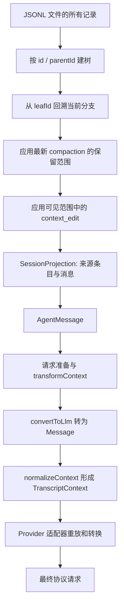
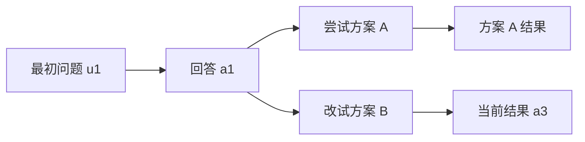
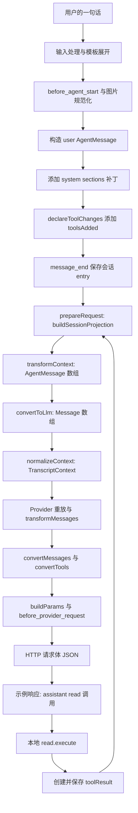

# 08 · 会话树、持久化与上下文投影

[返回总目录](README.md) · [前置：请求旅程](04-一条请求的完整旅程.md) · [下一章](09-压缩与错误恢复.md)

想先看到一条实际数据链路，可以直接阅读 [第 18 节：完整 JSON 实例](#18-完整-json-实例一句话如何走到两次模型请求)，再回看前面的会话树与投影规则。

## 1. 先回答：一份会话文件是不是模型记忆

它是模型输入的重要来源，但不等于模型的当前输入。会话文件记录了分支、设置变化、摘要和统计；模型只接收当前分支经投影、转换后的有效内容。

核心实现集中在 [session-manager.ts](https://github.com/earendil-works/pi/blob/6fb2e7815167e6b19006fc526d1a5d0f5f998787/packages/coding-agent/src/core/session-manager.ts)，格式说明见 [session-format.md](https://github.com/earendil-works/pi/blob/6fb2e7815167e6b19006fc526d1a5d0f5f998787/packages/coding-agent/docs/session-format.md)。

先区分四层数据，后面所有函数都在这些层之间工作：

| 层 | 主要结构 | 保存或表达什么 | 是否原样发送给 Provider |
|---|---|---|---|
| 会话存储 | `SessionEntry[]`，JSONL 的树节点 | 消息、模型设置、标签、扩展状态、摘要、编辑记录 | 否 |
| Agent 运行时 | `AgentMessage[]` | Pi 标准消息及应用自定义消息 | 否；先投影和转换 |
| Pi 模型接口 | `Message[]`、`TranscriptContext` | 统一的 system/user/assistant/toolResult 与内容块 | 仍需协议适配 |
| Provider 请求 | Chat 的 messages、Responses 的 input、Anthropic 的 system/messages 等 | 该协议实际支持的字段 | 由 SDK/传输层序列化发送 |

`Message` 的“模型兼容”表示它符合 Pi 的统一模型接口，不表示它已经等于某一家服务的 HTTP JSON。`AgentMessage` 与 `Message` 是类型名称，运行时是普通对象；转换函数负责实际变换，类型声明自己不会执行任何转换。[消息定义](https://github.com/earendil-works/pi/blob/6fb2e7815167e6b19006fc526d1a5d0f5f998787/packages/agent/src/types.ts) · [统一模型类型](https://github.com/earendil-works/pi/blob/6fb2e7815167e6b19006fc526d1a5d0f5f998787/packages/ai/src/types.ts)



UI、导出、费用统计和模型上下文各有自己的读取目的。不能用其中一条路径的结论替代另一条。

## 2. JSONL 的物理结构

JSONL 是每一行一个 JSON 对象。第一条有效记录是 SessionHeader，包含会话 ID、版本、时间、cwd 等。后续树节点有自己的 id、parentId 和 timestamp。

教学示意：

```text
header: 会话 S，cwd=/project
u1: user，parent=null
a1: assistant，parent=u1
u2: user，parent=a1
a2: assistant，parent=u2
```

header 的会话 ID 标识整份会话；entry ID 标识树中的某个节点；toolCallId 则关联工具调用与结果。三个 ID 用途不同。

entry timestamp 是 ISO 字符串；message 内部 timestamp 通常是毫秒时间戳。排序或比较时要注意转换。

## 3. 一条时间线如何变成树

用户回到 a1 后提出另一个问题：



文件可以同时保存两个分支；leafId 指向当前位置。构建上下文时从当前叶子回溯父节点，模型不会自动看到方案 A 的全部消息。

如果需要带走离开分支的经验，可以生成 branch_summary。摘要是显式的新上下文贡献，不是把整个兄弟分支重新拼进请求。

`resetLeaf()` 或从 null 建立带摘要分支还允许多个根，因此“每份文件必然只有一个根”也不是可靠假设。

## 4. 所有主要 entry 类型

| 类型 | 保存内容 | 对模型上下文的影响 |
|---|---|---|
| `message` | system/user/assistant/toolResult 等消息 | 按消息角色转换或保留 |
| `model_change` | 用户选定的 provider/model | 恢复模型选择；不作为普通聊天正文 |
| `thinking_level_change` | 推理等级变化 | 恢复配置 |
| `compaction` | 摘要、保留边界、系统检查点 | 用摘要和保留尾部代替更早内容 |
| `context_edit` | targetId 与 replacement | 省略或替换目标的上下文贡献 |
| `branch_summary` | 离开分支的摘要与来源 | 转为摘要消息 |
| `custom` | 扩展持久状态 | 不直接进入模型上下文 |
| `custom_message` | 扩展内容、display、details | 内容进入模型上下文 |
| `usage` | 非普通 assistant 请求的用量 | 计入统计，不形成模型消息 |
| `label` | 对某 entry 的书签 | 树导航元数据 |
| `session_info` | 会话显示名称等 | 列表元数据 |

`custom` 与 `custom_message` 是初学者最容易混淆的一对。如果只想保存一个计数器，应理解非上下文状态；如果想让模型记住一条补充说明，需要消息通道。

`display: false` 只控制自定义消息是否显示，不能用它阻止模型看到内容。

## 5. system 消息本身也是可重放状态

当前版本 system 消息可以保存：

- `content`：基础提示文本；重放时后续非空 content 按顺序追加。
- `sections`：按名字组织的提示词部分；补丁里的 null 表示移除。
- `toolsAdded`：增加或更新的工具声明。
- `toolsRemoved`：移除的工具。

最初声明完整状态，之后保存差异。命名 sections 按键替换或删除，content 则追加，工具声明按增删重放。它让“某次请求用了什么规则和工具”拥有会话内证据。扩展的 forceSystemPrompt 另走请求投影，强制文本本身不会因此成为原始 transcript 的替换记录。

压缩时若当前投影能重放出系统消息，会保存完整 systemMessage 检查点。否则前面的系统补丁被摘要替代以后，后面的差异补丁可能失去起点。该字段是可选的：没有系统状态的路径及较早版本记录可以不包含它。

重放工具函数见 [ai/utils/transcript.ts](https://github.com/earendil-works/pi/blob/6fb2e7815167e6b19006fc526d1a5d0f5f998787/packages/ai/src/utils/transcript.ts)。

## 6. 三个 build 函数分别做什么

### 6.1 `buildContextEntries()`：挑出有效范围

它先走当前路径，再找到最新压缩。压缩之后的内容保留；压缩之前从 firstKeptEntryId 开始的一段也保留；更早内容由摘要代表。

被选中的 entry 仍可能是标签、自定义状态等非模型消息，因为显示层也需要它们。

### 6.2 `buildSessionProjection()`：保留来源关系

返回结构包含 `entries` 和 `messages`。每个 ProjectedSessionEntry 保留 `sourceEntry`，并记录它实际贡献的 `messages`。

这个设计解决“模型里的第 N 条消息来自磁盘哪条记录”的问题。一条 compaction entry 可能贡献系统检查点与摘要两条消息；一个 context_edit entry 自身不贡献消息。

### 6.3 `buildSessionContext()`：给调用方更简单的结果

它基于投影返回 messages、thinkingLevel、model。SDK 恢复会话时使用这个视图，不需自行重写压缩和编辑逻辑。

## 7. context edit 的具体例子

假设 t1 是一条非常长的工具结果。扩展在后续安全边界追加：

```json
{"type":"context_edit","targetId":"t1","replacement":null}
```

这里省略了 entry 自身 id、parentId、timestamp。含义是：以后构建这个分支的上下文时，不让 t1 贡献消息。t1 的原始内容仍在文件中。

非 null 替换保存的是 `{ content: 新内容 }`；目标角色与其他元数据保持原样。对于 assistant/toolResult 的字符串内容，投影会规范化成文本块数组。

需要注意四个限制：

1. 生效范围由当前分支和当前压缩投影决定。
2. 同一目标在有效范围中有多条 edit 时，最后一条生效。
3. 回到 edit 之前的分支位置，原内容可能重新出现。
4. 省略工具调用时，要同时考虑对应结果；不能制造无调用来源的孤立 toolResult。

恢复失败请求时，`AgentSession._omitRecoveryAttempt()` 正是通过追加 edit 处理 assistant 和相应工具结果。

## 8. 为什么边界编辑先预览再提交

扩展的 turn_end 和 agent_before_settle 可以提出一组新增 entry。AgentSession 先在内存预览管理器中回放草稿，计算新的上下文和 canContinue，然后提交到真实会话。

这样下一个处理器看到的是前一个处理器已提出的视图，并且宿主能判断“继续运行”是否有合法起点。

完整 assistant 已结束、也没有新输入时，不能仅靠 `continue: true` 变出一条用户消息。查看 `_buildBoundaryContext()`、`_commitBoundaryDrafts()` 和 `ExtensionRunner.emitBoundary()`。

## 9. `/tree`、`/fork`、`/clone` 的不同

| 动作 | 存储结果 | 适用理解 |
|---|---|---|
| tree 导航 | 同一会话内更换当前位置并可创建后续分支 | 比较不同探索路线 |
| fork | 从选定历史位置创建新会话 | 将一段历史作为新任务起点 |
| clone | 复制当前选定历史到新会话 | 从当前进度另开会话 |
| resume | 打开另一份已有会话 | 继续之前的记录 |
| new | 创建新会话 | 新的对话起点 |

选择器只负责让用户选中位置；SessionManager 负责树和复制；AgentSessionRuntime 负责涉及新会话的生命周期替换。不要把业务规则都归到 UI 文件。

分支摘要的实现位于 [branch-summarization.ts](https://github.com/earendil-works/pi/blob/6fb2e7815167e6b19006fc526d1a5d0f5f998787/packages/coding-agent/src/core/compaction/branch-summarization.ts)，导航编排在 `AgentSession.navigateTree()`。

## 10. `!` 与 `!!` 的消息差别

用户手动运行 shell 命令产生 `bashExecution`，不是模型生成的 toolCall/toolResult 对。

`!command` 的结果通过 `bashExecutionToText()` 变为 user 文本供后续模型使用；`!!command` 以 excludeFromContext 标识排除，但仍可以保存在历史和 UI 中。

这说明“隐藏于模型”必须通过转换规则实现，而不是仅改变屏幕显示。入口见 [messages.ts](https://github.com/earendil-works/pi/blob/6fb2e7815167e6b19006fc526d1a5d0f5f998787/packages/coding-agent/src/core/messages.ts)。

## 11. 文件读取并非简单 `split` 全文

`loadEntriesFromFile()` 分块读取并用 StringDecoder 处理跨块 UTF-8 字符。解析时跳过空行和无法解析的行，验证首条有效记录是 header；有效文件末尾缺换行时会补换行，便于以后追加。

这意味着调用这个加载函数不一定是纯读取操作。做离线分析时，若只想观察原文件，可以使用只读文本工具，而不要无意调用带修复行为的加载 API。

列表发现使用受限 header 扫描，避免为了列出会话就同步读完每个巨型文件；发现失败的文件可能被跳过。直接打开会话与列表发现的容错目的不同。

## 12. 费用与上下文大小不能相互替代

上下文编辑后，之前请求已经产生的费用不会消失。用量统计可能还包括压缩摘要、分支摘要、嵌套工具模型调用和 cache warming。

所以：累计 totalTokens 是工作消耗；当前上下文估计是下一次请求可能携带的信息量。把所有历史请求 usage 相加当作当前上下文长度，会严重高估。

统计入口见 [usage-totals.ts](https://github.com/earendil-works/pi/blob/6fb2e7815167e6b19006fc526d1a5d0f5f998787/packages/coding-agent/src/core/usage-totals.ts)；估算见下一章。

## 13. 一次用户输入如何被编排成上下文

以用户提交“读 a.txt，然后告诉我里面有什么”为例。这里讨论默认 SDK/编码会话装配，不把低层独立 Agent 当成也具有全部会话功能。

### 13.1 启动或恢复时先建立可用的历史视图

`createAgentSession()` 先取得 SessionManager、SettingsManager、ResourceLoader 和 ModelRuntime。ResourceLoader 已收集项目指令、系统提示来源、技能和扩展资源；SessionManager 负责会话树。

SDK 调用 `sessionManager.buildSessionContext()`，将有效 messages 放进 Agent 初始状态。已有会话会沿当前分支恢复压缩、上下文编辑、模型和 thinking 设置；新会话没有旧消息。它不是把日志每行直接 push 到模型数组。[SDK 装配](https://github.com/earendil-works/pi/blob/6fb2e7815167e6b19006fc526d1a5d0f5f998787/packages/coding-agent/src/core/sdk.ts)

随后 AgentSession 建立工具注册表、活动工具和基础提示词选项，并安装请求/扩展回调。这里的资源加载与每次请求前的消息投影是不同动作；普通每次模型请求不会自动再扫描全仓库并读遍所有 AGENTS 文件。

### 13.2 输入先经过应用处理，才成为 user 消息

`AgentSession.prompt()` 的主要顺序是：

```text
扩展命令匹配
  → input 扩展处理原始文字/图片
  → 展开 skill 命令与 prompt template
  → 已运行则排队；空闲则检查模型和认证
  → 处理待补入的 bash/custom 消息、发送前压缩检查
  → before_agent_start
  → 按当前模型处理图片
  → 构造 user 和扩展 custom 消息
  → 准备 system patch 与工具集合
  → Agent.prompt(messages)
```

图是职责顺序概览；待补消息的 flush 在空闲分支检查模型前进行。扩展命令或 input 已接管时可能提前结束，流式运行中则按 steer/follow-up 入队，不发起同实例第二个并行 prompt。[输入函数](https://github.com/earendil-works/pi/blob/6fb2e7815167e6b19006fc526d1a5d0f5f998787/packages/coding-agent/src/core/agent-session.ts)

普通字符串变成：

```json
{
  "role": "user",
  "content": [{ "type": "text", "text": "读 a.txt，然后告诉我里面有什么" }],
  "timestamp": 1000
}
```

时间是示意。图片不会只保存成“文件路径字符串”，而是 `{type:"image",data:Base64,mimeType:...}` 内容块。扩展 before_agent_start 追加的内容则成为 custom 消息，不冒充用户亲自输入。

### 13.3 系统提示和工具声明进入同一份 transcript

基础提示词选项包括 cwd、项目上下文文件、技能目录、可见工具的短说明与使用规则。`buildSystemPromptSections()` 将它们生成命名 sections；`_preparePromptAndToolLoadout()` 和 `diffSystemPromptSections()` 比较旧状态与新状态，只生成有变化的 system patch。

循环的 `declareToolChanges()` 再对比历史中已声明的工具与本次可执行集合，补 toolsAdded/toolsRemoved。首次运行可能形成带完整 sections 和初始工具声明的 system 消息；后续只记录差量。

因此一次请求的输入不只用户问题，还包含有效系统状态、当前分支历史、摘要/近期尾部及当前声明的工具。工具 execute 函数保留在本机的可执行集合中，不进入声明。[系统构建](https://github.com/earendil-works/pi/blob/6fb2e7815167e6b19006fc526d1a5d0f5f998787/packages/coding-agent/src/core/system-prompt.ts) · [工具声明差量](https://github.com/earendil-works/pi/blob/6fb2e7815167e6b19006fc526d1a5d0f5f998787/packages/agent/src/agent-loop.ts)

### 13.4 完成消息经事件保存

用户、system patch、assistant 和工具结果成为完成消息时，核心发 message_end。Agent 先更新稳定状态；AgentSession 先派发扩展 message_end，再通知公开监听器，再追加相应的会话 entry。

assistant 的每个流式字符只更新部分消息和显示，不各写一行会话消息。工具的局部 onUpdate 也不自动成为新的聊天消息。保存后的 entry ID 与消息中的 toolCallId 用途不同，前者用于树和 context edit，后者用于调用/结果配对。[事件和持久化](https://github.com/earendil-works/pi/blob/6fb2e7815167e6b19006fc526d1a5d0f5f998787/packages/coding-agent/src/core/agent-session.ts)

## 14. 每次 Provider 请求之前，历史重新怎样选取

`_installAgentRequestProjection()` 为 Agent 安装 prepareRequest。每次真实模型请求前，包括第一次和工具后的续轮，都重新调用 `buildSessionProjection()`：

1. 从 leafId 沿 parentId 取得当前路径，不读取其他兄弟分支作为上下文。
2. 找到路径上最新 compaction，用其摘要节点加保留尾部及后续条目确定范围。
3. 收集这个范围内的 context_edit；同目标最后一条生效。
4. 将各 entry 映射为零条、一条或多条 AgentMessage，保留 sourceEntry 来源关系。
5. 展平成为 projection.messages，同时恢复路径中的模型/thinking 设置。

会话层把 projection.messages 替换进本次请求 context，将当前可执行工具数组放入 context.tools。后者是本地函数集合；系统消息里的工具声明才是后续 Provider 转换所读取的模型可见状态。

普通模型继续使用当前模型；虚拟模型在此按 user/continuation/retry 原因解析实际模型。若实际模型窗口要求压缩，则压缩后重新建立请求投影。路由对象不是一条 user 消息，也不需要把整个模型配置变成对话正文。[请求投影与路由](https://github.com/earendil-works/pi/blob/6fb2e7815167e6b19006fc526d1a5d0f5f998787/packages/coding-agent/src/core/agent-session.ts)

## 15. AgentMessage 到 Message：哪些保留，哪些改变

定义关系可简化为：

```ts
// 示意，省略声明合并细节。
type Message = SystemMessage | UserMessage | AssistantMessage | ToolResultMessage;
type AgentMessage = Message | BashExecutionMessage | CustomMessage
  | BranchSummaryMessage | CompactionSummaryMessage;
```

因此普通 system/user/assistant/toolResult **本来就是 AgentMessage 的一部分**，不需要为每个字段重新转换。编码会话的 `convertToLlm()` 对这些角色直接返回该对象。需要转换的是应用自己增加的角色：

| AgentMessage 角色 | convertToLlm 的结果 | 原来附属字段如何处理 |
|---|---|---|
| system/user/assistant/toolResult | 原样保留为 Pi Message | 以后由适配器选择实际协议字段 |
| bashExecution，未排除 | 转成 user 文本，含命令、输出、退出/截断说明 | 不是历史 toolCall/toolResult 对 |
| bashExecution，excludeFromContext:true | 过滤掉，贡献零条 Message | 历史和 UI 仍可保留 |
| custom | 转成 user，字符串内容规范为 text 块 | display、customType、details 不进入转换后的 user 正文 |
| branchSummary | 转成包裹 summary 的 user 文本 | fromId 用于来源，不作为普通内容字段发送 |
| compactionSummary | 转成带压缩说明和 summary 标签的 user 文本 | tokensBefore 不是模型对话正文 |

[编码会话转换器](https://github.com/earendil-works/pi/blob/6fb2e7815167e6b19006fc526d1a5d0f5f998787/packages/coding-agent/src/core/messages.ts)

例如两个运行时消息：

```json
[
  { "role": "custom", "customType": "hint", "content": "请保留原有换行", "display": false, "timestamp": 1 },
  { "role": "bashExecution", "command": "pwd", "output": "D:/demo", "cancelled": false, "truncated": false, "excludeFromContext": true, "timestamp": 2 }
]
```

转换后只有一条：

```json
[
  { "role": "user", "content": [{ "type": "text", "text": "请保留原有换行" }], "timestamp": 1 }
]
```

`display:false` 没有阻止模型看到提示。`excludeFromContext:true` 才让这条 bashExecution 在转换中消失。

通用 Agent 默认转换器只保留四种标准角色；SDK 给编码会话安装上述 convertToLlm，所以不能将通用默认行为与编码应用的自定义角色映射混为一谈。[Agent 默认转换](https://github.com/earendil-works/pi/blob/6fb2e7815167e6b19006fc526d1a5d0f5f998787/packages/agent/src/agent.ts) · [SDK 安装](https://github.com/earendil-works/pi/blob/6fb2e7815167e6b19006fc526d1a5d0f5f998787/packages/coding-agent/src/core/sdk.ts)

## 16. transformContext 为什么先于 convertToLlm

请求边界中的顺序是：

```text
AgentMessage[]
  → transformContext：仍然处理应用消息
  → convertToLlm：转为 Pi Message[]
  → normalizeContext({ messages })：形成 TranscriptContext
  → streamFunction：交给模型运行时和 Provider
```

第一步仍能知道某条消息是 bashExecution/custom/compactionSummary；如果先转成 user，这些来源区别就更难保留。`transformContext` 返回本次请求使用的列表，并不默认把它写回原始会话。

默认 SDK 的变换进入 `Runner.emitContext()`。Runner 先 structuredClone 消息，依次处理：

1. `context`：处理器看到不含 system 的会话内容。可以返回 messages，或在 event.messages 上修改；宿主恢复系统消息和声明状态。
2. `context_with_system`：处理器接着看到完整 transcript，输出直接用于后续步骤。移除了原有领先 system 时会报告扩展错误，但不会悄悄替它补回。
3. 会话安装的隐藏声明投影：从 system 的工具变化字段中过滤 hiddenDeclarations。
4. 强制提示投影：若本次运行有 forceSystemPrompt，将重放系统状态变成一个带强制文本及当前工具的头部，去掉原 system 消息。

这些请求级改动与追加 context_edit 不同：前者通常只改请求副本；后者追加持久记录，后续构建分支投影也会生效。[扩展变换](https://github.com/earendil-works/pi/blob/6fb2e7815167e6b19006fc526d1a5d0f5f998787/packages/coding-agent/src/core/extensions/runner.ts) · [会话投影包装](https://github.com/earendil-works/pi/blob/6fb2e7815167e6b19006fc526d1a5d0f5f998787/packages/coding-agent/src/core/agent-session.ts)

SDK 的 convertToLlm 包装还按 blockImages 设置过滤 user/toolResult 图片，换成文字说明。随后 Provider 适配器会按模型输入能力处理图片；这又是不同层的检查。

## 17. normalizeContext 不负责什么

公开 pi-ai 的 Context 可以有 `{systemPrompt, messages, tools}` 快捷字段。`normalizeContext()` 将额外 systemPrompt/tools 折成一个领先 system 消息，返回只以 messages 承载状态的 TranscriptContext。

但 Agent loop 调它时传的是 `{messages:llmMessages}`，没有那两个快捷字段，因此不会额外创建 system，更不会合并现有全部 system patch。不要把 normalize 读成“清洗、裁剪、压缩、修复所有上下文”的万能函数。

真正的系统重放由这些函数完成：

| 函数 | 作用 |
|---|---|
| getCurrentSystemMessage | 追加 content、按名称更新/移除 sections，重放得到完整系统状态 |
| getCurrentTools | 按顺序应用 toolsRemoved/toolsAdded，得出当前工具声明集合 |
| collapseSystemMessages | 将全部 system 变化折成一个头部，其余非 system 消息保留 |
| resolveTranscript | 根据协议是否支持对话中途 system，决定保留原位变化或折叠 |
| resolveTranscriptTools | 根据协议工具变化能力，将声明放在请求顶层或历史内追加位置 |

支持中途工具追加不代表必然支持删除和同名重定义。工具重放也不重新运行 tool.execute。[统一 transcript 工具](https://github.com/earendil-works/pi/blob/6fb2e7815167e6b19006fc526d1a5d0f5f998787/packages/ai/src/utils/transcript.ts)

## 18. 完整 JSON 实例：一句话如何走到两次模型请求

这一节沿着同一个例子逐阶段展示完整对象。代码框中的 JSON 是该阶段整个对象或数组的序列化结果，没有省略系统提示、工具 schema 或已经产生的消息元数据。某一阶段没有改变数据时，也仍展示完整结果，方便逐字段对照。

先区分“完整 JSON”和“把所有类型的可选字段都填满”：对象中值为 undefined 的属性、函数、Symbol 属性不能作为 JSON 字段保存。下面按 JSON.stringify 的结果展示；没有发生图片读取、压缩、扩展注入或嵌套调用，就不会凭空出现相应字段。函数和回调另用文字说明其所在位置。

这是一份按当前源码构造的固定条件实例，不是当前用户会话或联网请求的抓包。用户文字、文件内容、时间、节点 ID、模型响应、token 数与耗时采用示例值；消息组装、工具 schema、转换规则和请求字段采用源码的实际结构。第一条模型响应被设为 read 调用，便于继续观察工具结果进入第二次请求。

下面的步骤地图对应本节小节。每次模型请求都重新走投影和转换，工具完成后再走一遍。第一次完整请求体在 18.15，工具调用与结果在 18.16–18.18，第二次完整请求体在 18.24，自定义消息的格式变化在 18.25。



### 18.1 固定条件：明确这一份完整请求来自什么环境

假设工作目录为 C:/pi-json-demo，a.txt 是 UTF-8 文本，内容是 hello 后跟一个换行。新会话没有旧聊天；显式选择 read、bash、edit、write 四个内置编码工具；没有项目指令文件、技能、提示模板、用户追加提示、MCP、扩展处理器或强制系统提示。开启扩展的项目会在相应边界增加内容，不能直接套用此例的值。

本例选用 gpt-4o-mini 的 OpenAI Chat Completions 路径，thinking 为 off、缓存保留为 short。下面是完整的演示 Model 配置；窗口和输出上限是本例固定配置，cost 为本地演示计费值 0，并非服务商实时报价或自动发现的当前模型目录。api 决定使用哪套适配器；provider 是服务商标识；baseUrl 决定 HTTP 目标。这个配置对象本身不会整对象写进模型对话。

```json
{
  "id": "gpt-4o-mini",
  "name": "gpt-4o-mini",
  "api": "openai-completions",
  "provider": "openai",
  "baseUrl": "https://api.openai.com/v1",
  "reasoning": false,
  "input": [
    "text",
    "image"
  ],
  "cost": {
    "input": 0,
    "output": 0,
    "cacheRead": 0,
    "cacheWrite": 0
  },
  "contextWindow": 128000,
  "maxTokens": 16384
}
```

本例使用的两个会影响请求体的请求选项如下。SDK 还传递 signal、认证、超时、重试和回调等运行时参数；它们用于传输和事件处理，不是聊天正文或请求体的附加字段。reasoning 为 off 时，Agent 的 reasoning 选项是 undefined。

```json
{
  "sessionId": "11111111-2222-4333-8444-555555555555",
  "cacheRetention": "short"
}
```

会话头的完整 JSON 如下。它是文件第一行的对象，不是 AgentMessage，也不是当前分支中的 message 节点。SessionHeader.id 是会话 ID，后面 entry.id 是节点 ID，toolCall.id 又是调用 ID。三个标识用途不同。

```json
{
  "type": "session",
  "version": 3,
  "id": "11111111-2222-4333-8444-555555555555",
  "timestamp": "2026-10-11T12:00:00.000Z",
  "cwd": "C:/pi-json-demo"
}
```

[消息与模型类型](https://github.com/earendil-works/pi/blob/6fb2e7815167e6b19006fc526d1a5d0f5f998787/packages/ai/src/types.ts) · [SDK 初始化](https://github.com/earendil-works/pi/blob/6fb2e7815167e6b19006fc526d1a5d0f5f998787/packages/coding-agent/src/core/sdk.ts) · [会话头与设置节点](https://github.com/earendil-works/pi/blob/6fb2e7815167e6b19006fc526d1a5d0f5f998787/packages/coding-agent/src/core/session-manager.ts)

### 18.2 原始输入 → 输入处理结果 → 展开后的文字

调用 AgentSession.prompt(text) 时，text 只是一个字符串；字符串本身的完整 JSON 表示为：

```json
"读取 a.txt，然后告诉我里面有什么"
```

本例不是 / 命令，没有 input 扩展处理器。因此 _runInputHandlers 返回的对象序列化后为：

```json
{
  "text": "读取 a.txt，然后告诉我里面有什么"
}
```

它在运行时也有 images: undefined；JSON.stringify 会省掉该属性，因此没有 images 字段不表示这里还有隐藏的图片。技能命令与模板展开后，expandedText 仍是同一字符串：

```json
"读取 a.txt，然后告诉我里面有什么"
```

模型和认证检查通过、新会话无需发送前压缩后，流程才继续组装消息。这些检查不负责把 API key 添加到 user.content。入口见 [AgentSession.prompt](https://github.com/earendil-works/pi/blob/6fb2e7815167e6b19006fc526d1a5d0f5f998787/packages/coding-agent/src/core/agent-session.ts)。

### 18.3 before_agent_start 返回值与图片规范化结果

本例没有 before_agent_start 处理器。ExtensionRunner 仍将系统提示选项规范为完整集合，返回 messages 和 systemPromptOptions。下面展示这一返回值的完整 JSON，工具短说明与规则来自四个内置 ToolDefinition：

```json
{
  "messages": [],
  "systemPromptOptions": {
    "selectedTools": [
      "read",
      "bash",
      "edit",
      "write"
    ],
    "hiddenTools": [],
    "toolSnippets": {
      "read": "Read file contents",
      "bash": "Execute bash commands (ls, grep, find, etc.)",
      "edit": "Make precise file edits with exact text replacement, including multiple disjoint edits in one call",
      "write": "Create or overwrite files"
    },
    "toolGuidelines": {
      "read": [
        "Use read to examine files instead of cat or sed."
      ],
      "bash": [
        "You can inspect PI_* environment variables for current model and session details."
      ],
      "edit": [
        "Use edit for precise changes (edits[].oldText must match exactly)",
        "When changing multiple separate locations in one file, use one edit call with multiple entries in edits[] instead of multiple edit calls",
        "Each edits[].oldText is matched against the original file, not after earlier edits are applied. Do not emit overlapping or nested edits. Merge nearby changes into one edit.",
        "Keep edits[].oldText as small as possible while still being unique in the file. Do not pad with large unchanged regions."
      ],
      "write": [
        "Use write only for new files or complete rewrites."
      ]
    },
    "promptGuidelines": [],
    "appendSystemPrompt": "",
    "sections": {},
    "cwd": "C:/pi-json-demo",
    "contextFiles": [],
    "skills": []
  }
}
```

messages: [] 表示扩展没有附加自定义消息。selectedTools 是选择的名字，toolSnippets 和 toolGuidelines 用于生成自然语言系统提示；它们还不是调用参数 schema。customPrompt、forceSystemPrompt 为 undefined，所以不出现在 JSON 中；空数组或空对象则确实存在。

随后 _normalizePromptImages(undefined) 返回：

```json
{
  "images": [],
  "hints": []
}
```

没有图片或图片处理提示，最终 userText 仍等于原始文字。源码见 [扩展启动前回调](https://github.com/earendil-works/pi/blob/6fb2e7815167e6b19006fc526d1a5d0f5f998787/packages/coding-agent/src/core/extensions/runner.ts) · [输入与图片处理](https://github.com/earendil-works/pi/blob/6fb2e7815167e6b19006fc526d1a5d0f5f998787/packages/coding-agent/src/core/agent-session.ts)。

### 18.4 用户文字 → 一条完整 UserMessage，也是 AgentMessage

AgentSession.prompt 创建 userContent，再调用 Date.now()。得到的整个 user 对象如下：

```json
{
  "role": "user",
  "content": [
    {
      "type": "text",
      "text": "读取 a.txt，然后告诉我里面有什么"
    }
  ],
  "timestamp": 1791720000100
}
```

content 数组中目前只有一个 text 块；有附件时图片块也在同一数组中。timestamp 是毫秒时间。AgentMessage 是包含 Pi 标准 Message 与应用自定义消息的联合类型，因此这条 user 同时是 UserMessage、Message 和 AgentMessage，并不存在名为 agentmessage 的额外 JSON 外壳。

### 18.5 系统提示装配 → 交给 Agent.prompt 的完整消息数组

_preparePromptAndToolLoadout 根据选定工具建立本地执行集合，再调用 buildSystemPromptSections。新会话没有旧 sections，因此 diffSystemPromptSections 返回全部五个段；创建的 system 补丁被 unshift 到 user 前面。AgentSession 交给 Agent.prompt 的整个数组如下，此时尚未由 loop 添加 toolsAdded：

```json
[
  {
    "role": "system",
    "content": "",
    "sections": {
      "preamble": "You are an expert coding assistant operating inside pi, a coding agent harness. You help users by reading files, executing commands, editing code, and writing new files.",
      "tools": "<tools>\n- read: Read file contents\n- bash: Execute bash commands (ls, grep, find, etc.)\n- edit: Make precise file edits with exact text replacement, including multiple disjoint edits in one call\n- write: Create or overwrite files\n\nIn addition to the tools above, you may have access to other custom tools depending on the project.\n</tools>",
      "rules": "<rules>\n- Use bash for file operations like ls, rg, find\n- Use read to examine files instead of cat or sed.\n- You can inspect PI_* environment variables for current model and session details.\n- Use edit for precise changes (edits[].oldText must match exactly)\n- When changing multiple separate locations in one file, use one edit call with multiple entries in edits[] instead of multiple edit calls\n- Each edits[].oldText is matched against the original file, not after earlier edits are applied. Do not emit overlapping or nested edits. Merge nearby changes into one edit.\n- Keep edits[].oldText as small as possible while still being unique in the file. Do not pad with large unchanged regions.\n- Use write only for new files or complete rewrites.\n- Be concise in your responses\n- Show file paths clearly when working with files\n</rules>",
      "docs": "<docs>\nPi documentation (read only when the user asks about pi itself, its SDK, extensions, themes, skills, or TUI):\n- Main documentation: C:\\pi-source\\packages\\coding-agent\\README.md\n- Additional docs: C:\\pi-source\\packages\\coding-agent\\docs\n- Examples: C:\\pi-source\\packages\\coding-agent\\examples (extensions, custom tools, SDK)\n- When reading pi docs or examples, resolve docs/... under Additional docs and examples/... under Examples, not the current working directory\n- When asked about: extensions (docs/extensions.md, examples/extensions/), themes (docs/themes.md), skills (docs/skills.md), prompt templates (docs/prompt-templates.md), TUI components (docs/tui.md), keybindings (docs/keybindings.md), SDK integrations (docs/sdk.md), custom providers (docs/custom-provider.md), adding models (docs/models.md), pi packages (docs/packages.md), environment variables (docs/environment-variables.md), MCP servers (docs/mcp.md), codemode scripts and non-LLM models such as classifiers and image models (docs/codemode.md)\n- When working on pi topics, read the docs and examples, and follow .md cross-references before implementing\n- Always read pi .md files completely and follow links to related docs (e.g., tui.md for TUI API details)\n</docs>",
      "cwd": "<cwd>\nC:/pi-json-demo\n</cwd>"
    },
    "timestamp": 1791720000101
  },
  {
    "role": "user",
    "content": [
      {
        "type": "text",
        "text": "读取 a.txt，然后告诉我里面有什么"
      }
    ],
    "timestamp": 1791720000100
  }
]
```

system.content 是空字符串，系统提示并不为空：文字在 sections 中。preamble 是前言；tools 是自然语言工具介绍；rules 是规则；docs 是 Pi 文档位置；cwd 是工作目录。非 preamble 段已带 XML 标签。docs 中使用的是这个源码 checkout 的 coding-agent 资产路径；安装到别的位置时，getReadmePath/getDocsPath/getExamplesPath 会生成相应路径。

system 在稍后才生成，所以它的 timestamp 比 user 大；数组仍把 system 排在前面。消息顺序由组装及会话路径决定，不能按 timestamp 重新排序。源码见 [系统提示生成与差量](https://github.com/earendil-works/pi/blob/6fb2e7815167e6b19006fc526d1a5d0f5f998787/packages/coding-agent/src/core/system-prompt.ts) · [提示与工具 loadout 接线](https://github.com/earendil-works/pi/blob/6fb2e7815167e6b19006fc526d1a5d0f5f998787/packages/coding-agent/src/core/agent-session.ts)。

### 18.6 本地可执行工具与模型可见声明分别长什么样

下面先完整展示本例四个 AgentTool 经 JSON.stringify 后的结果。运行时各对象还有 execute；edit 还有 prepareArguments。这些是函数，JSON.stringify 不会显示它们。label 和 outputSchema 等可序列化信息则保留下来：

```json
[
  {
    "name": "read",
    "label": "read",
    "description": "Read the contents of a file. Supports text files and images (jpg, png, gif, webp, bmp). Images are sent as attachments. For text files, output is truncated to 2000 lines or 50KB (whichever is hit first). Use offset/limit for large files. When you need the full file, continue with offset until complete.",
    "parameters": {
      "type": "object",
      "required": [
        "path"
      ],
      "properties": {
        "path": {
          "type": "string",
          "description": "Path to the file to read (relative or absolute)"
        },
        "offset": {
          "type": "number",
          "description": "Line number to start reading from (1-indexed)"
        },
        "limit": {
          "type": "number",
          "description": "Maximum number of lines to read"
        }
      }
    },
    "outputSchema": {
      "anyOf": [
        {
          "type": "string"
        },
        {
          "type": "object",
          "required": [
            "type",
            "data",
            "mimeType",
            "note"
          ],
          "properties": {
            "type": {
              "type": "string",
              "const": "image"
            },
            "data": {
              "type": "string"
            },
            "mimeType": {
              "type": "string"
            },
            "note": {
              "type": "string"
            }
          }
        }
      ]
    },
    "constrainedSampling": {
      "type": "json_schema",
      "strict": "prefer"
    }
  },
  {
    "name": "bash",
    "label": "bash",
    "description": "Execute a bash command in the current working directory. Returns stdout and stderr. Output is truncated to last 2000 lines or 50KB (whichever is hit first). If truncated, full output is saved to a temp file. Optionally provide a timeout in seconds.",
    "parameters": {
      "type": "object",
      "required": [
        "command"
      ],
      "properties": {
        "command": {
          "type": "string",
          "description": "Shell command to execute"
        },
        "timeout": {
          "type": "number",
          "description": "Timeout in seconds (optional, no default timeout)"
        }
      }
    },
    "outputSchema": {
      "type": "object",
      "required": [
        "output",
        "truncated",
        "exit_code",
        "wall_time_seconds"
      ],
      "properties": {
        "output": {
          "type": "string",
          "description": "Combined stdout and stderr, possibly truncated"
        },
        "truncated": {
          "type": "boolean"
        },
        "full_output_path": {
          "type": "string",
          "description": "Full output, when truncated"
        },
        "exit_code": {
          "type": "number"
        },
        "wall_time_seconds": {
          "type": "number"
        }
      }
    },
    "constrainedSampling": {
      "type": "json_schema",
      "strict": "prefer"
    }
  },
  {
    "name": "edit",
    "label": "edit",
    "description": "Edit a single file using exact text replacement. Every edits[].oldText must match a unique, non-overlapping region of the original file. If two changes affect the same block or nearby lines, merge them into one edit instead of emitting overlapping edits. Do not include large unchanged regions just to connect distant changes.",
    "parameters": {
      "type": "object",
      "required": [
        "path",
        "edits"
      ],
      "properties": {
        "path": {
          "type": "string",
          "description": "Path to the file to edit (relative or absolute)"
        },
        "edits": {
          "type": "array",
          "items": {
            "type": "object",
            "required": [
              "oldText",
              "newText"
            ],
            "properties": {
              "oldText": {
                "type": "string",
                "description": "Exact text for one targeted replacement. It must be unique in the original file and must not overlap with any other edits[].oldText in the same call."
              },
              "newText": {
                "type": "string",
                "description": "Replacement text for this targeted edit."
              }
            }
          },
          "description": "One or more targeted replacements. Each edit is matched against the original file, not incrementally. Do not include overlapping or nested edits. If two changes touch the same block or nearby lines, merge them into one edit instead."
        }
      }
    },
    "constrainedSampling": {
      "type": "json_schema",
      "strict": "prefer"
    }
  },
  {
    "name": "write",
    "label": "write",
    "description": "Write content to a file. Creates the file if it doesn't exist, overwrites if it does. Automatically creates parent directories.",
    "parameters": {
      "type": "object",
      "required": [
        "path",
        "content"
      ],
      "properties": {
        "path": {
          "type": "string",
          "description": "Path to the file to write (relative or absolute)"
        },
        "content": {
          "type": "string",
          "description": "Content to write to the file"
        }
      }
    },
    "constrainedSampling": {
      "type": "json_schema",
      "strict": "prefer"
    }
  }
]
```

read 和 bash 的 outputSchema 描述程序化调用可得到的 structuredContent，不是模型调用的输入参数。parameters 才是输入 schema。write 和 edit 没有 outputSchema，因此该属性在 JSON 中缺席。执行、准备参数、输出类型和 UI 不是同一件事。

runAgentLoop 中 declareToolChanges 将这些工具经过 toToolDeclaration，仅保留 name、description、parameters，以及存在的 constrainedSampling。初次没有旧声明，四个工具都属于新增；它把 toolsAdded 合并到上一步的 system 补丁。循环实际使用、并发出 message_end 的完整 AgentMessage 数组为：

```json
[
  {
    "role": "system",
    "content": "",
    "sections": {
      "preamble": "You are an expert coding assistant operating inside pi, a coding agent harness. You help users by reading files, executing commands, editing code, and writing new files.",
      "tools": "<tools>\n- read: Read file contents\n- bash: Execute bash commands (ls, grep, find, etc.)\n- edit: Make precise file edits with exact text replacement, including multiple disjoint edits in one call\n- write: Create or overwrite files\n\nIn addition to the tools above, you may have access to other custom tools depending on the project.\n</tools>",
      "rules": "<rules>\n- Use bash for file operations like ls, rg, find\n- Use read to examine files instead of cat or sed.\n- You can inspect PI_* environment variables for current model and session details.\n- Use edit for precise changes (edits[].oldText must match exactly)\n- When changing multiple separate locations in one file, use one edit call with multiple entries in edits[] instead of multiple edit calls\n- Each edits[].oldText is matched against the original file, not after earlier edits are applied. Do not emit overlapping or nested edits. Merge nearby changes into one edit.\n- Keep edits[].oldText as small as possible while still being unique in the file. Do not pad with large unchanged regions.\n- Use write only for new files or complete rewrites.\n- Be concise in your responses\n- Show file paths clearly when working with files\n</rules>",
      "docs": "<docs>\nPi documentation (read only when the user asks about pi itself, its SDK, extensions, themes, skills, or TUI):\n- Main documentation: C:\\pi-source\\packages\\coding-agent\\README.md\n- Additional docs: C:\\pi-source\\packages\\coding-agent\\docs\n- Examples: C:\\pi-source\\packages\\coding-agent\\examples (extensions, custom tools, SDK)\n- When reading pi docs or examples, resolve docs/... under Additional docs and examples/... under Examples, not the current working directory\n- When asked about: extensions (docs/extensions.md, examples/extensions/), themes (docs/themes.md), skills (docs/skills.md), prompt templates (docs/prompt-templates.md), TUI components (docs/tui.md), keybindings (docs/keybindings.md), SDK integrations (docs/sdk.md), custom providers (docs/custom-provider.md), adding models (docs/models.md), pi packages (docs/packages.md), environment variables (docs/environment-variables.md), MCP servers (docs/mcp.md), codemode scripts and non-LLM models such as classifiers and image models (docs/codemode.md)\n- When working on pi topics, read the docs and examples, and follow .md cross-references before implementing\n- Always read pi .md files completely and follow links to related docs (e.g., tui.md for TUI API details)\n</docs>",
      "cwd": "<cwd>\nC:/pi-json-demo\n</cwd>"
    },
    "timestamp": 1791720000101,
    "toolsAdded": [
      {
        "name": "read",
        "description": "Read the contents of a file. Supports text files and images (jpg, png, gif, webp, bmp). Images are sent as attachments. For text files, output is truncated to 2000 lines or 50KB (whichever is hit first). Use offset/limit for large files. When you need the full file, continue with offset until complete.",
        "parameters": {
          "type": "object",
          "required": [
            "path"
          ],
          "properties": {
            "path": {
              "type": "string",
              "description": "Path to the file to read (relative or absolute)"
            },
            "offset": {
              "type": "number",
              "description": "Line number to start reading from (1-indexed)"
            },
            "limit": {
              "type": "number",
              "description": "Maximum number of lines to read"
            }
          }
        },
        "constrainedSampling": {
          "type": "json_schema",
          "strict": "prefer"
        }
      },
      {
        "name": "bash",
        "description": "Execute a bash command in the current working directory. Returns stdout and stderr. Output is truncated to last 2000 lines or 50KB (whichever is hit first). If truncated, full output is saved to a temp file. Optionally provide a timeout in seconds.",
        "parameters": {
          "type": "object",
          "required": [
            "command"
          ],
          "properties": {
            "command": {
              "type": "string",
              "description": "Shell command to execute"
            },
            "timeout": {
              "type": "number",
              "description": "Timeout in seconds (optional, no default timeout)"
            }
          }
        },
        "constrainedSampling": {
          "type": "json_schema",
          "strict": "prefer"
        }
      },
      {
        "name": "edit",
        "description": "Edit a single file using exact text replacement. Every edits[].oldText must match a unique, non-overlapping region of the original file. If two changes affect the same block or nearby lines, merge them into one edit instead of emitting overlapping edits. Do not include large unchanged regions just to connect distant changes.",
        "parameters": {
          "type": "object",
          "required": [
            "path",
            "edits"
          ],
          "properties": {
            "path": {
              "type": "string",
              "description": "Path to the file to edit (relative or absolute)"
            },
            "edits": {
              "type": "array",
              "items": {
                "type": "object",
                "required": [
                  "oldText",
                  "newText"
                ],
                "properties": {
                  "oldText": {
                    "type": "string",
                    "description": "Exact text for one targeted replacement. It must be unique in the original file and must not overlap with any other edits[].oldText in the same call."
                  },
                  "newText": {
                    "type": "string",
                    "description": "Replacement text for this targeted edit."
                  }
                }
              },
              "description": "One or more targeted replacements. Each edit is matched against the original file, not incrementally. Do not include overlapping or nested edits. If two changes touch the same block or nearby lines, merge them into one edit instead."
            }
          }
        },
        "constrainedSampling": {
          "type": "json_schema",
          "strict": "prefer"
        }
      },
      {
        "name": "write",
        "description": "Write content to a file. Creates the file if it doesn't exist, overwrites if it does. Automatically creates parent directories.",
        "parameters": {
          "type": "object",
          "required": [
            "path",
            "content"
          ],
          "properties": {
            "path": {
              "type": "string",
              "description": "Path to the file to write (relative or absolute)"
            },
            "content": {
              "type": "string",
              "description": "Content to write to the file"
            }
          }
        },
        "constrainedSampling": {
          "type": "json_schema",
          "strict": "prefer"
        }
      }
    ]
  },
  {
    "role": "user",
    "content": [
      {
        "type": "text",
        "text": "读取 a.txt，然后告诉我里面有什么"
      }
    ],
    "timestamp": 1791720000100
  }
]
```

这里的 toolsAdded 包含四个完整声明，不只有本次准备使用的 read。它告诉模型“可调用哪些工具”；user 的文字告诉模型“这次要做什么”。模型输入中没有任何 execute 的实现、文件句柄或 Promise，也没有工具的 label、outputSchema、prepareArguments 或渲染方法。

本例没有删除工具，withToolChanges 省略 toolsRemoved；不要补成 null。第一次声明后，工具集合不变的续轮也不会重复追加一条 toolsAdded 消息，但有效历史仍保存这份完整声明。源码见 [declareToolChanges](https://github.com/earendil-works/pi/blob/6fb2e7815167e6b19006fc526d1a5d0f5f998787/packages/agent/src/agent-loop.ts) · [toToolDeclaration](https://github.com/earendil-works/pi/blob/6fb2e7815167e6b19006fc526d1a5d0f5f998787/packages/ai/src/utils/transcript.ts) · [工具包装](https://github.com/earendil-works/pi/blob/6fb2e7815167e6b19006fc526d1a5d0f5f998787/packages/coding-agent/src/core/tools/tool-definition-wrapper.ts)。

### 18.7 message_end → 会话 entry：保存的完整记录

runAgentLoop 先发出初始 system 和 user 的 message_end，AgentSession 订阅回调保存它们。SDK 在新会话启动时已追加 model_change 与 thinking_level_change。下面是此时 SessionManager.getEntries() 返回的整个数组，顺序为设置节点、system 节点、user 节点：

```json
[
  {
    "type": "model_change",
    "id": "11111111",
    "parentId": null,
    "timestamp": "2026-10-11T12:00:00.010Z",
    "provider": "openai",
    "modelId": "gpt-4o-mini"
  },
  {
    "type": "thinking_level_change",
    "id": "22222222",
    "parentId": "11111111",
    "timestamp": "2026-10-11T12:00:00.011Z",
    "thinkingLevel": "off"
  },
  {
    "type": "message",
    "id": "33333333",
    "parentId": "22222222",
    "timestamp": "2026-10-11T12:00:00.102Z",
    "message": {
      "role": "system",
      "content": "",
      "sections": {
        "preamble": "You are an expert coding assistant operating inside pi, a coding agent harness. You help users by reading files, executing commands, editing code, and writing new files.",
        "tools": "<tools>\n- read: Read file contents\n- bash: Execute bash commands (ls, grep, find, etc.)\n- edit: Make precise file edits with exact text replacement, including multiple disjoint edits in one call\n- write: Create or overwrite files\n\nIn addition to the tools above, you may have access to other custom tools depending on the project.\n</tools>",
        "rules": "<rules>\n- Use bash for file operations like ls, rg, find\n- Use read to examine files instead of cat or sed.\n- You can inspect PI_* environment variables for current model and session details.\n- Use edit for precise changes (edits[].oldText must match exactly)\n- When changing multiple separate locations in one file, use one edit call with multiple entries in edits[] instead of multiple edit calls\n- Each edits[].oldText is matched against the original file, not after earlier edits are applied. Do not emit overlapping or nested edits. Merge nearby changes into one edit.\n- Keep edits[].oldText as small as possible while still being unique in the file. Do not pad with large unchanged regions.\n- Use write only for new files or complete rewrites.\n- Be concise in your responses\n- Show file paths clearly when working with files\n</rules>",
        "docs": "<docs>\nPi documentation (read only when the user asks about pi itself, its SDK, extensions, themes, skills, or TUI):\n- Main documentation: C:\\pi-source\\packages\\coding-agent\\README.md\n- Additional docs: C:\\pi-source\\packages\\coding-agent\\docs\n- Examples: C:\\pi-source\\packages\\coding-agent\\examples (extensions, custom tools, SDK)\n- When reading pi docs or examples, resolve docs/... under Additional docs and examples/... under Examples, not the current working directory\n- When asked about: extensions (docs/extensions.md, examples/extensions/), themes (docs/themes.md), skills (docs/skills.md), prompt templates (docs/prompt-templates.md), TUI components (docs/tui.md), keybindings (docs/keybindings.md), SDK integrations (docs/sdk.md), custom providers (docs/custom-provider.md), adding models (docs/models.md), pi packages (docs/packages.md), environment variables (docs/environment-variables.md), MCP servers (docs/mcp.md), codemode scripts and non-LLM models such as classifiers and image models (docs/codemode.md)\n- When working on pi topics, read the docs and examples, and follow .md cross-references before implementing\n- Always read pi .md files completely and follow links to related docs (e.g., tui.md for TUI API details)\n</docs>",
        "cwd": "<cwd>\nC:/pi-json-demo\n</cwd>"
      },
      "timestamp": 1791720000101,
      "toolsAdded": [
        {
          "name": "read",
          "description": "Read the contents of a file. Supports text files and images (jpg, png, gif, webp, bmp). Images are sent as attachments. For text files, output is truncated to 2000 lines or 50KB (whichever is hit first). Use offset/limit for large files. When you need the full file, continue with offset until complete.",
          "parameters": {
            "type": "object",
            "required": [
              "path"
            ],
            "properties": {
              "path": {
                "type": "string",
                "description": "Path to the file to read (relative or absolute)"
              },
              "offset": {
                "type": "number",
                "description": "Line number to start reading from (1-indexed)"
              },
              "limit": {
                "type": "number",
                "description": "Maximum number of lines to read"
              }
            }
          },
          "constrainedSampling": {
            "type": "json_schema",
            "strict": "prefer"
          }
        },
        {
          "name": "bash",
          "description": "Execute a bash command in the current working directory. Returns stdout and stderr. Output is truncated to last 2000 lines or 50KB (whichever is hit first). If truncated, full output is saved to a temp file. Optionally provide a timeout in seconds.",
          "parameters": {
            "type": "object",
            "required": [
              "command"
            ],
            "properties": {
              "command": {
                "type": "string",
                "description": "Shell command to execute"
              },
              "timeout": {
                "type": "number",
                "description": "Timeout in seconds (optional, no default timeout)"
              }
            }
          },
          "constrainedSampling": {
            "type": "json_schema",
            "strict": "prefer"
          }
        },
        {
          "name": "edit",
          "description": "Edit a single file using exact text replacement. Every edits[].oldText must match a unique, non-overlapping region of the original file. If two changes affect the same block or nearby lines, merge them into one edit instead of emitting overlapping edits. Do not include large unchanged regions just to connect distant changes.",
          "parameters": {
            "type": "object",
            "required": [
              "path",
              "edits"
            ],
            "properties": {
              "path": {
                "type": "string",
                "description": "Path to the file to edit (relative or absolute)"
              },
              "edits": {
                "type": "array",
                "items": {
                  "type": "object",
                  "required": [
                    "oldText",
                    "newText"
                  ],
                  "properties": {
                    "oldText": {
                      "type": "string",
                      "description": "Exact text for one targeted replacement. It must be unique in the original file and must not overlap with any other edits[].oldText in the same call."
                    },
                    "newText": {
                      "type": "string",
                      "description": "Replacement text for this targeted edit."
                    }
                  }
                },
                "description": "One or more targeted replacements. Each edit is matched against the original file, not incrementally. Do not include overlapping or nested edits. If two changes touch the same block or nearby lines, merge them into one edit instead."
              }
            }
          },
          "constrainedSampling": {
            "type": "json_schema",
            "strict": "prefer"
          }
        },
        {
          "name": "write",
          "description": "Write content to a file. Creates the file if it doesn't exist, overwrites if it does. Automatically creates parent directories.",
          "parameters": {
            "type": "object",
            "required": [
              "path",
              "content"
            ],
            "properties": {
              "path": {
                "type": "string",
                "description": "Path to the file to write (relative or absolute)"
              },
              "content": {
                "type": "string",
                "description": "Content to write to the file"
              }
            }
          },
          "constrainedSampling": {
            "type": "json_schema",
            "strict": "prefer"
          }
        }
      ]
    }
  },
  {
    "type": "message",
    "id": "44444444",
    "parentId": "33333333",
    "timestamp": "2026-10-11T12:00:00.103Z",
    "message": {
      "role": "user",
      "content": [
        {
          "type": "text",
          "text": "读取 a.txt，然后告诉我里面有什么"
        }
      ],
      "timestamp": 1791720000100
    }
  }
]
```

实际 JSONL 文件把会话头和这些对象各序列化为一行；上面的数组是 getEntries() 的视图，不是文件的额外外壳。开启持久化时，仅有模型、思考设置和 system 的启动记录先留在内存；收到这里的 user 后，_hasConversation() 为 true，_persist() 首次把会话头与已积累的全部记录写出。后续再追加新节点。使用内存会话则不写磁盘。

entry.message 才是 AgentMessage。entry.id、parentId、ISO timestamp 不会包装着一起发给模型。此时 leafId 为 44444444；沿 parentId 可以回到整个当前分支。这里的节点 ID、ISO 时间和消息毫秒时间都是固定示例值。源码见 [appendMessage 与持久化](https://github.com/earendil-works/pi/blob/6fb2e7815167e6b19006fc526d1a5d0f5f998787/packages/coding-agent/src/core/session-manager.ts) · [message_end 订阅处理](https://github.com/earendil-works/pi/blob/6fb2e7815167e6b19006fc526d1a5d0f5f998787/packages/coding-agent/src/core/agent-session.ts)。

### 18.8 prepareRequest → buildSessionProjection：完整投影

每次实际模型请求前，AgentSession.prepareRequest 都重新构建当前分支投影。没有压缩、context_edit 或分叉时，两条设置节点不贡献消息，system 和 user 各贡献一条；完整 SessionProjection 如下：

```json
{
  "entries": [
    {
      "sourceEntry": {
        "type": "model_change",
        "id": "11111111",
        "parentId": null,
        "timestamp": "2026-10-11T12:00:00.010Z",
        "provider": "openai",
        "modelId": "gpt-4o-mini"
      },
      "messages": []
    },
    {
      "sourceEntry": {
        "type": "thinking_level_change",
        "id": "22222222",
        "parentId": "11111111",
        "timestamp": "2026-10-11T12:00:00.011Z",
        "thinkingLevel": "off"
      },
      "messages": []
    },
    {
      "sourceEntry": {
        "type": "message",
        "id": "33333333",
        "parentId": "22222222",
        "timestamp": "2026-10-11T12:00:00.102Z",
        "message": {
          "role": "system",
          "content": "",
          "sections": {
            "preamble": "You are an expert coding assistant operating inside pi, a coding agent harness. You help users by reading files, executing commands, editing code, and writing new files.",
            "tools": "<tools>\n- read: Read file contents\n- bash: Execute bash commands (ls, grep, find, etc.)\n- edit: Make precise file edits with exact text replacement, including multiple disjoint edits in one call\n- write: Create or overwrite files\n\nIn addition to the tools above, you may have access to other custom tools depending on the project.\n</tools>",
            "rules": "<rules>\n- Use bash for file operations like ls, rg, find\n- Use read to examine files instead of cat or sed.\n- You can inspect PI_* environment variables for current model and session details.\n- Use edit for precise changes (edits[].oldText must match exactly)\n- When changing multiple separate locations in one file, use one edit call with multiple entries in edits[] instead of multiple edit calls\n- Each edits[].oldText is matched against the original file, not after earlier edits are applied. Do not emit overlapping or nested edits. Merge nearby changes into one edit.\n- Keep edits[].oldText as small as possible while still being unique in the file. Do not pad with large unchanged regions.\n- Use write only for new files or complete rewrites.\n- Be concise in your responses\n- Show file paths clearly when working with files\n</rules>",
            "docs": "<docs>\nPi documentation (read only when the user asks about pi itself, its SDK, extensions, themes, skills, or TUI):\n- Main documentation: C:\\pi-source\\packages\\coding-agent\\README.md\n- Additional docs: C:\\pi-source\\packages\\coding-agent\\docs\n- Examples: C:\\pi-source\\packages\\coding-agent\\examples (extensions, custom tools, SDK)\n- When reading pi docs or examples, resolve docs/... under Additional docs and examples/... under Examples, not the current working directory\n- When asked about: extensions (docs/extensions.md, examples/extensions/), themes (docs/themes.md), skills (docs/skills.md), prompt templates (docs/prompt-templates.md), TUI components (docs/tui.md), keybindings (docs/keybindings.md), SDK integrations (docs/sdk.md), custom providers (docs/custom-provider.md), adding models (docs/models.md), pi packages (docs/packages.md), environment variables (docs/environment-variables.md), MCP servers (docs/mcp.md), codemode scripts and non-LLM models such as classifiers and image models (docs/codemode.md)\n- When working on pi topics, read the docs and examples, and follow .md cross-references before implementing\n- Always read pi .md files completely and follow links to related docs (e.g., tui.md for TUI API details)\n</docs>",
            "cwd": "<cwd>\nC:/pi-json-demo\n</cwd>"
          },
          "timestamp": 1791720000101,
          "toolsAdded": [
            {
              "name": "read",
              "description": "Read the contents of a file. Supports text files and images (jpg, png, gif, webp, bmp). Images are sent as attachments. For text files, output is truncated to 2000 lines or 50KB (whichever is hit first). Use offset/limit for large files. When you need the full file, continue with offset until complete.",
              "parameters": {
                "type": "object",
                "required": [
                  "path"
                ],
                "properties": {
                  "path": {
                    "type": "string",
                    "description": "Path to the file to read (relative or absolute)"
                  },
                  "offset": {
                    "type": "number",
                    "description": "Line number to start reading from (1-indexed)"
                  },
                  "limit": {
                    "type": "number",
                    "description": "Maximum number of lines to read"
                  }
                }
              },
              "constrainedSampling": {
                "type": "json_schema",
                "strict": "prefer"
              }
            },
            {
              "name": "bash",
              "description": "Execute a bash command in the current working directory. Returns stdout and stderr. Output is truncated to last 2000 lines or 50KB (whichever is hit first). If truncated, full output is saved to a temp file. Optionally provide a timeout in seconds.",
              "parameters": {
                "type": "object",
                "required": [
                  "command"
                ],
                "properties": {
                  "command": {
                    "type": "string",
                    "description": "Shell command to execute"
                  },
                  "timeout": {
                    "type": "number",
                    "description": "Timeout in seconds (optional, no default timeout)"
                  }
                }
              },
              "constrainedSampling": {
                "type": "json_schema",
                "strict": "prefer"
              }
            },
            {
              "name": "edit",
              "description": "Edit a single file using exact text replacement. Every edits[].oldText must match a unique, non-overlapping region of the original file. If two changes affect the same block or nearby lines, merge them into one edit instead of emitting overlapping edits. Do not include large unchanged regions just to connect distant changes.",
              "parameters": {
                "type": "object",
                "required": [
                  "path",
                  "edits"
                ],
                "properties": {
                  "path": {
                    "type": "string",
                    "description": "Path to the file to edit (relative or absolute)"
                  },
                  "edits": {
                    "type": "array",
                    "items": {
                      "type": "object",
                      "required": [
                        "oldText",
                        "newText"
                      ],
                      "properties": {
                        "oldText": {
                          "type": "string",
                          "description": "Exact text for one targeted replacement. It must be unique in the original file and must not overlap with any other edits[].oldText in the same call."
                        },
                        "newText": {
                          "type": "string",
                          "description": "Replacement text for this targeted edit."
                        }
                      }
                    },
                    "description": "One or more targeted replacements. Each edit is matched against the original file, not incrementally. Do not include overlapping or nested edits. If two changes touch the same block or nearby lines, merge them into one edit instead."
                  }
                }
              },
              "constrainedSampling": {
                "type": "json_schema",
                "strict": "prefer"
              }
            },
            {
              "name": "write",
              "description": "Write content to a file. Creates the file if it doesn't exist, overwrites if it does. Automatically creates parent directories.",
              "parameters": {
                "type": "object",
                "required": [
                  "path",
                  "content"
                ],
                "properties": {
                  "path": {
                    "type": "string",
                    "description": "Path to the file to write (relative or absolute)"
                  },
                  "content": {
                    "type": "string",
                    "description": "Content to write to the file"
                  }
                }
              },
              "constrainedSampling": {
                "type": "json_schema",
                "strict": "prefer"
              }
            }
          ]
        }
      },
      "messages": [
        {
          "role": "system",
          "content": "",
          "sections": {
            "preamble": "You are an expert coding assistant operating inside pi, a coding agent harness. You help users by reading files, executing commands, editing code, and writing new files.",
            "tools": "<tools>\n- read: Read file contents\n- bash: Execute bash commands (ls, grep, find, etc.)\n- edit: Make precise file edits with exact text replacement, including multiple disjoint edits in one call\n- write: Create or overwrite files\n\nIn addition to the tools above, you may have access to other custom tools depending on the project.\n</tools>",
            "rules": "<rules>\n- Use bash for file operations like ls, rg, find\n- Use read to examine files instead of cat or sed.\n- You can inspect PI_* environment variables for current model and session details.\n- Use edit for precise changes (edits[].oldText must match exactly)\n- When changing multiple separate locations in one file, use one edit call with multiple entries in edits[] instead of multiple edit calls\n- Each edits[].oldText is matched against the original file, not after earlier edits are applied. Do not emit overlapping or nested edits. Merge nearby changes into one edit.\n- Keep edits[].oldText as small as possible while still being unique in the file. Do not pad with large unchanged regions.\n- Use write only for new files or complete rewrites.\n- Be concise in your responses\n- Show file paths clearly when working with files\n</rules>",
            "docs": "<docs>\nPi documentation (read only when the user asks about pi itself, its SDK, extensions, themes, skills, or TUI):\n- Main documentation: C:\\pi-source\\packages\\coding-agent\\README.md\n- Additional docs: C:\\pi-source\\packages\\coding-agent\\docs\n- Examples: C:\\pi-source\\packages\\coding-agent\\examples (extensions, custom tools, SDK)\n- When reading pi docs or examples, resolve docs/... under Additional docs and examples/... under Examples, not the current working directory\n- When asked about: extensions (docs/extensions.md, examples/extensions/), themes (docs/themes.md), skills (docs/skills.md), prompt templates (docs/prompt-templates.md), TUI components (docs/tui.md), keybindings (docs/keybindings.md), SDK integrations (docs/sdk.md), custom providers (docs/custom-provider.md), adding models (docs/models.md), pi packages (docs/packages.md), environment variables (docs/environment-variables.md), MCP servers (docs/mcp.md), codemode scripts and non-LLM models such as classifiers and image models (docs/codemode.md)\n- When working on pi topics, read the docs and examples, and follow .md cross-references before implementing\n- Always read pi .md files completely and follow links to related docs (e.g., tui.md for TUI API details)\n</docs>",
            "cwd": "<cwd>\nC:/pi-json-demo\n</cwd>"
          },
          "timestamp": 1791720000101,
          "toolsAdded": [
            {
              "name": "read",
              "description": "Read the contents of a file. Supports text files and images (jpg, png, gif, webp, bmp). Images are sent as attachments. For text files, output is truncated to 2000 lines or 50KB (whichever is hit first). Use offset/limit for large files. When you need the full file, continue with offset until complete.",
              "parameters": {
                "type": "object",
                "required": [
                  "path"
                ],
                "properties": {
                  "path": {
                    "type": "string",
                    "description": "Path to the file to read (relative or absolute)"
                  },
                  "offset": {
                    "type": "number",
                    "description": "Line number to start reading from (1-indexed)"
                  },
                  "limit": {
                    "type": "number",
                    "description": "Maximum number of lines to read"
                  }
                }
              },
              "constrainedSampling": {
                "type": "json_schema",
                "strict": "prefer"
              }
            },
            {
              "name": "bash",
              "description": "Execute a bash command in the current working directory. Returns stdout and stderr. Output is truncated to last 2000 lines or 50KB (whichever is hit first). If truncated, full output is saved to a temp file. Optionally provide a timeout in seconds.",
              "parameters": {
                "type": "object",
                "required": [
                  "command"
                ],
                "properties": {
                  "command": {
                    "type": "string",
                    "description": "Shell command to execute"
                  },
                  "timeout": {
                    "type": "number",
                    "description": "Timeout in seconds (optional, no default timeout)"
                  }
                }
              },
              "constrainedSampling": {
                "type": "json_schema",
                "strict": "prefer"
              }
            },
            {
              "name": "edit",
              "description": "Edit a single file using exact text replacement. Every edits[].oldText must match a unique, non-overlapping region of the original file. If two changes affect the same block or nearby lines, merge them into one edit instead of emitting overlapping edits. Do not include large unchanged regions just to connect distant changes.",
              "parameters": {
                "type": "object",
                "required": [
                  "path",
                  "edits"
                ],
                "properties": {
                  "path": {
                    "type": "string",
                    "description": "Path to the file to edit (relative or absolute)"
                  },
                  "edits": {
                    "type": "array",
                    "items": {
                      "type": "object",
                      "required": [
                        "oldText",
                        "newText"
                      ],
                      "properties": {
                        "oldText": {
                          "type": "string",
                          "description": "Exact text for one targeted replacement. It must be unique in the original file and must not overlap with any other edits[].oldText in the same call."
                        },
                        "newText": {
                          "type": "string",
                          "description": "Replacement text for this targeted edit."
                        }
                      }
                    },
                    "description": "One or more targeted replacements. Each edit is matched against the original file, not incrementally. Do not include overlapping or nested edits. If two changes touch the same block or nearby lines, merge them into one edit instead."
                  }
                }
              },
              "constrainedSampling": {
                "type": "json_schema",
                "strict": "prefer"
              }
            },
            {
              "name": "write",
              "description": "Write content to a file. Creates the file if it doesn't exist, overwrites if it does. Automatically creates parent directories.",
              "parameters": {
                "type": "object",
                "required": [
                  "path",
                  "content"
                ],
                "properties": {
                  "path": {
                    "type": "string",
                    "description": "Path to the file to write (relative or absolute)"
                  },
                  "content": {
                    "type": "string",
                    "description": "Content to write to the file"
                  }
                }
              },
              "constrainedSampling": {
                "type": "json_schema",
                "strict": "prefer"
              }
            }
          ]
        }
      ]
    },
    {
      "sourceEntry": {
        "type": "message",
        "id": "44444444",
        "parentId": "33333333",
        "timestamp": "2026-10-11T12:00:00.103Z",
        "message": {
          "role": "user",
          "content": [
            {
              "type": "text",
              "text": "读取 a.txt，然后告诉我里面有什么"
            }
          ],
          "timestamp": 1791720000100
        }
      },
      "messages": [
        {
          "role": "user",
          "content": [
            {
              "type": "text",
              "text": "读取 a.txt，然后告诉我里面有什么"
            }
          ],
          "timestamp": 1791720000100
        }
      ]
    }
  ],
  "messages": [
    {
      "role": "system",
      "content": "",
      "sections": {
        "preamble": "You are an expert coding assistant operating inside pi, a coding agent harness. You help users by reading files, executing commands, editing code, and writing new files.",
        "tools": "<tools>\n- read: Read file contents\n- bash: Execute bash commands (ls, grep, find, etc.)\n- edit: Make precise file edits with exact text replacement, including multiple disjoint edits in one call\n- write: Create or overwrite files\n\nIn addition to the tools above, you may have access to other custom tools depending on the project.\n</tools>",
        "rules": "<rules>\n- Use bash for file operations like ls, rg, find\n- Use read to examine files instead of cat or sed.\n- You can inspect PI_* environment variables for current model and session details.\n- Use edit for precise changes (edits[].oldText must match exactly)\n- When changing multiple separate locations in one file, use one edit call with multiple entries in edits[] instead of multiple edit calls\n- Each edits[].oldText is matched against the original file, not after earlier edits are applied. Do not emit overlapping or nested edits. Merge nearby changes into one edit.\n- Keep edits[].oldText as small as possible while still being unique in the file. Do not pad with large unchanged regions.\n- Use write only for new files or complete rewrites.\n- Be concise in your responses\n- Show file paths clearly when working with files\n</rules>",
        "docs": "<docs>\nPi documentation (read only when the user asks about pi itself, its SDK, extensions, themes, skills, or TUI):\n- Main documentation: C:\\pi-source\\packages\\coding-agent\\README.md\n- Additional docs: C:\\pi-source\\packages\\coding-agent\\docs\n- Examples: C:\\pi-source\\packages\\coding-agent\\examples (extensions, custom tools, SDK)\n- When reading pi docs or examples, resolve docs/... under Additional docs and examples/... under Examples, not the current working directory\n- When asked about: extensions (docs/extensions.md, examples/extensions/), themes (docs/themes.md), skills (docs/skills.md), prompt templates (docs/prompt-templates.md), TUI components (docs/tui.md), keybindings (docs/keybindings.md), SDK integrations (docs/sdk.md), custom providers (docs/custom-provider.md), adding models (docs/models.md), pi packages (docs/packages.md), environment variables (docs/environment-variables.md), MCP servers (docs/mcp.md), codemode scripts and non-LLM models such as classifiers and image models (docs/codemode.md)\n- When working on pi topics, read the docs and examples, and follow .md cross-references before implementing\n- Always read pi .md files completely and follow links to related docs (e.g., tui.md for TUI API details)\n</docs>",
        "cwd": "<cwd>\nC:/pi-json-demo\n</cwd>"
      },
      "timestamp": 1791720000101,
      "toolsAdded": [
        {
          "name": "read",
          "description": "Read the contents of a file. Supports text files and images (jpg, png, gif, webp, bmp). Images are sent as attachments. For text files, output is truncated to 2000 lines or 50KB (whichever is hit first). Use offset/limit for large files. When you need the full file, continue with offset until complete.",
          "parameters": {
            "type": "object",
            "required": [
              "path"
            ],
            "properties": {
              "path": {
                "type": "string",
                "description": "Path to the file to read (relative or absolute)"
              },
              "offset": {
                "type": "number",
                "description": "Line number to start reading from (1-indexed)"
              },
              "limit": {
                "type": "number",
                "description": "Maximum number of lines to read"
              }
            }
          },
          "constrainedSampling": {
            "type": "json_schema",
            "strict": "prefer"
          }
        },
        {
          "name": "bash",
          "description": "Execute a bash command in the current working directory. Returns stdout and stderr. Output is truncated to last 2000 lines or 50KB (whichever is hit first). If truncated, full output is saved to a temp file. Optionally provide a timeout in seconds.",
          "parameters": {
            "type": "object",
            "required": [
              "command"
            ],
            "properties": {
              "command": {
                "type": "string",
                "description": "Shell command to execute"
              },
              "timeout": {
                "type": "number",
                "description": "Timeout in seconds (optional, no default timeout)"
              }
            }
          },
          "constrainedSampling": {
            "type": "json_schema",
            "strict": "prefer"
          }
        },
        {
          "name": "edit",
          "description": "Edit a single file using exact text replacement. Every edits[].oldText must match a unique, non-overlapping region of the original file. If two changes affect the same block or nearby lines, merge them into one edit instead of emitting overlapping edits. Do not include large unchanged regions just to connect distant changes.",
          "parameters": {
            "type": "object",
            "required": [
              "path",
              "edits"
            ],
            "properties": {
              "path": {
                "type": "string",
                "description": "Path to the file to edit (relative or absolute)"
              },
              "edits": {
                "type": "array",
                "items": {
                  "type": "object",
                  "required": [
                    "oldText",
                    "newText"
                  ],
                  "properties": {
                    "oldText": {
                      "type": "string",
                      "description": "Exact text for one targeted replacement. It must be unique in the original file and must not overlap with any other edits[].oldText in the same call."
                    },
                    "newText": {
                      "type": "string",
                      "description": "Replacement text for this targeted edit."
                    }
                  }
                },
                "description": "One or more targeted replacements. Each edit is matched against the original file, not incrementally. Do not include overlapping or nested edits. If two changes touch the same block or nearby lines, merge them into one edit instead."
              }
            }
          },
          "constrainedSampling": {
            "type": "json_schema",
            "strict": "prefer"
          }
        },
        {
          "name": "write",
          "description": "Write content to a file. Creates the file if it doesn't exist, overwrites if it does. Automatically creates parent directories.",
          "parameters": {
            "type": "object",
            "required": [
              "path",
              "content"
            ],
            "properties": {
              "path": {
                "type": "string",
                "description": "Path to the file to write (relative or absolute)"
              },
              "content": {
                "type": "string",
                "description": "Content to write to the file"
              }
            }
          },
          "constrainedSampling": {
            "type": "json_schema",
            "strict": "prefer"
          }
        }
      ]
    },
    {
      "role": "user",
      "content": [
        {
          "type": "text",
          "text": "读取 a.txt，然后告诉我里面有什么"
        }
      ],
      "timestamp": 1791720000100
    }
  ],
  "thinkingLevel": "off",
  "model": {
    "provider": "openai",
    "modelId": "gpt-4o-mini"
  }
}
```

entries 中的 sourceEntry 保留来源，messages 是该来源贡献的消息；最外层 messages 再把各贡献展平。因而同一个 system 在 JSON 里出现多次，是不同字段视图引用了同一信息，不是 Provider 会收到多条重复 system。thinkingLevel 与 model 是设置恢复结果；其中 model 只是 provider/modelId 的选择信息。

prepareRequest 将 projection.messages 放回 request.context.messages，并把当前 AgentTool[] 放在 context.tools。这个 tools 数组含本地函数；Provider 不会将整个 AgentContext 当作 JSON 请求体。下阶段的消息来源只有最外层 projection.messages。源码见 [投影构建](https://github.com/earendil-works/pi/blob/6fb2e7815167e6b19006fc526d1a5d0f5f998787/packages/coding-agent/src/core/session-manager.ts) · [请求前投影安装](https://github.com/earendil-works/pi/blob/6fb2e7815167e6b19006fc526d1a5d0f5f998787/packages/coding-agent/src/core/agent-session.ts)。

### 18.9 transformContext：完整 AgentMessage[]

SDK 的 transformContext 接到 ExtensionRunner.emitContext。本例无 context/context_with_system 处理器、隐藏声明或强制提示，输出内容不变。整个输出数组如下：

```json
[
  {
    "role": "system",
    "content": "",
    "sections": {
      "preamble": "You are an expert coding assistant operating inside pi, a coding agent harness. You help users by reading files, executing commands, editing code, and writing new files.",
      "tools": "<tools>\n- read: Read file contents\n- bash: Execute bash commands (ls, grep, find, etc.)\n- edit: Make precise file edits with exact text replacement, including multiple disjoint edits in one call\n- write: Create or overwrite files\n\nIn addition to the tools above, you may have access to other custom tools depending on the project.\n</tools>",
      "rules": "<rules>\n- Use bash for file operations like ls, rg, find\n- Use read to examine files instead of cat or sed.\n- You can inspect PI_* environment variables for current model and session details.\n- Use edit for precise changes (edits[].oldText must match exactly)\n- When changing multiple separate locations in one file, use one edit call with multiple entries in edits[] instead of multiple edit calls\n- Each edits[].oldText is matched against the original file, not after earlier edits are applied. Do not emit overlapping or nested edits. Merge nearby changes into one edit.\n- Keep edits[].oldText as small as possible while still being unique in the file. Do not pad with large unchanged regions.\n- Use write only for new files or complete rewrites.\n- Be concise in your responses\n- Show file paths clearly when working with files\n</rules>",
      "docs": "<docs>\nPi documentation (read only when the user asks about pi itself, its SDK, extensions, themes, skills, or TUI):\n- Main documentation: C:\\pi-source\\packages\\coding-agent\\README.md\n- Additional docs: C:\\pi-source\\packages\\coding-agent\\docs\n- Examples: C:\\pi-source\\packages\\coding-agent\\examples (extensions, custom tools, SDK)\n- When reading pi docs or examples, resolve docs/... under Additional docs and examples/... under Examples, not the current working directory\n- When asked about: extensions (docs/extensions.md, examples/extensions/), themes (docs/themes.md), skills (docs/skills.md), prompt templates (docs/prompt-templates.md), TUI components (docs/tui.md), keybindings (docs/keybindings.md), SDK integrations (docs/sdk.md), custom providers (docs/custom-provider.md), adding models (docs/models.md), pi packages (docs/packages.md), environment variables (docs/environment-variables.md), MCP servers (docs/mcp.md), codemode scripts and non-LLM models such as classifiers and image models (docs/codemode.md)\n- When working on pi topics, read the docs and examples, and follow .md cross-references before implementing\n- Always read pi .md files completely and follow links to related docs (e.g., tui.md for TUI API details)\n</docs>",
      "cwd": "<cwd>\nC:/pi-json-demo\n</cwd>"
    },
    "timestamp": 1791720000101,
    "toolsAdded": [
      {
        "name": "read",
        "description": "Read the contents of a file. Supports text files and images (jpg, png, gif, webp, bmp). Images are sent as attachments. For text files, output is truncated to 2000 lines or 50KB (whichever is hit first). Use offset/limit for large files. When you need the full file, continue with offset until complete.",
        "parameters": {
          "type": "object",
          "required": [
            "path"
          ],
          "properties": {
            "path": {
              "type": "string",
              "description": "Path to the file to read (relative or absolute)"
            },
            "offset": {
              "type": "number",
              "description": "Line number to start reading from (1-indexed)"
            },
            "limit": {
              "type": "number",
              "description": "Maximum number of lines to read"
            }
          }
        },
        "constrainedSampling": {
          "type": "json_schema",
          "strict": "prefer"
        }
      },
      {
        "name": "bash",
        "description": "Execute a bash command in the current working directory. Returns stdout and stderr. Output is truncated to last 2000 lines or 50KB (whichever is hit first). If truncated, full output is saved to a temp file. Optionally provide a timeout in seconds.",
        "parameters": {
          "type": "object",
          "required": [
            "command"
          ],
          "properties": {
            "command": {
              "type": "string",
              "description": "Shell command to execute"
            },
            "timeout": {
              "type": "number",
              "description": "Timeout in seconds (optional, no default timeout)"
            }
          }
        },
        "constrainedSampling": {
          "type": "json_schema",
          "strict": "prefer"
        }
      },
      {
        "name": "edit",
        "description": "Edit a single file using exact text replacement. Every edits[].oldText must match a unique, non-overlapping region of the original file. If two changes affect the same block or nearby lines, merge them into one edit instead of emitting overlapping edits. Do not include large unchanged regions just to connect distant changes.",
        "parameters": {
          "type": "object",
          "required": [
            "path",
            "edits"
          ],
          "properties": {
            "path": {
              "type": "string",
              "description": "Path to the file to edit (relative or absolute)"
            },
            "edits": {
              "type": "array",
              "items": {
                "type": "object",
                "required": [
                  "oldText",
                  "newText"
                ],
                "properties": {
                  "oldText": {
                    "type": "string",
                    "description": "Exact text for one targeted replacement. It must be unique in the original file and must not overlap with any other edits[].oldText in the same call."
                  },
                  "newText": {
                    "type": "string",
                    "description": "Replacement text for this targeted edit."
                  }
                }
              },
              "description": "One or more targeted replacements. Each edit is matched against the original file, not incrementally. Do not include overlapping or nested edits. If two changes touch the same block or nearby lines, merge them into one edit instead."
            }
          }
        },
        "constrainedSampling": {
          "type": "json_schema",
          "strict": "prefer"
        }
      },
      {
        "name": "write",
        "description": "Write content to a file. Creates the file if it doesn't exist, overwrites if it does. Automatically creates parent directories.",
        "parameters": {
          "type": "object",
          "required": [
            "path",
            "content"
          ],
          "properties": {
            "path": {
              "type": "string",
              "description": "Path to the file to write (relative or absolute)"
            },
            "content": {
              "type": "string",
              "description": "Content to write to the file"
            }
          }
        },
        "constrainedSampling": {
          "type": "json_schema",
          "strict": "prefer"
        }
      }
    ]
  },
  {
    "role": "user",
    "content": [
      {
        "type": "text",
        "text": "读取 a.txt，然后告诉我里面有什么"
      }
    ],
    "timestamp": 1791720000100
  }
]
```

有处理器时，这里可能增加、删除或改写消息；是否改变原始会话记录是另一个问题。本例不能凭空添加一条 custom 消息来制造格式变化。源码见 [SDK transformContext](https://github.com/earendil-works/pi/blob/6fb2e7815167e6b19006fc526d1a5d0f5f998787/packages/coding-agent/src/core/sdk.ts) · [context 派发](https://github.com/earendil-works/pi/blob/6fb2e7815167e6b19006fc526d1a5d0f5f998787/packages/coding-agent/src/core/extensions/runner.ts)。

### 18.10 convertToLlm：完整 Message[]，这一例确实没有字段改变

调用 coding-agent 的 convertToLlm 后，整个数组为：

```json
[
  {
    "role": "system",
    "content": "",
    "sections": {
      "preamble": "You are an expert coding assistant operating inside pi, a coding agent harness. You help users by reading files, executing commands, editing code, and writing new files.",
      "tools": "<tools>\n- read: Read file contents\n- bash: Execute bash commands (ls, grep, find, etc.)\n- edit: Make precise file edits with exact text replacement, including multiple disjoint edits in one call\n- write: Create or overwrite files\n\nIn addition to the tools above, you may have access to other custom tools depending on the project.\n</tools>",
      "rules": "<rules>\n- Use bash for file operations like ls, rg, find\n- Use read to examine files instead of cat or sed.\n- You can inspect PI_* environment variables for current model and session details.\n- Use edit for precise changes (edits[].oldText must match exactly)\n- When changing multiple separate locations in one file, use one edit call with multiple entries in edits[] instead of multiple edit calls\n- Each edits[].oldText is matched against the original file, not after earlier edits are applied. Do not emit overlapping or nested edits. Merge nearby changes into one edit.\n- Keep edits[].oldText as small as possible while still being unique in the file. Do not pad with large unchanged regions.\n- Use write only for new files or complete rewrites.\n- Be concise in your responses\n- Show file paths clearly when working with files\n</rules>",
      "docs": "<docs>\nPi documentation (read only when the user asks about pi itself, its SDK, extensions, themes, skills, or TUI):\n- Main documentation: C:\\pi-source\\packages\\coding-agent\\README.md\n- Additional docs: C:\\pi-source\\packages\\coding-agent\\docs\n- Examples: C:\\pi-source\\packages\\coding-agent\\examples (extensions, custom tools, SDK)\n- When reading pi docs or examples, resolve docs/... under Additional docs and examples/... under Examples, not the current working directory\n- When asked about: extensions (docs/extensions.md, examples/extensions/), themes (docs/themes.md), skills (docs/skills.md), prompt templates (docs/prompt-templates.md), TUI components (docs/tui.md), keybindings (docs/keybindings.md), SDK integrations (docs/sdk.md), custom providers (docs/custom-provider.md), adding models (docs/models.md), pi packages (docs/packages.md), environment variables (docs/environment-variables.md), MCP servers (docs/mcp.md), codemode scripts and non-LLM models such as classifiers and image models (docs/codemode.md)\n- When working on pi topics, read the docs and examples, and follow .md cross-references before implementing\n- Always read pi .md files completely and follow links to related docs (e.g., tui.md for TUI API details)\n</docs>",
      "cwd": "<cwd>\nC:/pi-json-demo\n</cwd>"
    },
    "timestamp": 1791720000101,
    "toolsAdded": [
      {
        "name": "read",
        "description": "Read the contents of a file. Supports text files and images (jpg, png, gif, webp, bmp). Images are sent as attachments. For text files, output is truncated to 2000 lines or 50KB (whichever is hit first). Use offset/limit for large files. When you need the full file, continue with offset until complete.",
        "parameters": {
          "type": "object",
          "required": [
            "path"
          ],
          "properties": {
            "path": {
              "type": "string",
              "description": "Path to the file to read (relative or absolute)"
            },
            "offset": {
              "type": "number",
              "description": "Line number to start reading from (1-indexed)"
            },
            "limit": {
              "type": "number",
              "description": "Maximum number of lines to read"
            }
          }
        },
        "constrainedSampling": {
          "type": "json_schema",
          "strict": "prefer"
        }
      },
      {
        "name": "bash",
        "description": "Execute a bash command in the current working directory. Returns stdout and stderr. Output is truncated to last 2000 lines or 50KB (whichever is hit first). If truncated, full output is saved to a temp file. Optionally provide a timeout in seconds.",
        "parameters": {
          "type": "object",
          "required": [
            "command"
          ],
          "properties": {
            "command": {
              "type": "string",
              "description": "Shell command to execute"
            },
            "timeout": {
              "type": "number",
              "description": "Timeout in seconds (optional, no default timeout)"
            }
          }
        },
        "constrainedSampling": {
          "type": "json_schema",
          "strict": "prefer"
        }
      },
      {
        "name": "edit",
        "description": "Edit a single file using exact text replacement. Every edits[].oldText must match a unique, non-overlapping region of the original file. If two changes affect the same block or nearby lines, merge them into one edit instead of emitting overlapping edits. Do not include large unchanged regions just to connect distant changes.",
        "parameters": {
          "type": "object",
          "required": [
            "path",
            "edits"
          ],
          "properties": {
            "path": {
              "type": "string",
              "description": "Path to the file to edit (relative or absolute)"
            },
            "edits": {
              "type": "array",
              "items": {
                "type": "object",
                "required": [
                  "oldText",
                  "newText"
                ],
                "properties": {
                  "oldText": {
                    "type": "string",
                    "description": "Exact text for one targeted replacement. It must be unique in the original file and must not overlap with any other edits[].oldText in the same call."
                  },
                  "newText": {
                    "type": "string",
                    "description": "Replacement text for this targeted edit."
                  }
                }
              },
              "description": "One or more targeted replacements. Each edit is matched against the original file, not incrementally. Do not include overlapping or nested edits. If two changes touch the same block or nearby lines, merge them into one edit instead."
            }
          }
        },
        "constrainedSampling": {
          "type": "json_schema",
          "strict": "prefer"
        }
      },
      {
        "name": "write",
        "description": "Write content to a file. Creates the file if it doesn't exist, overwrites if it does. Automatically creates parent directories.",
        "parameters": {
          "type": "object",
          "required": [
            "path",
            "content"
          ],
          "properties": {
            "path": {
              "type": "string",
              "description": "Path to the file to write (relative or absolute)"
            },
            "content": {
              "type": "string",
              "description": "Content to write to the file"
            }
          }
        },
        "constrainedSampling": {
          "type": "json_schema",
          "strict": "prefer"
        }
      }
    ]
  },
  {
    "role": "user",
    "content": [
      {
        "type": "text",
        "text": "读取 a.txt，然后告诉我里面有什么"
      }
    ],
    "timestamp": 1791720000100
  }
]
```

和上一段逐字对照，会发现相同。system 和 user 已经属于标准 Message，转换器直接 return m；不是先删 timestamp，也不是把所有内容压成字符串。AgentMessage → Message 表示离开应用自定义角色集合，不要求每个对象必然改格式。真正发生角色转换的完整例子见 18.25。blockImages 包装在本例没有图片可过滤。源码见 [convertToLlm](https://github.com/earendil-works/pi/blob/6fb2e7815167e6b19006fc526d1a5d0f5f998787/packages/coding-agent/src/core/messages.ts) · [SDK 包装](https://github.com/earendil-works/pi/blob/6fb2e7815167e6b19006fc526d1a5d0f5f998787/packages/coding-agent/src/core/sdk.ts)。

### 18.11 normalizeContext：完整 TranscriptContext

loop 调用 normalizeContext({ messages: llmMessages })，没有传快捷 systemPrompt 或 tools 字段。得到的整个对象为：

```json
{
  "messages": [
    {
      "role": "system",
      "content": "",
      "sections": {
        "preamble": "You are an expert coding assistant operating inside pi, a coding agent harness. You help users by reading files, executing commands, editing code, and writing new files.",
        "tools": "<tools>\n- read: Read file contents\n- bash: Execute bash commands (ls, grep, find, etc.)\n- edit: Make precise file edits with exact text replacement, including multiple disjoint edits in one call\n- write: Create or overwrite files\n\nIn addition to the tools above, you may have access to other custom tools depending on the project.\n</tools>",
        "rules": "<rules>\n- Use bash for file operations like ls, rg, find\n- Use read to examine files instead of cat or sed.\n- You can inspect PI_* environment variables for current model and session details.\n- Use edit for precise changes (edits[].oldText must match exactly)\n- When changing multiple separate locations in one file, use one edit call with multiple entries in edits[] instead of multiple edit calls\n- Each edits[].oldText is matched against the original file, not after earlier edits are applied. Do not emit overlapping or nested edits. Merge nearby changes into one edit.\n- Keep edits[].oldText as small as possible while still being unique in the file. Do not pad with large unchanged regions.\n- Use write only for new files or complete rewrites.\n- Be concise in your responses\n- Show file paths clearly when working with files\n</rules>",
        "docs": "<docs>\nPi documentation (read only when the user asks about pi itself, its SDK, extensions, themes, skills, or TUI):\n- Main documentation: C:\\pi-source\\packages\\coding-agent\\README.md\n- Additional docs: C:\\pi-source\\packages\\coding-agent\\docs\n- Examples: C:\\pi-source\\packages\\coding-agent\\examples (extensions, custom tools, SDK)\n- When reading pi docs or examples, resolve docs/... under Additional docs and examples/... under Examples, not the current working directory\n- When asked about: extensions (docs/extensions.md, examples/extensions/), themes (docs/themes.md), skills (docs/skills.md), prompt templates (docs/prompt-templates.md), TUI components (docs/tui.md), keybindings (docs/keybindings.md), SDK integrations (docs/sdk.md), custom providers (docs/custom-provider.md), adding models (docs/models.md), pi packages (docs/packages.md), environment variables (docs/environment-variables.md), MCP servers (docs/mcp.md), codemode scripts and non-LLM models such as classifiers and image models (docs/codemode.md)\n- When working on pi topics, read the docs and examples, and follow .md cross-references before implementing\n- Always read pi .md files completely and follow links to related docs (e.g., tui.md for TUI API details)\n</docs>",
        "cwd": "<cwd>\nC:/pi-json-demo\n</cwd>"
      },
      "timestamp": 1791720000101,
      "toolsAdded": [
        {
          "name": "read",
          "description": "Read the contents of a file. Supports text files and images (jpg, png, gif, webp, bmp). Images are sent as attachments. For text files, output is truncated to 2000 lines or 50KB (whichever is hit first). Use offset/limit for large files. When you need the full file, continue with offset until complete.",
          "parameters": {
            "type": "object",
            "required": [
              "path"
            ],
            "properties": {
              "path": {
                "type": "string",
                "description": "Path to the file to read (relative or absolute)"
              },
              "offset": {
                "type": "number",
                "description": "Line number to start reading from (1-indexed)"
              },
              "limit": {
                "type": "number",
                "description": "Maximum number of lines to read"
              }
            }
          },
          "constrainedSampling": {
            "type": "json_schema",
            "strict": "prefer"
          }
        },
        {
          "name": "bash",
          "description": "Execute a bash command in the current working directory. Returns stdout and stderr. Output is truncated to last 2000 lines or 50KB (whichever is hit first). If truncated, full output is saved to a temp file. Optionally provide a timeout in seconds.",
          "parameters": {
            "type": "object",
            "required": [
              "command"
            ],
            "properties": {
              "command": {
                "type": "string",
                "description": "Shell command to execute"
              },
              "timeout": {
                "type": "number",
                "description": "Timeout in seconds (optional, no default timeout)"
              }
            }
          },
          "constrainedSampling": {
            "type": "json_schema",
            "strict": "prefer"
          }
        },
        {
          "name": "edit",
          "description": "Edit a single file using exact text replacement. Every edits[].oldText must match a unique, non-overlapping region of the original file. If two changes affect the same block or nearby lines, merge them into one edit instead of emitting overlapping edits. Do not include large unchanged regions just to connect distant changes.",
          "parameters": {
            "type": "object",
            "required": [
              "path",
              "edits"
            ],
            "properties": {
              "path": {
                "type": "string",
                "description": "Path to the file to edit (relative or absolute)"
              },
              "edits": {
                "type": "array",
                "items": {
                  "type": "object",
                  "required": [
                    "oldText",
                    "newText"
                  ],
                  "properties": {
                    "oldText": {
                      "type": "string",
                      "description": "Exact text for one targeted replacement. It must be unique in the original file and must not overlap with any other edits[].oldText in the same call."
                    },
                    "newText": {
                      "type": "string",
                      "description": "Replacement text for this targeted edit."
                    }
                  }
                },
                "description": "One or more targeted replacements. Each edit is matched against the original file, not incrementally. Do not include overlapping or nested edits. If two changes touch the same block or nearby lines, merge them into one edit instead."
              }
            }
          },
          "constrainedSampling": {
            "type": "json_schema",
            "strict": "prefer"
          }
        },
        {
          "name": "write",
          "description": "Write content to a file. Creates the file if it doesn't exist, overwrites if it does. Automatically creates parent directories.",
          "parameters": {
            "type": "object",
            "required": [
              "path",
              "content"
            ],
            "properties": {
              "path": {
                "type": "string",
                "description": "Path to the file to write (relative or absolute)"
              },
              "content": {
                "type": "string",
                "description": "Content to write to the file"
              }
            }
          },
          "constrainedSampling": {
            "type": "json_schema",
            "strict": "prefer"
          }
        }
      ]
    },
    {
      "role": "user",
      "content": [
        {
          "type": "text",
          "text": "读取 a.txt，然后告诉我里面有什么"
        }
      ],
      "timestamp": 1791720000100
    }
  ]
}
```

这一阶段增加了顶层 messages 容器，没有再生成一条 system，也没有合并或压缩现有消息。TranscriptContext 的类型品牌只用于 TypeScript 检查，没有同名运行时 JSON 属性。此时工具仍在 system.toolsAdded 中。源码见 [normalizeContext](https://github.com/earendil-works/pi/blob/6fb2e7815167e6b19006fc526d1a5d0f5f998787/packages/ai/src/utils/transcript.ts) · [streamAssistantResponse](https://github.com/earendil-works/pi/blob/6fb2e7815167e6b19006fc526d1a5d0f5f998787/packages/agent/src/agent-loop.ts)。

### 18.12 ModelRuntime 与 Provider 系统重放：完整模型上下文

ModelRuntime 解析实际模型、认证和请求选项，再交给 openai-completions。它不会把整个 Model 或 API key 变成聊天消息。本例模型是固定物理模型，不发生虚拟模型路由。

当前适配器检测到 supportsMidConvoSystemMessages 为 false，会通过 resolveTranscript/collapseSystemMessages 回放 system。这里只有一条 system，因此回放后的完整 TranscriptContext 仍如下：

```json
{
  "messages": [
    {
      "role": "system",
      "content": "",
      "sections": {
        "preamble": "You are an expert coding assistant operating inside pi, a coding agent harness. You help users by reading files, executing commands, editing code, and writing new files.",
        "tools": "<tools>\n- read: Read file contents\n- bash: Execute bash commands (ls, grep, find, etc.)\n- edit: Make precise file edits with exact text replacement, including multiple disjoint edits in one call\n- write: Create or overwrite files\n\nIn addition to the tools above, you may have access to other custom tools depending on the project.\n</tools>",
        "rules": "<rules>\n- Use bash for file operations like ls, rg, find\n- Use read to examine files instead of cat or sed.\n- You can inspect PI_* environment variables for current model and session details.\n- Use edit for precise changes (edits[].oldText must match exactly)\n- When changing multiple separate locations in one file, use one edit call with multiple entries in edits[] instead of multiple edit calls\n- Each edits[].oldText is matched against the original file, not after earlier edits are applied. Do not emit overlapping or nested edits. Merge nearby changes into one edit.\n- Keep edits[].oldText as small as possible while still being unique in the file. Do not pad with large unchanged regions.\n- Use write only for new files or complete rewrites.\n- Be concise in your responses\n- Show file paths clearly when working with files\n</rules>",
        "docs": "<docs>\nPi documentation (read only when the user asks about pi itself, its SDK, extensions, themes, skills, or TUI):\n- Main documentation: C:\\pi-source\\packages\\coding-agent\\README.md\n- Additional docs: C:\\pi-source\\packages\\coding-agent\\docs\n- Examples: C:\\pi-source\\packages\\coding-agent\\examples (extensions, custom tools, SDK)\n- When reading pi docs or examples, resolve docs/... under Additional docs and examples/... under Examples, not the current working directory\n- When asked about: extensions (docs/extensions.md, examples/extensions/), themes (docs/themes.md), skills (docs/skills.md), prompt templates (docs/prompt-templates.md), TUI components (docs/tui.md), keybindings (docs/keybindings.md), SDK integrations (docs/sdk.md), custom providers (docs/custom-provider.md), adding models (docs/models.md), pi packages (docs/packages.md), environment variables (docs/environment-variables.md), MCP servers (docs/mcp.md), codemode scripts and non-LLM models such as classifiers and image models (docs/codemode.md)\n- When working on pi topics, read the docs and examples, and follow .md cross-references before implementing\n- Always read pi .md files completely and follow links to related docs (e.g., tui.md for TUI API details)\n</docs>",
        "cwd": "<cwd>\nC:/pi-json-demo\n</cwd>"
      },
      "toolsAdded": [
        {
          "name": "read",
          "description": "Read the contents of a file. Supports text files and images (jpg, png, gif, webp, bmp). Images are sent as attachments. For text files, output is truncated to 2000 lines or 50KB (whichever is hit first). Use offset/limit for large files. When you need the full file, continue with offset until complete.",
          "parameters": {
            "type": "object",
            "required": [
              "path"
            ],
            "properties": {
              "path": {
                "type": "string",
                "description": "Path to the file to read (relative or absolute)"
              },
              "offset": {
                "type": "number",
                "description": "Line number to start reading from (1-indexed)"
              },
              "limit": {
                "type": "number",
                "description": "Maximum number of lines to read"
              }
            }
          },
          "constrainedSampling": {
            "type": "json_schema",
            "strict": "prefer"
          }
        },
        {
          "name": "bash",
          "description": "Execute a bash command in the current working directory. Returns stdout and stderr. Output is truncated to last 2000 lines or 50KB (whichever is hit first). If truncated, full output is saved to a temp file. Optionally provide a timeout in seconds.",
          "parameters": {
            "type": "object",
            "required": [
              "command"
            ],
            "properties": {
              "command": {
                "type": "string",
                "description": "Shell command to execute"
              },
              "timeout": {
                "type": "number",
                "description": "Timeout in seconds (optional, no default timeout)"
              }
            }
          },
          "constrainedSampling": {
            "type": "json_schema",
            "strict": "prefer"
          }
        },
        {
          "name": "edit",
          "description": "Edit a single file using exact text replacement. Every edits[].oldText must match a unique, non-overlapping region of the original file. If two changes affect the same block or nearby lines, merge them into one edit instead of emitting overlapping edits. Do not include large unchanged regions just to connect distant changes.",
          "parameters": {
            "type": "object",
            "required": [
              "path",
              "edits"
            ],
            "properties": {
              "path": {
                "type": "string",
                "description": "Path to the file to edit (relative or absolute)"
              },
              "edits": {
                "type": "array",
                "items": {
                  "type": "object",
                  "required": [
                    "oldText",
                    "newText"
                  ],
                  "properties": {
                    "oldText": {
                      "type": "string",
                      "description": "Exact text for one targeted replacement. It must be unique in the original file and must not overlap with any other edits[].oldText in the same call."
                    },
                    "newText": {
                      "type": "string",
                      "description": "Replacement text for this targeted edit."
                    }
                  }
                },
                "description": "One or more targeted replacements. Each edit is matched against the original file, not incrementally. Do not include overlapping or nested edits. If two changes touch the same block or nearby lines, merge them into one edit instead."
              }
            }
          },
          "constrainedSampling": {
            "type": "json_schema",
            "strict": "prefer"
          }
        },
        {
          "name": "write",
          "description": "Write content to a file. Creates the file if it doesn't exist, overwrites if it does. Automatically creates parent directories.",
          "parameters": {
            "type": "object",
            "required": [
              "path",
              "content"
            ],
            "properties": {
              "path": {
                "type": "string",
                "description": "Path to the file to write (relative or absolute)"
              },
              "content": {
                "type": "string",
                "description": "Content to write to the file"
              }
            }
          },
          "constrainedSampling": {
            "type": "json_schema",
            "strict": "prefer"
          }
        }
      ],
      "timestamp": 1791720000101
    },
    {
      "role": "user",
      "content": [
        {
          "type": "text",
          "text": "读取 a.txt，然后告诉我里面有什么"
        }
      ],
      "timestamp": 1791720000100
    }
  ]
}
```

若历史有多个 system 补丁，回放会按顺序追加 content、更新 sections、处理工具增删，所得头部才可能与原数组不同。然后适配器调用 transformMessages，处理图片能力、跨模型历史、工具调用 ID 与配对。本例没有这些需要改变的内容，完整 Message[] 输出为：

```json
[
  {
    "role": "system",
    "content": "",
    "sections": {
      "preamble": "You are an expert coding assistant operating inside pi, a coding agent harness. You help users by reading files, executing commands, editing code, and writing new files.",
      "tools": "<tools>\n- read: Read file contents\n- bash: Execute bash commands (ls, grep, find, etc.)\n- edit: Make precise file edits with exact text replacement, including multiple disjoint edits in one call\n- write: Create or overwrite files\n\nIn addition to the tools above, you may have access to other custom tools depending on the project.\n</tools>",
      "rules": "<rules>\n- Use bash for file operations like ls, rg, find\n- Use read to examine files instead of cat or sed.\n- You can inspect PI_* environment variables for current model and session details.\n- Use edit for precise changes (edits[].oldText must match exactly)\n- When changing multiple separate locations in one file, use one edit call with multiple entries in edits[] instead of multiple edit calls\n- Each edits[].oldText is matched against the original file, not after earlier edits are applied. Do not emit overlapping or nested edits. Merge nearby changes into one edit.\n- Keep edits[].oldText as small as possible while still being unique in the file. Do not pad with large unchanged regions.\n- Use write only for new files or complete rewrites.\n- Be concise in your responses\n- Show file paths clearly when working with files\n</rules>",
      "docs": "<docs>\nPi documentation (read only when the user asks about pi itself, its SDK, extensions, themes, skills, or TUI):\n- Main documentation: C:\\pi-source\\packages\\coding-agent\\README.md\n- Additional docs: C:\\pi-source\\packages\\coding-agent\\docs\n- Examples: C:\\pi-source\\packages\\coding-agent\\examples (extensions, custom tools, SDK)\n- When reading pi docs or examples, resolve docs/... under Additional docs and examples/... under Examples, not the current working directory\n- When asked about: extensions (docs/extensions.md, examples/extensions/), themes (docs/themes.md), skills (docs/skills.md), prompt templates (docs/prompt-templates.md), TUI components (docs/tui.md), keybindings (docs/keybindings.md), SDK integrations (docs/sdk.md), custom providers (docs/custom-provider.md), adding models (docs/models.md), pi packages (docs/packages.md), environment variables (docs/environment-variables.md), MCP servers (docs/mcp.md), codemode scripts and non-LLM models such as classifiers and image models (docs/codemode.md)\n- When working on pi topics, read the docs and examples, and follow .md cross-references before implementing\n- Always read pi .md files completely and follow links to related docs (e.g., tui.md for TUI API details)\n</docs>",
      "cwd": "<cwd>\nC:/pi-json-demo\n</cwd>"
    },
    "toolsAdded": [
      {
        "name": "read",
        "description": "Read the contents of a file. Supports text files and images (jpg, png, gif, webp, bmp). Images are sent as attachments. For text files, output is truncated to 2000 lines or 50KB (whichever is hit first). Use offset/limit for large files. When you need the full file, continue with offset until complete.",
        "parameters": {
          "type": "object",
          "required": [
            "path"
          ],
          "properties": {
            "path": {
              "type": "string",
              "description": "Path to the file to read (relative or absolute)"
            },
            "offset": {
              "type": "number",
              "description": "Line number to start reading from (1-indexed)"
            },
            "limit": {
              "type": "number",
              "description": "Maximum number of lines to read"
            }
          }
        },
        "constrainedSampling": {
          "type": "json_schema",
          "strict": "prefer"
        }
      },
      {
        "name": "bash",
        "description": "Execute a bash command in the current working directory. Returns stdout and stderr. Output is truncated to last 2000 lines or 50KB (whichever is hit first). If truncated, full output is saved to a temp file. Optionally provide a timeout in seconds.",
        "parameters": {
          "type": "object",
          "required": [
            "command"
          ],
          "properties": {
            "command": {
              "type": "string",
              "description": "Shell command to execute"
            },
            "timeout": {
              "type": "number",
              "description": "Timeout in seconds (optional, no default timeout)"
            }
          }
        },
        "constrainedSampling": {
          "type": "json_schema",
          "strict": "prefer"
        }
      },
      {
        "name": "edit",
        "description": "Edit a single file using exact text replacement. Every edits[].oldText must match a unique, non-overlapping region of the original file. If two changes affect the same block or nearby lines, merge them into one edit instead of emitting overlapping edits. Do not include large unchanged regions just to connect distant changes.",
        "parameters": {
          "type": "object",
          "required": [
            "path",
            "edits"
          ],
          "properties": {
            "path": {
              "type": "string",
              "description": "Path to the file to edit (relative or absolute)"
            },
            "edits": {
              "type": "array",
              "items": {
                "type": "object",
                "required": [
                  "oldText",
                  "newText"
                ],
                "properties": {
                  "oldText": {
                    "type": "string",
                    "description": "Exact text for one targeted replacement. It must be unique in the original file and must not overlap with any other edits[].oldText in the same call."
                  },
                  "newText": {
                    "type": "string",
                    "description": "Replacement text for this targeted edit."
                  }
                }
              },
              "description": "One or more targeted replacements. Each edit is matched against the original file, not incrementally. Do not include overlapping or nested edits. If two changes touch the same block or nearby lines, merge them into one edit instead."
            }
          }
        },
        "constrainedSampling": {
          "type": "json_schema",
          "strict": "prefer"
        }
      },
      {
        "name": "write",
        "description": "Write content to a file. Creates the file if it doesn't exist, overwrites if it does. Automatically creates parent directories.",
        "parameters": {
          "type": "object",
          "required": [
            "path",
            "content"
          ],
          "properties": {
            "path": {
              "type": "string",
              "description": "Path to the file to write (relative or absolute)"
            },
            "content": {
              "type": "string",
              "description": "Content to write to the file"
            }
          }
        },
        "constrainedSampling": {
          "type": "json_schema",
          "strict": "prefer"
        }
      }
    ],
    "timestamp": 1791720000101
  },
  {
    "role": "user",
    "content": [
      {
        "type": "text",
        "text": "读取 a.txt，然后告诉我里面有什么"
      }
    ],
    "timestamp": 1791720000100
  }
]
```

transformMessages 与 Agent 层的 transformContext 是两层不同的处理。适配器还通过 resolveTranscriptTools 得到本次完整 requestTools；本例有四个工具，它们将在顶层 tools 出现。源码见 [ModelRuntime](https://github.com/earendil-works/pi/blob/6fb2e7815167e6b19006fc526d1a5d0f5f998787/packages/coding-agent/src/core/model-runtime.ts) · [transcript 重放](https://github.com/earendil-works/pi/blob/6fb2e7815167e6b19006fc526d1a5d0f5f998787/packages/ai/src/utils/transcript.ts) · [Provider 历史处理](https://github.com/earendil-works/pi/blob/6fb2e7815167e6b19006fc526d1a5d0f5f998787/packages/ai/src/api/transform-messages.ts)。

resolveTranscriptTools 的整个返回值如下。anchorsAdditions 为 false，意味着本次完整工具集合放在请求顶层，而不是在历史中按位置添加工具声明：

```json
{
  "requestTools": [
    {
      "name": "read",
      "description": "Read the contents of a file. Supports text files and images (jpg, png, gif, webp, bmp). Images are sent as attachments. For text files, output is truncated to 2000 lines or 50KB (whichever is hit first). Use offset/limit for large files. When you need the full file, continue with offset until complete.",
      "parameters": {
        "type": "object",
        "required": [
          "path"
        ],
        "properties": {
          "path": {
            "type": "string",
            "description": "Path to the file to read (relative or absolute)"
          },
          "offset": {
            "type": "number",
            "description": "Line number to start reading from (1-indexed)"
          },
          "limit": {
            "type": "number",
            "description": "Maximum number of lines to read"
          }
        }
      },
      "constrainedSampling": {
        "type": "json_schema",
        "strict": "prefer"
      }
    },
    {
      "name": "bash",
      "description": "Execute a bash command in the current working directory. Returns stdout and stderr. Output is truncated to last 2000 lines or 50KB (whichever is hit first). If truncated, full output is saved to a temp file. Optionally provide a timeout in seconds.",
      "parameters": {
        "type": "object",
        "required": [
          "command"
        ],
        "properties": {
          "command": {
            "type": "string",
            "description": "Shell command to execute"
          },
          "timeout": {
            "type": "number",
            "description": "Timeout in seconds (optional, no default timeout)"
          }
        }
      },
      "constrainedSampling": {
        "type": "json_schema",
        "strict": "prefer"
      }
    },
    {
      "name": "edit",
      "description": "Edit a single file using exact text replacement. Every edits[].oldText must match a unique, non-overlapping region of the original file. If two changes affect the same block or nearby lines, merge them into one edit instead of emitting overlapping edits. Do not include large unchanged regions just to connect distant changes.",
      "parameters": {
        "type": "object",
        "required": [
          "path",
          "edits"
        ],
        "properties": {
          "path": {
            "type": "string",
            "description": "Path to the file to edit (relative or absolute)"
          },
          "edits": {
            "type": "array",
            "items": {
              "type": "object",
              "required": [
                "oldText",
                "newText"
              ],
              "properties": {
                "oldText": {
                  "type": "string",
                  "description": "Exact text for one targeted replacement. It must be unique in the original file and must not overlap with any other edits[].oldText in the same call."
                },
                "newText": {
                  "type": "string",
                  "description": "Replacement text for this targeted edit."
                }
              }
            },
            "description": "One or more targeted replacements. Each edit is matched against the original file, not incrementally. Do not include overlapping or nested edits. If two changes touch the same block or nearby lines, merge them into one edit instead."
          }
        }
      },
      "constrainedSampling": {
        "type": "json_schema",
        "strict": "prefer"
      }
    },
    {
      "name": "write",
      "description": "Write content to a file. Creates the file if it doesn't exist, overwrites if it does. Automatically creates parent directories.",
      "parameters": {
        "type": "object",
        "required": [
          "path",
          "content"
        ],
        "properties": {
          "path": {
            "type": "string",
            "description": "Path to the file to write (relative or absolute)"
          },
          "content": {
            "type": "string",
            "description": "Content to write to the file"
          }
        }
      },
      "constrainedSampling": {
        "type": "json_schema",
        "strict": "prefer"
      }
    }
  ],
  "anchorsAdditions": false
}
```

### 18.13 请求选项归一化与 convertMessages 的完整输出

streamSimple 的 buildBaseOptions 决定输出上限。本例输入远未接近窗口边界，因此 maxTokens 保持演示 Model.maxTokens 的 16384。对 18.1 固定的演示请求选项调用 buildBaseOptions 后，返回对象的完整 JSON 表示如下；其余值为 undefined 的属性没有 JSON 字段：

```json
{
  "maxTokens": 16384,
  "cacheRetention": "short",
  "sessionId": "11111111-2222-4333-8444-555555555555"
}
```

实际 SDK 还单独传递认证、超时、重试、signal、回调和 HTTP headers；函数与 AbortSignal 不能完整表达成 JSON。它们用于发起或取消请求，不会因消息转换而写进下面的 messages 或 HTTP body。这也不是 AgentLoopConfig 的序列化输出。

convertMessages 将 system.sections 按顺序拼成一个系统文本字符串，保留 user 的文本块，但不将内部 timestamp 复制到协议消息。整个 Chat messages 数组如下：

```json
[
  {
    "role": "system",
    "content": "You are an expert coding assistant operating inside pi, a coding agent harness. You help users by reading files, executing commands, editing code, and writing new files.\n\n<tools>\n- read: Read file contents\n- bash: Execute bash commands (ls, grep, find, etc.)\n- edit: Make precise file edits with exact text replacement, including multiple disjoint edits in one call\n- write: Create or overwrite files\n\nIn addition to the tools above, you may have access to other custom tools depending on the project.\n</tools>\n\n<rules>\n- Use bash for file operations like ls, rg, find\n- Use read to examine files instead of cat or sed.\n- You can inspect PI_* environment variables for current model and session details.\n- Use edit for precise changes (edits[].oldText must match exactly)\n- When changing multiple separate locations in one file, use one edit call with multiple entries in edits[] instead of multiple edit calls\n- Each edits[].oldText is matched against the original file, not after earlier edits are applied. Do not emit overlapping or nested edits. Merge nearby changes into one edit.\n- Keep edits[].oldText as small as possible while still being unique in the file. Do not pad with large unchanged regions.\n- Use write only for new files or complete rewrites.\n- Be concise in your responses\n- Show file paths clearly when working with files\n</rules>\n\n<docs>\nPi documentation (read only when the user asks about pi itself, its SDK, extensions, themes, skills, or TUI):\n- Main documentation: C:\\pi-source\\packages\\coding-agent\\README.md\n- Additional docs: C:\\pi-source\\packages\\coding-agent\\docs\n- Examples: C:\\pi-source\\packages\\coding-agent\\examples (extensions, custom tools, SDK)\n- When reading pi docs or examples, resolve docs/... under Additional docs and examples/... under Examples, not the current working directory\n- When asked about: extensions (docs/extensions.md, examples/extensions/), themes (docs/themes.md), skills (docs/skills.md), prompt templates (docs/prompt-templates.md), TUI components (docs/tui.md), keybindings (docs/keybindings.md), SDK integrations (docs/sdk.md), custom providers (docs/custom-provider.md), adding models (docs/models.md), pi packages (docs/packages.md), environment variables (docs/environment-variables.md), MCP servers (docs/mcp.md), codemode scripts and non-LLM models such as classifiers and image models (docs/codemode.md)\n- When working on pi topics, read the docs and examples, and follow .md cross-references before implementing\n- Always read pi .md files completely and follow links to related docs (e.g., tui.md for TUI API details)\n</docs>\n\n<cwd>\nC:/pi-json-demo\n</cwd>"
  },
  {
    "role": "user",
    "content": [
      {
        "type": "text",
        "text": "读取 a.txt，然后告诉我里面有什么"
      }
    ]
  }
]
```

系统提示只是一条 role: system 消息，其中 tools 段是自然语言说明；可调用函数的 schema 在下一步的请求顶层 tools 中。Model.reasoning 为 false，所以不使用 developer 角色。源码见 [buildBaseOptions](https://github.com/earendil-works/pi/blob/6fb2e7815167e6b19006fc526d1a5d0f5f998787/packages/ai/src/api/simple-options.ts) · [convertMessages](https://github.com/earendil-works/pi/blob/6fb2e7815167e6b19006fc526d1a5d0f5f998787/packages/ai/src/api/openai-completions.ts) · [系统文本渲染](https://github.com/earendil-works/pi/blob/6fb2e7815167e6b19006fc526d1a5d0f5f998787/packages/ai/src/utils/text.ts)。

### 18.14 buildParams：第一次请求发送前的完整协议 JSON

buildParams 同时调用 convertTools，将四个内部工具声明改为 Chat 的 type: function/function 结构，再加入模型、流式选项、缓存键、存储选项和输出上限。完整参数对象的 JSON 为：

```json
{
  "model": "gpt-4o-mini",
  "messages": [
    {
      "role": "system",
      "content": "You are an expert coding assistant operating inside pi, a coding agent harness. You help users by reading files, executing commands, editing code, and writing new files.\n\n<tools>\n- read: Read file contents\n- bash: Execute bash commands (ls, grep, find, etc.)\n- edit: Make precise file edits with exact text replacement, including multiple disjoint edits in one call\n- write: Create or overwrite files\n\nIn addition to the tools above, you may have access to other custom tools depending on the project.\n</tools>\n\n<rules>\n- Use bash for file operations like ls, rg, find\n- Use read to examine files instead of cat or sed.\n- You can inspect PI_* environment variables for current model and session details.\n- Use edit for precise changes (edits[].oldText must match exactly)\n- When changing multiple separate locations in one file, use one edit call with multiple entries in edits[] instead of multiple edit calls\n- Each edits[].oldText is matched against the original file, not after earlier edits are applied. Do not emit overlapping or nested edits. Merge nearby changes into one edit.\n- Keep edits[].oldText as small as possible while still being unique in the file. Do not pad with large unchanged regions.\n- Use write only for new files or complete rewrites.\n- Be concise in your responses\n- Show file paths clearly when working with files\n</rules>\n\n<docs>\nPi documentation (read only when the user asks about pi itself, its SDK, extensions, themes, skills, or TUI):\n- Main documentation: C:\\pi-source\\packages\\coding-agent\\README.md\n- Additional docs: C:\\pi-source\\packages\\coding-agent\\docs\n- Examples: C:\\pi-source\\packages\\coding-agent\\examples (extensions, custom tools, SDK)\n- When reading pi docs or examples, resolve docs/... under Additional docs and examples/... under Examples, not the current working directory\n- When asked about: extensions (docs/extensions.md, examples/extensions/), themes (docs/themes.md), skills (docs/skills.md), prompt templates (docs/prompt-templates.md), TUI components (docs/tui.md), keybindings (docs/keybindings.md), SDK integrations (docs/sdk.md), custom providers (docs/custom-provider.md), adding models (docs/models.md), pi packages (docs/packages.md), environment variables (docs/environment-variables.md), MCP servers (docs/mcp.md), codemode scripts and non-LLM models such as classifiers and image models (docs/codemode.md)\n- When working on pi topics, read the docs and examples, and follow .md cross-references before implementing\n- Always read pi .md files completely and follow links to related docs (e.g., tui.md for TUI API details)\n</docs>\n\n<cwd>\nC:/pi-json-demo\n</cwd>"
    },
    {
      "role": "user",
      "content": [
        {
          "type": "text",
          "text": "读取 a.txt，然后告诉我里面有什么"
        }
      ]
    }
  ],
  "stream": true,
  "prompt_cache_key": "11111111-2222-4333-8444-555555555555",
  "stream_options": {
    "include_usage": true
  },
  "store": false,
  "max_completion_tokens": 16384,
  "tools": [
    {
      "type": "function",
      "function": {
        "name": "read",
        "description": "Read the contents of a file. Supports text files and images (jpg, png, gif, webp, bmp). Images are sent as attachments. For text files, output is truncated to 2000 lines or 50KB (whichever is hit first). Use offset/limit for large files. When you need the full file, continue with offset until complete.",
        "parameters": {
          "type": "object",
          "required": [
            "path"
          ],
          "properties": {
            "path": {
              "type": "string",
              "description": "Path to the file to read (relative or absolute)"
            },
            "offset": {
              "type": "number",
              "description": "Line number to start reading from (1-indexed)"
            },
            "limit": {
              "type": "number",
              "description": "Maximum number of lines to read"
            }
          }
        }
      }
    },
    {
      "type": "function",
      "function": {
        "name": "bash",
        "description": "Execute a bash command in the current working directory. Returns stdout and stderr. Output is truncated to last 2000 lines or 50KB (whichever is hit first). If truncated, full output is saved to a temp file. Optionally provide a timeout in seconds.",
        "parameters": {
          "type": "object",
          "required": [
            "command"
          ],
          "properties": {
            "command": {
              "type": "string",
              "description": "Shell command to execute"
            },
            "timeout": {
              "type": "number",
              "description": "Timeout in seconds (optional, no default timeout)"
            }
          }
        }
      }
    },
    {
      "type": "function",
      "function": {
        "name": "edit",
        "description": "Edit a single file using exact text replacement. Every edits[].oldText must match a unique, non-overlapping region of the original file. If two changes affect the same block or nearby lines, merge them into one edit instead of emitting overlapping edits. Do not include large unchanged regions just to connect distant changes.",
        "parameters": {
          "type": "object",
          "required": [
            "path",
            "edits"
          ],
          "properties": {
            "path": {
              "type": "string",
              "description": "Path to the file to edit (relative or absolute)"
            },
            "edits": {
              "type": "array",
              "items": {
                "type": "object",
                "required": [
                  "oldText",
                  "newText"
                ],
                "properties": {
                  "oldText": {
                    "type": "string",
                    "description": "Exact text for one targeted replacement. It must be unique in the original file and must not overlap with any other edits[].oldText in the same call."
                  },
                  "newText": {
                    "type": "string",
                    "description": "Replacement text for this targeted edit."
                  }
                }
              },
              "description": "One or more targeted replacements. Each edit is matched against the original file, not incrementally. Do not include overlapping or nested edits. If two changes touch the same block or nearby lines, merge them into one edit instead."
            }
          }
        }
      }
    },
    {
      "type": "function",
      "function": {
        "name": "write",
        "description": "Write content to a file. Creates the file if it doesn't exist, overwrites if it does. Automatically creates parent directories.",
        "parameters": {
          "type": "object",
          "required": [
            "path",
            "content"
          ],
          "properties": {
            "path": {
              "type": "string",
              "description": "Path to the file to write (relative or absolute)"
            },
            "content": {
              "type": "string",
              "description": "Content to write to the file"
            }
          }
        }
      }
    }
  ]
}
```

这一份请求还没有 assistant 工具调用或文件结果，因为第一次模型响应尚未产生。四个工具的定义都已经发送，工具函数本身仍在本机。prompt_cache_key 来自 sessionId，stream_options.include_usage 请求流式用量，store: false 来自当前兼容设置，max_completion_tokens 来自 maxTokens。没有显式设置 temperature 或 tool_choice，就没有这两个字段。

当前源码的 detectCompat 默认 supportsStrictMode 为 false；本例没有 model.compat 覆盖。因此工具的 constrainedSampling: {type: json_schema, strict: prefer} 不会原样进入请求，也不会凭空添加 strict: true、required 的新字段或 additionalProperties: false。如果实际模型 compat 开启 strict，constrained-sampling 会另行生成严格 schema，选填字段也可能变成可为 null 的必填字段。这是配置导致的另一份 JSON，不能混入当前例子。源码见 [buildParams / convertTools / getCompat](https://github.com/earendil-works/pi/blob/6fb2e7815167e6b19006fc526d1a5d0f5f998787/packages/ai/src/api/openai-completions.ts) · [严格 schema 转换](https://github.com/earendil-works/pi/blob/6fb2e7815167e6b19006fc526d1a5d0f5f998787/packages/ai/src/api/constrained-sampling.ts)。

### 18.15 before_provider_request 之后：第一次 HTTP 请求体的完整 JSON

适配器先构造 params，再执行 options.onPayload；SDK 将它接到 before_provider_request。本例没有此事件的扩展处理器，因此参数内容没有被替换。交给 OpenAI SDK 的请求体完整如下：

```json
{
  "model": "gpt-4o-mini",
  "messages": [
    {
      "role": "system",
      "content": "You are an expert coding assistant operating inside pi, a coding agent harness. You help users by reading files, executing commands, editing code, and writing new files.\n\n<tools>\n- read: Read file contents\n- bash: Execute bash commands (ls, grep, find, etc.)\n- edit: Make precise file edits with exact text replacement, including multiple disjoint edits in one call\n- write: Create or overwrite files\n\nIn addition to the tools above, you may have access to other custom tools depending on the project.\n</tools>\n\n<rules>\n- Use bash for file operations like ls, rg, find\n- Use read to examine files instead of cat or sed.\n- You can inspect PI_* environment variables for current model and session details.\n- Use edit for precise changes (edits[].oldText must match exactly)\n- When changing multiple separate locations in one file, use one edit call with multiple entries in edits[] instead of multiple edit calls\n- Each edits[].oldText is matched against the original file, not after earlier edits are applied. Do not emit overlapping or nested edits. Merge nearby changes into one edit.\n- Keep edits[].oldText as small as possible while still being unique in the file. Do not pad with large unchanged regions.\n- Use write only for new files or complete rewrites.\n- Be concise in your responses\n- Show file paths clearly when working with files\n</rules>\n\n<docs>\nPi documentation (read only when the user asks about pi itself, its SDK, extensions, themes, skills, or TUI):\n- Main documentation: C:\\pi-source\\packages\\coding-agent\\README.md\n- Additional docs: C:\\pi-source\\packages\\coding-agent\\docs\n- Examples: C:\\pi-source\\packages\\coding-agent\\examples (extensions, custom tools, SDK)\n- When reading pi docs or examples, resolve docs/... under Additional docs and examples/... under Examples, not the current working directory\n- When asked about: extensions (docs/extensions.md, examples/extensions/), themes (docs/themes.md), skills (docs/skills.md), prompt templates (docs/prompt-templates.md), TUI components (docs/tui.md), keybindings (docs/keybindings.md), SDK integrations (docs/sdk.md), custom providers (docs/custom-provider.md), adding models (docs/models.md), pi packages (docs/packages.md), environment variables (docs/environment-variables.md), MCP servers (docs/mcp.md), codemode scripts and non-LLM models such as classifiers and image models (docs/codemode.md)\n- When working on pi topics, read the docs and examples, and follow .md cross-references before implementing\n- Always read pi .md files completely and follow links to related docs (e.g., tui.md for TUI API details)\n</docs>\n\n<cwd>\nC:/pi-json-demo\n</cwd>"
    },
    {
      "role": "user",
      "content": [
        {
          "type": "text",
          "text": "读取 a.txt，然后告诉我里面有什么"
        }
      ]
    }
  ],
  "stream": true,
  "prompt_cache_key": "11111111-2222-4333-8444-555555555555",
  "stream_options": {
    "include_usage": true
  },
  "store": false,
  "max_completion_tokens": 16384,
  "tools": [
    {
      "type": "function",
      "function": {
        "name": "read",
        "description": "Read the contents of a file. Supports text files and images (jpg, png, gif, webp, bmp). Images are sent as attachments. For text files, output is truncated to 2000 lines or 50KB (whichever is hit first). Use offset/limit for large files. When you need the full file, continue with offset until complete.",
        "parameters": {
          "type": "object",
          "required": [
            "path"
          ],
          "properties": {
            "path": {
              "type": "string",
              "description": "Path to the file to read (relative or absolute)"
            },
            "offset": {
              "type": "number",
              "description": "Line number to start reading from (1-indexed)"
            },
            "limit": {
              "type": "number",
              "description": "Maximum number of lines to read"
            }
          }
        }
      }
    },
    {
      "type": "function",
      "function": {
        "name": "bash",
        "description": "Execute a bash command in the current working directory. Returns stdout and stderr. Output is truncated to last 2000 lines or 50KB (whichever is hit first). If truncated, full output is saved to a temp file. Optionally provide a timeout in seconds.",
        "parameters": {
          "type": "object",
          "required": [
            "command"
          ],
          "properties": {
            "command": {
              "type": "string",
              "description": "Shell command to execute"
            },
            "timeout": {
              "type": "number",
              "description": "Timeout in seconds (optional, no default timeout)"
            }
          }
        }
      }
    },
    {
      "type": "function",
      "function": {
        "name": "edit",
        "description": "Edit a single file using exact text replacement. Every edits[].oldText must match a unique, non-overlapping region of the original file. If two changes affect the same block or nearby lines, merge them into one edit instead of emitting overlapping edits. Do not include large unchanged regions just to connect distant changes.",
        "parameters": {
          "type": "object",
          "required": [
            "path",
            "edits"
          ],
          "properties": {
            "path": {
              "type": "string",
              "description": "Path to the file to edit (relative or absolute)"
            },
            "edits": {
              "type": "array",
              "items": {
                "type": "object",
                "required": [
                  "oldText",
                  "newText"
                ],
                "properties": {
                  "oldText": {
                    "type": "string",
                    "description": "Exact text for one targeted replacement. It must be unique in the original file and must not overlap with any other edits[].oldText in the same call."
                  },
                  "newText": {
                    "type": "string",
                    "description": "Replacement text for this targeted edit."
                  }
                }
              },
              "description": "One or more targeted replacements. Each edit is matched against the original file, not incrementally. Do not include overlapping or nested edits. If two changes touch the same block or nearby lines, merge them into one edit instead."
            }
          }
        }
      }
    },
    {
      "type": "function",
      "function": {
        "name": "write",
        "description": "Write content to a file. Creates the file if it doesn't exist, overwrites if it does. Automatically creates parent directories.",
        "parameters": {
          "type": "object",
          "required": [
            "path",
            "content"
          ],
          "properties": {
            "path": {
              "type": "string",
              "description": "Path to the file to write (relative or absolute)"
            },
            "content": {
              "type": "string",
              "description": "Content to write to the file"
            }
          }
        }
      }
    }
  ]
}
```

SDK 对这个对象进行 JSON 序列化，随后发送到 baseUrl 下的 /chat/completions。本例对应 POST https://api.openai.com/v1/chat/completions。实际在线请求还需要认证头；Authorization、Content-Type、超时、重试次数和 AbortSignal 不在上面的 JSON 请求体中。这里展示的是 body，不能把 body 与完整 HTTP 报文混为一谈。本节没有执行联网请求。

第一次的转换可逐项概括为：系统段变为一条系统文本；toolsAdded 变为顶层 tools；内部 parameters 被放到 function.parameters；user.timestamp 消失；模型与流式/缓存/存储/上限选项成为请求字段。源码见 [onPayload 与 SDK 发送](https://github.com/earendil-works/pi/blob/6fb2e7815167e6b19006fc526d1a5d0f5f998787/packages/ai/src/api/openai-completions.ts) · [SDK before_provider_request 接线](https://github.com/earendil-works/pi/blob/6fb2e7815167e6b19006fc526d1a5d0f5f998787/packages/coding-agent/src/core/sdk.ts)。

### 18.16 第一次模型响应：完整 AssistantMessage 中的 read 调用

为继续这条链路，设模型返回一个 read 调用：name 为 read，参数为 {path: a.txt}，没有附带普通文本或 thinking。下面是 Provider 流转换完成、Agent loop 补上 thinkingLevel 后，整个稳定 AssistantMessage 的 JSON；响应 ID、用量与耗时都是示例值：

```json
{
  "role": "assistant",
  "content": [
    {
      "type": "toolCall",
      "id": "call_read_a",
      "name": "read",
      "arguments": {
        "path": "a.txt"
      }
    }
  ],
  "api": "openai-completions",
  "provider": "openai",
  "model": "gpt-4o-mini",
  "responseId": "chatcmpl-example-01",
  "usage": {
    "input": 2400,
    "output": 18,
    "cacheRead": 0,
    "cacheWrite": 0,
    "totalTokens": 2418,
    "cost": {
      "input": 0,
      "output": 0,
      "cacheRead": 0,
      "cacheWrite": 0,
      "total": 0
    }
  },
  "stopReason": "toolUse",
  "rawStopReason": "tool_calls",
  "timestamp": 1791720000200,
  "durationMs": 900,
  "thinkingLevel": "off"
}
```

content 中的 toolCall 是调用意图，不是工具实现。arguments 在 Pi 内部是对象；call_read_a 用于配对结果。api/provider/model 描述这条回复的来源；responseId 是上游响应 ID；usage 记录统计；stopReason: toolUse 让 loop 执行工具；rawStopReason 保存协议的 tool_calls；durationMs 是回复耗时；thinkingLevel 为 off。

这个示例响应没有 responseModel 差异、providerThinkingLevel、thinkingSignature、deferred、diagnostics 或 errorMessage，因此这些可选字段没有出现。时间或费用统计不会因为存在于 AssistantMessage，就自动成为下一次发给模型的正文。源码见 [Chat 流适配](https://github.com/earendil-works/pi/blob/6fb2e7815167e6b19006fc526d1a5d0f5f998787/packages/ai/src/api/openai-completions.ts) · [loop 补充 thinkingLevel](https://github.com/earendil-works/pi/blob/6fb2e7815167e6b19006fc526d1a5d0f5f998787/packages/agent/src/agent-loop.ts) · [响应耗时记录](https://github.com/earendil-works/pi/blob/6fb2e7815167e6b19006fc526d1a5d0f5f998787/packages/ai/src/utils/event-stream.ts)。

### 18.17 prepareToolCall → beforeToolCall → read.execute：完整参数与返回值

loop 从 assistant.content 找出工具调用，以 name 找到本地 read AgentTool。read 没有 prepareArguments；schema 校验后，传给 execute 的整个参数对象仍为：

```json
{
  "path": "a.txt"
}
```

没有 offset 或 limit，就采用 read 的默认读取范围。本例 beforeToolCall 会接到 AgentSession 的 tool_call 入口，但没有注册处理器来阻止或改变调用。execute 还接收独立参数 toolCallId=call_read_a、signal 和 onUpdate；wrapper 可提供 ExtensionContext。它们不是上面参数对象中遗漏的字段，模型也不能通过 JSON 指定本机回调函数。

在假设目录中，resolveReadPathAsync 将 a.txt 解析到 C:/pi-json-demo/a.txt。read 先检查可读性，再检测文件头是否为支持的图片；本例为文本，于是 fs/promises.readFile 返回字节，按 UTF-8 解码、选行、truncateHead。hello 后的换行被保留，没有触发行数或字节截断。read.execute 成功返回对象的完整 JSON 为：

```json
{
  "content": [
    {
      "type": "text",
      "text": "hello\n"
    }
  ],
  "structuredContent": "hello\n"
}
```

content 给模型/显示使用，structuredContent 是程序化调用可直接使用的字符串。本例 details 在运行时为 undefined，因为没有截断；其 JSON 字段因此缺席。readOutputSchema 描述 structuredContent 的形状，并不会另加入本次读取的正文。源码见 [工具调用准备与执行](https://github.com/earendil-works/pi/blob/6fb2e7815167e6b19006fc526d1a5d0f5f998787/packages/agent/src/agent-loop.ts) · [read.execute](https://github.com/earendil-works/pi/blob/6fb2e7815167e6b19006fc526d1a5d0f5f998787/packages/coding-agent/src/core/tools/read.ts)。

### 18.18 afterToolCall → createToolResultMessage：整个会话工具结果

成功执行后 afterToolCall 接到 AgentSession 的 tool_result 入口；本例没有处理器改写结果。createToolResultMessage 取出 content、details、usage、isError、durationMs 和关联 ID，创建下面完整的 ToolResultMessage：

```json
{
  "role": "toolResult",
  "toolCallId": "call_read_a",
  "toolName": "read",
  "content": [
    {
      "type": "text",
      "text": "hello\n"
    }
  ],
  "isError": false,
  "durationMs": 12,
  "timestamp": 1791720001112
}
```

对照上一步：structuredContent 没有被复制进会话消息；toolCallId、toolName、isError、durationMs、timestamp 是 loop 添加或选取的字段。usage、details 为 undefined，因此 JSON 没有这些字段；没有嵌套调用，也没有 nestedCalls。read 的 structuredContent 即便内容与 text 一样，也不应再重复拼进模型输入。

assistant 调用与工具结果两条完成消息都会经 message_end 保存。对应新追加的完整会话节点为：

```json
[
  {
    "type": "message",
    "id": "55555555",
    "parentId": "44444444",
    "timestamp": "2026-10-11T12:00:01.101Z",
    "message": {
      "role": "assistant",
      "content": [
        {
          "type": "toolCall",
          "id": "call_read_a",
          "name": "read",
          "arguments": {
            "path": "a.txt"
          }
        }
      ],
      "api": "openai-completions",
      "provider": "openai",
      "model": "gpt-4o-mini",
      "responseId": "chatcmpl-example-01",
      "usage": {
        "input": 2400,
        "output": 18,
        "cacheRead": 0,
        "cacheWrite": 0,
        "totalTokens": 2418,
        "cost": {
          "input": 0,
          "output": 0,
          "cacheRead": 0,
          "cacheWrite": 0,
          "total": 0
        }
      },
      "stopReason": "toolUse",
      "rawStopReason": "tool_calls",
      "timestamp": 1791720000200,
      "durationMs": 900,
      "thinkingLevel": "off"
    }
  },
  {
    "type": "message",
    "id": "66666666",
    "parentId": "55555555",
    "timestamp": "2026-10-11T12:00:01.113Z",
    "message": {
      "role": "toolResult",
      "toolCallId": "call_read_a",
      "toolName": "read",
      "content": [
        {
          "type": "text",
          "text": "hello\n"
        }
      ],
      "isError": false,
      "durationMs": 12,
      "timestamp": 1791720001112
    }
  }
]
```

工具局部更新或 tool_execution 事件不自动变成额外聊天消息。本例也不会把 beforeToolCall/afterToolCall 的事件对象整体追加到模型输入。源码见 [结果定稿与 createToolResultMessage](https://github.com/earendil-works/pi/blob/6fb2e7815167e6b19006fc526d1a5d0f5f998787/packages/agent/src/agent-loop.ts) · [会话工具钩子与持久化](https://github.com/earendil-works/pi/blob/6fb2e7815167e6b19006fc526d1a5d0f5f998787/packages/coding-agent/src/core/agent-session.ts)。

### 18.19 工具完成后的下一轮：重新得到完整 SessionProjection

本次 Pi turn 在 assistant 响应和工具结果完成后结束，但 loop 看到 toolCall，因此继续请求模型。prepareRequest 再沿 leafId=66666666 投影。没有新增输入、系统段或工具增删，declareToolChanges 的待追加结果是空数组：

```json
[]
```

它不代表四个工具被移除：原 system.toolsAdded 仍在有效历史。第二次完整投影如下，messages 已从两条增到四条：

```json
{
  "entries": [
    {
      "sourceEntry": {
        "type": "model_change",
        "id": "11111111",
        "parentId": null,
        "timestamp": "2026-10-11T12:00:00.010Z",
        "provider": "openai",
        "modelId": "gpt-4o-mini"
      },
      "messages": []
    },
    {
      "sourceEntry": {
        "type": "thinking_level_change",
        "id": "22222222",
        "parentId": "11111111",
        "timestamp": "2026-10-11T12:00:00.011Z",
        "thinkingLevel": "off"
      },
      "messages": []
    },
    {
      "sourceEntry": {
        "type": "message",
        "id": "33333333",
        "parentId": "22222222",
        "timestamp": "2026-10-11T12:00:00.102Z",
        "message": {
          "role": "system",
          "content": "",
          "sections": {
            "preamble": "You are an expert coding assistant operating inside pi, a coding agent harness. You help users by reading files, executing commands, editing code, and writing new files.",
            "tools": "<tools>\n- read: Read file contents\n- bash: Execute bash commands (ls, grep, find, etc.)\n- edit: Make precise file edits with exact text replacement, including multiple disjoint edits in one call\n- write: Create or overwrite files\n\nIn addition to the tools above, you may have access to other custom tools depending on the project.\n</tools>",
            "rules": "<rules>\n- Use bash for file operations like ls, rg, find\n- Use read to examine files instead of cat or sed.\n- You can inspect PI_* environment variables for current model and session details.\n- Use edit for precise changes (edits[].oldText must match exactly)\n- When changing multiple separate locations in one file, use one edit call with multiple entries in edits[] instead of multiple edit calls\n- Each edits[].oldText is matched against the original file, not after earlier edits are applied. Do not emit overlapping or nested edits. Merge nearby changes into one edit.\n- Keep edits[].oldText as small as possible while still being unique in the file. Do not pad with large unchanged regions.\n- Use write only for new files or complete rewrites.\n- Be concise in your responses\n- Show file paths clearly when working with files\n</rules>",
            "docs": "<docs>\nPi documentation (read only when the user asks about pi itself, its SDK, extensions, themes, skills, or TUI):\n- Main documentation: C:\\pi-source\\packages\\coding-agent\\README.md\n- Additional docs: C:\\pi-source\\packages\\coding-agent\\docs\n- Examples: C:\\pi-source\\packages\\coding-agent\\examples (extensions, custom tools, SDK)\n- When reading pi docs or examples, resolve docs/... under Additional docs and examples/... under Examples, not the current working directory\n- When asked about: extensions (docs/extensions.md, examples/extensions/), themes (docs/themes.md), skills (docs/skills.md), prompt templates (docs/prompt-templates.md), TUI components (docs/tui.md), keybindings (docs/keybindings.md), SDK integrations (docs/sdk.md), custom providers (docs/custom-provider.md), adding models (docs/models.md), pi packages (docs/packages.md), environment variables (docs/environment-variables.md), MCP servers (docs/mcp.md), codemode scripts and non-LLM models such as classifiers and image models (docs/codemode.md)\n- When working on pi topics, read the docs and examples, and follow .md cross-references before implementing\n- Always read pi .md files completely and follow links to related docs (e.g., tui.md for TUI API details)\n</docs>",
            "cwd": "<cwd>\nC:/pi-json-demo\n</cwd>"
          },
          "timestamp": 1791720000101,
          "toolsAdded": [
            {
              "name": "read",
              "description": "Read the contents of a file. Supports text files and images (jpg, png, gif, webp, bmp). Images are sent as attachments. For text files, output is truncated to 2000 lines or 50KB (whichever is hit first). Use offset/limit for large files. When you need the full file, continue with offset until complete.",
              "parameters": {
                "type": "object",
                "required": [
                  "path"
                ],
                "properties": {
                  "path": {
                    "type": "string",
                    "description": "Path to the file to read (relative or absolute)"
                  },
                  "offset": {
                    "type": "number",
                    "description": "Line number to start reading from (1-indexed)"
                  },
                  "limit": {
                    "type": "number",
                    "description": "Maximum number of lines to read"
                  }
                }
              },
              "constrainedSampling": {
                "type": "json_schema",
                "strict": "prefer"
              }
            },
            {
              "name": "bash",
              "description": "Execute a bash command in the current working directory. Returns stdout and stderr. Output is truncated to last 2000 lines or 50KB (whichever is hit first). If truncated, full output is saved to a temp file. Optionally provide a timeout in seconds.",
              "parameters": {
                "type": "object",
                "required": [
                  "command"
                ],
                "properties": {
                  "command": {
                    "type": "string",
                    "description": "Shell command to execute"
                  },
                  "timeout": {
                    "type": "number",
                    "description": "Timeout in seconds (optional, no default timeout)"
                  }
                }
              },
              "constrainedSampling": {
                "type": "json_schema",
                "strict": "prefer"
              }
            },
            {
              "name": "edit",
              "description": "Edit a single file using exact text replacement. Every edits[].oldText must match a unique, non-overlapping region of the original file. If two changes affect the same block or nearby lines, merge them into one edit instead of emitting overlapping edits. Do not include large unchanged regions just to connect distant changes.",
              "parameters": {
                "type": "object",
                "required": [
                  "path",
                  "edits"
                ],
                "properties": {
                  "path": {
                    "type": "string",
                    "description": "Path to the file to edit (relative or absolute)"
                  },
                  "edits": {
                    "type": "array",
                    "items": {
                      "type": "object",
                      "required": [
                        "oldText",
                        "newText"
                      ],
                      "properties": {
                        "oldText": {
                          "type": "string",
                          "description": "Exact text for one targeted replacement. It must be unique in the original file and must not overlap with any other edits[].oldText in the same call."
                        },
                        "newText": {
                          "type": "string",
                          "description": "Replacement text for this targeted edit."
                        }
                      }
                    },
                    "description": "One or more targeted replacements. Each edit is matched against the original file, not incrementally. Do not include overlapping or nested edits. If two changes touch the same block or nearby lines, merge them into one edit instead."
                  }
                }
              },
              "constrainedSampling": {
                "type": "json_schema",
                "strict": "prefer"
              }
            },
            {
              "name": "write",
              "description": "Write content to a file. Creates the file if it doesn't exist, overwrites if it does. Automatically creates parent directories.",
              "parameters": {
                "type": "object",
                "required": [
                  "path",
                  "content"
                ],
                "properties": {
                  "path": {
                    "type": "string",
                    "description": "Path to the file to write (relative or absolute)"
                  },
                  "content": {
                    "type": "string",
                    "description": "Content to write to the file"
                  }
                }
              },
              "constrainedSampling": {
                "type": "json_schema",
                "strict": "prefer"
              }
            }
          ]
        }
      },
      "messages": [
        {
          "role": "system",
          "content": "",
          "sections": {
            "preamble": "You are an expert coding assistant operating inside pi, a coding agent harness. You help users by reading files, executing commands, editing code, and writing new files.",
            "tools": "<tools>\n- read: Read file contents\n- bash: Execute bash commands (ls, grep, find, etc.)\n- edit: Make precise file edits with exact text replacement, including multiple disjoint edits in one call\n- write: Create or overwrite files\n\nIn addition to the tools above, you may have access to other custom tools depending on the project.\n</tools>",
            "rules": "<rules>\n- Use bash for file operations like ls, rg, find\n- Use read to examine files instead of cat or sed.\n- You can inspect PI_* environment variables for current model and session details.\n- Use edit for precise changes (edits[].oldText must match exactly)\n- When changing multiple separate locations in one file, use one edit call with multiple entries in edits[] instead of multiple edit calls\n- Each edits[].oldText is matched against the original file, not after earlier edits are applied. Do not emit overlapping or nested edits. Merge nearby changes into one edit.\n- Keep edits[].oldText as small as possible while still being unique in the file. Do not pad with large unchanged regions.\n- Use write only for new files or complete rewrites.\n- Be concise in your responses\n- Show file paths clearly when working with files\n</rules>",
            "docs": "<docs>\nPi documentation (read only when the user asks about pi itself, its SDK, extensions, themes, skills, or TUI):\n- Main documentation: C:\\pi-source\\packages\\coding-agent\\README.md\n- Additional docs: C:\\pi-source\\packages\\coding-agent\\docs\n- Examples: C:\\pi-source\\packages\\coding-agent\\examples (extensions, custom tools, SDK)\n- When reading pi docs or examples, resolve docs/... under Additional docs and examples/... under Examples, not the current working directory\n- When asked about: extensions (docs/extensions.md, examples/extensions/), themes (docs/themes.md), skills (docs/skills.md), prompt templates (docs/prompt-templates.md), TUI components (docs/tui.md), keybindings (docs/keybindings.md), SDK integrations (docs/sdk.md), custom providers (docs/custom-provider.md), adding models (docs/models.md), pi packages (docs/packages.md), environment variables (docs/environment-variables.md), MCP servers (docs/mcp.md), codemode scripts and non-LLM models such as classifiers and image models (docs/codemode.md)\n- When working on pi topics, read the docs and examples, and follow .md cross-references before implementing\n- Always read pi .md files completely and follow links to related docs (e.g., tui.md for TUI API details)\n</docs>",
            "cwd": "<cwd>\nC:/pi-json-demo\n</cwd>"
          },
          "timestamp": 1791720000101,
          "toolsAdded": [
            {
              "name": "read",
              "description": "Read the contents of a file. Supports text files and images (jpg, png, gif, webp, bmp). Images are sent as attachments. For text files, output is truncated to 2000 lines or 50KB (whichever is hit first). Use offset/limit for large files. When you need the full file, continue with offset until complete.",
              "parameters": {
                "type": "object",
                "required": [
                  "path"
                ],
                "properties": {
                  "path": {
                    "type": "string",
                    "description": "Path to the file to read (relative or absolute)"
                  },
                  "offset": {
                    "type": "number",
                    "description": "Line number to start reading from (1-indexed)"
                  },
                  "limit": {
                    "type": "number",
                    "description": "Maximum number of lines to read"
                  }
                }
              },
              "constrainedSampling": {
                "type": "json_schema",
                "strict": "prefer"
              }
            },
            {
              "name": "bash",
              "description": "Execute a bash command in the current working directory. Returns stdout and stderr. Output is truncated to last 2000 lines or 50KB (whichever is hit first). If truncated, full output is saved to a temp file. Optionally provide a timeout in seconds.",
              "parameters": {
                "type": "object",
                "required": [
                  "command"
                ],
                "properties": {
                  "command": {
                    "type": "string",
                    "description": "Shell command to execute"
                  },
                  "timeout": {
                    "type": "number",
                    "description": "Timeout in seconds (optional, no default timeout)"
                  }
                }
              },
              "constrainedSampling": {
                "type": "json_schema",
                "strict": "prefer"
              }
            },
            {
              "name": "edit",
              "description": "Edit a single file using exact text replacement. Every edits[].oldText must match a unique, non-overlapping region of the original file. If two changes affect the same block or nearby lines, merge them into one edit instead of emitting overlapping edits. Do not include large unchanged regions just to connect distant changes.",
              "parameters": {
                "type": "object",
                "required": [
                  "path",
                  "edits"
                ],
                "properties": {
                  "path": {
                    "type": "string",
                    "description": "Path to the file to edit (relative or absolute)"
                  },
                  "edits": {
                    "type": "array",
                    "items": {
                      "type": "object",
                      "required": [
                        "oldText",
                        "newText"
                      ],
                      "properties": {
                        "oldText": {
                          "type": "string",
                          "description": "Exact text for one targeted replacement. It must be unique in the original file and must not overlap with any other edits[].oldText in the same call."
                        },
                        "newText": {
                          "type": "string",
                          "description": "Replacement text for this targeted edit."
                        }
                      }
                    },
                    "description": "One or more targeted replacements. Each edit is matched against the original file, not incrementally. Do not include overlapping or nested edits. If two changes touch the same block or nearby lines, merge them into one edit instead."
                  }
                }
              },
              "constrainedSampling": {
                "type": "json_schema",
                "strict": "prefer"
              }
            },
            {
              "name": "write",
              "description": "Write content to a file. Creates the file if it doesn't exist, overwrites if it does. Automatically creates parent directories.",
              "parameters": {
                "type": "object",
                "required": [
                  "path",
                  "content"
                ],
                "properties": {
                  "path": {
                    "type": "string",
                    "description": "Path to the file to write (relative or absolute)"
                  },
                  "content": {
                    "type": "string",
                    "description": "Content to write to the file"
                  }
                }
              },
              "constrainedSampling": {
                "type": "json_schema",
                "strict": "prefer"
              }
            }
          ]
        }
      ]
    },
    {
      "sourceEntry": {
        "type": "message",
        "id": "44444444",
        "parentId": "33333333",
        "timestamp": "2026-10-11T12:00:00.103Z",
        "message": {
          "role": "user",
          "content": [
            {
              "type": "text",
              "text": "读取 a.txt，然后告诉我里面有什么"
            }
          ],
          "timestamp": 1791720000100
        }
      },
      "messages": [
        {
          "role": "user",
          "content": [
            {
              "type": "text",
              "text": "读取 a.txt，然后告诉我里面有什么"
            }
          ],
          "timestamp": 1791720000100
        }
      ]
    },
    {
      "sourceEntry": {
        "type": "message",
        "id": "55555555",
        "parentId": "44444444",
        "timestamp": "2026-10-11T12:00:01.101Z",
        "message": {
          "role": "assistant",
          "content": [
            {
              "type": "toolCall",
              "id": "call_read_a",
              "name": "read",
              "arguments": {
                "path": "a.txt"
              }
            }
          ],
          "api": "openai-completions",
          "provider": "openai",
          "model": "gpt-4o-mini",
          "responseId": "chatcmpl-example-01",
          "usage": {
            "input": 2400,
            "output": 18,
            "cacheRead": 0,
            "cacheWrite": 0,
            "totalTokens": 2418,
            "cost": {
              "input": 0,
              "output": 0,
              "cacheRead": 0,
              "cacheWrite": 0,
              "total": 0
            }
          },
          "stopReason": "toolUse",
          "rawStopReason": "tool_calls",
          "timestamp": 1791720000200,
          "durationMs": 900,
          "thinkingLevel": "off"
        }
      },
      "messages": [
        {
          "role": "assistant",
          "content": [
            {
              "type": "toolCall",
              "id": "call_read_a",
              "name": "read",
              "arguments": {
                "path": "a.txt"
              }
            }
          ],
          "api": "openai-completions",
          "provider": "openai",
          "model": "gpt-4o-mini",
          "responseId": "chatcmpl-example-01",
          "usage": {
            "input": 2400,
            "output": 18,
            "cacheRead": 0,
            "cacheWrite": 0,
            "totalTokens": 2418,
            "cost": {
              "input": 0,
              "output": 0,
              "cacheRead": 0,
              "cacheWrite": 0,
              "total": 0
            }
          },
          "stopReason": "toolUse",
          "rawStopReason": "tool_calls",
          "timestamp": 1791720000200,
          "durationMs": 900,
          "thinkingLevel": "off"
        }
      ]
    },
    {
      "sourceEntry": {
        "type": "message",
        "id": "66666666",
        "parentId": "55555555",
        "timestamp": "2026-10-11T12:00:01.113Z",
        "message": {
          "role": "toolResult",
          "toolCallId": "call_read_a",
          "toolName": "read",
          "content": [
            {
              "type": "text",
              "text": "hello\n"
            }
          ],
          "isError": false,
          "durationMs": 12,
          "timestamp": 1791720001112
        }
      },
      "messages": [
        {
          "role": "toolResult",
          "toolCallId": "call_read_a",
          "toolName": "read",
          "content": [
            {
              "type": "text",
              "text": "hello\n"
            }
          ],
          "isError": false,
          "durationMs": 12,
          "timestamp": 1791720001112
        }
      ]
    }
  ],
  "messages": [
    {
      "role": "system",
      "content": "",
      "sections": {
        "preamble": "You are an expert coding assistant operating inside pi, a coding agent harness. You help users by reading files, executing commands, editing code, and writing new files.",
        "tools": "<tools>\n- read: Read file contents\n- bash: Execute bash commands (ls, grep, find, etc.)\n- edit: Make precise file edits with exact text replacement, including multiple disjoint edits in one call\n- write: Create or overwrite files\n\nIn addition to the tools above, you may have access to other custom tools depending on the project.\n</tools>",
        "rules": "<rules>\n- Use bash for file operations like ls, rg, find\n- Use read to examine files instead of cat or sed.\n- You can inspect PI_* environment variables for current model and session details.\n- Use edit for precise changes (edits[].oldText must match exactly)\n- When changing multiple separate locations in one file, use one edit call with multiple entries in edits[] instead of multiple edit calls\n- Each edits[].oldText is matched against the original file, not after earlier edits are applied. Do not emit overlapping or nested edits. Merge nearby changes into one edit.\n- Keep edits[].oldText as small as possible while still being unique in the file. Do not pad with large unchanged regions.\n- Use write only for new files or complete rewrites.\n- Be concise in your responses\n- Show file paths clearly when working with files\n</rules>",
        "docs": "<docs>\nPi documentation (read only when the user asks about pi itself, its SDK, extensions, themes, skills, or TUI):\n- Main documentation: C:\\pi-source\\packages\\coding-agent\\README.md\n- Additional docs: C:\\pi-source\\packages\\coding-agent\\docs\n- Examples: C:\\pi-source\\packages\\coding-agent\\examples (extensions, custom tools, SDK)\n- When reading pi docs or examples, resolve docs/... under Additional docs and examples/... under Examples, not the current working directory\n- When asked about: extensions (docs/extensions.md, examples/extensions/), themes (docs/themes.md), skills (docs/skills.md), prompt templates (docs/prompt-templates.md), TUI components (docs/tui.md), keybindings (docs/keybindings.md), SDK integrations (docs/sdk.md), custom providers (docs/custom-provider.md), adding models (docs/models.md), pi packages (docs/packages.md), environment variables (docs/environment-variables.md), MCP servers (docs/mcp.md), codemode scripts and non-LLM models such as classifiers and image models (docs/codemode.md)\n- When working on pi topics, read the docs and examples, and follow .md cross-references before implementing\n- Always read pi .md files completely and follow links to related docs (e.g., tui.md for TUI API details)\n</docs>",
        "cwd": "<cwd>\nC:/pi-json-demo\n</cwd>"
      },
      "timestamp": 1791720000101,
      "toolsAdded": [
        {
          "name": "read",
          "description": "Read the contents of a file. Supports text files and images (jpg, png, gif, webp, bmp). Images are sent as attachments. For text files, output is truncated to 2000 lines or 50KB (whichever is hit first). Use offset/limit for large files. When you need the full file, continue with offset until complete.",
          "parameters": {
            "type": "object",
            "required": [
              "path"
            ],
            "properties": {
              "path": {
                "type": "string",
                "description": "Path to the file to read (relative or absolute)"
              },
              "offset": {
                "type": "number",
                "description": "Line number to start reading from (1-indexed)"
              },
              "limit": {
                "type": "number",
                "description": "Maximum number of lines to read"
              }
            }
          },
          "constrainedSampling": {
            "type": "json_schema",
            "strict": "prefer"
          }
        },
        {
          "name": "bash",
          "description": "Execute a bash command in the current working directory. Returns stdout and stderr. Output is truncated to last 2000 lines or 50KB (whichever is hit first). If truncated, full output is saved to a temp file. Optionally provide a timeout in seconds.",
          "parameters": {
            "type": "object",
            "required": [
              "command"
            ],
            "properties": {
              "command": {
                "type": "string",
                "description": "Shell command to execute"
              },
              "timeout": {
                "type": "number",
                "description": "Timeout in seconds (optional, no default timeout)"
              }
            }
          },
          "constrainedSampling": {
            "type": "json_schema",
            "strict": "prefer"
          }
        },
        {
          "name": "edit",
          "description": "Edit a single file using exact text replacement. Every edits[].oldText must match a unique, non-overlapping region of the original file. If two changes affect the same block or nearby lines, merge them into one edit instead of emitting overlapping edits. Do not include large unchanged regions just to connect distant changes.",
          "parameters": {
            "type": "object",
            "required": [
              "path",
              "edits"
            ],
            "properties": {
              "path": {
                "type": "string",
                "description": "Path to the file to edit (relative or absolute)"
              },
              "edits": {
                "type": "array",
                "items": {
                  "type": "object",
                  "required": [
                    "oldText",
                    "newText"
                  ],
                  "properties": {
                    "oldText": {
                      "type": "string",
                      "description": "Exact text for one targeted replacement. It must be unique in the original file and must not overlap with any other edits[].oldText in the same call."
                    },
                    "newText": {
                      "type": "string",
                      "description": "Replacement text for this targeted edit."
                    }
                  }
                },
                "description": "One or more targeted replacements. Each edit is matched against the original file, not incrementally. Do not include overlapping or nested edits. If two changes touch the same block or nearby lines, merge them into one edit instead."
              }
            }
          },
          "constrainedSampling": {
            "type": "json_schema",
            "strict": "prefer"
          }
        },
        {
          "name": "write",
          "description": "Write content to a file. Creates the file if it doesn't exist, overwrites if it does. Automatically creates parent directories.",
          "parameters": {
            "type": "object",
            "required": [
              "path",
              "content"
            ],
            "properties": {
              "path": {
                "type": "string",
                "description": "Path to the file to write (relative or absolute)"
              },
              "content": {
                "type": "string",
                "description": "Content to write to the file"
              }
            }
          },
          "constrainedSampling": {
            "type": "json_schema",
            "strict": "prefer"
          }
        }
      ]
    },
    {
      "role": "user",
      "content": [
        {
          "type": "text",
          "text": "读取 a.txt，然后告诉我里面有什么"
        }
      ],
      "timestamp": 1791720000100
    },
    {
      "role": "assistant",
      "content": [
        {
          "type": "toolCall",
          "id": "call_read_a",
          "name": "read",
          "arguments": {
            "path": "a.txt"
          }
        }
      ],
      "api": "openai-completions",
      "provider": "openai",
      "model": "gpt-4o-mini",
      "responseId": "chatcmpl-example-01",
      "usage": {
        "input": 2400,
        "output": 18,
        "cacheRead": 0,
        "cacheWrite": 0,
        "totalTokens": 2418,
        "cost": {
          "input": 0,
          "output": 0,
          "cacheRead": 0,
          "cacheWrite": 0,
          "total": 0
        }
      },
      "stopReason": "toolUse",
      "rawStopReason": "tool_calls",
      "timestamp": 1791720000200,
      "durationMs": 900,
      "thinkingLevel": "off"
    },
    {
      "role": "toolResult",
      "toolCallId": "call_read_a",
      "toolName": "read",
      "content": [
        {
          "type": "text",
          "text": "hello\n"
        }
      ],
      "isError": false,
      "durationMs": 12,
      "timestamp": 1791720001112
    }
  ],
  "thinkingLevel": "off",
  "model": {
    "provider": "openai",
    "modelId": "gpt-4o-mini"
  }
}
```

最外层 messages 的顺序是 system → user → assistant(toolCall) → toolResult。只有当前分支的有效消息进入该数组；模型设置和思考设置仍留在 entries/model/thinkingLevel 视图。

### 18.20 第二次 transformContext 与 convertToLlm：分别展示完整数组

第二次 transformContext 的整个 AgentMessage[] 输出为：

```json
[
  {
    "role": "system",
    "content": "",
    "sections": {
      "preamble": "You are an expert coding assistant operating inside pi, a coding agent harness. You help users by reading files, executing commands, editing code, and writing new files.",
      "tools": "<tools>\n- read: Read file contents\n- bash: Execute bash commands (ls, grep, find, etc.)\n- edit: Make precise file edits with exact text replacement, including multiple disjoint edits in one call\n- write: Create or overwrite files\n\nIn addition to the tools above, you may have access to other custom tools depending on the project.\n</tools>",
      "rules": "<rules>\n- Use bash for file operations like ls, rg, find\n- Use read to examine files instead of cat or sed.\n- You can inspect PI_* environment variables for current model and session details.\n- Use edit for precise changes (edits[].oldText must match exactly)\n- When changing multiple separate locations in one file, use one edit call with multiple entries in edits[] instead of multiple edit calls\n- Each edits[].oldText is matched against the original file, not after earlier edits are applied. Do not emit overlapping or nested edits. Merge nearby changes into one edit.\n- Keep edits[].oldText as small as possible while still being unique in the file. Do not pad with large unchanged regions.\n- Use write only for new files or complete rewrites.\n- Be concise in your responses\n- Show file paths clearly when working with files\n</rules>",
      "docs": "<docs>\nPi documentation (read only when the user asks about pi itself, its SDK, extensions, themes, skills, or TUI):\n- Main documentation: C:\\pi-source\\packages\\coding-agent\\README.md\n- Additional docs: C:\\pi-source\\packages\\coding-agent\\docs\n- Examples: C:\\pi-source\\packages\\coding-agent\\examples (extensions, custom tools, SDK)\n- When reading pi docs or examples, resolve docs/... under Additional docs and examples/... under Examples, not the current working directory\n- When asked about: extensions (docs/extensions.md, examples/extensions/), themes (docs/themes.md), skills (docs/skills.md), prompt templates (docs/prompt-templates.md), TUI components (docs/tui.md), keybindings (docs/keybindings.md), SDK integrations (docs/sdk.md), custom providers (docs/custom-provider.md), adding models (docs/models.md), pi packages (docs/packages.md), environment variables (docs/environment-variables.md), MCP servers (docs/mcp.md), codemode scripts and non-LLM models such as classifiers and image models (docs/codemode.md)\n- When working on pi topics, read the docs and examples, and follow .md cross-references before implementing\n- Always read pi .md files completely and follow links to related docs (e.g., tui.md for TUI API details)\n</docs>",
      "cwd": "<cwd>\nC:/pi-json-demo\n</cwd>"
    },
    "timestamp": 1791720000101,
    "toolsAdded": [
      {
        "name": "read",
        "description": "Read the contents of a file. Supports text files and images (jpg, png, gif, webp, bmp). Images are sent as attachments. For text files, output is truncated to 2000 lines or 50KB (whichever is hit first). Use offset/limit for large files. When you need the full file, continue with offset until complete.",
        "parameters": {
          "type": "object",
          "required": [
            "path"
          ],
          "properties": {
            "path": {
              "type": "string",
              "description": "Path to the file to read (relative or absolute)"
            },
            "offset": {
              "type": "number",
              "description": "Line number to start reading from (1-indexed)"
            },
            "limit": {
              "type": "number",
              "description": "Maximum number of lines to read"
            }
          }
        },
        "constrainedSampling": {
          "type": "json_schema",
          "strict": "prefer"
        }
      },
      {
        "name": "bash",
        "description": "Execute a bash command in the current working directory. Returns stdout and stderr. Output is truncated to last 2000 lines or 50KB (whichever is hit first). If truncated, full output is saved to a temp file. Optionally provide a timeout in seconds.",
        "parameters": {
          "type": "object",
          "required": [
            "command"
          ],
          "properties": {
            "command": {
              "type": "string",
              "description": "Shell command to execute"
            },
            "timeout": {
              "type": "number",
              "description": "Timeout in seconds (optional, no default timeout)"
            }
          }
        },
        "constrainedSampling": {
          "type": "json_schema",
          "strict": "prefer"
        }
      },
      {
        "name": "edit",
        "description": "Edit a single file using exact text replacement. Every edits[].oldText must match a unique, non-overlapping region of the original file. If two changes affect the same block or nearby lines, merge them into one edit instead of emitting overlapping edits. Do not include large unchanged regions just to connect distant changes.",
        "parameters": {
          "type": "object",
          "required": [
            "path",
            "edits"
          ],
          "properties": {
            "path": {
              "type": "string",
              "description": "Path to the file to edit (relative or absolute)"
            },
            "edits": {
              "type": "array",
              "items": {
                "type": "object",
                "required": [
                  "oldText",
                  "newText"
                ],
                "properties": {
                  "oldText": {
                    "type": "string",
                    "description": "Exact text for one targeted replacement. It must be unique in the original file and must not overlap with any other edits[].oldText in the same call."
                  },
                  "newText": {
                    "type": "string",
                    "description": "Replacement text for this targeted edit."
                  }
                }
              },
              "description": "One or more targeted replacements. Each edit is matched against the original file, not incrementally. Do not include overlapping or nested edits. If two changes touch the same block or nearby lines, merge them into one edit instead."
            }
          }
        },
        "constrainedSampling": {
          "type": "json_schema",
          "strict": "prefer"
        }
      },
      {
        "name": "write",
        "description": "Write content to a file. Creates the file if it doesn't exist, overwrites if it does. Automatically creates parent directories.",
        "parameters": {
          "type": "object",
          "required": [
            "path",
            "content"
          ],
          "properties": {
            "path": {
              "type": "string",
              "description": "Path to the file to write (relative or absolute)"
            },
            "content": {
              "type": "string",
              "description": "Content to write to the file"
            }
          }
        },
        "constrainedSampling": {
          "type": "json_schema",
          "strict": "prefer"
        }
      }
    ]
  },
  {
    "role": "user",
    "content": [
      {
        "type": "text",
        "text": "读取 a.txt，然后告诉我里面有什么"
      }
    ],
    "timestamp": 1791720000100
  },
  {
    "role": "assistant",
    "content": [
      {
        "type": "toolCall",
        "id": "call_read_a",
        "name": "read",
        "arguments": {
          "path": "a.txt"
        }
      }
    ],
    "api": "openai-completions",
    "provider": "openai",
    "model": "gpt-4o-mini",
    "responseId": "chatcmpl-example-01",
    "usage": {
      "input": 2400,
      "output": 18,
      "cacheRead": 0,
      "cacheWrite": 0,
      "totalTokens": 2418,
      "cost": {
        "input": 0,
        "output": 0,
        "cacheRead": 0,
        "cacheWrite": 0,
        "total": 0
      }
    },
    "stopReason": "toolUse",
    "rawStopReason": "tool_calls",
    "timestamp": 1791720000200,
    "durationMs": 900,
    "thinkingLevel": "off"
  },
  {
    "role": "toolResult",
    "toolCallId": "call_read_a",
    "toolName": "read",
    "content": [
      {
        "type": "text",
        "text": "hello\n"
      }
    ],
    "isError": false,
    "durationMs": 12,
    "timestamp": 1791720001112
  }
]
```

第二次 convertToLlm 的整个 Message[] 输出为：

```json
[
  {
    "role": "system",
    "content": "",
    "sections": {
      "preamble": "You are an expert coding assistant operating inside pi, a coding agent harness. You help users by reading files, executing commands, editing code, and writing new files.",
      "tools": "<tools>\n- read: Read file contents\n- bash: Execute bash commands (ls, grep, find, etc.)\n- edit: Make precise file edits with exact text replacement, including multiple disjoint edits in one call\n- write: Create or overwrite files\n\nIn addition to the tools above, you may have access to other custom tools depending on the project.\n</tools>",
      "rules": "<rules>\n- Use bash for file operations like ls, rg, find\n- Use read to examine files instead of cat or sed.\n- You can inspect PI_* environment variables for current model and session details.\n- Use edit for precise changes (edits[].oldText must match exactly)\n- When changing multiple separate locations in one file, use one edit call with multiple entries in edits[] instead of multiple edit calls\n- Each edits[].oldText is matched against the original file, not after earlier edits are applied. Do not emit overlapping or nested edits. Merge nearby changes into one edit.\n- Keep edits[].oldText as small as possible while still being unique in the file. Do not pad with large unchanged regions.\n- Use write only for new files or complete rewrites.\n- Be concise in your responses\n- Show file paths clearly when working with files\n</rules>",
      "docs": "<docs>\nPi documentation (read only when the user asks about pi itself, its SDK, extensions, themes, skills, or TUI):\n- Main documentation: C:\\pi-source\\packages\\coding-agent\\README.md\n- Additional docs: C:\\pi-source\\packages\\coding-agent\\docs\n- Examples: C:\\pi-source\\packages\\coding-agent\\examples (extensions, custom tools, SDK)\n- When reading pi docs or examples, resolve docs/... under Additional docs and examples/... under Examples, not the current working directory\n- When asked about: extensions (docs/extensions.md, examples/extensions/), themes (docs/themes.md), skills (docs/skills.md), prompt templates (docs/prompt-templates.md), TUI components (docs/tui.md), keybindings (docs/keybindings.md), SDK integrations (docs/sdk.md), custom providers (docs/custom-provider.md), adding models (docs/models.md), pi packages (docs/packages.md), environment variables (docs/environment-variables.md), MCP servers (docs/mcp.md), codemode scripts and non-LLM models such as classifiers and image models (docs/codemode.md)\n- When working on pi topics, read the docs and examples, and follow .md cross-references before implementing\n- Always read pi .md files completely and follow links to related docs (e.g., tui.md for TUI API details)\n</docs>",
      "cwd": "<cwd>\nC:/pi-json-demo\n</cwd>"
    },
    "timestamp": 1791720000101,
    "toolsAdded": [
      {
        "name": "read",
        "description": "Read the contents of a file. Supports text files and images (jpg, png, gif, webp, bmp). Images are sent as attachments. For text files, output is truncated to 2000 lines or 50KB (whichever is hit first). Use offset/limit for large files. When you need the full file, continue with offset until complete.",
        "parameters": {
          "type": "object",
          "required": [
            "path"
          ],
          "properties": {
            "path": {
              "type": "string",
              "description": "Path to the file to read (relative or absolute)"
            },
            "offset": {
              "type": "number",
              "description": "Line number to start reading from (1-indexed)"
            },
            "limit": {
              "type": "number",
              "description": "Maximum number of lines to read"
            }
          }
        },
        "constrainedSampling": {
          "type": "json_schema",
          "strict": "prefer"
        }
      },
      {
        "name": "bash",
        "description": "Execute a bash command in the current working directory. Returns stdout and stderr. Output is truncated to last 2000 lines or 50KB (whichever is hit first). If truncated, full output is saved to a temp file. Optionally provide a timeout in seconds.",
        "parameters": {
          "type": "object",
          "required": [
            "command"
          ],
          "properties": {
            "command": {
              "type": "string",
              "description": "Shell command to execute"
            },
            "timeout": {
              "type": "number",
              "description": "Timeout in seconds (optional, no default timeout)"
            }
          }
        },
        "constrainedSampling": {
          "type": "json_schema",
          "strict": "prefer"
        }
      },
      {
        "name": "edit",
        "description": "Edit a single file using exact text replacement. Every edits[].oldText must match a unique, non-overlapping region of the original file. If two changes affect the same block or nearby lines, merge them into one edit instead of emitting overlapping edits. Do not include large unchanged regions just to connect distant changes.",
        "parameters": {
          "type": "object",
          "required": [
            "path",
            "edits"
          ],
          "properties": {
            "path": {
              "type": "string",
              "description": "Path to the file to edit (relative or absolute)"
            },
            "edits": {
              "type": "array",
              "items": {
                "type": "object",
                "required": [
                  "oldText",
                  "newText"
                ],
                "properties": {
                  "oldText": {
                    "type": "string",
                    "description": "Exact text for one targeted replacement. It must be unique in the original file and must not overlap with any other edits[].oldText in the same call."
                  },
                  "newText": {
                    "type": "string",
                    "description": "Replacement text for this targeted edit."
                  }
                }
              },
              "description": "One or more targeted replacements. Each edit is matched against the original file, not incrementally. Do not include overlapping or nested edits. If two changes touch the same block or nearby lines, merge them into one edit instead."
            }
          }
        },
        "constrainedSampling": {
          "type": "json_schema",
          "strict": "prefer"
        }
      },
      {
        "name": "write",
        "description": "Write content to a file. Creates the file if it doesn't exist, overwrites if it does. Automatically creates parent directories.",
        "parameters": {
          "type": "object",
          "required": [
            "path",
            "content"
          ],
          "properties": {
            "path": {
              "type": "string",
              "description": "Path to the file to write (relative or absolute)"
            },
            "content": {
              "type": "string",
              "description": "Content to write to the file"
            }
          }
        },
        "constrainedSampling": {
          "type": "json_schema",
          "strict": "prefer"
        }
      }
    ]
  },
  {
    "role": "user",
    "content": [
      {
        "type": "text",
        "text": "读取 a.txt，然后告诉我里面有什么"
      }
    ],
    "timestamp": 1791720000100
  },
  {
    "role": "assistant",
    "content": [
      {
        "type": "toolCall",
        "id": "call_read_a",
        "name": "read",
        "arguments": {
          "path": "a.txt"
        }
      }
    ],
    "api": "openai-completions",
    "provider": "openai",
    "model": "gpt-4o-mini",
    "responseId": "chatcmpl-example-01",
    "usage": {
      "input": 2400,
      "output": 18,
      "cacheRead": 0,
      "cacheWrite": 0,
      "totalTokens": 2418,
      "cost": {
        "input": 0,
        "output": 0,
        "cacheRead": 0,
        "cacheWrite": 0,
        "total": 0
      }
    },
    "stopReason": "toolUse",
    "rawStopReason": "tool_calls",
    "timestamp": 1791720000200,
    "durationMs": 900,
    "thinkingLevel": "off"
  },
  {
    "role": "toolResult",
    "toolCallId": "call_read_a",
    "toolName": "read",
    "content": [
      {
        "type": "text",
        "text": "hello\n"
      }
    ],
    "isError": false,
    "durationMs": 12,
    "timestamp": 1791720001112
  }
]
```

四条消息都是标准角色，仍原样保留。assistant 的 usage、来源与耗时，以及 toolResult 的 isError、工具名字与耗时，此刻还在 Pi Message 中；这是 Provider 无关结构，不是最终 Chat JSON。

### 18.21 第二次 normalizeContext、系统重放与 Provider 历史处理

normalizeContext 得到的完整 TranscriptContext 为：

```json
{
  "messages": [
    {
      "role": "system",
      "content": "",
      "sections": {
        "preamble": "You are an expert coding assistant operating inside pi, a coding agent harness. You help users by reading files, executing commands, editing code, and writing new files.",
        "tools": "<tools>\n- read: Read file contents\n- bash: Execute bash commands (ls, grep, find, etc.)\n- edit: Make precise file edits with exact text replacement, including multiple disjoint edits in one call\n- write: Create or overwrite files\n\nIn addition to the tools above, you may have access to other custom tools depending on the project.\n</tools>",
        "rules": "<rules>\n- Use bash for file operations like ls, rg, find\n- Use read to examine files instead of cat or sed.\n- You can inspect PI_* environment variables for current model and session details.\n- Use edit for precise changes (edits[].oldText must match exactly)\n- When changing multiple separate locations in one file, use one edit call with multiple entries in edits[] instead of multiple edit calls\n- Each edits[].oldText is matched against the original file, not after earlier edits are applied. Do not emit overlapping or nested edits. Merge nearby changes into one edit.\n- Keep edits[].oldText as small as possible while still being unique in the file. Do not pad with large unchanged regions.\n- Use write only for new files or complete rewrites.\n- Be concise in your responses\n- Show file paths clearly when working with files\n</rules>",
        "docs": "<docs>\nPi documentation (read only when the user asks about pi itself, its SDK, extensions, themes, skills, or TUI):\n- Main documentation: C:\\pi-source\\packages\\coding-agent\\README.md\n- Additional docs: C:\\pi-source\\packages\\coding-agent\\docs\n- Examples: C:\\pi-source\\packages\\coding-agent\\examples (extensions, custom tools, SDK)\n- When reading pi docs or examples, resolve docs/... under Additional docs and examples/... under Examples, not the current working directory\n- When asked about: extensions (docs/extensions.md, examples/extensions/), themes (docs/themes.md), skills (docs/skills.md), prompt templates (docs/prompt-templates.md), TUI components (docs/tui.md), keybindings (docs/keybindings.md), SDK integrations (docs/sdk.md), custom providers (docs/custom-provider.md), adding models (docs/models.md), pi packages (docs/packages.md), environment variables (docs/environment-variables.md), MCP servers (docs/mcp.md), codemode scripts and non-LLM models such as classifiers and image models (docs/codemode.md)\n- When working on pi topics, read the docs and examples, and follow .md cross-references before implementing\n- Always read pi .md files completely and follow links to related docs (e.g., tui.md for TUI API details)\n</docs>",
        "cwd": "<cwd>\nC:/pi-json-demo\n</cwd>"
      },
      "timestamp": 1791720000101,
      "toolsAdded": [
        {
          "name": "read",
          "description": "Read the contents of a file. Supports text files and images (jpg, png, gif, webp, bmp). Images are sent as attachments. For text files, output is truncated to 2000 lines or 50KB (whichever is hit first). Use offset/limit for large files. When you need the full file, continue with offset until complete.",
          "parameters": {
            "type": "object",
            "required": [
              "path"
            ],
            "properties": {
              "path": {
                "type": "string",
                "description": "Path to the file to read (relative or absolute)"
              },
              "offset": {
                "type": "number",
                "description": "Line number to start reading from (1-indexed)"
              },
              "limit": {
                "type": "number",
                "description": "Maximum number of lines to read"
              }
            }
          },
          "constrainedSampling": {
            "type": "json_schema",
            "strict": "prefer"
          }
        },
        {
          "name": "bash",
          "description": "Execute a bash command in the current working directory. Returns stdout and stderr. Output is truncated to last 2000 lines or 50KB (whichever is hit first). If truncated, full output is saved to a temp file. Optionally provide a timeout in seconds.",
          "parameters": {
            "type": "object",
            "required": [
              "command"
            ],
            "properties": {
              "command": {
                "type": "string",
                "description": "Shell command to execute"
              },
              "timeout": {
                "type": "number",
                "description": "Timeout in seconds (optional, no default timeout)"
              }
            }
          },
          "constrainedSampling": {
            "type": "json_schema",
            "strict": "prefer"
          }
        },
        {
          "name": "edit",
          "description": "Edit a single file using exact text replacement. Every edits[].oldText must match a unique, non-overlapping region of the original file. If two changes affect the same block or nearby lines, merge them into one edit instead of emitting overlapping edits. Do not include large unchanged regions just to connect distant changes.",
          "parameters": {
            "type": "object",
            "required": [
              "path",
              "edits"
            ],
            "properties": {
              "path": {
                "type": "string",
                "description": "Path to the file to edit (relative or absolute)"
              },
              "edits": {
                "type": "array",
                "items": {
                  "type": "object",
                  "required": [
                    "oldText",
                    "newText"
                  ],
                  "properties": {
                    "oldText": {
                      "type": "string",
                      "description": "Exact text for one targeted replacement. It must be unique in the original file and must not overlap with any other edits[].oldText in the same call."
                    },
                    "newText": {
                      "type": "string",
                      "description": "Replacement text for this targeted edit."
                    }
                  }
                },
                "description": "One or more targeted replacements. Each edit is matched against the original file, not incrementally. Do not include overlapping or nested edits. If two changes touch the same block or nearby lines, merge them into one edit instead."
              }
            }
          },
          "constrainedSampling": {
            "type": "json_schema",
            "strict": "prefer"
          }
        },
        {
          "name": "write",
          "description": "Write content to a file. Creates the file if it doesn't exist, overwrites if it does. Automatically creates parent directories.",
          "parameters": {
            "type": "object",
            "required": [
              "path",
              "content"
            ],
            "properties": {
              "path": {
                "type": "string",
                "description": "Path to the file to write (relative or absolute)"
              },
              "content": {
                "type": "string",
                "description": "Content to write to the file"
              }
            }
          },
          "constrainedSampling": {
            "type": "json_schema",
            "strict": "prefer"
          }
        }
      ]
    },
    {
      "role": "user",
      "content": [
        {
          "type": "text",
          "text": "读取 a.txt，然后告诉我里面有什么"
        }
      ],
      "timestamp": 1791720000100
    },
    {
      "role": "assistant",
      "content": [
        {
          "type": "toolCall",
          "id": "call_read_a",
          "name": "read",
          "arguments": {
            "path": "a.txt"
          }
        }
      ],
      "api": "openai-completions",
      "provider": "openai",
      "model": "gpt-4o-mini",
      "responseId": "chatcmpl-example-01",
      "usage": {
        "input": 2400,
        "output": 18,
        "cacheRead": 0,
        "cacheWrite": 0,
        "totalTokens": 2418,
        "cost": {
          "input": 0,
          "output": 0,
          "cacheRead": 0,
          "cacheWrite": 0,
          "total": 0
        }
      },
      "stopReason": "toolUse",
      "rawStopReason": "tool_calls",
      "timestamp": 1791720000200,
      "durationMs": 900,
      "thinkingLevel": "off"
    },
    {
      "role": "toolResult",
      "toolCallId": "call_read_a",
      "toolName": "read",
      "content": [
        {
          "type": "text",
          "text": "hello\n"
        }
      ],
      "isError": false,
      "durationMs": 12,
      "timestamp": 1791720001112
    }
  ]
}
```

ModelRuntime 解析后，Chat 适配器系统重放得到的整个对象为：

```json
{
  "messages": [
    {
      "role": "system",
      "content": "",
      "sections": {
        "preamble": "You are an expert coding assistant operating inside pi, a coding agent harness. You help users by reading files, executing commands, editing code, and writing new files.",
        "tools": "<tools>\n- read: Read file contents\n- bash: Execute bash commands (ls, grep, find, etc.)\n- edit: Make precise file edits with exact text replacement, including multiple disjoint edits in one call\n- write: Create or overwrite files\n\nIn addition to the tools above, you may have access to other custom tools depending on the project.\n</tools>",
        "rules": "<rules>\n- Use bash for file operations like ls, rg, find\n- Use read to examine files instead of cat or sed.\n- You can inspect PI_* environment variables for current model and session details.\n- Use edit for precise changes (edits[].oldText must match exactly)\n- When changing multiple separate locations in one file, use one edit call with multiple entries in edits[] instead of multiple edit calls\n- Each edits[].oldText is matched against the original file, not after earlier edits are applied. Do not emit overlapping or nested edits. Merge nearby changes into one edit.\n- Keep edits[].oldText as small as possible while still being unique in the file. Do not pad with large unchanged regions.\n- Use write only for new files or complete rewrites.\n- Be concise in your responses\n- Show file paths clearly when working with files\n</rules>",
        "docs": "<docs>\nPi documentation (read only when the user asks about pi itself, its SDK, extensions, themes, skills, or TUI):\n- Main documentation: C:\\pi-source\\packages\\coding-agent\\README.md\n- Additional docs: C:\\pi-source\\packages\\coding-agent\\docs\n- Examples: C:\\pi-source\\packages\\coding-agent\\examples (extensions, custom tools, SDK)\n- When reading pi docs or examples, resolve docs/... under Additional docs and examples/... under Examples, not the current working directory\n- When asked about: extensions (docs/extensions.md, examples/extensions/), themes (docs/themes.md), skills (docs/skills.md), prompt templates (docs/prompt-templates.md), TUI components (docs/tui.md), keybindings (docs/keybindings.md), SDK integrations (docs/sdk.md), custom providers (docs/custom-provider.md), adding models (docs/models.md), pi packages (docs/packages.md), environment variables (docs/environment-variables.md), MCP servers (docs/mcp.md), codemode scripts and non-LLM models such as classifiers and image models (docs/codemode.md)\n- When working on pi topics, read the docs and examples, and follow .md cross-references before implementing\n- Always read pi .md files completely and follow links to related docs (e.g., tui.md for TUI API details)\n</docs>",
        "cwd": "<cwd>\nC:/pi-json-demo\n</cwd>"
      },
      "toolsAdded": [
        {
          "name": "read",
          "description": "Read the contents of a file. Supports text files and images (jpg, png, gif, webp, bmp). Images are sent as attachments. For text files, output is truncated to 2000 lines or 50KB (whichever is hit first). Use offset/limit for large files. When you need the full file, continue with offset until complete.",
          "parameters": {
            "type": "object",
            "required": [
              "path"
            ],
            "properties": {
              "path": {
                "type": "string",
                "description": "Path to the file to read (relative or absolute)"
              },
              "offset": {
                "type": "number",
                "description": "Line number to start reading from (1-indexed)"
              },
              "limit": {
                "type": "number",
                "description": "Maximum number of lines to read"
              }
            }
          },
          "constrainedSampling": {
            "type": "json_schema",
            "strict": "prefer"
          }
        },
        {
          "name": "bash",
          "description": "Execute a bash command in the current working directory. Returns stdout and stderr. Output is truncated to last 2000 lines or 50KB (whichever is hit first). If truncated, full output is saved to a temp file. Optionally provide a timeout in seconds.",
          "parameters": {
            "type": "object",
            "required": [
              "command"
            ],
            "properties": {
              "command": {
                "type": "string",
                "description": "Shell command to execute"
              },
              "timeout": {
                "type": "number",
                "description": "Timeout in seconds (optional, no default timeout)"
              }
            }
          },
          "constrainedSampling": {
            "type": "json_schema",
            "strict": "prefer"
          }
        },
        {
          "name": "edit",
          "description": "Edit a single file using exact text replacement. Every edits[].oldText must match a unique, non-overlapping region of the original file. If two changes affect the same block or nearby lines, merge them into one edit instead of emitting overlapping edits. Do not include large unchanged regions just to connect distant changes.",
          "parameters": {
            "type": "object",
            "required": [
              "path",
              "edits"
            ],
            "properties": {
              "path": {
                "type": "string",
                "description": "Path to the file to edit (relative or absolute)"
              },
              "edits": {
                "type": "array",
                "items": {
                  "type": "object",
                  "required": [
                    "oldText",
                    "newText"
                  ],
                  "properties": {
                    "oldText": {
                      "type": "string",
                      "description": "Exact text for one targeted replacement. It must be unique in the original file and must not overlap with any other edits[].oldText in the same call."
                    },
                    "newText": {
                      "type": "string",
                      "description": "Replacement text for this targeted edit."
                    }
                  }
                },
                "description": "One or more targeted replacements. Each edit is matched against the original file, not incrementally. Do not include overlapping or nested edits. If two changes touch the same block or nearby lines, merge them into one edit instead."
              }
            }
          },
          "constrainedSampling": {
            "type": "json_schema",
            "strict": "prefer"
          }
        },
        {
          "name": "write",
          "description": "Write content to a file. Creates the file if it doesn't exist, overwrites if it does. Automatically creates parent directories.",
          "parameters": {
            "type": "object",
            "required": [
              "path",
              "content"
            ],
            "properties": {
              "path": {
                "type": "string",
                "description": "Path to the file to write (relative or absolute)"
              },
              "content": {
                "type": "string",
                "description": "Content to write to the file"
              }
            }
          },
          "constrainedSampling": {
            "type": "json_schema",
            "strict": "prefer"
          }
        }
      ],
      "timestamp": 1791720000101
    },
    {
      "role": "user",
      "content": [
        {
          "type": "text",
          "text": "读取 a.txt，然后告诉我里面有什么"
        }
      ],
      "timestamp": 1791720000100
    },
    {
      "role": "assistant",
      "content": [
        {
          "type": "toolCall",
          "id": "call_read_a",
          "name": "read",
          "arguments": {
            "path": "a.txt"
          }
        }
      ],
      "api": "openai-completions",
      "provider": "openai",
      "model": "gpt-4o-mini",
      "responseId": "chatcmpl-example-01",
      "usage": {
        "input": 2400,
        "output": 18,
        "cacheRead": 0,
        "cacheWrite": 0,
        "totalTokens": 2418,
        "cost": {
          "input": 0,
          "output": 0,
          "cacheRead": 0,
          "cacheWrite": 0,
          "total": 0
        }
      },
      "stopReason": "toolUse",
      "rawStopReason": "tool_calls",
      "timestamp": 1791720000200,
      "durationMs": 900,
      "thinkingLevel": "off"
    },
    {
      "role": "toolResult",
      "toolCallId": "call_read_a",
      "toolName": "read",
      "content": [
        {
          "type": "text",
          "text": "hello\n"
        }
      ],
      "isError": false,
      "durationMs": 12,
      "timestamp": 1791720001112
    }
  ]
}
```

接着 transformMessages 的完整 Message[] 输出为：

```json
[
  {
    "role": "system",
    "content": "",
    "sections": {
      "preamble": "You are an expert coding assistant operating inside pi, a coding agent harness. You help users by reading files, executing commands, editing code, and writing new files.",
      "tools": "<tools>\n- read: Read file contents\n- bash: Execute bash commands (ls, grep, find, etc.)\n- edit: Make precise file edits with exact text replacement, including multiple disjoint edits in one call\n- write: Create or overwrite files\n\nIn addition to the tools above, you may have access to other custom tools depending on the project.\n</tools>",
      "rules": "<rules>\n- Use bash for file operations like ls, rg, find\n- Use read to examine files instead of cat or sed.\n- You can inspect PI_* environment variables for current model and session details.\n- Use edit for precise changes (edits[].oldText must match exactly)\n- When changing multiple separate locations in one file, use one edit call with multiple entries in edits[] instead of multiple edit calls\n- Each edits[].oldText is matched against the original file, not after earlier edits are applied. Do not emit overlapping or nested edits. Merge nearby changes into one edit.\n- Keep edits[].oldText as small as possible while still being unique in the file. Do not pad with large unchanged regions.\n- Use write only for new files or complete rewrites.\n- Be concise in your responses\n- Show file paths clearly when working with files\n</rules>",
      "docs": "<docs>\nPi documentation (read only when the user asks about pi itself, its SDK, extensions, themes, skills, or TUI):\n- Main documentation: C:\\pi-source\\packages\\coding-agent\\README.md\n- Additional docs: C:\\pi-source\\packages\\coding-agent\\docs\n- Examples: C:\\pi-source\\packages\\coding-agent\\examples (extensions, custom tools, SDK)\n- When reading pi docs or examples, resolve docs/... under Additional docs and examples/... under Examples, not the current working directory\n- When asked about: extensions (docs/extensions.md, examples/extensions/), themes (docs/themes.md), skills (docs/skills.md), prompt templates (docs/prompt-templates.md), TUI components (docs/tui.md), keybindings (docs/keybindings.md), SDK integrations (docs/sdk.md), custom providers (docs/custom-provider.md), adding models (docs/models.md), pi packages (docs/packages.md), environment variables (docs/environment-variables.md), MCP servers (docs/mcp.md), codemode scripts and non-LLM models such as classifiers and image models (docs/codemode.md)\n- When working on pi topics, read the docs and examples, and follow .md cross-references before implementing\n- Always read pi .md files completely and follow links to related docs (e.g., tui.md for TUI API details)\n</docs>",
      "cwd": "<cwd>\nC:/pi-json-demo\n</cwd>"
    },
    "toolsAdded": [
      {
        "name": "read",
        "description": "Read the contents of a file. Supports text files and images (jpg, png, gif, webp, bmp). Images are sent as attachments. For text files, output is truncated to 2000 lines or 50KB (whichever is hit first). Use offset/limit for large files. When you need the full file, continue with offset until complete.",
        "parameters": {
          "type": "object",
          "required": [
            "path"
          ],
          "properties": {
            "path": {
              "type": "string",
              "description": "Path to the file to read (relative or absolute)"
            },
            "offset": {
              "type": "number",
              "description": "Line number to start reading from (1-indexed)"
            },
            "limit": {
              "type": "number",
              "description": "Maximum number of lines to read"
            }
          }
        },
        "constrainedSampling": {
          "type": "json_schema",
          "strict": "prefer"
        }
      },
      {
        "name": "bash",
        "description": "Execute a bash command in the current working directory. Returns stdout and stderr. Output is truncated to last 2000 lines or 50KB (whichever is hit first). If truncated, full output is saved to a temp file. Optionally provide a timeout in seconds.",
        "parameters": {
          "type": "object",
          "required": [
            "command"
          ],
          "properties": {
            "command": {
              "type": "string",
              "description": "Shell command to execute"
            },
            "timeout": {
              "type": "number",
              "description": "Timeout in seconds (optional, no default timeout)"
            }
          }
        },
        "constrainedSampling": {
          "type": "json_schema",
          "strict": "prefer"
        }
      },
      {
        "name": "edit",
        "description": "Edit a single file using exact text replacement. Every edits[].oldText must match a unique, non-overlapping region of the original file. If two changes affect the same block or nearby lines, merge them into one edit instead of emitting overlapping edits. Do not include large unchanged regions just to connect distant changes.",
        "parameters": {
          "type": "object",
          "required": [
            "path",
            "edits"
          ],
          "properties": {
            "path": {
              "type": "string",
              "description": "Path to the file to edit (relative or absolute)"
            },
            "edits": {
              "type": "array",
              "items": {
                "type": "object",
                "required": [
                  "oldText",
                  "newText"
                ],
                "properties": {
                  "oldText": {
                    "type": "string",
                    "description": "Exact text for one targeted replacement. It must be unique in the original file and must not overlap with any other edits[].oldText in the same call."
                  },
                  "newText": {
                    "type": "string",
                    "description": "Replacement text for this targeted edit."
                  }
                }
              },
              "description": "One or more targeted replacements. Each edit is matched against the original file, not incrementally. Do not include overlapping or nested edits. If two changes touch the same block or nearby lines, merge them into one edit instead."
            }
          }
        },
        "constrainedSampling": {
          "type": "json_schema",
          "strict": "prefer"
        }
      },
      {
        "name": "write",
        "description": "Write content to a file. Creates the file if it doesn't exist, overwrites if it does. Automatically creates parent directories.",
        "parameters": {
          "type": "object",
          "required": [
            "path",
            "content"
          ],
          "properties": {
            "path": {
              "type": "string",
              "description": "Path to the file to write (relative or absolute)"
            },
            "content": {
              "type": "string",
              "description": "Content to write to the file"
            }
          }
        },
        "constrainedSampling": {
          "type": "json_schema",
          "strict": "prefer"
        }
      }
    ],
    "timestamp": 1791720000101
  },
  {
    "role": "user",
    "content": [
      {
        "type": "text",
        "text": "读取 a.txt，然后告诉我里面有什么"
      }
    ],
    "timestamp": 1791720000100
  },
  {
    "role": "assistant",
    "content": [
      {
        "type": "toolCall",
        "id": "call_read_a",
        "name": "read",
        "arguments": {
          "path": "a.txt"
        }
      }
    ],
    "api": "openai-completions",
    "provider": "openai",
    "model": "gpt-4o-mini",
    "responseId": "chatcmpl-example-01",
    "usage": {
      "input": 2400,
      "output": 18,
      "cacheRead": 0,
      "cacheWrite": 0,
      "totalTokens": 2418,
      "cost": {
        "input": 0,
        "output": 0,
        "cacheRead": 0,
        "cacheWrite": 0,
        "total": 0
      }
    },
    "stopReason": "toolUse",
    "rawStopReason": "tool_calls",
    "timestamp": 1791720000200,
    "durationMs": 900,
    "thinkingLevel": "off"
  },
  {
    "role": "toolResult",
    "toolCallId": "call_read_a",
    "toolName": "read",
    "content": [
      {
        "type": "text",
        "text": "hello\n"
      }
    ],
    "isError": false,
    "durationMs": 12,
    "timestamp": 1791720001112
  }
]
```

本例调用和结果齐全、来源模型一致、没有图片或 system 中途补丁，因此没有需要规范化的差异。若工具调用没有结果，transformMessages 可能补一个 isError 的 No result provided；这不会代表本地工具曾成功执行。本例已有 read 结果，不触发该分支。

### 18.22 第二次 convertMessages：完整 Chat messages

适配器把内部 toolCall 内容块移到 assistant.tool_calls；将参数对象 JSON.stringify 成 function.arguments 字符串；把 toolResult 变成 role: tool，并用 tool_call_id 对应调用 ID。完整 messages 数组为：

```json
[
  {
    "role": "system",
    "content": "You are an expert coding assistant operating inside pi, a coding agent harness. You help users by reading files, executing commands, editing code, and writing new files.\n\n<tools>\n- read: Read file contents\n- bash: Execute bash commands (ls, grep, find, etc.)\n- edit: Make precise file edits with exact text replacement, including multiple disjoint edits in one call\n- write: Create or overwrite files\n\nIn addition to the tools above, you may have access to other custom tools depending on the project.\n</tools>\n\n<rules>\n- Use bash for file operations like ls, rg, find\n- Use read to examine files instead of cat or sed.\n- You can inspect PI_* environment variables for current model and session details.\n- Use edit for precise changes (edits[].oldText must match exactly)\n- When changing multiple separate locations in one file, use one edit call with multiple entries in edits[] instead of multiple edit calls\n- Each edits[].oldText is matched against the original file, not after earlier edits are applied. Do not emit overlapping or nested edits. Merge nearby changes into one edit.\n- Keep edits[].oldText as small as possible while still being unique in the file. Do not pad with large unchanged regions.\n- Use write only for new files or complete rewrites.\n- Be concise in your responses\n- Show file paths clearly when working with files\n</rules>\n\n<docs>\nPi documentation (read only when the user asks about pi itself, its SDK, extensions, themes, skills, or TUI):\n- Main documentation: C:\\pi-source\\packages\\coding-agent\\README.md\n- Additional docs: C:\\pi-source\\packages\\coding-agent\\docs\n- Examples: C:\\pi-source\\packages\\coding-agent\\examples (extensions, custom tools, SDK)\n- When reading pi docs or examples, resolve docs/... under Additional docs and examples/... under Examples, not the current working directory\n- When asked about: extensions (docs/extensions.md, examples/extensions/), themes (docs/themes.md), skills (docs/skills.md), prompt templates (docs/prompt-templates.md), TUI components (docs/tui.md), keybindings (docs/keybindings.md), SDK integrations (docs/sdk.md), custom providers (docs/custom-provider.md), adding models (docs/models.md), pi packages (docs/packages.md), environment variables (docs/environment-variables.md), MCP servers (docs/mcp.md), codemode scripts and non-LLM models such as classifiers and image models (docs/codemode.md)\n- When working on pi topics, read the docs and examples, and follow .md cross-references before implementing\n- Always read pi .md files completely and follow links to related docs (e.g., tui.md for TUI API details)\n</docs>\n\n<cwd>\nC:/pi-json-demo\n</cwd>"
  },
  {
    "role": "user",
    "content": [
      {
        "type": "text",
        "text": "读取 a.txt，然后告诉我里面有什么"
      }
    ]
  },
  {
    "role": "assistant",
    "content": null,
    "tool_calls": [
      {
        "id": "call_read_a",
        "type": "function",
        "function": {
          "name": "read",
          "arguments": "{\"path\":\"a.txt\"}"
        }
      }
    ]
  },
  {
    "role": "tool",
    "content": "hello\n",
    "tool_call_id": "call_read_a"
  }
]
```

本例 assistant 只有工具调用，因此 content: null，同时有 tool_calls；参数字符串外层 JSON 必须转义引号，这不是多了一层工具执行。模型的 read 名字保留在 function.name，结果以 tool_call_id 配对，当前兼容配置不额外发送工具结果 name。hello 后的换行仍存在。

内部 api、provider、model、responseId、usage、stopReason、rawStopReason、thinkingLevel、durationMs、timestamp 都没有作为聊天字段发送。它们先参与 Pi 的控制、统计或历史处理，适配器再选出协议需要的字段。

### 18.23 第二次 buildParams：完整协议参数对象

第二次请求输出上限仍为 16384；同一个 sessionId 继续成为缓存键；顶层 tools 仍包含四个完整工具。工具后的读取结果没有由服务端自动加入，Pi 显式构造这一份新请求。buildParams 返回值的完整 JSON 为：

```json
{
  "model": "gpt-4o-mini",
  "messages": [
    {
      "role": "system",
      "content": "You are an expert coding assistant operating inside pi, a coding agent harness. You help users by reading files, executing commands, editing code, and writing new files.\n\n<tools>\n- read: Read file contents\n- bash: Execute bash commands (ls, grep, find, etc.)\n- edit: Make precise file edits with exact text replacement, including multiple disjoint edits in one call\n- write: Create or overwrite files\n\nIn addition to the tools above, you may have access to other custom tools depending on the project.\n</tools>\n\n<rules>\n- Use bash for file operations like ls, rg, find\n- Use read to examine files instead of cat or sed.\n- You can inspect PI_* environment variables for current model and session details.\n- Use edit for precise changes (edits[].oldText must match exactly)\n- When changing multiple separate locations in one file, use one edit call with multiple entries in edits[] instead of multiple edit calls\n- Each edits[].oldText is matched against the original file, not after earlier edits are applied. Do not emit overlapping or nested edits. Merge nearby changes into one edit.\n- Keep edits[].oldText as small as possible while still being unique in the file. Do not pad with large unchanged regions.\n- Use write only for new files or complete rewrites.\n- Be concise in your responses\n- Show file paths clearly when working with files\n</rules>\n\n<docs>\nPi documentation (read only when the user asks about pi itself, its SDK, extensions, themes, skills, or TUI):\n- Main documentation: C:\\pi-source\\packages\\coding-agent\\README.md\n- Additional docs: C:\\pi-source\\packages\\coding-agent\\docs\n- Examples: C:\\pi-source\\packages\\coding-agent\\examples (extensions, custom tools, SDK)\n- When reading pi docs or examples, resolve docs/... under Additional docs and examples/... under Examples, not the current working directory\n- When asked about: extensions (docs/extensions.md, examples/extensions/), themes (docs/themes.md), skills (docs/skills.md), prompt templates (docs/prompt-templates.md), TUI components (docs/tui.md), keybindings (docs/keybindings.md), SDK integrations (docs/sdk.md), custom providers (docs/custom-provider.md), adding models (docs/models.md), pi packages (docs/packages.md), environment variables (docs/environment-variables.md), MCP servers (docs/mcp.md), codemode scripts and non-LLM models such as classifiers and image models (docs/codemode.md)\n- When working on pi topics, read the docs and examples, and follow .md cross-references before implementing\n- Always read pi .md files completely and follow links to related docs (e.g., tui.md for TUI API details)\n</docs>\n\n<cwd>\nC:/pi-json-demo\n</cwd>"
    },
    {
      "role": "user",
      "content": [
        {
          "type": "text",
          "text": "读取 a.txt，然后告诉我里面有什么"
        }
      ]
    },
    {
      "role": "assistant",
      "content": null,
      "tool_calls": [
        {
          "id": "call_read_a",
          "type": "function",
          "function": {
            "name": "read",
            "arguments": "{\"path\":\"a.txt\"}"
          }
        }
      ]
    },
    {
      "role": "tool",
      "content": "hello\n",
      "tool_call_id": "call_read_a"
    }
  ],
  "stream": true,
  "prompt_cache_key": "11111111-2222-4333-8444-555555555555",
  "stream_options": {
    "include_usage": true
  },
  "store": false,
  "max_completion_tokens": 16384,
  "tools": [
    {
      "type": "function",
      "function": {
        "name": "read",
        "description": "Read the contents of a file. Supports text files and images (jpg, png, gif, webp, bmp). Images are sent as attachments. For text files, output is truncated to 2000 lines or 50KB (whichever is hit first). Use offset/limit for large files. When you need the full file, continue with offset until complete.",
        "parameters": {
          "type": "object",
          "required": [
            "path"
          ],
          "properties": {
            "path": {
              "type": "string",
              "description": "Path to the file to read (relative or absolute)"
            },
            "offset": {
              "type": "number",
              "description": "Line number to start reading from (1-indexed)"
            },
            "limit": {
              "type": "number",
              "description": "Maximum number of lines to read"
            }
          }
        }
      }
    },
    {
      "type": "function",
      "function": {
        "name": "bash",
        "description": "Execute a bash command in the current working directory. Returns stdout and stderr. Output is truncated to last 2000 lines or 50KB (whichever is hit first). If truncated, full output is saved to a temp file. Optionally provide a timeout in seconds.",
        "parameters": {
          "type": "object",
          "required": [
            "command"
          ],
          "properties": {
            "command": {
              "type": "string",
              "description": "Shell command to execute"
            },
            "timeout": {
              "type": "number",
              "description": "Timeout in seconds (optional, no default timeout)"
            }
          }
        }
      }
    },
    {
      "type": "function",
      "function": {
        "name": "edit",
        "description": "Edit a single file using exact text replacement. Every edits[].oldText must match a unique, non-overlapping region of the original file. If two changes affect the same block or nearby lines, merge them into one edit instead of emitting overlapping edits. Do not include large unchanged regions just to connect distant changes.",
        "parameters": {
          "type": "object",
          "required": [
            "path",
            "edits"
          ],
          "properties": {
            "path": {
              "type": "string",
              "description": "Path to the file to edit (relative or absolute)"
            },
            "edits": {
              "type": "array",
              "items": {
                "type": "object",
                "required": [
                  "oldText",
                  "newText"
                ],
                "properties": {
                  "oldText": {
                    "type": "string",
                    "description": "Exact text for one targeted replacement. It must be unique in the original file and must not overlap with any other edits[].oldText in the same call."
                  },
                  "newText": {
                    "type": "string",
                    "description": "Replacement text for this targeted edit."
                  }
                }
              },
              "description": "One or more targeted replacements. Each edit is matched against the original file, not incrementally. Do not include overlapping or nested edits. If two changes touch the same block or nearby lines, merge them into one edit instead."
            }
          }
        }
      }
    },
    {
      "type": "function",
      "function": {
        "name": "write",
        "description": "Write content to a file. Creates the file if it doesn't exist, overwrites if it does. Automatically creates parent directories.",
        "parameters": {
          "type": "object",
          "required": [
            "path",
            "content"
          ],
          "properties": {
            "path": {
              "type": "string",
              "description": "Path to the file to write (relative or absolute)"
            },
            "content": {
              "type": "string",
              "description": "Content to write to the file"
            }
          }
        }
      }
    }
  ]
}
```

对照第一次，顶层配置和工具 schema 没变，messages 增加了 assistant.tool_calls 与 role: tool 两条记录。也没有因为 history 已经有 tool_calls，就省掉当前工具声明。

### 18.24 第二次 before_provider_request 之后：完整 HTTP 请求体

本例没有发送前改写处理器，因此第二次交给 SDK 的完整 JSON body 为：

```json
{
  "model": "gpt-4o-mini",
  "messages": [
    {
      "role": "system",
      "content": "You are an expert coding assistant operating inside pi, a coding agent harness. You help users by reading files, executing commands, editing code, and writing new files.\n\n<tools>\n- read: Read file contents\n- bash: Execute bash commands (ls, grep, find, etc.)\n- edit: Make precise file edits with exact text replacement, including multiple disjoint edits in one call\n- write: Create or overwrite files\n\nIn addition to the tools above, you may have access to other custom tools depending on the project.\n</tools>\n\n<rules>\n- Use bash for file operations like ls, rg, find\n- Use read to examine files instead of cat or sed.\n- You can inspect PI_* environment variables for current model and session details.\n- Use edit for precise changes (edits[].oldText must match exactly)\n- When changing multiple separate locations in one file, use one edit call with multiple entries in edits[] instead of multiple edit calls\n- Each edits[].oldText is matched against the original file, not after earlier edits are applied. Do not emit overlapping or nested edits. Merge nearby changes into one edit.\n- Keep edits[].oldText as small as possible while still being unique in the file. Do not pad with large unchanged regions.\n- Use write only for new files or complete rewrites.\n- Be concise in your responses\n- Show file paths clearly when working with files\n</rules>\n\n<docs>\nPi documentation (read only when the user asks about pi itself, its SDK, extensions, themes, skills, or TUI):\n- Main documentation: C:\\pi-source\\packages\\coding-agent\\README.md\n- Additional docs: C:\\pi-source\\packages\\coding-agent\\docs\n- Examples: C:\\pi-source\\packages\\coding-agent\\examples (extensions, custom tools, SDK)\n- When reading pi docs or examples, resolve docs/... under Additional docs and examples/... under Examples, not the current working directory\n- When asked about: extensions (docs/extensions.md, examples/extensions/), themes (docs/themes.md), skills (docs/skills.md), prompt templates (docs/prompt-templates.md), TUI components (docs/tui.md), keybindings (docs/keybindings.md), SDK integrations (docs/sdk.md), custom providers (docs/custom-provider.md), adding models (docs/models.md), pi packages (docs/packages.md), environment variables (docs/environment-variables.md), MCP servers (docs/mcp.md), codemode scripts and non-LLM models such as classifiers and image models (docs/codemode.md)\n- When working on pi topics, read the docs and examples, and follow .md cross-references before implementing\n- Always read pi .md files completely and follow links to related docs (e.g., tui.md for TUI API details)\n</docs>\n\n<cwd>\nC:/pi-json-demo\n</cwd>"
    },
    {
      "role": "user",
      "content": [
        {
          "type": "text",
          "text": "读取 a.txt，然后告诉我里面有什么"
        }
      ]
    },
    {
      "role": "assistant",
      "content": null,
      "tool_calls": [
        {
          "id": "call_read_a",
          "type": "function",
          "function": {
            "name": "read",
            "arguments": "{\"path\":\"a.txt\"}"
          }
        }
      ]
    },
    {
      "role": "tool",
      "content": "hello\n",
      "tool_call_id": "call_read_a"
    }
  ],
  "stream": true,
  "prompt_cache_key": "11111111-2222-4333-8444-555555555555",
  "stream_options": {
    "include_usage": true
  },
  "store": false,
  "max_completion_tokens": 16384,
  "tools": [
    {
      "type": "function",
      "function": {
        "name": "read",
        "description": "Read the contents of a file. Supports text files and images (jpg, png, gif, webp, bmp). Images are sent as attachments. For text files, output is truncated to 2000 lines or 50KB (whichever is hit first). Use offset/limit for large files. When you need the full file, continue with offset until complete.",
        "parameters": {
          "type": "object",
          "required": [
            "path"
          ],
          "properties": {
            "path": {
              "type": "string",
              "description": "Path to the file to read (relative or absolute)"
            },
            "offset": {
              "type": "number",
              "description": "Line number to start reading from (1-indexed)"
            },
            "limit": {
              "type": "number",
              "description": "Maximum number of lines to read"
            }
          }
        }
      }
    },
    {
      "type": "function",
      "function": {
        "name": "bash",
        "description": "Execute a bash command in the current working directory. Returns stdout and stderr. Output is truncated to last 2000 lines or 50KB (whichever is hit first). If truncated, full output is saved to a temp file. Optionally provide a timeout in seconds.",
        "parameters": {
          "type": "object",
          "required": [
            "command"
          ],
          "properties": {
            "command": {
              "type": "string",
              "description": "Shell command to execute"
            },
            "timeout": {
              "type": "number",
              "description": "Timeout in seconds (optional, no default timeout)"
            }
          }
        }
      }
    },
    {
      "type": "function",
      "function": {
        "name": "edit",
        "description": "Edit a single file using exact text replacement. Every edits[].oldText must match a unique, non-overlapping region of the original file. If two changes affect the same block or nearby lines, merge them into one edit instead of emitting overlapping edits. Do not include large unchanged regions just to connect distant changes.",
        "parameters": {
          "type": "object",
          "required": [
            "path",
            "edits"
          ],
          "properties": {
            "path": {
              "type": "string",
              "description": "Path to the file to edit (relative or absolute)"
            },
            "edits": {
              "type": "array",
              "items": {
                "type": "object",
                "required": [
                  "oldText",
                  "newText"
                ],
                "properties": {
                  "oldText": {
                    "type": "string",
                    "description": "Exact text for one targeted replacement. It must be unique in the original file and must not overlap with any other edits[].oldText in the same call."
                  },
                  "newText": {
                    "type": "string",
                    "description": "Replacement text for this targeted edit."
                  }
                }
              },
              "description": "One or more targeted replacements. Each edit is matched against the original file, not incrementally. Do not include overlapping or nested edits. If two changes touch the same block or nearby lines, merge them into one edit instead."
            }
          }
        }
      }
    },
    {
      "type": "function",
      "function": {
        "name": "write",
        "description": "Write content to a file. Creates the file if it doesn't exist, overwrites if it does. Automatically creates parent directories.",
        "parameters": {
          "type": "object",
          "required": [
            "path",
            "content"
          ],
          "properties": {
            "path": {
              "type": "string",
              "description": "Path to the file to write (relative or absolute)"
            },
            "content": {
              "type": "string",
              "description": "Content to write to the file"
            }
          }
        }
      }
    }
  ]
}
```

这是模型回答“文件里有什么”之前看到的完整输入：系统提示、原始用户请求、可调用工具的 schema、模型之前提出的 read 调用以及本机读到的 hello。

设第二次响应不再调用工具，返回下面的完整稳定 AssistantMessage。它是收到请求之后的输出，不属于刚刚发送的第二份 body：

```json
{
  "role": "assistant",
  "content": [
    {
      "type": "text",
      "text": "a.txt 中是一行 hello，末尾有一个换行。"
    }
  ],
  "api": "openai-completions",
  "provider": "openai",
  "model": "gpt-4o-mini",
  "responseId": "chatcmpl-example-02",
  "usage": {
    "input": 2440,
    "output": 25,
    "cacheRead": 0,
    "cacheWrite": 0,
    "totalTokens": 2465,
    "cost": {
      "input": 0,
      "output": 0,
      "cacheRead": 0,
      "cacheWrite": 0,
      "total": 0
    }
  },
  "stopReason": "stop",
  "rawStopReason": "stop",
  "timestamp": 1791720001200,
  "durationMs": 700,
  "thinkingLevel": "off"
}
```

它随后保存到会话；下一次用户提问或合法续轮的请求才可能携带它。第二份请求不会倒过来包含自己尚未产生的回答。

### 18.25 真正改变 AgentMessage 角色的完整补充例子

前面的普通四种角色在 convertToLlm 中没有改变。下面单独观察自定义角色，不把它们伪装成新会话必然存在的消息。假设投影得到下面完整的五条 AgentMessage：一条 custom、一条参与上下文的 shell 日志、一条排除的 shell 日志、一条分支摘要和一条压缩摘要。

```json
[
  {
    "role": "custom",
    "customType": "hint",
    "content": "请保留文件原有换行。",
    "display": false,
    "details": {
      "origin": "extension"
    },
    "timestamp": 1000
  },
  {
    "role": "bashExecution",
    "command": "pwd",
    "output": "C:/pi-json-demo\n",
    "exitCode": 0,
    "cancelled": false,
    "truncated": false,
    "timestamp": 1001
  },
  {
    "role": "bashExecution",
    "command": "pwd",
    "output": "C:/pi-json-demo\n",
    "exitCode": 0,
    "cancelled": false,
    "truncated": false,
    "timestamp": 1002,
    "excludeFromContext": true
  },
  {
    "role": "branchSummary",
    "summary": "上一分支已确认 a.txt 内容是 hello。",
    "fromId": "77777777",
    "timestamp": 1003
  },
  {
    "role": "compactionSummary",
    "summary": "用户要求读取 a.txt；已经读到 hello。",
    "tokensBefore": 90000,
    "timestamp": 1004
  }
]
```

convertToLlm 的完整 Message[] 输出只有四条：

```json
[
  {
    "role": "user",
    "content": [
      {
        "type": "text",
        "text": "请保留文件原有换行。"
      }
    ],
    "timestamp": 1000
  },
  {
    "role": "user",
    "content": [
      {
        "type": "text",
        "text": "Ran `pwd`\n```\nC:/pi-json-demo\n\n```"
      }
    ],
    "timestamp": 1001
  },
  {
    "role": "user",
    "content": [
      {
        "type": "text",
        "text": "The following is a summary of a branch that this conversation came back from:\n\n<summary>\n上一分支已确认 a.txt 内容是 hello。</summary>"
      }
    ],
    "timestamp": 1003
  },
  {
    "role": "user",
    "content": [
      {
        "type": "text",
        "text": "The conversation history before this point was compacted into the following summary:\n\n<summary>\n用户要求读取 a.txt；已经读到 hello。\n</summary>"
      }
    ],
    "timestamp": 1004
  }
]
```

逐项对照：custom.content 字符串变成 user.content 的 text 块，customType/display/details 消失；第一条 bashExecution 变成含命令、输出和代码围栏的 user；excludeFromContext: true 的第二条 shell 日志完全不贡献 Message；branchSummary/compactionSummary 都变成带源码规定前缀与 summary 标签的 user 文本。display: false 只影响显示，没有阻止 custom 内容进入模型。timestamp 仍保留，直到后续 Provider 转换才可能消失。

分支/压缩摘要一般由对应 session entry 投影产生，不通过 appendMessage 直接保存该摘要角色。这些摘要只是作为模型输入文本出现，不是“重新执行历史工具”。源码见 [自定义消息转换](https://github.com/earendil-works/pi/blob/6fb2e7815167e6b19006fc526d1a5d0f5f998787/packages/coding-agent/src/core/messages.ts) · [sessionEntryToContextMessages](https://github.com/earendil-works/pi/blob/6fb2e7815167e6b19006fc526d1a5d0f5f998787/packages/coding-agent/src/core/session-manager.ts)。

### 18.26 用字段来源检查自己有没有把几层结构混在一起

| 看到的字段 | 在本例哪一层出现 | 到最终 Chat body 怎么处理 |
|---|---|---|
| 原始 text | 输入处理结果 | 成为 user.content 的 text 块 |
| timestamp | Pi 消息 | 适配器不复制为协议聊天字段 |
| sections | system 消息 | 按顺序渲染成系统文本 |
| toolsAdded | system 消息 | 回放成当前顶层 tools |
| toolsRemoved | 有删除时的 system 补丁 | 回放当前声明；本例未产生 |
| parameters | 工具声明 | 进入 function.parameters |
| constrainedSampling | Pi 工具声明 | 参与采样格式决策；不是同名协议字段 |
| execute/prepareArguments | 本地 AgentTool | 函数留在本机，不进入 JSON body |
| outputSchema | 程序化工具输出说明 | 本例 Chat 工具声明不发送它 |
| toolCall.id / arguments | assistant 的内容块 | 变成 tool_calls.id / function.arguments 字符串 |
| structuredContent | read.execute 返回值 | createToolResultMessage 不复制它 |
| toolCallId / content | ToolResultMessage | 变成 tool_call_id / content 文本 |
| details/usage/durationMs/nestedCalls | 工具或消息元数据 | 不整体拼进模型正文；本例缺席的可选项不补齐 |
| id/parentId/timestamp/message | 会话 entry | 投影只取有效消息，去掉 entry 外壳 |
| sessionId | 请求选项 | 在本例生成 prompt_cache_key |
| API key/headers/signal/重试 | 请求运行时参数 | 用于 HTTP 传输，不是模型正文或 body 字段 |

若你的实际请求有图片、技能、AGENTS 文件、附加提示、旧历史、工具增删、压缩、扩展改写、推理签名或不同 Provider，变化发生在上面对应的具体步骤。不能把这些所有可选情况随意塞进同一份 JSON，并称为默认请求。先固定输入和配置，再比较每阶段实际产生的数据，才能判断是哪一层增加、替换、过滤或重编码了内容。

## 19. 同一组 Pi 消息变成三种实际协议

上一节已展示一条完整 Chat 请求链路。本节保留小型字段对照，便于识别协议差异；下列片段是对照摘录，不是前面完整示例的替代品。

假设当前只有 read 工具，文件 a.txt 的内容是 hello。第二次模型请求之前，Pi 消息的关键字段如下。为了突出转换，省略时间、assistant 的模型/use/cost 元数据和完整 schema；这是字段摘录，不是可直接提交的完整请求。

```json
[
  { "role": "system", "content": "你是代码助手", "toolsAdded": [{ "name": "read", "description": "读取文件", "parameters": { "type": "object", "properties": { "path": { "type": "string" } }, "required": ["path"] } }] },
  { "role": "user", "content": [{ "type": "text", "text": "读 a.txt" }] },
  { "role": "assistant", "content": [{ "type": "toolCall", "id": "c1", "name": "read", "arguments": { "path": "a.txt" } }] },
  { "role": "toolResult", "toolCallId": "c1", "toolName": "read", "content": [{ "type": "text", "text": "hello" }], "isError": false }
]
```

以下选用普通 JSON function 工具、非推理模型、无图片、无中途系统变化的简化情况，省略缓存、strict、请求头等选项。模型名是教学占位，具体字段受实际模型兼容设置影响。

### 19.1 OpenAI Chat Completions：messages 加顶层 tools

```json
{
  "model": "example-model",
  "stream": true,
  "messages": [
    { "role": "system", "content": "你是代码助手" },
    { "role": "user", "content": [{ "type": "text", "text": "读 a.txt" }] },
    { "role": "assistant", "content": null, "tool_calls": [
      { "id": "c1", "type": "function", "function": { "name": "read", "arguments": "{\"path\":\"a.txt\"}" } }
    ] },
    { "role": "tool", "tool_call_id": "c1", "content": "hello" }
  ],
  "tools": [{ "type": "function", "function": {
    "name": "read", "description": "读取文件",
    "parameters": { "type": "object", "properties": { "path": { "type": "string" } }, "required": ["path"] }
  } }]
}
```

Pi 的 toolCall 块移到 assistant.tool_calls；参数对象变成 JSON 字符串；toolResult 变成 role:tool，用 tool_call_id 配对。声明中的函数只有接口，没有读取实现。

reasoning 模型可能使用 developer 角色；某些兼容服务会要求补名字、占位 assistant 或不同推理字段。工具结果里的图片通常另放附加 user 图片消息，不能将 role:tool 的纯文本限制直接套到所有协议。[Chat 转换](https://github.com/earendil-works/pi/blob/6fb2e7815167e6b19006fc526d1a5d0f5f998787/packages/ai/src/api/openai-completions.ts)

### 19.2 OpenAI Responses：input 中有独立调用 item

```json
{
  "model": "example-model",
  "stream": true,
  "input": [
    { "role": "system", "content": "你是代码助手" },
    { "role": "user", "content": [{ "type": "input_text", "text": "读 a.txt" }] },
    { "type": "function_call", "call_id": "c1", "name": "read", "arguments": "{\"path\":\"a.txt\"}" },
    { "type": "function_call_output", "call_id": "c1", "output": "hello" }
  ],
  "tools": [{ "type": "function", "name": "read", "description": "读取文件",
    "parameters": { "type": "object", "properties": { "path": { "type": "string" } }, "required": ["path"] }
  }]
}
```

Responses 不只是改 messages 的名字：assistant 中不同内容块会拆成独立 item。历史文字成为 output_text message，调用成为 function_call，结果成为 function_call_output；原服务的 reasoning 签名也可能恢复成原生 reasoning item。

Pi 还可能用 `call_id|item_id` 保存两个标识，发送结果时提取 call_id，重放时按来源服务/模型处理 item ID。因而不能只看运行时 toolCall.id 就假设线上 ID 一定逐字相同。[Responses 转换](https://github.com/earendil-works/pi/blob/6fb2e7815167e6b19006fc526d1a5d0f5f998787/packages/ai/src/api/openai-responses-shared.ts) · [请求组装](https://github.com/earendil-works/pi/blob/6fb2e7815167e6b19006fc526d1a5d0f5f998787/packages/ai/src/api/openai-responses.ts)

### 19.3 Anthropic：独立 system，tool_result 在 user 内容里

```json
{
  "model": "example-model",
  "max_tokens": 1024,
  "stream": true,
  "system": [{ "type": "text", "text": "你是代码助手" }],
  "messages": [
    { "role": "user", "content": [{ "type": "text", "text": "读 a.txt" }] },
    { "role": "assistant", "content": [
      { "type": "tool_use", "id": "c1", "name": "read", "input": { "path": "a.txt" } }
    ] },
    { "role": "user", "content": [
      { "type": "tool_result", "tool_use_id": "c1", "content": [{ "type": "text", "text": "hello" }], "is_error": false }
    ] }
  ],
  "tools": [{ "name": "read", "description": "读取文件",
    "input_schema": { "type": "object", "properties": { "path": { "type": "string" } }, "required": ["path"] }
  }]
}
```

这里 user 中的 tool_result 是协议包装，不表示用户亲自输入 hello。调用参数仍是 input 对象，而非 Chat 的 function.arguments 字符串。多个相邻工具结果可能合并到同一条 user 消息。

示例使用普通 API 认证路径，省略缓存/beta/thinking 配置；OAuth 身份说明、工具名字转换及原生工具变化可能让最终请求进一步不同。适配器也会安排中途 system 的位置，避免插在工具调用和结果之间破坏协议关联。[Anthropic 转换](https://github.com/earendil-works/pi/blob/6fb2e7815167e6b19006fc526d1a5d0f5f998787/packages/ai/src/api/anthropic-messages.ts)

## 20. Message 中哪些字段最终没有直接发出去

| 内部内容 | 请求转换中的用途 |
|---|---|
| user 的文字、图片 | 转换为该协议支持的内容块 |
| assistant 的文字、toolCall | 转换为历史文字与原生工具调用 |
| thinking / 各种 signature | 按协议、来源模型和能力决定保留原生结构、转文本或省略 |
| toolCallId / toolResult 的关联 | 规范化成 tool_call_id、call_id、tool_use_id 等配对字段 |
| toolResult.content | 成为模型可见结果；图片按协议处理 |
| details、nestedCalls、durationMs | 会话/UI/统计元数据，不直接作为普通工具正文发送 |
| usage、stopReason、provider、model、timestamp | 内部统计、控制流、跨模型重放判断等；不会把这些整对象照抄进聊天正文 |
| system.sections、toolsAdded/toolsRemoved | 渲染/重放成系统指令和协议工具声明，不发送 Pi 字段名本身 |

“没有直接发送”不代表没有作用，例如 assistant.model 影响是否能重放某个推理签名。也不要把记忆文件里的字段数与模型接收的 token 数直接等同。

适配器中的 `transformMessages()` 还处理跨模型的思考/签名和工具配对等兼容问题；它与上面的 AgentMessage 级 `transformContext` 是不同函数、不同层。[跨模型转换](https://github.com/earendil-works/pi/blob/6fb2e7815167e6b19006fc526d1a5d0f5f998787/packages/ai/src/api/transform-messages.ts)

## 21. 最后一次修改请求的扩展在哪

`ModelRuntime.streamSimple()` 解析实际模型与认证，再交给该 Provider 的 streamSimple。适配器用 buildParams 等函数生成具体参数，并在发送前调用 options.onPayload。SDK 把这个回调接到 `before_provider_request`。

此时事件中的 payload 已经是上一节的 messages/input/system/tools 等协议形状，而不是 AgentMessage 数组。扩展可以观察或返回替换参数。之后 SDK/HTTP 层才发送请求；请求头扩展是另一个入口。[模型运行时](https://github.com/earendil-works/pi/blob/6fb2e7815167e6b19006fc526d1a5d0f5f998787/packages/coding-agent/src/core/model-runtime.ts) · [SDK 回调安装](https://github.com/earendil-works/pi/blob/6fb2e7815167e6b19006fc526d1a5d0f5f998787/packages/coding-agent/src/core/sdk.ts)

因此，想确认实际发送内容，应追到适配器的参数构建和 onPayload 之后。只查看 SessionManager、Agent.state.messages 或 convertToLlm 输出，都还没有到最终发送边界。

模型响应回来后则反向变换：Provider 流 → Pi AssistantMessageEvent/AssistantMessage → AgentEvent → 应用显示与会话保存。输入请求与输出响应是两条方向不同的数据链。[Provider 事件桥接](https://github.com/earendil-works/pi/blob/6fb2e7815167e6b19006fc526d1a5d0f5f998787/packages/agent/src/agent-loop.ts)

## 22. 把两次模型请求的消息增量写在一起

```text
第一次请求：
  有效 system 与 read 声明
  + 用户“读 a.txt”

第一次响应及工具执行后：
  增加 assistant 的 read 调用 c1
  增加 toolResult(c1, hello)

第二次请求：
  重新构建投影，应用本次扩展及协议转换
  system + user + assistant 调用 + toolResult

第二次响应：
  增加 assistant 最终说明

下一次用户提问：
  在当前有效历史后增加新的 user
  若已有压缩，旧前缀先由摘要代表
```

这个例子中，调用和结果进入第二次请求；第一份请求不会在服务端自动因为本地文件读取而变化。Pi 要显式构造并发送下一份请求。缓存可能复用计算，但不会让本地工具结果不经请求就自动到达模型。

练习：将例子中的 read 换成被 tool_call 扩展阻止的 write。写出第二次请求里对应的错误工具结果，并回答为何没有磁盘写入、却仍需要 toolCallId 配对。

## 23. 测试阅读清单

- [session-context-edit.test.ts](https://github.com/earendil-works/pi/blob/6fb2e7815167e6b19006fc526d1a5d0f5f998787/packages/coding-agent/test/session-context-edit.test.ts)：省略、替换与分支。
- [agent-session-branching.test.ts](https://github.com/earendil-works/pi/blob/6fb2e7815167e6b19006fc526d1a5d0f5f998787/packages/coding-agent/test/agent-session-branching.test.ts)：会话分叉。
- [agent-session-tree-navigation.test.ts](https://github.com/earendil-works/pi/blob/6fb2e7815167e6b19006fc526d1a5d0f5f998787/packages/coding-agent/test/agent-session-tree-navigation.test.ts)：树导航。
- [session-file-invalid.test.ts](https://github.com/earendil-works/pi/blob/6fb2e7815167e6b19006fc526d1a5d0f5f998787/packages/coding-agent/test/session-file-invalid.test.ts)：无效文件。
- [session-cwd.test.ts](https://github.com/earendil-works/pi/blob/6fb2e7815167e6b19006fc526d1a5d0f5f998787/packages/coding-agent/test/session-cwd.test.ts)：目录关联。

练习：在纸上建立两条分支，其中一条追加 context edit，再追加 compaction。分别写出每个叶子的原始路径、有效 entry、模型消息。能独立完成，就真正理解了会话投影。
