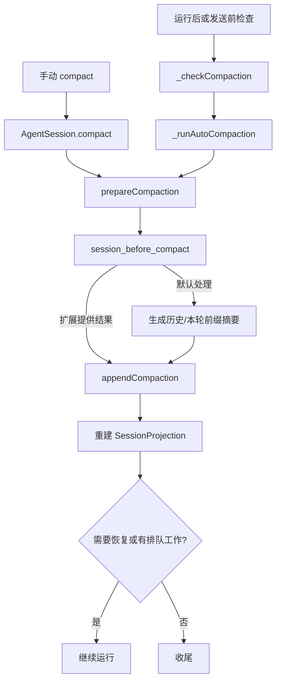
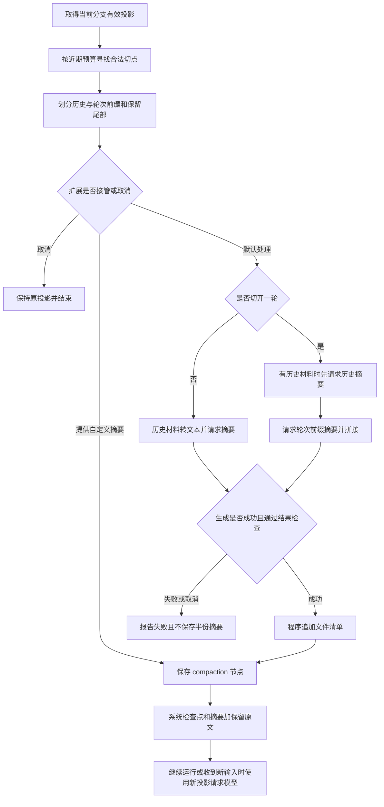
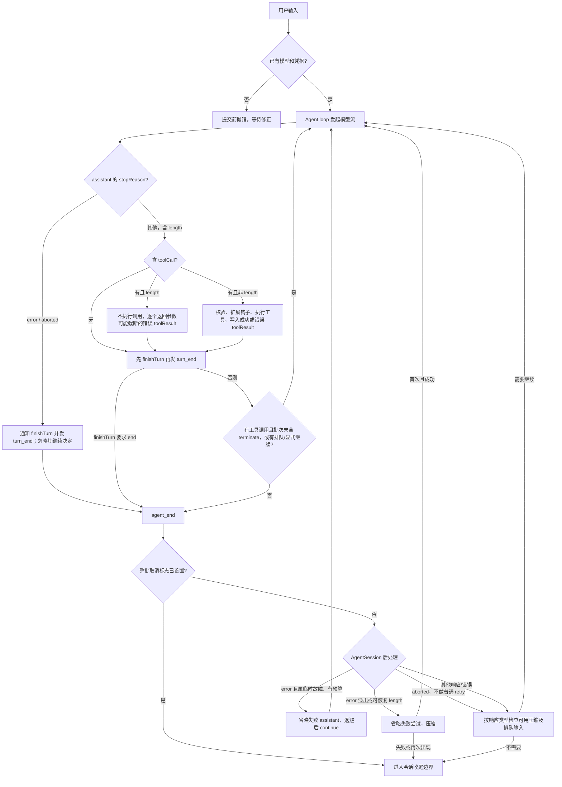

# 09 · 上下文压缩、重试与取消

[返回总目录](README.md) · [上一章](08-会话与上下文.md) · [下一章](10-提示词与扩展机制.md)

## 1. 压缩解决什么问题

模型一次请求可接收的上下文有限。长期工作会积累用户输入、工具结果和答复，不能永远将所有原文重复发送。

Pi 的做法是生成摘要，并保留近期的一段原文。原始历史继续存在；压缩改变以后构建模型上下文的方式。若想先看全过程，可直接从 [9.2 完整例子](#92-一个完整例子先明确压缩哪段会话) 读到 9.14，再回看触发条件。

主要实现：[compaction.ts](https://github.com/earendil-works/pi/blob/6fb2e7815167e6b19006fc526d1a5d0f5f998787/packages/coding-agent/src/core/compaction/compaction.ts)、[AgentSession](https://github.com/earendil-works/pi/blob/6fb2e7815167e6b19006fc526d1a5d0f5f998787/packages/coding-agent/src/core/agent-session.ts)、[SessionManager](https://github.com/earendil-works/pi/blob/6fb2e7815167e6b19006fc526d1a5d0f5f998787/packages/coding-agent/src/core/session-manager.ts)。这里讨论默认 CLI 体系，Durable 的恢复流程见 [第 13 章](13-Durable与远程体系.md)。

先把“压缩”定义准确：它不是删除 JSONL，也不是把旧文件改写成短文件，而是追加一个 `compaction` 会话节点，让之后的 `buildSessionProjection()` 用摘要代表较早前缀。原始记录仍可用于树导航、导出、费用统计和审计；Provider 下一次只看到新的有效投影。

整个过程可以先记成：

```text
当前分支 JSONL
  → buildSessionProjection
  → estimateProjectedContextTokens
  → 超过阈值或 Provider 溢出
  → prepareCompaction：选切点、分历史与近期尾部
  → convertToLlm + serializeConversation
  → 独立摘要模型请求
  → appendCompaction：写 summary/firstKeptEntryId/systemMessage
  → 重新 buildSessionProjection
  → 下一次 Agent 请求携带“摘要 + 保留尾部 + 新消息”
```

摘要模型请求本身不是普通工具回合：它不执行历史工具，也不把摘要结果直接当作最终用户回答。

## 2. 三个数不要混淆

| 名称 | 含义 | 当前内置默认 |
|---|---|---|
| contextWindow | 模型上下文容量 | 随模型/配置而变 |
| reserveTokens | 触发压缩前预留的空间 | 16384 |
| keepRecentTokens | 切分时尽量保留的近期内容预算 | 20000 |

默认值来自 [settings-defaults.ts](https://github.com/earendil-works/pi/blob/6fb2e7815167e6b19006fc526d1a5d0f5f998787/packages/coding-agent/src/core/settings-defaults.ts)。实际值还可能受用户设置与模型覆盖影响。

触发公式为 `contextTokens > contextWindow - reserveTokens`，是严格大于。若窗口是教学假设值 100000，预留 16384，则阈值为 83616。保留 20000 并不意味着最终上下文恰好 20000，因为还要加摘要、系统状态，而且切分要尊重消息边界。

## 3. token 如何估算

`calculateContextTokens()` 优先使用非零 totalTokens，否则由 input、output、cacheRead、cacheWrite 相加。

`estimateContextTokens()` 找到最近一条有效 assistant usage，将它作为当时上下文的基数，只估算之后新增消息。没有可靠 usage 时才估算整个消息列表。

例子：最近一次有效 usage 为 10000，之后新增工具结果估计 500，则当前估计为 10500。不是把每次请求的 usage 全部相加。

失败、取消或全零 usage 不能直接作为可靠基数。旧 usage 还可能因为后来的 context edit 或 compaction 而失效；`estimateProjectedContextTokens()` 会验证 usage 与最新修改的先后关系，不可靠时重新估算有效投影。

纯文本估算是一种近似，不是调用每家模型的精确 tokenizer。图片、工具 schema 和协议封装也让估算与实际计费存在差异。

## 4. 手动和自动从哪里进入



手动和自动共用底层算法，但返回值与后续动作不同。自动路径返回 true 往往表示“应继续运行”，不能简单解释为“压缩成功”。

## 5. 一次自动压缩的真实时间线

假设模型刚完成一次 `read` 工具回合，`AgentSession._handlePostAgentRun()` 处理 `agent_end`：

1. 先处理可重试的普通网络错误；这一步是 Provider/Agent 重试，不等于压缩。
2. 调用 `_checkCompaction(lastAssistant, true, toolResults)`。
3. 先确认压缩开关、assistant 是否来自当前模型、是否已经越过最新 compaction 边界。
4. 识别三类情况：上下文溢出、成功但输入已超过窗口、普通阈值越界。
5. 需要压缩时调用 `_runAutoCompaction(reason, willRetry)`。
6. 从当前 leaf 分支调用 `prepareCompaction()`，没有合法可压缩内容就结束自动路径。
7. 派发 `session_before_compact`。扩展可以取消，或返回自己的 summary/firstKeptEntryId/tokensBefore/details；否则走默认 `compact()`。
8. 默认路径生成摘要，检查摘要是否被 error 或 length 截断。
9. `sessionManager.appendCompaction()` 追加节点，刷新 Agent 的 canonical projection。
10. 派发 `session_compact`，发送 `compaction_end`。
11. overflow recovery 若 `willRetry=true`，外层收到 true 后调用 `agent.continue()`；普通 threshold 压缩通常只缩短后续请求，不重跑已完成回答。

手动 `/compact` 走 `AgentSession.compact()`：它先 abort 当前运行，压缩完成后不自动恢复被中断的旧回合。相同的 `prepareCompaction`、扩展钩子和底层摘要函数，被不同入口包装成不同的后续行为。[检查与自动压缩](https://github.com/earendil-works/pi/blob/6fb2e7815167e6b19006fc526d1a5d0f5f998787/packages/coding-agent/src/core/agent-session.ts)

## 6. 切分必须尊重工具调用

不能将保留部分从一个孤立 toolResult 开始，因为 Provider 可能要求先有对应 assistant 工具调用。

切分算法从新到旧累计消息大小，再选合法消息边界，不直接从 toolResult 开始保留。若预算线落在一个很大的工具结果内，算法会寻找该位置及其之后的合法边界，可能把整组调用与结果放进待摘要前缀；不能笼统理解为“一定向前扩展并保留大结果”。相邻不贡献上下文的元数据也可能一并保留。具体数值走读见本章 9.3 和 9.13。

源码同时存在 `findCutPoint()` 和针对投影的 `findProjectedCutPoint()`。当前 `prepareCompaction()` 先调用 `buildSessionProjection()`，再使用投影切点，确保摘要基于编辑后的有效上下文。

这是不能只读函数名列表的例子：公开的旧辅助函数仍存在，但当前主要路径需要看真正的调用者。

Skill 正文经 `read` 进入 `toolResult` 后，也遵守这个切点与保留范围；默认没有 Skill 全文固定保留或压缩后强制重读的特殊规则。大文件怎样分页、正文被摘要后怎样重新读取，以及文件路径记录能保留什么，见 [第 10 章：Skill 读取不完整](10-提示词与扩展机制.md#716-skill-太大read-没有读完怎么办) 和 [压缩后的 Skill 恢复](10-提示词与扩展机制.md#717-压缩之后-skill-规则丢失谁负责恢复)。

## 7. 跨越一轮中间时为什么生成两部分摘要

假设一轮过程是：用户提出任务 → read → 工具结果 → edit → 工具结果 → 后续请求。历史很长，切点可能落在这一轮中间。

`CompactionPreparation` 区分：

- `messagesToSummarize`：较早的历史。
- `turnPrefixMessages`：当前被切开这一轮的前半段。
- `previousSummary`：更早一次压缩形成的摘要。
- `firstKeptEntryId`：近期原文从哪里开始保留。
- `fileOps`：已读取和修改文件的记录。

如果切在一轮中间，默认实现分别总结历史和本轮前缀，再组合为一个摘要。这样模型在看到后半段工具结果时，仍能知道本轮最初要解决什么。

这些摘要请求的 usage 被合并统计；压缩本身也会消耗模型资源。

## 8. 摘要内容与失败判定

默认提示要求保留目标、约束、进展、关键决定、下一步和关键上下文，并保留精确路径、函数名与错误信息。完整模板和逐项解释见 9.6；从压缩前记录到下一次请求的完整例子见 9.2—9.14。

`getSummarizationFailure()` 和 `completeSummarization()` 检查摘要请求是否可用。被 length 截断的摘要不能作为完整检查点直接保存，否则会把半份任务状态当成已完成摘要。

摘要输入的序列化属于另一条转换路径，见 [compaction/utils.ts](https://github.com/earendil-works/pi/blob/6fb2e7815167e6b19006fc526d1a5d0f5f998787/packages/coding-agent/src/core/compaction/utils.ts)。摘要请求中的工具输出截断，不等于删除原会话中的工具内容。

### 8.1 摘要请求到底发送了什么

`generateSummaryWithUsage()` 的顺序是：

```text
messagesToSummarize: AgentMessage[]
  → convertToLlm()
  → serializeConversation()
  → <conversation>...</conversation>
  → <previous-summary>...</previous-summary>（若已有摘要）
  → 固定摘要规则
  → buildSummarizationContext()
  → completeSummarization()
  → 独立 Provider 请求
```

`serializeConversation()` 把角色写成纯文本标签，例如 `[User]`、`[Assistant tool calls]`、`[Tool result]`。它这样做是为了告诉摘要模型“这些是要阅读的记录”，避免模型把其中最后一句当成继续对话的用户问题。工具结果每条最多保留 2000 字符并添加截断标记；这只限制摘要请求输入，SessionManager 中的原文仍然完整。

摘要请求使用 `SUMMARIZATION_SYSTEM_PROMPT`，明确要求只输出结构化摘要、不继续对话、不回答记录里的问题。该系统文本没有单独写一句“禁止调用工具”；不提供业务工具声明，以及拒绝带 toolCall 的摘要，是请求构造和代码检查共同实施的限制。历史摘要的 `maxTokens` 取 `min(floor(0.8 * reserveTokens), model.maxTokens)`，但模型上限不大于零时按无此上限处理；轮次前缀使用 0.5 的系数。摘要也会消耗 Provider 用量，结果的 usage 保存到 compaction entry。

如果摘要响应 stopReason 是 `error` 或 `length`，`getSummarizationFailure()` 给出失败原因，由调用处抛错，不保存半份摘要。即使模型返回了看似完整的文字，只要它带 toolCall 也会失败，因为摘要阶段不允许执行工具。[摘要序列化](https://github.com/earendil-works/pi/blob/6fb2e7815167e6b19006fc526d1a5d0f5f998787/packages/coding-agent/src/core/compaction/utils.ts) · [摘要请求](https://github.com/earendil-works/pi/blob/6fb2e7815167e6b19006fc526d1a5d0f5f998787/packages/coding-agent/src/core/compaction/compaction.ts)

## 9. 压缩成功后保存什么

`appendCompaction()` 保存 summary、firstKeptEntryId、tokensBefore，以及可选 details、usage 和系统检查点。

包含 systemMessage 的压缩记录重建时形成：完整系统状态 → 摘要 → 保留的近期非系统消息 → 压缩后新消息。旧系统补丁被完整检查点吸收，避免重复或丢失声明。若当时没有可重放的系统消息，或恢复的是没有该字段的旧记录，则投影只从摘要开始，不会凭空生成一个检查点。

若使用保留零条旧消息的表示，firstKeptEntryId 可以指向压缩 entry 自身。不要把它误解成文件物理截断位置。

### 9.1 `CompactionEntry` 的字段如何使用

```json
{
  "type": "compaction",
  "summary": "旧历史的结构化摘要",
  "firstKeptEntryId": "e42",
  "tokensBefore": 91234,
  "usage": { "input": 3000, "output": 700, "cacheRead": 0, "cacheWrite": 0, "totalTokens": 3700 },
  "details": { "readFiles": ["a.ts"], "modifiedFiles": ["b.ts"] },
  "systemMessage": { "role": "system", "content": "...", "toolsAdded": [] }
}
```

字段值是教学示意：

- `summary` 是之后给模型看的摘要文本；它不是替换磁盘旧消息的原地修改。
- `firstKeptEntryId` 指向仍要从原分支保留的旧 entry。重建时摘要先出现，再从这个节点开始取尾部；若为压缩节点自身，表示不保留更早旧尾部。
- `tokensBefore` 记录触发前的上下文估算，方便 UI、调试和统计，不是未来每次请求的固定 token 数。
- `usage` 是生成摘要的额外模型调用用量，不应误加成当前上下文长度。
- `details` 当前默认包含读过和修改过的文件列表，帮助下一次摘要保留工作事实；扩展可以保存自己的 JSON 数据。
- `systemMessage` 是压缩边界的系统状态检查点，包含重放后的提示词段和工具声明。这样被摘要移走的旧 system patch 不必再依赖。

`appendCompaction()` 会把新节点挂在当前 leaf 下，并把 leaf 前移。随后 `_refreshFinalizedContext()` 重新加载投影，使 Agent 内存状态与磁盘树的有效视图一致。

### 9.2 一个完整例子：先明确压缩哪段会话

下面用“调查登录失败但不修改文件”的短会话贯穿整个过程。为了完整展示 JSON 而不用省略号，例子采用可供 SDK 配置的精简 system 和 read 工具声明，**不是默认 CLI 的完整系统提示词与内置 read schema**。模型名、ID、时间以及摘要文本均为教学值；没有调用真实 Provider，usage 为零表示本例未测量实际用量。这里按源码算法计算切点、摘要输入与投影转换，不把教学摘要冒充模型实测答案。

这个短会话远没达到默认自动阈值。假设使用手动压缩，并为了观察切点把 keepRecentTokens 设为 39；reserveTokens 仍是 16384。39 是本例的本地估算预算，不是 Pi 默认值，也不是实际 tokenizer 测量。以下完整数组是当前分支的 SessionEntry 记录，不含 JSONL 文件头与未设置的可选字段：

```json
[
  {
    "type": "message",
    "id": "00000001",
    "parentId": null,
    "timestamp": "2026-10-13T12:00:00.000Z",
    "message": {
      "role": "system",
      "content": "你是代码助手。遵守用户约束，基于工具结果回答。",
      "toolsAdded": [
        {
          "name": "read",
          "description": "读取指定文件的文本。",
          "parameters": {
            "type": "object",
            "properties": {
              "path": {
                "type": "string"
              }
            },
            "required": [
              "path"
            ]
          }
        }
      ],
      "timestamp": 1791892800000
    }
  },
  {
    "type": "message",
    "id": "00000002",
    "parentId": "00000001",
    "timestamp": "2026-10-13T12:00:01.000Z",
    "message": {
      "role": "user",
      "content": [
        {
          "type": "text",
          "text": "请调查登录失败的原因，只分析，不修改文件。"
        }
      ],
      "timestamp": 1791892801000
    }
  },
  {
    "type": "message",
    "id": "00000003",
    "parentId": "00000002",
    "timestamp": "2026-10-13T12:00:02.000Z",
    "message": {
      "role": "assistant",
      "content": [
        {
          "type": "text",
          "text": "先读取登录实现。"
        },
        {
          "type": "toolCall",
          "id": "call_read_1",
          "name": "read",
          "arguments": {
            "path": "src/login.ts"
          }
        }
      ],
      "api": "openai-completions",
      "provider": "example-provider",
      "model": "example-model",
      "usage": {
        "input": 0,
        "output": 0,
        "cacheRead": 0,
        "cacheWrite": 0,
        "totalTokens": 0,
        "cost": {
          "input": 0,
          "output": 0,
          "cacheRead": 0,
          "cacheWrite": 0,
          "total": 0
        }
      },
      "stopReason": "toolUse",
      "timestamp": 1791892802000
    }
  },
  {
    "type": "message",
    "id": "00000004",
    "parentId": "00000003",
    "timestamp": "2026-10-13T12:00:03.000Z",
    "message": {
      "role": "toolResult",
      "toolCallId": "call_read_1",
      "toolName": "read",
      "content": [
        {
          "type": "text",
          "text": "export function login(token: string) {\n  return token === \"valid\";\n}\n"
        }
      ],
      "isError": false,
      "timestamp": 1791892803000
    }
  },
  {
    "type": "message",
    "id": "00000005",
    "parentId": "00000004",
    "timestamp": "2026-10-13T12:00:04.000Z",
    "message": {
      "role": "assistant",
      "content": [
        {
          "type": "text",
          "text": "login 只接受字符串 valid。尚未检查调用方是否传入该值，不能确认根因。"
        }
      ],
      "api": "openai-completions",
      "provider": "example-provider",
      "model": "example-model",
      "usage": {
        "input": 0,
        "output": 0,
        "cacheRead": 0,
        "cacheWrite": 0,
        "totalTokens": 0,
        "cost": {
          "input": 0,
          "output": 0,
          "cacheRead": 0,
          "cacheWrite": 0,
          "total": 0
        }
      },
      "stopReason": "stop",
      "timestamp": 1791892804000
    }
  },
  {
    "type": "message",
    "id": "00000006",
    "parentId": "00000005",
    "timestamp": "2026-10-13T12:00:05.000Z",
    "message": {
      "role": "user",
      "content": [
        {
          "type": "text",
          "text": "继续检查调用方，仍然不要修改文件。"
        }
      ],
      "timestamp": 1791892805000
    }
  },
  {
    "type": "message",
    "id": "00000007",
    "parentId": "00000006",
    "timestamp": "2026-10-13T12:00:06.000Z",
    "message": {
      "role": "assistant",
      "content": [
        {
          "type": "toolCall",
          "id": "call_read_2",
          "name": "read",
          "arguments": {
            "path": "src/main.ts"
          }
        }
      ],
      "api": "openai-completions",
      "provider": "example-provider",
      "model": "example-model",
      "usage": {
        "input": 0,
        "output": 0,
        "cacheRead": 0,
        "cacheWrite": 0,
        "totalTokens": 0,
        "cost": {
          "input": 0,
          "output": 0,
          "cacheRead": 0,
          "cacheWrite": 0,
          "total": 0
        }
      },
      "stopReason": "toolUse",
      "timestamp": 1791892806000
    }
  },
  {
    "type": "message",
    "id": "00000008",
    "parentId": "00000007",
    "timestamp": "2026-10-13T12:00:07.000Z",
    "message": {
      "role": "toolResult",
      "toolCallId": "call_read_2",
      "toolName": "read",
      "content": [
        {
          "type": "text",
          "text": "const ok = login(\"expired\");\nconsole.log(ok);\n"
        }
      ],
      "isError": false,
      "timestamp": 1791892807000
    }
  },
  {
    "type": "message",
    "id": "00000009",
    "parentId": "00000008",
    "timestamp": "2026-10-13T12:00:08.000Z",
    "message": {
      "role": "assistant",
      "content": [
        {
          "type": "text",
          "text": "调用方传入 expired，与 login 接受的 valid 不一致。这条示例调用会返回 false；文件未修改。"
        }
      ],
      "api": "openai-completions",
      "provider": "example-provider",
      "model": "example-model",
      "usage": {
        "input": 0,
        "output": 0,
        "cacheRead": 0,
        "cacheWrite": 0,
        "totalTokens": 0,
        "cost": {
          "input": 0,
          "output": 0,
          "cacheRead": 0,
          "cacheWrite": 0,
          "total": 0
        }
      },
      "stopReason": "stop",
      "timestamp": 1791892808000
    }
  }
]
```

注意三个不同的对象：

- entry 的 id、parentId、timestamp 用于会话树及记录时间。
- entry.message 才是 AgentMessage。assistant 的 usage、api、provider、model 等是 Pi 消息数据，不等于全会原样传进 Provider 的正文。
- toolResult.toolCallId 对应 assistant 内容块里的调用 id，不是 entry id。压缩保留工具关联时不能把它们混用。

此时没有旧摘要和 context_edit，buildSessionProjection 的 messages 就是上面九个 entry.message 按顺序组成的数组。按角色看是 system → user → assistant(read) → toolResult → assistant → user → assistant(read) → toolResult → assistant；这是本例的压缩前有效上下文，压缩时不会重新执行其中的 read。

### 9.3 程序怎样选出待摘要部分和保留尾部

本例的切分设置完整如下：

```json
{
  "enabled": true,
  "reserveTokens": 16384,
  "keepRecentTokens": 39
}
```

estimateTokens 用字符串长度除以 4 并向上取整。以下是本例各消息的源码计算结果；系统声明的工具 schema 也计入系统消息的估算。

| entry ID | 角色 | 本地估算 token | 在本次压缩中的去向 |
|---|---|---:|---|
| 00000001 | system | 40 | 生成系统状态检查点 |
| 00000002 | user | 6 | 作为历史送去摘要 |
| 00000003 | assistant | 9 | 作为历史送去摘要 |
| 00000004 | toolResult | 18 | 作为历史送去摘要 |
| 00000005 | assistant | 10 | 作为历史送去摘要 |
| 00000006 | user | 5 | 保持原文 |
| 00000007 | assistant | 7 | 保持原文 |
| 00000008 | toolResult | 12 | 保持原文 |
| 00000009 | assistant | 15 | 保持原文 |

findProjectedCutPoint 从最后一条往前累计：15 → 27 → 34 → 39。加到 00000006 的 user 时满足 accumulatedTokens >= keepRecentTokens，该位置本身是合法切点，也是一轮的起点，因此：

```json
{
  "firstKeptEntryId": "00000006",
  "isSplitTurn": false,
  "tokensBefore": 122,
  "historyEntryIds": [
    "00000002",
    "00000003",
    "00000004",
    "00000005"
  ],
  "turnPrefixEntryIds": [],
  "retainedEntryIds": [
    "00000006",
    "00000007",
    "00000008",
    "00000009"
  ]
}
```

这个对象用于标明各区间，其中 historyEntryIds 等是讲解用的索引，不是 CompactionPreparation 的原生字段。真正 preparation 的 messagesToSummarize 是 00000002—00000005 的四条 message；turnPrefixMessages 是空数组，previousSummary 为 undefined，所以序列化 JSON 时没有该字段。

系统消息不送进历史摘要，而由保存阶段重放成 systemMessage 检查点。tokensBefore = 122 是压缩前当前有效上下文的本地估算，包含 system；39 只是所选尾部的估算，不包含即将生成的摘要。

切点算法选择的是“累计位置或它之后的第一个合法切点”。它不会把预算当作精确字数截断器；合法边界选择、无消息贡献的相邻元数据和恢复省略记录都可能调整结果。因此 keepRecentTokens 是选尾部的参数，不保证最终上下文等于该数字。本例只有普通消息，没有那些额外调整。[切点与准备](https://github.com/earendil-works/pi/blob/6fb2e7815167e6b19006fc526d1a5d0f5f998787/packages/coding-agent/src/core/compaction/compaction.ts)

### 9.4 待摘要的 AgentMessage 怎样变成一段文本

第一步先调用 convertToLlm(messagesToSummarize)。本例四条本来就是 user、assistant、toolResult，所以内容不变；如果有 bashExecution、custom 等类型，则按第 08 章的规则转换或过滤。

第二步 serializeConversation 把这些消息变成以下**完整的摘要材料文本**：

```text
[User]: 请调查登录失败的原因，只分析，不修改文件。

[Assistant]: 先读取登录实现。

[Assistant tool calls]: read(path="src/login.ts")

[Tool result]: export function login(token: string) {
  return token === "valid";
}


[Assistant]: login 只接受字符串 valid。尚未检查调用方是否传入该值，不能确认根因。
```

这里发生了明显变化：

| 原消息内容 | 摘要材料里的处理 |
|---|---|
| user 正文 | 写成 [User] 标签后的文字；多个 text 块按该分支规则连接 |
| assistant 正文 | 写成 [Assistant] 文字 |
| assistant thinking | 若有明文 thinking 块，写成 [Assistant thinking]；不携带其协议签名 |
| assistant toolCall | 写成工具名与逐个 JSON 序列化的参数；不携带调用 id |
| toolResult | 提取 text 内容，写成 [Tool result]；不保留完整协议对象 |
| 图片内容 | 不传图片字节给这次纯文本摘要；仅有图片而无文字的内容可能不形成文本行 |
| usage、provider、时间戳、entry id | 不作为这段会话文本的正文 |
| system 提示与工具声明 | 不属于 messagesToSummarize，另由系统检查点保留 |

工具结果先提取 text，再截到 2000 个 JavaScript 字符串单位以内，之后追加截断提示；这不是 2000 tokens，也不是 2000 字节。对于超出 BMP 的字符，字符串 length 按 UTF-16 代码单元计数。截断提示自身会让最终文本超过 2000。原始 toolResult 不因此被修改，但摘要模型看不到被截去的部分。

因此摘要模型看到的是“用于理解工作的文字记录”，不是可以直接再次执行的工具调用协议。它并不会把历史 read 重新调用一遍。[序列化原文](https://github.com/earendil-works/pi/blob/6fb2e7815167e6b19006fc526d1a5d0f5f998787/packages/coding-agent/src/core/compaction/utils.ts) · [消息转换](https://github.com/earendil-works/pi/blob/6fb2e7815167e6b19006fc526d1a5d0f5f998787/packages/coding-agent/src/core/messages.ts)

### 9.5 摘要请求的完整上下文与参数

generateSummaryWithUsage 将材料放入 conversation 标签，再追加模板；首次摘要没有 previous-summary 标签。本例 customInstructions 为“保留用户禁止修改文件的要求。”，会加在模板末尾的 Additional focus 后面。

buildSummarizationContext 再调用 normalizeContext，形成下面完整的 TranscriptContext：

```json
{
  "messages": [
    {
      "role": "system",
      "content": "You are a context summarization assistant. Your task is to read a conversation between a user and an AI assistant, then produce a structured summary following the exact format specified.\n\nDo NOT continue the conversation. Do NOT respond to any questions in the conversation. ONLY output the structured summary.",
      "timestamp": 0
    },
    {
      "role": "user",
      "content": [
        {
          "type": "text",
          "text": "<conversation>\n[User]: 请调查登录失败的原因，只分析，不修改文件。\n\n[Assistant]: 先读取登录实现。\n\n[Assistant tool calls]: read(path=\"src/login.ts\")\n\n[Tool result]: export function login(token: string) {\n  return token === \"valid\";\n}\n\n\n[Assistant]: login 只接受字符串 valid。尚未检查调用方是否传入该值，不能确认根因。\n</conversation>\n\nThe messages above are a conversation to summarize. Create a structured context checkpoint summary that another LLM will use to continue the work.\n\nUse this EXACT format:\n\n## Goal\n[What is the user trying to accomplish? Can be multiple items if the session covers different tasks.]\n\n## Constraints & Preferences\n- [Any constraints, preferences, or requirements mentioned by user]\n- [Or \"(none)\" if none were mentioned]\n\n## Progress\n### Done\n- [x] [Completed tasks/changes]\n\n### In Progress\n- [ ] [Current work]\n\n### Blocked\n- [Issues preventing progress, if any]\n\n## Key Decisions\n- **[Decision]**: [Brief rationale]\n\n## Next Steps\n1. [Ordered list of what should happen next]\n\n## Critical Context\n- [Any data, examples, or references needed to continue]\n- [Or \"(none)\" if not applicable]\n\nKeep each section concise. Preserve exact file paths, function names, and error messages.\n\nAdditional focus: 保留用户禁止修改文件的要求。"
        }
      ],
      "timestamp": 1791892820000
    }
  ]
}
```

这个 JSON 是 Pi 交给模型调用层的规范化上下文，不是某个 Provider 的 HTTP 请求体。适配器会进一步转换角色、字段和参数；各家协议差异见第 08 章。此处只有摘要专用 system 与一个装着历史记录的 user，**没有原会话那组业务 tools 声明，也没有原会话的完整 system**。

本例模型 maxTokens 为 16384，历史摘要输出上限计算为 min(floor(0.8 × 16384), 16384) = 13107。传到摘要调用边界、能够序列化的选项如下；未设置的 apiKey、headers、env、signal、reasoning 不会成为 JSON 字段：

```json
{
  "maxTokens": 13107,
  "sessionId": "doc-session",
  "cacheRetention": "none"
}
```

sessionId 是请求路由用的值，不是历史聊天复制开关；这里固定为教学值 doc-session。普通 AgentSession 的默认压缩调用目前不传 sessionId，completeSummarization 因而生成新的路由 ID；其他调用者可以传入。cacheRetention: none 是源码对摘要请求提出的缓存保留选项，实际缓存行为还由适配器与 Provider 决定。

这是独立的摘要调用，走 streamFn 或 completeSimple 以及摘要重试逻辑，不经过普通 agent loop 去继续原业务任务。实际模型与认证由会话的摘要请求路由解析，不应仅凭提示词就假定换成某个固定的小模型。[摘要构造](https://github.com/earendil-works/pi/blob/6fb2e7815167e6b19006fc526d1a5d0f5f998787/packages/coding-agent/src/core/compaction/compaction.ts) · [会话摘要路由](https://github.com/earendil-works/pi/blob/6fb2e7815167e6b19006fc526d1a5d0f5f998787/packages/coding-agent/src/core/agent-session.ts)

### 9.6 压缩 prompt template 的完整内容与设计

下面四段都是当前源码的模板文本。对“为什么这样安排”的解释依据模板写明的目标和实际数据流，不代表额外的隐藏规则。

**A. 所有这些摘要请求使用的系统提示词**

```text
You are a context summarization assistant. Your task is to read a conversation between a user and an AI assistant, then produce a structured summary following the exact format specified.

Do NOT continue the conversation. Do NOT respond to any questions in the conversation. ONLY output the structured summary.
```

它把模型角色限定为“读取记录并输出结构化摘要”，并明确不继续原对话、不回答其中的问题。conversation 标签与纯文本序列化配合这个要求，目的是让旧对话成为待处理材料，而不是让模型看到最后一句就接着答题。标签和文字约束本身不是程序级安全隔离。

**B. 首次生成历史摘要的模板**

```text
The messages above are a conversation to summarize. Create a structured context checkpoint summary that another LLM will use to continue the work.

Use this EXACT format:

## Goal
[What is the user trying to accomplish? Can be multiple items if the session covers different tasks.]

## Constraints & Preferences
- [Any constraints, preferences, or requirements mentioned by user]
- [Or "(none)" if none were mentioned]

## Progress
### Done
- [x] [Completed tasks/changes]

### In Progress
- [ ] [Current work]

### Blocked
- [Issues preventing progress, if any]

## Key Decisions
- **[Decision]**: [Brief rationale]

## Next Steps
1. [Ordered list of what should happen next]

## Critical Context
- [Any data, examples, or references needed to continue]
- [Or "(none)" if not applicable]

Keep each section concise. Preserve exact file paths, function names, and error messages.
```

这些字段承担不同的续接责任：

| 模板部分 | 要保留什么 | 对后续工作的意义 |
|---|---|---|
| Goal | 用户最终要完成的任务 | 避免只记住最近工具操作而忘记目的 |
| Constraints & Preferences | 用户限制和偏好 | 防止“只分析、不改文件”这类要求丢失 |
| Progress / Done | 已完成事项 | 减少重复调查或把完成结果当作待办 |
| Progress / In Progress | 当前未完成工作 | 给接续模型明确的进行中状态 |
| Progress / Blocked | 阻碍执行的问题 | 防止把受阻工作当成已完成 |
| Key Decisions | 决策及简短依据 | 保留为什么走当前方案 |
| Next Steps | 有顺序的后续动作 | 帮助恢复操作顺序 |
| Critical Context | 必要数据、示例、引用 | 保存支撑继续工作的具体事实 |

模板要求简洁，并精确保留路径、函数名和错误信息。它没有规定“每个字段必须多少 tokens”“保留百分之几的原文”，也不是逐条消息等比例缩短。模型会根据语义选择、合并和改写事实，因此是有损摘要。

**C. 已经有旧摘要时的更新模板**

```text
The messages above are NEW conversation messages to incorporate into the existing summary provided in <previous-summary> tags.

Update the existing structured summary with new information. RULES:
- PRESERVE all existing information from the previous summary
- ADD new progress, decisions, and context from the new messages
- UPDATE the Progress section: move items from "In Progress" to "Done" when completed
- UPDATE "Next Steps" based on what was accomplished
- PRESERVE exact file paths, function names, and error messages
- If something is no longer relevant, you may remove it

Use this EXACT format:

## Goal
[Preserve existing goals, add new ones if the task expanded]

## Constraints & Preferences
- [Preserve existing, add new ones discovered]

## Progress
### Done
- [x] [Include previously done items AND newly completed items]

### In Progress
- [ ] [Current work - update based on progress]

### Blocked
- [Current blockers - remove if resolved]

## Key Decisions
- **[Decision]**: [Brief rationale] (preserve all previous, add new)

## Next Steps
1. [Update based on current state]

## Critical Context
- [Preserve important context, add new if needed]

Keep each section concise. Preserve exact file paths, function names, and error messages.
```

实际输入先放本次新纳入摘要的 conversation，再放 previous-summary，然后追加这段更新模板。所谓“新消息”是相对于上次已经概括的历史而言，可以包括上次保留的原文尾部，并不只指刚收到的一句话。

规则同时要求保留已有信息、追加新进展、把完成项从 In Progress 移到 Done、更新 Next Steps，也允许删除已经不相关的信息。因此它不是机械拼接，也不是永远保留所有旧文字；“哪些已经不相关”主要由模型判断。旧摘要丢失的事实不会因为重复总结而自动从磁盘原文找回来。

**D. 切在一轮中间时的轮次前缀模板**

```text
The messages above are earlier context from an ongoing conversation. Later messages are stored separately and do not need to be reconstructed.

Create a concise checkpoint of the user's request and the progress shown above. This checkpoint will be placed before the later messages so the conversation can continue with the necessary context.

## Original Request
[What did the user ask for?]

## Progress So Far
- [Key decisions and work completed in these messages]

## Context Needed to Continue
- [Information from these messages needed to understand the later work]

Only summarize information explicitly present above. Do not infer or recreate later messages.
```

这份模板更短，只回答“用户最初要什么、这部分已经做到哪里、理解后半段需要什么”。它明确说明后半段单独保存，并禁止推测或重建那些后续消息。

历史摘要与轮次前缀不是共用一段材料：前者概括更早历史，后者只概括被切开轮次的前半段。轮次前缀的输入格式也不同，使用 # Conversation 和 # Instructions 标题，而非 previous-summary 组合格式。

customInstructions 只在 generateSummaryWithUsage 中追加为 Additional focus，适用于首次或更新的历史摘要。当前 generateTurnPrefixSummary 没有接收这个参数，因此不会自动把相同额外要求追加到轮次前缀模板。若用户约束本来就在前缀对话里，模型仍能从那段材料读到。[四份模板与调用者](https://github.com/earendil-works/pi/blob/6fb2e7815167e6b19006fc526d1a5d0f5f998787/packages/coding-agent/src/core/compaction/compaction.ts) · [系统模板](https://github.com/earendil-works/pi/blob/6fb2e7815167e6b19006fc526d1a5d0f5f998787/packages/coding-agent/src/core/compaction/utils.ts)

### 9.7 摘要模型产出什么，程序又追加什么

本例假定模型返回下面这份完整摘要。它是符合材料的教学输出，不是确定性算法可以保证逐字生成的结果：

```markdown
## Goal
调查登录失败原因。

## Constraints & Preferences
- 只分析，不修改文件。

## Progress
### Done
- [x] 已读取 src/login.ts，login 仅在 token === "valid" 时返回 true。
### In Progress
- [ ] 尚需检查调用方传入值。
### Blocked
- 无。

## Key Decisions
- **暂不认定根因**：尚未读取调用方。

## Next Steps
1. 检查调用方传入 login 的参数。

## Critical Context
- 函数签名：login(token: string)。
```

其中“尚需检查调用方”并不与完整历史矛盾：摘要请求只看到了 00000002—00000005；检查调用方的后续消息在保留尾部。后续模型必须把摘要和尾部一起看，不能把摘要视为涵盖最后一条消息的全会话现状。

compact 随后依据工具调用参数收集文件路径，并在模型文字末尾追加：

```xml
<read-files>
src/login.ts
</read-files>
```

这是程序生成的清单，不要求模型自行列出。readFiles 只列“读过且未被归到修改类”的路径；write/edit 归入 modifiedFiles，路径按字符串去重排序。清单不会自动读取文件、展开正文、确认工具实际成功，或记录分页是否读完。src/main.ts 在保留尾部，所以本次待摘要部分提取出的文件清单只有 src/login.ts。

如果存在上一次默认摘要，extractFileOperations 还会合并旧 compaction.details 的文件列表；fromHook 摘要详情不按默认结构盲目读取。完整 summary 是模型文字加上这些程序生成的清单。[路径提取与格式化](https://github.com/earendil-works/pi/blob/6fb2e7815167e6b19006fc526d1a5d0f5f998787/packages/coding-agent/src/core/compaction/utils.ts) · [合并旧文件信息](https://github.com/earendil-works/pi/blob/6fb2e7815167e6b19006fc526d1a5d0f5f998787/packages/coding-agent/src/core/compaction/compaction.ts)

### 9.8 生成成功与内容正确是两种检查

默认路径会等待摘要请求及其可重试失败处理结束，再检查：

- error：报告生成失败。
- aborted：摘要重试辅助逻辑结束请求；会话取消路径不会把未完成工作保存为成功压缩。
- length：认为触及输出上限，拒绝把不完整摘要当作检查点。
- 响应包含 toolCall：抛错；摘要流程不执行这些工具。
- 成功文本：提取 text 块；生成过程中的 thinking 不拼成最终 summary。

这里没有逐节解析 Markdown 的结构校验，没有检查每个 Goal、Constraint 是否仍在，也没有对每个事实与原文作自动等价验证。Use this EXACT format 是给模型的要求，不是 JSON schema 级别的格式保证。正常停止但漏掉用户要求、写错事实、缺少某个标题的文本，不会仅因这些语义缺陷被当前函数自动拒绝。

历史摘要预算系数为 0.8，轮次前缀为 0.5；两次请求各有自己的 maxTokens。按默认 reserveTokens 且模型上限足够大，分别为 13107 和 8192，不意味着拼接结果总长保证小于 16384，也不意味着每次必须写满预算。失败重试和取消详见本章第 13、15 节。[生成检查](https://github.com/earendil-works/pi/blob/6fb2e7815167e6b19006fc526d1a5d0f5f998787/packages/coding-agent/src/core/compaction/compaction.ts)

### 9.9 成功后追加的 compaction entry 完整长什么样

appendCompaction 取得当前有效 system 状态，更新时间戳，并将新的节点挂到原 leaf 00000009 后。它不会将摘要再作为普通 assistant 回答追加一次。本例新增的完整节点为：

```json
{
  "type": "compaction",
  "id": "cccccccc",
  "parentId": "00000009",
  "timestamp": "2026-10-13T12:00:20.000Z",
  "summary": "## Goal\n调查登录失败原因。\n\n## Constraints & Preferences\n- 只分析，不修改文件。\n\n## Progress\n### Done\n- [x] 已读取 src/login.ts，login 仅在 token === \"valid\" 时返回 true。\n### In Progress\n- [ ] 尚需检查调用方传入值。\n### Blocked\n- 无。\n\n## Key Decisions\n- **暂不认定根因**：尚未读取调用方。\n\n## Next Steps\n1. 检查调用方传入 login 的参数。\n\n## Critical Context\n- 函数签名：login(token: string)。\n\n<read-files>\nsrc/login.ts\n</read-files>",
  "firstKeptEntryId": "00000006",
  "tokensBefore": 122,
  "details": {
    "readFiles": [
      "src/login.ts"
    ],
    "modifiedFiles": []
  },
  "usage": {
    "input": 0,
    "output": 0,
    "cacheRead": 0,
    "cacheWrite": 0,
    "totalTokens": 0,
    "cost": {
      "input": 0,
      "output": 0,
      "cacheRead": 0,
      "cacheWrite": 0,
      "total": 0
    }
  },
  "systemMessage": {
    "role": "system",
    "content": "你是代码助手。遵守用户约束，基于工具结果回答。",
    "toolsAdded": [
      {
        "name": "read",
        "description": "读取指定文件的文本。",
        "parameters": {
          "type": "object",
          "properties": {
            "path": {
              "type": "string"
            }
          },
          "required": [
            "path"
          ]
        }
      }
    ],
    "timestamp": 1791892820000
  }
}
```

usage 全零仍表示教学输入没有真实计量，不意味着压缩免费。真实请求的 usage 会存入同一个字段。fromHook 为 undefined 时 JSON 中省略；没有设置的字段并不是被隐藏展示。

记录顺序现在是 00000001 → … → 00000009 → cccccccc。这个箭头是树路径概览，完整的九条旧记录已经列在 9.2；旧节点的内容、id 和 parentId 没有被重写。新节点的 firstKeptEntryId 指向更早的 00000006，而 parentId 指向追加时的原 leaf 00000009，两者承担不同职责。

这里 systemMessage 的 timestamp 更新为压缩时间；content 和 toolsAdded 来自系统状态重放，不由摘要模型重新编写。若原历史包含多个 system patch，会重放并保存其有效结果，而不是依赖摘要模型复述工具 schema。[appendCompaction](https://github.com/earendil-works/pi/blob/6fb2e7815167e6b19006fc526d1a5d0f5f998787/packages/coding-agent/src/core/session-manager.ts)

### 9.10 压缩后上下文：摘要排在保留尾部前面

buildContextEntries 不直接返回磁盘最后几行，而是构造当前有效序列：

```json
[
  "cccccccc",
  "00000006",
  "00000007",
  "00000008",
  "00000009"
]
```

cccccccc 自己贡献两条消息：systemMessage 检查点和 compactionSummary。之后四个旧 entry 各贡献原来的 message。因此 buildSessionProjection().messages 的完整结果是：

```json
[
  {
    "role": "system",
    "content": "你是代码助手。遵守用户约束，基于工具结果回答。",
    "toolsAdded": [
      {
        "name": "read",
        "description": "读取指定文件的文本。",
        "parameters": {
          "type": "object",
          "properties": {
            "path": {
              "type": "string"
            }
          },
          "required": [
            "path"
          ]
        }
      }
    ],
    "timestamp": 1791892820000
  },
  {
    "role": "compactionSummary",
    "summary": "## Goal\n调查登录失败原因。\n\n## Constraints & Preferences\n- 只分析，不修改文件。\n\n## Progress\n### Done\n- [x] 已读取 src/login.ts，login 仅在 token === \"valid\" 时返回 true。\n### In Progress\n- [ ] 尚需检查调用方传入值。\n### Blocked\n- 无。\n\n## Key Decisions\n- **暂不认定根因**：尚未读取调用方。\n\n## Next Steps\n1. 检查调用方传入 login 的参数。\n\n## Critical Context\n- 函数签名：login(token: string)。\n\n<read-files>\nsrc/login.ts\n</read-files>",
    "tokensBefore": 122,
    "timestamp": 1791892820000
  },
  {
    "role": "user",
    "content": [
      {
        "type": "text",
        "text": "继续检查调用方，仍然不要修改文件。"
      }
    ],
    "timestamp": 1791892805000
  },
  {
    "role": "assistant",
    "content": [
      {
        "type": "toolCall",
        "id": "call_read_2",
        "name": "read",
        "arguments": {
          "path": "src/main.ts"
        }
      }
    ],
    "api": "openai-completions",
    "provider": "example-provider",
    "model": "example-model",
    "usage": {
      "input": 0,
      "output": 0,
      "cacheRead": 0,
      "cacheWrite": 0,
      "totalTokens": 0,
      "cost": {
        "input": 0,
        "output": 0,
        "cacheRead": 0,
        "cacheWrite": 0,
        "total": 0
      }
    },
    "stopReason": "toolUse",
    "timestamp": 1791892806000
  },
  {
    "role": "toolResult",
    "toolCallId": "call_read_2",
    "toolName": "read",
    "content": [
      {
        "type": "text",
        "text": "const ok = login(\"expired\");\nconsole.log(ok);\n"
      }
    ],
    "isError": false,
    "timestamp": 1791892807000
  },
  {
    "role": "assistant",
    "content": [
      {
        "type": "text",
        "text": "调用方传入 expired，与 login 接受的 valid 不一致。这条示例调用会返回 false；文件未修改。"
      }
    ],
    "api": "openai-completions",
    "provider": "example-provider",
    "model": "example-model",
    "usage": {
      "input": 0,
      "output": 0,
      "cacheRead": 0,
      "cacheWrite": 0,
      "totalTokens": 0,
      "cost": {
        "input": 0,
        "output": 0,
        "cacheRead": 0,
        "cacheWrite": 0,
        "total": 0
      }
    },
    "stopReason": "stop",
    "timestamp": 1791892808000
  }
]
```

此时系统状态、摘要和保留原文各有不同来源：

- system 是程序重放保存的系统状态，业务工具声明仍然存在。
- compactionSummary.summary 是摘要正文，不是普通 assistant 的最终答案；tokensBefore 只是历史统计。
- 保留尾部的 user、assistant、toolResult 没有被摘要改写，工具调用关联也仍在。
- 更早原文不在当前模型投影中，但仍留在原始会话树里。

### 9.11 下一次模型请求前，compactionSummary 怎样转换

假设压缩完成后用户再问“根据以上发现，给出修复建议，仍不要修改文件。”。convertToLlm 把 compactionSummary 转成一条 user 消息，并用固定说明及 summary 标签包住正文。下面是下一次请求在 Provider 适配器前的完整规范化消息上下文：

```json
{
  "messages": [
    {
      "role": "system",
      "content": "你是代码助手。遵守用户约束，基于工具结果回答。",
      "toolsAdded": [
        {
          "name": "read",
          "description": "读取指定文件的文本。",
          "parameters": {
            "type": "object",
            "properties": {
              "path": {
                "type": "string"
              }
            },
            "required": [
              "path"
            ]
          }
        }
      ],
      "timestamp": 1791892820000
    },
    {
      "role": "user",
      "content": [
        {
          "type": "text",
          "text": "The conversation history before this point was compacted into the following summary:\n\n<summary>\n## Goal\n调查登录失败原因。\n\n## Constraints & Preferences\n- 只分析，不修改文件。\n\n## Progress\n### Done\n- [x] 已读取 src/login.ts，login 仅在 token === \"valid\" 时返回 true。\n### In Progress\n- [ ] 尚需检查调用方传入值。\n### Blocked\n- 无。\n\n## Key Decisions\n- **暂不认定根因**：尚未读取调用方。\n\n## Next Steps\n1. 检查调用方传入 login 的参数。\n\n## Critical Context\n- 函数签名：login(token: string)。\n\n<read-files>\nsrc/login.ts\n</read-files>\n</summary>"
        }
      ],
      "timestamp": 1791892820000
    },
    {
      "role": "user",
      "content": [
        {
          "type": "text",
          "text": "继续检查调用方，仍然不要修改文件。"
        }
      ],
      "timestamp": 1791892805000
    },
    {
      "role": "assistant",
      "content": [
        {
          "type": "toolCall",
          "id": "call_read_2",
          "name": "read",
          "arguments": {
            "path": "src/main.ts"
          }
        }
      ],
      "api": "openai-completions",
      "provider": "example-provider",
      "model": "example-model",
      "usage": {
        "input": 0,
        "output": 0,
        "cacheRead": 0,
        "cacheWrite": 0,
        "totalTokens": 0,
        "cost": {
          "input": 0,
          "output": 0,
          "cacheRead": 0,
          "cacheWrite": 0,
          "total": 0
        }
      },
      "stopReason": "toolUse",
      "timestamp": 1791892806000
    },
    {
      "role": "toolResult",
      "toolCallId": "call_read_2",
      "toolName": "read",
      "content": [
        {
          "type": "text",
          "text": "const ok = login(\"expired\");\nconsole.log(ok);\n"
        }
      ],
      "isError": false,
      "timestamp": 1791892807000
    },
    {
      "role": "assistant",
      "content": [
        {
          "type": "text",
          "text": "调用方传入 expired，与 login 接受的 valid 不一致。这条示例调用会返回 false；文件未修改。"
        }
      ],
      "api": "openai-completions",
      "provider": "example-provider",
      "model": "example-model",
      "usage": {
        "input": 0,
        "output": 0,
        "cacheRead": 0,
        "cacheWrite": 0,
        "totalTokens": 0,
        "cost": {
          "input": 0,
          "output": 0,
          "cacheRead": 0,
          "cacheWrite": 0,
          "total": 0
        }
      },
      "stopReason": "stop",
      "timestamp": 1791892808000
    },
    {
      "role": "user",
      "content": [
        {
          "type": "text",
          "text": "根据以上发现，给出修复建议，仍不要修改文件。"
        }
      ],
      "timestamp": 1791892821000
    }
  ]
}
```

这里的第一个 user 由 Pi 根据摘要生成，不是用户刚输入的新消息；最后一个 user 才是新的请求。把摘要转换成 user 角色不会让旧 read 工具重跑，也不表示物理日志中重新写入了全部保留尾部。

这份 JSON 仍属于 Pi Message/TranscriptContext：assistant 的 usage、api、provider 和 timestamp 等不是直接提交给所有 Provider 的字段，system.toolsAdded 也需经过工具声明转换。Provider HTTP 体在后续适配阶段形成；阅读时不能把这份 JSON 误当作已经完成所有协议变换的 HTTP 体。[摘要转 user](https://github.com/earendil-works/pi/blob/6fb2e7815167e6b19006fc526d1a5d0f5f998787/packages/coding-agent/src/core/messages.ts) · [完整 Provider 转换过程](08-会话与上下文.md)

短例子为了展示结构，结构化摘要甚至可能比原历史更长。压缩没有“输出一定短于输入”的硬性校验；它的实际收益来自把真实长历史概括成相对短的文字，并保留所需原文尾部。不能用本例 122 tokens 推导真实会话的压缩比，也不能把 usage 全零当作测量结果。

### 9.12 第二次压缩：旧摘要不会自动展开成原始历史

之后又积累了新对话时，prepareCompaction 先读取最新有效投影，取出 previousSummary，并从它之后选择本次待摘要消息。旧摘要代表的原文不会被默认重新加载进摘要请求。

以刚才保留的第二轮成为下一次待摘要材料为例，完整更新请求的 user 文本如下；系统提示词仍是 9.6 的 A，历史摘要输出预算计算也不变：

```text
<conversation>
[User]: 继续检查调用方，仍然不要修改文件。

[Assistant tool calls]: read(path="src/main.ts")

[Tool result]: const ok = login("expired");
console.log(ok);


[Assistant]: 调用方传入 expired，与 login 接受的 valid 不一致。这条示例调用会返回 false；文件未修改。
</conversation>

<previous-summary>
## Goal
调查登录失败原因。

## Constraints & Preferences
- 只分析，不修改文件。

## Progress
### Done
- [x] 已读取 src/login.ts，login 仅在 token === "valid" 时返回 true。
### In Progress
- [ ] 尚需检查调用方传入值。
### Blocked
- 无。

## Key Decisions
- **暂不认定根因**：尚未读取调用方。

## Next Steps
1. 检查调用方传入 login 的参数。

## Critical Context
- 函数签名：login(token: string)。

<read-files>
src/login.ts
</read-files>
</previous-summary>

The messages above are NEW conversation messages to incorporate into the existing summary provided in <previous-summary> tags.

Update the existing structured summary with new information. RULES:
- PRESERVE all existing information from the previous summary
- ADD new progress, decisions, and context from the new messages
- UPDATE the Progress section: move items from "In Progress" to "Done" when completed
- UPDATE "Next Steps" based on what was accomplished
- PRESERVE exact file paths, function names, and error messages
- If something is no longer relevant, you may remove it

Use this EXACT format:

## Goal
[Preserve existing goals, add new ones if the task expanded]

## Constraints & Preferences
- [Preserve existing, add new ones discovered]

## Progress
### Done
- [x] [Include previously done items AND newly completed items]

### In Progress
- [ ] [Current work - update based on progress]

### Blocked
- [Current blockers - remove if resolved]

## Key Decisions
- **[Decision]**: [Brief rationale] (preserve all previous, add new)

## Next Steps
1. [Update based on current state]

## Critical Context
- [Preserve important context, add new if needed]

Keep each section concise. Preserve exact file paths, function names, and error messages.

Additional focus: 保留用户禁止修改文件的要求。
```

这表示“旧摘要 + 本次材料 → 一份更新摘要”，不是“新摘要和旧摘要永远逐份叠加”。更新成功后，新的 compaction 会成为当前有效检查点。保留范围里即使出现旧 compaction entry，投影也只让最新检查点贡献摘要，避免旧摘要重复注入。

多次压缩可能反复概括已概括的事实。程序保留路径清单和原始日志，并不保证每个语义细节仍在模型当前上下文里；需要精确内容时，模型通常要重新读取文件或通过额外能力查阅历史。[prepareCompaction](https://github.com/earendil-works/pi/blob/6fb2e7815167e6b19006fc526d1a5d0f5f998787/packages/coding-agent/src/core/compaction/compaction.ts) · [只投影最新摘要](https://github.com/earendil-works/pi/blob/6fb2e7815167e6b19006fc526d1a5d0f5f998787/packages/coding-agent/src/core/session-manager.ts)

### 9.13 改一个切分预算，为什么就需要两次摘要

仍使用 9.2 的同一组完整记录，仅把 keepRecentTokens 从 39 改为 34。累计到最后一轮 assistant 工具调用时，15 + 12 + 7 = 34，所以保留从 00000007 开始。这个 entry 是 assistant 而非本轮 user，于是算法向前定位轮次起点 00000006：

```json
{
  "firstKeptEntryId": "00000007",
  "isSplitTurn": true,
  "historyEntryIds": [
    "00000002",
    "00000003",
    "00000004",
    "00000005"
  ],
  "turnPrefixEntryIds": [
    "00000006"
  ],
  "retainedEntryIds": [
    "00000007",
    "00000008",
    "00000009"
  ]
}
```

本次分为：

- 更早历史：00000002—00000005，仍走首次或更新历史摘要模板。
- 轮次前缀：只有 00000006 的用户请求，走轮次前缀模板。
- 保留原文：00000007—00000009，包括 read 调用、对应结果和后续回答。

compact 先 await 历史摘要，再 await 轮次前缀摘要；这两次调用是顺序执行，不是 Promise.all 并行。第二次请求的完整 TranscriptContext 是：

```json
{
  "messages": [
    {
      "role": "system",
      "content": "You are a context summarization assistant. Your task is to read a conversation between a user and an AI assistant, then produce a structured summary following the exact format specified.\n\nDo NOT continue the conversation. Do NOT respond to any questions in the conversation. ONLY output the structured summary.",
      "timestamp": 0
    },
    {
      "role": "user",
      "content": [
        {
          "type": "text",
          "text": "# Conversation\n[User]: 继续检查调用方，仍然不要修改文件。\n\n# Instructions\nThe messages above are earlier context from an ongoing conversation. Later messages are stored separately and do not need to be reconstructed.\n\nCreate a concise checkpoint of the user's request and the progress shown above. This checkpoint will be placed before the later messages so the conversation can continue with the necessary context.\n\n## Original Request\n[What did the user ask for?]\n\n## Progress So Far\n- [Key decisions and work completed in these messages]\n\n## Context Needed to Continue\n- [Information from these messages needed to understand the later work]\n\nOnly summarize information explicitly present above. Do not infer or recreate later messages."
        }
      ],
      "timestamp": 1791892820000
    }
  ]
}
```

注意这里没有把 src/main.ts 的工具结果送入前缀摘要，所以不能要求它总结出“调用方传入 expired”。该事实仍在保留原文里。前缀提示明确要求不要猜测后半段。

程序最后按以下源码形式拼接；这是展示拼接规则的代码片段，不是固定的模型输出：

```ts
summary = `${historyText}\n\n---\n\n**Turn Context (split turn):**\n\n${turnPrefixResult.text}`;
```

随后才追加文件列表，合并两次摘要的 usage，并保存为同一个 compaction entry。没有历史消息可摘要时，historyText 直接采用 previousSummary，若也没有则用 No prior history.，只请求轮次前缀摘要。因此“切在轮次中间”是可能产生两次请求，不是任何情况都固定两次。

本例展示了两次请求；没有真实调用模型来验证摘要质量。若历史请求成功、前缀请求失败，默认 compact 不会返回完整成功结果，上层也不会把半份结果当作此次压缩节点保存。[两阶段生成与拼接](https://github.com/earendil-works/pi/blob/6fb2e7815167e6b19006fc526d1a5d0f5f998787/packages/coding-agent/src/core/compaction/compaction.ts)

### 9.14 把整个压缩过程放回一张图



这里真正被“压缩”的是待摘要历史的模型可见表示。原始会话记录、系统检查点、保留尾部、摘要文字和下一次 Provider 请求属于不同层：

| 层 | 压缩带来的变化 | 是否逐字保留旧正文 |
|---|---|---|
| 磁盘历史与树 | 追加 compaction 节点，保留原节点 | 原节点保留 |
| 有效系统状态 | 保存重放后的检查点 | 保存有效状态，不保留全部补丁作为独立上下文 |
| 较早会话正文 | 被结构化摘要代替 | 否，依赖模型概括 |
| 近期保留尾部 | 继续使用原消息 | 是，但有效投影仍受已有 context_edit 影响 |
| 摘要输入 | 历史转纯文本，工具结果限长，图片不直接传入 | 否 |
| 下一次模型输入 | 摘要转 user，再接尾部和新消息 | 不再自动包含被摘要前缀的全部原文 |

读完应能沿着同一条记录回答：它原来在哪个 entry，是否进入摘要材料，是否被原样保留，摘要模型实际看到了什么，最终又以哪个角色进入下一次请求。阈值决定“何时尝试压缩”，这一整条转换链才决定“压缩后模型还知道什么”。

## 10. 自动压缩的三条路径

`_checkCompaction()` 需要区分：

| 情况 | 保留已完成回答? | 是否恢复原请求 |
|---|---|---|
| context overflow 错误或可恢复的 length 停止 | 失败/截断尝试从未来上下文省略 | 最多一次压缩后恢复尝试 |
| 已成功回答，但用量超过配置窗口 | 保留 | 不重跑已完成答复 |
| 超过预留阈值 | 保留 | 通常只是为后续请求压缩；队列可能促使继续 |

还要检查报错是否来自当前相关模型，避免用户切到大窗口模型后仍用旧模型的溢出结论压缩。虚拟模型路径需要结合真正作答的物理模型限制。

已发生压缩之前的旧 assistant usage，不应再次触发同样的压缩。

### 10.1 为什么 `_checkCompaction()` 要区分消息来源

模型切换后，旧模型的 overflow 不能直接拿来判断新模型。`_modelForMessage()` 会按 assistant 记录的 provider/model 找出实际产生响应的物理模型；虚拟模型还要从路由结果找物理模型。

同样，压缩后保留的 assistant usage 可能是在更大的旧投影上测得。若其来源早于最新 compaction 或后续 context_edit 改变了可见内容，`estimateProjectedContextTokens()` 会放弃这个 usage 基线，按当前有效消息重新估算。否则旧的 90000 tokens 可能让刚压缩完的短上下文再次被误判为超限。

这就是为什么 `assistant.usage.totalTokens`、所有历史 usage 相加、当前 projection 的本地估算和 Provider 的实际输入 token 不能互换。

## 11. 失败尝试怎样省略

`_omitRecoveryAttempt()` 查出失败 assistant 与相关工具结果的来源 entry ID，并追加 replacement 为 null 的 context edit，再刷新 Agent 上下文。

这保留了诊断历史与费用记录，也避免重试请求继续携带失败响应。当前实现不是删除 JSONL 行。

如果尝试过一次压缩恢复仍失败，代码发出明确失败事件，不无限压缩与重发。

## 12. Provider 溢出怎样触发有限恢复

Provider 溢出通常发生在请求已经发出之后，所以阈值估算没有挡住它。`isContextOverflow()` 识别各 Provider 的错误文字、部分成功但 `input + cacheRead > contextWindow` 的情况，以及某些服务用 `stopReason:"length"` 且几乎没有输出表示输入填满窗口的情况。

另一个线索 `isRecoverableLength()` 更宽：只要 length 停止时输出 token 还少于原始期望上限，就允许尝试一次 compact-and-retry；这不能证明一定是上下文溢出，也可能是 Provider 提前截断，因此上层仍设置次数上限。

溢出恢复具体是：

```text
assistant(error/length)
  → _omitRecoveryAttempt：给失败 assistant 和工具结果追加 context_edit(null)
  → _runAutoCompaction("overflow", true)
  → 追加 compaction entry，刷新 projection
  → agent.continue()
  → prepareRequest 重新取摘要后的消息
```

失败 assistant 及其 toolResult 没有从 JSONL 删除，只是从当前模型投影省略，避免下一次请求带着没有可配对调用的残缺响应。如果 compact-and-retry 再失败，`_overflowRecoveryAttempted` 阻止无限循环，并发出 `session_compact_failed`/错误收尾。

已成功完成的 assistant 若只是 usage 超过窗口，`willRetry=false`：压缩是为了下一次请求，不重跑已经完成的文字。普通 threshold 也一样。[溢出判定](https://github.com/earendil-works/pi/blob/6fb2e7815167e6b19006fc526d1a5d0f5f998787/packages/ai/src/utils/overflow.ts) · [恢复逻辑](https://github.com/earendil-works/pi/blob/6fb2e7815167e6b19006fc526d1a5d0f5f998787/packages/coding-agent/src/core/agent-session.ts)

## 13. 错误先在哪一层变成什么

先认清两种消息：`toolResult.isError=true` 表示**一次工具调用失败**，通常连同调用记录送回模型，让模型选择下一步；`assistant.stopReason="error"` 表示**一次模型响应失败**，底层 Agent loop 就此结束，`AgentSession` 才有机会按策略重新请求。两者不是同一个 retry 计数器。下面的“继续”指 Agent loop 会有下一次模型请求；下一次是否再次调用同一工具由模型决定。[工具结果包装](https://github.com/earendil-works/pi/blob/6fb2e7815167e6b19006fc526d1a5d0f5f998787/packages/agent/src/agent-loop.ts) · [失败 assistant 的硬退出](https://github.com/earendil-works/pi/blob/6fb2e7815167e6b19006fc526d1a5d0f5f998787/packages/agent/src/agent-loop.ts) · [运行后处理](https://github.com/earendil-works/pi/blob/6fb2e7815167e6b19006fc526d1a5d0f5f998787/packages/coding-agent/src/core/agent-session.ts)

| 失败发生处 | 捕获与可见结果 | 此轮是否继续，谁决定后续 | 固定自动重试 |
|---|---|---|---|
| 启动前没有选中模型、没有凭据 | `AgentSession.prompt()` 在发送前抛错，尚无 Provider 响应；已经进入底层流后发现缺钥，则 Provider/Agent 错误链可能形成失败 assistant | 没有可用请求就不能继续；用户修正模型或认证后再提交 | 无 |
| skill 发现、解析失败 | 加载器收集 warning diagnostic，缺必要描述则不纳入可用 skill；不会为它开启模型重试 | 仍可使用其他资源；未知 `/skill:name` 原样传下去 | 无 |
| 模型按目录提示用 `read`/`bash` 读取 `SKILL.md` 失败 | 普通工具失败，形成 `toolResult.isError=true` | 未被终止或取消时通常继续，模型可修路径/权限或告知失败 | 无 |
| 未知工具、参数 schema 不合格、扩展明确 `block` | 执行前形成含原因的错误工具结果；工具主体未运行 | 未被终止或取消时通常继续；若批次全部结果要求 `terminate`，不再因该批工具结果续跑 | 无 |
| 工具执行抛错、bash 非零退出或超时 | 错误文字进入 `toolResult`，`isError=true`；非零退出还保留 `exit_code` 结构化结果 | 未被终止或取消时通常继续，由模型决定改命令或停止 | 无 |
| 扩展 `tool_call` 抛错；扩展 `tool_result` 抛错 | 前者向上到工具准备阶段，变为错误工具结果，阻止主体执行；后者被扩展 runner 报告，保留此前工具结果，其他结果处理继续 | 前者由模型再决策；后者不会自动改成失败工具结果 | 无 |
| HTTP 429、5xx、DNS/连接错误、流中断 | Provider 侧可在**建立流前**重试请求；仍失败则常见为 `assistant.errorMessage` | `AgentSession` 再按错误文字与预算判断是否 `agent.continue()` | 有条件，见下文 |
| HTTP 401/403 或 429 额度耗尽 | 请求层默认不重试 401/403；429 在请求层先按状态码/响应头判断，尚不识别“余额不足”语义 | 失败形成 assistant 后，外层错误文字分类通常不会重试认证/额度问题 | 通常无；见 13.3 的分层条件 |
| 明确上下文溢出或可恢复的 `length` | 失败/截断 assistant 留在历史；投影里省略后，尝试压缩 | 成功压缩后只恢复一次；第二次同类失败收尾 | 最多一次压缩恢复 |
| 用户取消、运行时未预期异常 | 取消标成 `aborted` 并阻止重试；运行时异常形成带原始错误文字的 assistant 错误事件 | 再由会话后处理按具体错误判断；未匹配临时错误就结束 | 取消无 |

这张表说的是默认数据去向，不能把 `isError=true` 理解为事务回滚。比如一次 `bash` 已写入文件、后续命令却返回非零，Pi 只报告失败；不会自动撤销文件。成功的工具也不会因为会话 retry 被框架自动重放，不过新的模型请求**可能再次提出**相同工具调用，调用者需要看真实结果和副作用。[执行前校验/阻止](https://github.com/earendil-works/pi/blob/6fb2e7815167e6b19006fc526d1a5d0f5f998787/packages/agent/src/agent-loop.ts) · [执行中捕获](https://github.com/earendil-works/pi/blob/6fb2e7815167e6b19006fc526d1a5d0f5f998787/packages/agent/src/agent-loop.ts) · [bash 退出结果](https://github.com/earendil-works/pi/blob/6fb2e7815167e6b19006fc526d1a5d0f5f998787/packages/coding-agent/src/core/tools/bash.ts)

### 13.1 从调用到收尾的分支



图中“批次未全 terminate”只在**确有工具调用**时成立：扩展阻止某个工具并返回 `terminate:true`，若该批已完成结果**全部**要求终止，底层不会因这些工具结果再请求模型；新排队消息或显式继续仍有自己的入口。`length` 携带 toolCall 时所有调用都因参数可能截断而产生错误结果，工具主体不执行；若随后没有继续请求，`length` 才到 `agent_end`，交给会话检查有限压缩恢复。`error`/`aborted` 会通知 `finishTurn`、发 `turn_end`，但不接受钩子的继续决定。会话层先看 `_agentRunAbortRequested`：整批取消时停止；仅单条响应为 `aborted` 时不做普通 retry，但仍可能处理排队输入，进入收尾边界后 `agent_before_settle` 也可能提出继续。普通无 toolCall 的答复也经 `turn_end` 和排队检查后结束。工具的错误文字来自 `prepareToolCall()`、`executePreparedToolCall()` 和 `createToolResultMessage()`；`AgentSession._handlePostAgentRun()` 则按“临时错误重试 → 压缩检查 → 排队输入”处理底层结束后的状态。[底层循环与 length](https://github.com/earendil-works/pi/blob/6fb2e7815167e6b19006fc526d1a5d0f5f998787/packages/agent/src/agent-loop.ts) · [批次终止条件](https://github.com/earendil-works/pi/blob/6fb2e7815167e6b19006fc526d1a5d0f5f998787/packages/agent/src/agent-loop.ts) · [后处理与结算边界](https://github.com/earendil-works/pi/blob/6fb2e7815167e6b19006fc526d1a5d0f5f998787/packages/coding-agent/src/core/agent-session.ts) · [阻止并终止的测试](https://github.com/earendil-works/pi/blob/6fb2e7815167e6b19006fc526d1a5d0f5f998787/packages/coding-agent/test/suite/regressions/5998-blocked-tool-terminate.test.ts)

### 13.2 工具与 skill 的具体失败

skill 加载有两段：启动/重载时，[skills.ts](https://github.com/earendil-works/pi/blob/6fb2e7815167e6b19006fc526d1a5d0f5f998787/packages/coding-agent/src/core/skills.ts) 读取元数据并记录诊断；系统提示给模型的是可用 skill 的名称、说明和位置，模型按需用 `read` 或 `bash` 打开正文。用户直接输入 `/skill:name` 时，`prompt()` 在 Provider 请求前展开命令；若已发现的文件此时读失败，会报告 `skill_expansion` 扩展错误并返回原输入，未知名称也原样传下去，不能误以为正文已展开。发现/展开错误不属于“模型自动重试 skill”；模型自己读取文件失败才是模型可见的普通工具结果。完整加载与展开顺序见 [第 10 章](10-提示词与扩展机制.md)。[skill 加载/提示](https://github.com/earendil-works/pi/blob/6fb2e7815167e6b19006fc526d1a5d0f5f998787/packages/coding-agent/src/core/skills.ts) · [prompt 展开](https://github.com/earendil-works/pi/blob/6fb2e7815167e6b19006fc526d1a5d0f5f998787/packages/coding-agent/src/core/agent-session.ts)

例如模型调用不存在的 `scan_repo`，`prepareToolCall()` 返回 `Tool scan_repo not found`；参数不符合工具 schema 时，校验抛出的错误在同一处捕获。扩展 `tool_call` 返回 `{block:true, reason:"需要授权"}` 也在执行前变为错误工具结果。扩展**抛异常**时，runner 的 `emitToolCall()` 没有把它当通知错误吞掉，上层工具准备捕获并阻止执行。相比之下，`tool_result` 处理器抛异常时 runner 记录扩展错误，维持已得到的工具结果；扩展主动返回新 content 或 `isError` 才会改变结果。[工具准备](https://github.com/earendil-works/pi/blob/6fb2e7815167e6b19006fc526d1a5d0f5f998787/packages/agent/src/agent-loop.ts) · [扩展钩子](https://github.com/earendil-works/pi/blob/6fb2e7815167e6b19006fc526d1a5d0f5f998787/packages/coding-agent/src/core/extensions/runner.ts)

`bash` 返回非零退出码时保留 stdout/stderr，并附 `Command exited with code N`；工具原始返回还含结构化 `exit_code`，但下面写入会话的 `toolResult` 主要携带文字与错误标记。设置了 `timeout` 且到时，会附 `Command timed out after N seconds` 并抛给工具执行层；未设置 timeout 不会凭空套默认时限。两者都成为错误工具结果。输出中提到文件被修改，不代表命令整体成功，也不保证撤销。[bash 实现](https://github.com/earendil-works/pi/blob/6fb2e7815167e6b19006fc526d1a5d0f5f998787/packages/coding-agent/src/core/tools/bash.ts) · [会话结果包装](https://github.com/earendil-works/pi/blob/6fb2e7815167e6b19006fc526d1a5d0f5f998787/packages/agent/src/agent-loop.ts)

以下是**教学构造的完整相关消息对象，不是抓包或某次真实会话**。`timestamp`、模型名和用量只用于说明字段位置：

```json
{
  "role": "toolResult",
  "toolCallId": "call_7",
  "toolName": "bash",
  "content": [{ "type": "text", "text": "tests failed\n\nCommand exited with code 2" }],
  "isError": true,
  "durationMs": 300,
  "timestamp": 1000
}
```

这里 `toolCallId` 对应上一条 assistant 的调用。下一次请求会让模型看到错误内容；Pi 没有“bash 失败再运行三次”的规则。若模型选择修复命令，才会出现新的 toolCall。[结果消息字段](https://github.com/earendil-works/pi/blob/6fb2e7815167e6b19006fc526d1a5d0f5f998787/packages/agent/src/agent-loop.ts)

### 13.3 两层 Provider/Agent 重试怎样计算

| 所在层 | 当前默认或起点 | 判断依据 | 等待与上限 |
|---|---|---|---|
| Provider 建流前 helper | `retryProviderRequest()` 自身 `maxRetries=0`；调用方可另传值 | 带状态码/响应头的请求异常 | 优先按服务端等待；否则指数退避，单次最多 8 秒并有抖动 |
| AgentSession 会话层 | `settings.retry.enabled=true`，`maxRetries=3` 次**额外**重试 | 完成一次底层运行后的 `assistant.stopReason="error"` 与错误文字 | 默认 2、4、8 秒，单次上限 60 秒，无抖动 |

#### 13.3.1 内层：请求还没拿到流

`retryProviderRequest()` 包住**建流请求**。它先看服务端 `x-should-retry`；没有明确指示时，无状态码的传输错误、408、409、429 和 5xx 才是候选，`noRetryStatuses` 还可排除指定状态。401/403 默认不在候选内；若服务端明确给 `x-should-retry:true` 且没有被 `noRetryStatuses` 排除，仍可能进入重试。这个 helper **只看状态和响应头，不读 429 错误正文以区分“短暂限流”与“额度耗尽”**；若 429 的余额不足被当作普通 429 且配置了内层重试，可能先耗掉内层预算，之后外层才见到正文。不能写成“两层都会识别 billing”。[请求层分类](https://github.com/earendil-works/pi/blob/6fb2e7815167e6b19006fc526d1a5d0f5f998787/packages/ai/src/utils/provider-retry.ts) · [Provider 重试测试](https://github.com/earendil-works/pi/blob/6fb2e7815167e6b19006fc526d1a5d0f5f998787/packages/ai/test/provider-retry.test.ts)

函数自己的 `maxRetries` 缺省为 0，具体 Provider/调用者可传别的值。OpenAI Responses 把 SDK 自带重试设为 0，再将调用选项交给此 helper；`AgentSession` 的默认 `maxRetries=3` 不能直接套到每家 Provider 的内部请求。[OpenAI Responses 调用](https://github.com/earendil-works/pi/blob/6fb2e7815167e6b19006fc526d1a5d0f5f998787/packages/ai/src/api/openai-responses.ts) · [SDK 选项传递](https://github.com/earendil-works/pi/blob/6fb2e7815167e6b19006fc526d1a5d0f5f998787/packages/coding-agent/src/core/sdk.ts)

若响应头给出有效 `retry-after-ms` 或 `retry-after`，按服务端时间等；请求的等待超过 `maxRetryDelayMs`（缺省 60 秒）会**抛错拒绝这次内层重试**，不是夹紧到 60 秒。这个错误随后若变成含 `retry delay` 的失败 assistant，外层仍可能按自己的预算重试，不能把“内层拒绝”误解为“整批会话必然立即停止”。没有有效服务端时间时，计算 0.5、1、2、4、8 秒起的等待，单次最多 8 秒并随机减小 0–25%；等待可中断。拿到流后，流处理位于 helper 外；此时断流不会由 helper 原地重建流，而是让适配层形成失败响应，再看外层。[等待算法](https://github.com/earendil-works/pi/blob/6fb2e7815167e6b19006fc526d1a5d0f5f998787/packages/ai/src/utils/provider-retry.ts) · [流边界](https://github.com/earendil-works/pi/blob/6fb2e7815167e6b19006fc526d1a5d0f5f998787/packages/ai/src/api/openai-responses.ts)

#### 13.3.2 外层：assistant 已经失败

`AgentSession._isRetryableError()` 先排除上下文溢出，再用失败 assistant 的 `errorMessage` 分类：429 限流、500/502/503/504/520/524、忙碌、网络/DNS、超时、提前断流等可入候选；`insufficient_quota`、billing、quota exceeded、订阅用量上限等文字先被排除。401/403 本身不在可重试文字模式内，认证失败应先修凭据。**同为 429**，短暂限流文字可能重试，额度耗尽文字会被排除；若服务只返回含 `429` 的含糊正文，这层可能无法识别真实额度原因，分类并不保证服务已恢复。[错误文字分类](https://github.com/earendil-works/pi/blob/6fb2e7815167e6b19006fc526d1a5d0f5f998787/packages/ai/src/utils/retry.ts) · [限额与临时故障测试](https://github.com/earendil-works/pi/blob/6fb2e7815167e6b19006fc526d1a5d0f5f998787/packages/ai/test/retry.test.ts) · [会话排除溢出](https://github.com/earendil-works/pi/blob/6fb2e7815167e6b19006fc526d1a5d0f5f998787/packages/coding-agent/src/core/agent-session.ts)

`_prepareRetry()` 按当前设置最多安排 3 次额外请求。初次失败后等 2 秒，第二次失败后等 4 秒，第三次失败后等 8 秒；`maxAgentDelayMs` 缺省 60 秒限制**每次**等待，不是整个会话的总时限，算法没有抖动。每次安排时发 `auto_retry_start`，追加 `context_edit(null)`，让这条失败 assistant 保留在 JSONL 却从会话投影省略；等待完成后由 `agent.continue()` 再请求。收到非 `error` 的 assistant 时清零连续失败计数，并发 `auto_retry_end(success:true)`；预算耗尽且仍是错误时发失败事件。[默认设置](https://github.com/earendil-works/pi/blob/6fb2e7815167e6b19006fc526d1a5d0f5f998787/packages/coding-agent/src/core/settings-defaults.ts) · [延迟函数](https://github.com/earendil-works/pi/blob/6fb2e7815167e6b19006fc526d1a5d0f5f998787/packages/ai/src/utils/retry.ts) · [会话重试与测试](https://github.com/earendil-works/pi/blob/6fb2e7815167e6b19006fc526d1a5d0f5f998787/packages/coding-agent/src/core/agent-session.ts) · [AgentSession retry 测试](https://github.com/earendil-works/pi/blob/6fb2e7815167e6b19006fc526d1a5d0f5f998787/packages/coding-agent/test/agent-session-retry.test.ts)

这里的 `success:true` **不能直接当作任务成功**。当前 `message_end` 处理分支的精确条件是 `assistantMsg.stopReason !== "error" && this._retryAttempt > 0`，所以重试响应返回 `length`，甚至在生成途中被取消而返回 `aborted`，也可能先发这个事件并将计数清零。相反，在退避 sleep 期间取消会进入 `_finishCancelledRetry()`，发 `success:false` 和 `finalError:"Retry cancelled"`。前者表示这一段连续错误重试计数结束，后者表示等待被打断；最终结果还要结合 `stopReason`、运行取消标记和后续压缩/结算事件判断。[消息结束与取消收尾](https://github.com/earendil-works/pi/blob/6fb2e7815167e6b19006fc526d1a5d0f5f998787/packages/coding-agent/src/core/agent-session.ts)

第 4 次仍失败而没有下一次重试时，不会为**这条最终失败**追加新的省略 edit，因此它留在会话历史；若没有后续压缩或编辑，也仍在会话投影中，供用户查看。但“会话投影”不等于“实际送给 Provider 的消息”。[transformMessages()](https://github.com/earendil-works/pi/blob/6fb2e7815167e6b19006fc526d1a5d0f5f998787/packages/ai/src/api/transform-messages.ts) 会在组装 Provider 输入时再过滤 `stopReason="error"` 或 `"aborted"` 的 assistant，避免重放不完整响应。前几次 retry 的失败消息则既留在物理 JSONL，又已被 `context_edit(null)` 从投影移走。三个层次分别是**原始历史、会话投影、Provider 输入**。[省略 edit](https://github.com/earendil-works/pi/blob/6fb2e7815167e6b19006fc526d1a5d0f5f998787/packages/coding-agent/src/core/agent-session.ts) · [Provider 输入过滤](https://github.com/earendil-works/pi/blob/6fb2e7815167e6b19006fc526d1a5d0f5f998787/packages/ai/src/api/transform-messages.ts)

若某调用方给请求层配置 `N` 次内部重试，且每次外层请求都在建流前碰到满足两层条件的可重试错误，最多可能出现 `(3+1) × (N+1)` 次建流请求。这是**条件上界**，不是默认次数；流已开始、认证失败、额度耗尽、取消或任一成功都会改变路径。两层都不自动重放已成功工具，也不提供外部副作用的事务回滚。[请求层循环](https://github.com/earendil-works/pi/blob/6fb2e7815167e6b19006fc526d1a5d0f5f998787/packages/ai/src/utils/provider-retry.ts) · [会话后处理](https://github.com/earendil-works/pi/blob/6fb2e7815167e6b19006fc526d1a5d0f5f998787/packages/coding-agent/src/core/agent-session.ts)

以下也是**教学构造的完整相关 assistant 消息对象，不是抓包**。真实 `errorMessage` 由 Provider 适配层格式化，不能依赖示例的字面前缀：

```json
{
  "role": "assistant",
  "content": [{ "type": "text", "text": "" }],
  "api": "openai-responses",
  "provider": "openai",
  "model": "example-model",
  "usage": {
    "input": 0,
    "output": 0,
    "cacheRead": 0,
    "cacheWrite": 0,
    "totalTokens": 0,
    "cost": { "input": 0, "output": 0, "cacheRead": 0, "cacheWrite": 0, "total": 0 }
  },
  "stopReason": "error",
  "errorMessage": "OpenAI API error: 429 rate limit exceeded",
  "timestamp": 1001
}
```

时间线 A 假设内层 `maxRetries=0`，只看会话层默认退避：

```text
0 秒   模型请求 #1 → 429 rate limit；写入失败 assistant，外层判定可重试。
2 秒   模型请求 #2 → 503；#1 已由 context_edit 从投影省略，外层再等 4 秒。
6 秒   模型请求 #3 → stop 成功；#2 也已从投影省略，连续失败计数清零。
合计：3 次模型请求，2 次额外请求；没有工具执行。
```

若请求层内部就把 429 解决了，外层根本看不到 #1 的失败，计数与等待会不同。时间线 B 说明工具副作用：

```text
请求 #1 → assistant 调 bash，bash 成功写文件一次，结果进入历史。
请求 #2 → 模型流中断，形成失败 assistant；外层省略该失败并退避。
请求 #3 → 模型根据仍在的成功工具结果继续；文件仍已修改。
合计：3 次模型请求、1 次实际 bash 执行；#3 若再提同一工具才可能再次执行。
```

这里没有“失败后自动回滚文件，再把 bash 固定执行三遍”的机制。[消息持久化与省略](https://github.com/earendil-works/pi/blob/6fb2e7815167e6b19006fc526d1a5d0f5f998787/packages/coding-agent/src/core/agent-session.ts) · [请求/工具循环](https://github.com/earendil-works/pi/blob/6fb2e7815167e6b19006fc526d1a5d0f5f998787/packages/agent/src/agent-loop.ts)

### 13.4 摘要请求、溢出和最终失败

压缩摘要另起一次模型请求，不经过普通工具 loop。`completeSummarization()` 把**单次摘要请求**交给 `retryAssistantCall()`；它对可重试的 `error` 使用同一 `settings.retry` 预算与延迟，对 `aborted` 立即结束。它判断的是返回的 assistant 消息；若生成函数直接抛异常，异常会向调用者传播，而不是被当成一条可重试的消息。这里“请求成功”只表示不再是 `error`/`aborted`：随后 `getSummarizationFailure()` 仍会拒绝 `length`，带 toolCall 的摘要也会被拒绝。若某次重试返回 `length`，retry 回调可能先报告请求层结束，语义检查仍会使压缩失败。这是语义校验失败，不会因为文字看起来像摘要就落盘。摘要失败时自动压缩发 `compaction_end`/`session_compact_failed`，手动压缩把错误交给调用者；不会写入一个半成品 compaction entry。[摘要重试](https://github.com/earendil-works/pi/blob/6fb2e7815167e6b19006fc526d1a5d0f5f998787/packages/coding-agent/src/core/compaction/compaction.ts) · [摘要失败判定](https://github.com/earendil-works/pi/blob/6fb2e7815167e6b19006fc526d1a5d0f5f998787/packages/coding-agent/src/core/compaction/compaction.ts) · [压缩失败收尾](https://github.com/earendil-works/pi/blob/6fb2e7815167e6b19006fc526d1a5d0f5f998787/packages/coding-agent/src/core/agent-session.ts)

上下文 `overflow` 不走普通网络重试。`_checkCompaction()` 在明确溢出、或 `length` 低于预期输出上限且满足来源条件时，第一次把失败 assistant 及该轮相关工具结果从**未来投影**省略，压缩后 `continue()`；再次发生同类失败就发出明确恢复失败事件，停止这种压缩重试。已成功的 `stop` 响应若仅 usage 超窗口，只压缩未来上下文，不重跑答复。`_runAutoCompaction()` 找不到切点、缺模型、摘要失败或被取消时也不会凭空宣布恢复成功。[判定与一次上限](https://github.com/earendil-works/pi/blob/6fb2e7815167e6b19006fc526d1a5d0f5f998787/packages/coding-agent/src/core/agent-session.ts) · [省略实现](https://github.com/earendil-works/pi/blob/6fb2e7815167e6b19006fc526d1a5d0f5f998787/packages/coding-agent/src/core/agent-session.ts) · [溢出识别](https://github.com/earendil-works/pi/blob/6fb2e7815167e6b19006fc526d1a5d0f5f998787/packages/ai/src/utils/overflow.ts)

时间线 C 是有限溢出恢复。这里假设压缩切点没有切开一轮，只需一次摘要请求且立即成功，并且没有排队输入或扩展提出新的继续动作：

```text
会话请求 #1 → 输入过长，assistant(error) 写入 JSONL。
恢复准备    → context_edit(null) 省略这条失败；摘要请求 #1 成功并写入 compaction 节点。
会话请求 #2 → 使用摘要后的投影，仍报 overflow。
收尾        → 不再生成第二份摘要或发会话请求 #3；报告恢复失败。
合计：2 次会话模型请求 + 1 次成功的独立摘要请求。
```

原始失败消息、编辑记录和摘要节点仍供诊断；当前投影与物理日志不同。若第一次压缩本身失败，则没有会话请求 #2，摘要请求是否重试还取决于其独立 retry 预算。`session_compact_failed` 是有对应扩展处理器时派发的事件，`compaction_end` 则携带失败文字。[一次恢复上限及事件](https://github.com/earendil-works/pi/blob/6fb2e7815167e6b19006fc526d1a5d0f5f998787/packages/coding-agent/src/core/agent-session.ts)

## 14. 压缩时用户继续输入怎么办

Session 的直接 prompt 在手动压缩期间会拒绝提交。交互层有自己的 compaction queue，等压缩结束后投递。

`InteractiveMode.flushCompactionQueue()` 会根据原运行是否仍将继续，选择进入队列或启动新的 prompt。第一条消息并非在所有情况下都立即发起独立请求：原运行若尚未完全结束，仍可能按 streamingBehavior 排队。

这也是 SDK、RPC、交互模式需要分别阅读的地方：底层状态约束相同，模式层对用户输入的缓冲策略不一定相同。

## 15. 取消和失败的可观察结果

取消要看正在做什么，不能把“停止等待”误读成“已经撤销所有副作用”：

| 正在执行 | 取消入口与结果 |
|---|---|
| 普通 Agent 运行 | `abort()` 给当前运行发 AbortSignal；模型流以 `aborted` 结束时底层 loop 硬退出，不执行该失败响应里的工具，后处理不安排重试。工具自身按信号协作中断，已经完成的外部操作没有统一回滚。[底层 loop](https://github.com/earendil-works/pi/blob/6fb2e7815167e6b19006fc526d1a5d0f5f998787/packages/agent/src/agent-loop.ts) · [Agent.abort](https://github.com/earendil-works/pi/blob/6fb2e7815167e6b19006fc526d1a5d0f5f998787/packages/agent/src/agent.ts) |
| 会话退避等待 | `abortRetry()` 只打断 `_prepareRetry()` 的 sleep，发 `auto_retry_end(success:false, finalError:"Retry cancelled")`，不再执行**这次 retry**；后处理仍可能检查压缩与排队消息。若要停止当前整批运行，应调用会话 `abort()`，它还会设置运行取消标记。[等待取消与后处理](https://github.com/earendil-works/pi/blob/6fb2e7815167e6b19006fc526d1a5d0f5f998787/packages/coding-agent/src/core/agent-session.ts) |
| Provider 建流前等待 | `retryProviderRequest()` 的可中断等待抛 `AbortError`；适配层把已取消的流结果标成 `aborted`。[请求等待](https://github.com/earendil-works/pi/blob/6fb2e7815167e6b19006fc526d1a5d0f5f998787/packages/ai/src/utils/provider-retry.ts) · [适配层收尾](https://github.com/earendil-works/pi/blob/6fb2e7815167e6b19006fc526d1a5d0f5f998787/packages/ai/src/api/openai-responses.ts) |
| 手动/自动压缩或分支摘要 | `abortCompaction()`、`abortBranchSummary()` 向相应 controller 发信号；摘要 retry 的退避也可被中断，未完成摘要不保存为压缩节点。单独取消压缩不等于清空会话队列；会话 `abort()` 会同时取消这些操作、设置运行标记并等待 idle。[摘要请求](https://github.com/earendil-works/pi/blob/6fb2e7815167e6b19006fc526d1a5d0f5f998787/packages/coding-agent/src/core/compaction/compaction.ts) · [会话取消](https://github.com/earendil-works/pi/blob/6fb2e7815167e6b19006fc526d1a5d0f5f998787/packages/coding-agent/src/core/agent-session.ts) |

观察事件时，`compaction_start/end` 提供压缩原因、是否中止、是否准备继续；失败时 `compaction_end` 带错误文字，`session_compact_failed` 只在注册了扩展处理器时向扩展派发。`auto_retry_start/end` 报告会话层 retry；摘要 retry 另有 `summarization_retry_scheduled/attempt_start/finished`，这些只说明摘要请求的 retry 状态，不能代替最终摘要内容校验。`agent_end` 只说一次底层 loop 已结束，后处理可能立刻 `continue()`；`agent_settled` 表示当前会话运行到达结算边界，但其回调中新提交的 prompt 可延迟到事件之后继续处理。[事件与后处理](https://github.com/earendil-works/pi/blob/6fb2e7815167e6b19006fc526d1a5d0f5f998787/packages/coding-agent/src/core/agent-session.ts)

最后还可能有不属于预期分类的异常，例如上下文转换、扩展或运行时抛错。`Agent.runWithLifecycle()` 捕获执行器的异常后调用 `handleRunFailure()`，用空文本、原始 `errorMessage` 生成 assistant 消息：当前运行的 AbortSignal 已取消时，`stopReason` 为 `"aborted"`，否则为 `"error"`。随后依次派发 `message_start`、`message_end`、`turn_end`、`agent_end`；`finally` 调用 `finishRun()` 清除 streaming 和运行状态、唤醒等待 idle 的调用者。`AgentSession` 随后仍按取消状态、实际错误文字及溢出条件判断能否恢复；没有恢复条件或待处理输入时，保留可见失败并走结算。不能为了让界面显示“已完成”而把它改成 `stop`。[异常转消息](https://github.com/earendil-works/pi/blob/6fb2e7815167e6b19006fc526d1a5d0f5f998787/packages/agent/src/agent.ts) · [会话最终结算](https://github.com/earendil-works/pi/blob/6fb2e7815167e6b19006fc526d1a5d0f5f998787/packages/coding-agent/src/core/agent-session.ts)

## 16. 从测试理解困难场景

| 测试 | 重点问题 |
|---|---|
| [compaction.test.ts](https://github.com/earendil-works/pi/blob/6fb2e7815167e6b19006fc526d1a5d0f5f998787/packages/coding-agent/test/compaction.test.ts) | 切点与摘要准备 |
| [session-context-edit.test.ts](https://github.com/earendil-works/pi/blob/6fb2e7815167e6b19006fc526d1a5d0f5f998787/packages/coding-agent/test/session-context-edit.test.ts) | 编辑后的上下文如何参与投影 |
| [auto-compaction-queue](https://github.com/earendil-works/pi/blob/6fb2e7815167e6b19006fc526d1a5d0f5f998787/packages/coding-agent/test/agent-session-auto-compaction-queue.test.ts) | 压缩期间输入 |
| [pre-prompt regression](https://github.com/earendil-works/pi/blob/6fb2e7815167e6b19006fc526d1a5d0f5f998787/packages/coding-agent/test/suite/regressions/pre-prompt-compaction-no-continue.test.ts) | 新输入之前压缩不能额外续跑旧答复 |
| [zero-usage regression](https://github.com/earendil-works/pi/blob/6fb2e7815167e6b19006fc526d1a5d0f5f998787/packages/coding-agent/test/suite/regressions/8328-zero-usage-auto-compaction.test.ts) | usage 为零仍需估算 |
| [cancellation regression](https://github.com/earendil-works/pi/blob/6fb2e7815167e6b19006fc526d1a5d0f5f998787/packages/coding-agent/test/suite/regressions/9340-9777-auto-compaction-cancellation.test.ts) | 自动压缩取消 |
| [retry.test.ts](https://github.com/earendil-works/pi/blob/6fb2e7815167e6b19006fc526d1a5d0f5f998787/packages/ai/test/retry.test.ts) | 429 额度排除、错误文字分类、退避和 `retryAssistantCall` 中断 |
| [provider-retry.test.ts](https://github.com/earendil-works/pi/blob/6fb2e7815167e6b19006fc526d1a5d0f5f998787/packages/ai/test/provider-retry.test.ts) | 响应头、禁止重试状态、服务端等待超限及中断 |
| [agent-session-retry.test.ts](https://github.com/earendil-works/pi/blob/6fb2e7815167e6b19006fc526d1a5d0f5f998787/packages/coding-agent/test/agent-session-retry.test.ts) | 会话成功/耗尽、等待上限、重试后工具继续运行 |
| [blocked-tool-terminate](https://github.com/earendil-works/pi/blob/6fb2e7815167e6b19006fc526d1a5d0f5f998787/packages/coding-agent/test/suite/regressions/5998-blocked-tool-terminate.test.ts) | 扩展阻止执行并终止工具批次 |

练习：构造“长工具结果 → 网络错误 → 新输入”的纸面时间线，标出 usage 何时可靠、何时应估算、失败消息何时被省略、何时可以认为整个运行结束。

## 17. 用一个数值例子复盘完整压缩

假设模型窗口为 100000，`reserveTokens=16384`，`keepRecentTokens=20000`。最近有效 assistant usage 是 82000，随后新增工具结果本地估算 3000，因此当前估算是 85000：

```text
85000 > 100000 - 16384 = 83616
```

触发 threshold compaction。随后切点算法重新按消息的本地大小从后往前累计，并选择合法边界。假设最终选出的尾部本地估算为 19000 tokens，且从一个 assistant toolCall 开始，那么该调用及其后面的 toolResult 一起作为尾部保留。若累计位置落在 toolResult 内，会选择该位置或之后的合法切点，而不是直接从孤立结果开始；不能一概说算法会向前扩展尾部直到超过 20000。也不能直接用 85000 - 19000 当作摘要请求的真实输入量：85000 含 Provider usage 基数，摘要材料却会再转为纯文本，并将单个工具结果正文限制为 2000 个字符串单位。

保存后，下次投影可能是：

```text
systemMessage 检查点
+ compactionSummary（约 2000 字符摘要）
+ 从 firstKeptEntryId 开始的近期 assistant/toolResult
+ 压缩后新 user/assistant/toolResult
```

这份新投影的本地估算不必等于 20000 + 摘要字符数：系统提示、工具 schema、图片估算、消息边界和换行都在其中。若 Provider 仍报告 overflow，才进入一次有界恢复，而不是重复无限压缩。

读完本章应能解释三个不同问题：原始历史还在不在、下一次请求带什么、这次摘要调用花了多少 token。三者的答案分别是“还在”“摘要加保留投影”“有独立 usage”。
