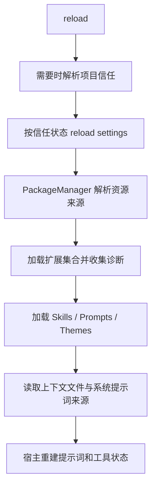
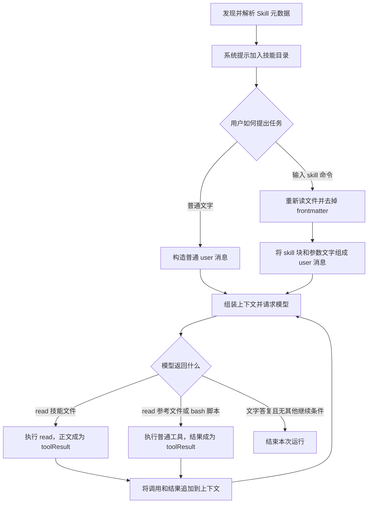
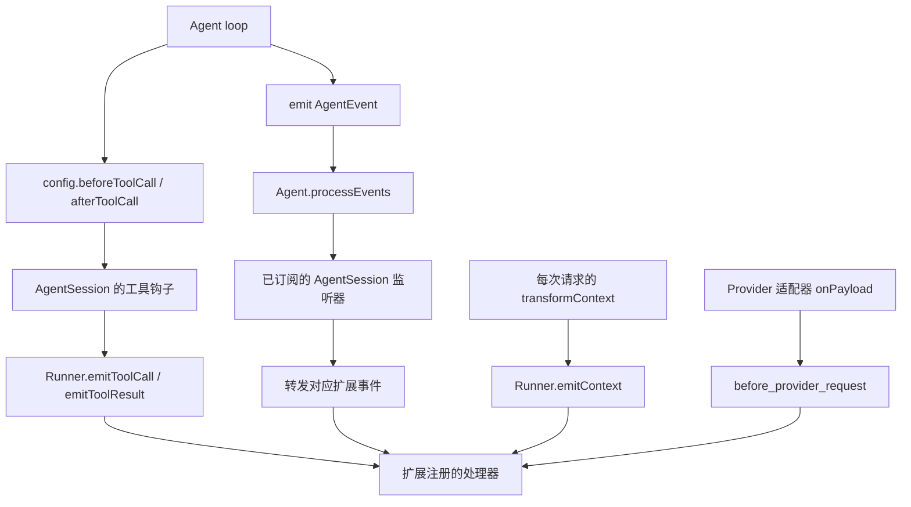
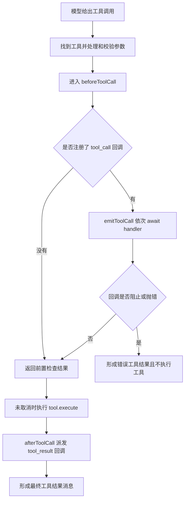

# 10 · 提示词、资源发现与扩展生命周期

[返回总目录](README.md) · [上一章](09-压缩与错误恢复.md) · [下一章](11-终端与运行模式.md)

## 1. 四种扩展方式各改变什么

| 资源 | 形式 | 改变的对象 | 例子 |
|---|---|---|---|
| Skill | 指令 Markdown 与附属文件 | 模型如何完成某类工作 | 代码审查流程 |
| Prompt template | 带参数占位符的 Markdown | 一次用户输入的正文 | `/review src` 展开成审查要求 |
| Theme | 主题定义 | 终端视觉呈现 | 文本、边框、状态颜色 |
| Extension | 在 Pi 进程执行的代码 | 工具、事件、命令、Provider、UI 等 | 拦截工具、注册 MCP 服务 |

Pi package 则是分发这些资源的容器，可以来自 npm、Git 或本地位置。它不是另一个独立 Agent 循环。

入口：[resource-loader.ts](https://github.com/earendil-works/pi/blob/6fb2e7815167e6b19006fc526d1a5d0f5f998787/packages/coding-agent/src/core/resource-loader.ts)、[package-manager.ts](https://github.com/earendil-works/pi/blob/6fb2e7815167e6b19006fc526d1a5d0f5f998787/packages/coding-agent/src/core/package-manager.ts)、[extensions/types.ts](https://github.com/earendil-works/pi/blob/6fb2e7815167e6b19006fc526d1a5d0f5f998787/packages/coding-agent/src/core/extensions/types.ts)。

## 2. 系统提示词如何组织

[system-prompt.ts](https://github.com/earendil-works/pi/blob/6fb2e7815167e6b19006fc526d1a5d0f5f998787/packages/coding-agent/src/core/system-prompt.ts) 将提示词组织为命名 sections，主要包括：

| section | 内容 | 来源 |
|---|---|---|
| preamble | 助手职责前言 | 默认文本或 customPrompt |
| tools | 可见工具的简短介绍 | 当前工具集合与 snippets |
| rules | 工具使用规则和通用要求 | 工具 guidelines 与自定义 guidelines |
| docs | Pi 自身文档的位置与阅读指引 | 包资产路径 |
| addendum | 追加系统说明 | appendSystemPrompt |
| project_context | 项目指令文件 | ResourceLoader 已加载文本 |
| skills | 技能目录 | 技能名称、描述、路径 |
| cwd | 当前工作目录 | 当前会话目录 |

还可以添加合法命名的自定义 sections。preamble 是普通文本，其他段通常带同名标签，便于模型识别更新。

`normalizeBuildSystemPromptOptions()` 填齐数组和映射并复制容器，让扩展能修改选项而不意外改动调用者的原始容器。

## 3. 三种“自定义提示词”不要混用

1. `customPrompt` 替换默认前言及默认工具/规则/文档段，但仍可附加项目上下文、技能、cwd 等。
2. `appendSystemPrompt` 添加补充说明，保留其他正常结构。
3. `forceSystemPrompt` 表示本次请求采用完整替换文本，即便空字符串也有明确替换含义。

`buildSystemPromptState()` 处理第三种完整文本状态；AgentSession 在运行中还通过 `_installAgentForcedPromptProjection()` 处理扩展强制覆盖与结构化 transcript 的关系。因而要区分“保存的结构化变化”与“这次 Provider 得到的强制文本”。

改变工具集合也影响提示词：隐藏声明的工具不能继续被当作普通直接工具展示在 tools/rules 段；但若文件阅读能力仍可间接访问，技能目录仍有保留的理由。

## 4. 提示词补丁的一个例子

假设初始 sections 是 preamble、rules、cwd。加载新技能后新增 skills 段；`diffSystemPromptSections()` 只返回发生变化的项。

```ts
// 示意：不是完整 system 消息。
{ skills: "<skills>...</skills>" }
```

后来移除该段则返回 `{ skills: null }`。重放时 null 表示删除旧值，而非向模型发送字符串 `null`。

这个设计让提示词变化与普通对话一起存在于 transcript。它并不保证所有 Provider 都能增量表达同样变化；不支持的协议可能需要完整检查点，详见 [模型与 Provider](06-模型与Provider.md)。

## 5. AGENTS 文件怎么发现

`loadContextFileFromDir()` 在同一目录依次检查：

```text
AGENTS.override.md → AGENTS.md → AGENTS.MD → CLAUDE.md → CLAUDE.MD
```

取第一个存在且可读的文件，不把同目录全部候选叠加。

`loadProjectContextFiles()` 先收集 agentDir 的全局上下文，再从外层祖先到 cwd 排列项目上下文。嵌套 linked worktree 中属于同一逻辑仓库范围的重复副本会被识别并跳过。

这一步只收集文本，不实现一个会自动裁决自然语言规则冲突的引擎。也不要据此推断 Pi 启动时扫描了整个仓库每个子目录的 AGENTS 文件；这里的主路径是 cwd 的祖先链。

## 6. ResourceLoader 的一轮 reload



CLI 显式路径、全局/项目资源、包内资源和内置扩展都带来源信息。路径合并会去重，冲突形成诊断，不能简单假设“文件名相同就永远最后覆盖”。不同资源的去重策略需要分别看 updateSkillsFromPaths、updatePromptsFromPaths 等方法。

`noExtensions`、`noSkills` 等选项主要控制默认发现来源，显式附加路径有独立处理。阅读禁用参数时要追实际条件，而不是只按名称理解为“绝对禁止一切加载”。

## 7. Skill：从发现文件到模型实际使用

Skill 是一份有名称、描述和正文的操作说明，可以附带参考文档、脚本和素材。Pi 不会把每个 Skill 自动变成一个带 execute 的工具。默认实现中，真正读取文件、运行脚本的仍是 read、bash 等已有工具；模型读懂说明后，决定调用哪个工具以及传什么参数。

因此，“加载 Skill”至少有三种不同含义：磁盘上找到并解析它、将目录信息提供给模型、将正文提供给模型。前两步完成，不代表第三步已经完成。下面沿同一个例子逐步区分。

### 7.1 先看一个完整的技能目录

```text
C:/pi-skill-demo/
├── notes.txt
└── .pi/skills/count-lines/
    ├── SKILL.md
    ├── references/rules.md
    └── scripts/count.mjs
```

SKILL.md 的完整内容如下。开头两个 --- 之间叫 frontmatter，是 YAML 格式的元数据；后面是给模型阅读的正文。

```markdown
---
name: count-lines
description: 统计文本文件的行数。用户要求统计行数时使用。
---

# 统计行数

1. 先读取 `references/rules.md`。
2. 使用 bash 执行 `node "<技能目录>/scripts/count.mjs" "<用户文件的绝对路径>"`。
3. 根据脚本输出报告行数。
```

references/rules.md 的完整内容：

```markdown
# 计数规则

空文件为 0 行；末尾换行不额外算一行。
```

scripts/count.mjs 的完整内容：

```javascript
import { readFile } from "node:fs/promises";

const text = await readFile(process.argv[2], "utf8");
// 末尾的空分段来自最后一个换行，不代表额外的一行。
const lines = text.split(/\r\n|\n|\r/);
if (lines.at(-1) === "") lines.pop();
console.log(lines.length);
```

notes.txt 的内容为 alpha、beta 两行，末尾有换行，其精确字符串表示为：

```json
"alpha\nbeta\n"
```

scripts 和 references 是文件目录，不是 Pi 自动执行的阶段名。读取 SKILL.md 不会递归读取这些目录，也不会自动运行 count.mjs。正文里的 `<技能目录>` 是说明文字，模型要换成真实路径。Node.js 必须已经可用；Skill 文件本身不会自动安装它。

### 7.2 Pi 在哪里找 Skill，谁负责扫描

```text
启动或 /reload
  → DefaultResourceLoader.reload()
  → PackageManager 解析包、用户资源、可信项目资源和显式路径
  → ResourceLoader 合并实际启用的 skillPaths
  → updateSkillsFromPaths()
  → loadSkills({ includeDefaults: false, skillPaths })
  → 扫描目录 / 读取文件 / 解析 frontmatter
  → { skills, diagnostics }
  → 宿主重建系统提示与命令补全
```

通常涉及 ~/.pi/agent/skills、当前项目 .pi/skills、~/.agents/skills，以及从 cwd 向祖先寻找的 .agents/skills；找到 Git 仓库根后，祖先搜索在那里停止。还可以从 Pi package、设置中的资源路径、命令行附加路径及扩展资源获得技能。项目自动发现受项目是否可信影响，不能只看文件存在就断定会加载。

要特别注意：loadSkills(includeDefaults: true) 自己只追加传统用户与当前项目目录；实际 ResourceLoader 调用它时使用 false，因为上层 PackageManager 已经合并更多来源。读低层函数里两行默认目录，不能得出“整个 Pi 只找两个目录”的结论。

实际发现顺序也决定同名谁胜出：loadSkills 用 Map 保留先进入的名称，后来的同名项形成 collision 诊断；同一真实文件通过符号链接重复出现会去重。ResourceLoader 把 CLI 启用路径放在普通启用资源前，并单独合并额外路径；PackageManager 的项目、用户和包来源还各有装配顺序。因此不能把低层 includeDefaults:true 的“用户先、项目后”当作默认 CLI 的总优先级。

目录里发现未被忽略、可识别为文件的 SKILL.md 后，该目录被视为一个技能根，不再深入附属目录发现新技能；即使这个 SKILL.md 后来因缺少描述而未载入，该扫描分支也已经返回。没有找到这样的文件时才继续递归。低层扫描根目录还可接受带 description 的直接 .md 文件，递归子目录则以 SKILL.md 为入口。扫描处理 .gitignore、.ignore、.fdignore，跳过隐藏条目和 node_modules 等。不同来源的上层收集规则也有差异；例如 .agents 采用 Agent Skills 目录形式，不能把所有来源都当成任意 .md 文件集合。

[发现与路径汇总](https://github.com/earendil-works/pi/blob/6fb2e7815167e6b19006fc526d1a5d0f5f998787/packages/coding-agent/src/core/package-manager.ts) · [资源合并](https://github.com/earendil-works/pi/blob/6fb2e7815167e6b19006fc526d1a5d0f5f998787/packages/coding-agent/src/core/resource-loader.ts) · [技能扫描与校验](https://github.com/earendil-works/pi/blob/6fb2e7815167e6b19006fc526d1a5d0f5f998787/packages/coding-agent/src/core/skills.ts)

### 7.3 解析完得到什么，哪些字段真的有作用

本例经资源来源信息补齐后，内存中的一个完整 Skill 对象可以是下面这样。路径用固定示例值表示；sourceInfo 是本地来源记录，不会原样拼进模型提示。

```json
{
  "name": "count-lines",
  "description": "统计文本文件的行数。用户要求统计行数时使用。",
  "filePath": "C:/pi-skill-demo/.pi/skills/count-lines/SKILL.md",
  "baseDir": "C:/pi-skill-demo/.pi/skills/count-lines",
  "sourceInfo": {
    "path": "C:/pi-skill-demo/.pi/skills/count-lines/SKILL.md",
    "source": "auto",
    "scope": "project",
    "origin": "top-level",
    "baseDir": "C:/pi-skill-demo/.pi"
  },
  "disableModelInvocation": false
}
```

| 字段 | 用途 | 是否出现在默认技能目录文本中 |
|---|---|---|
| name | 匹配 /skill:名称，以及展示名称 | 是 |
| description | 让模型判断何时适用 | 是 |
| filePath | 真正读取哪个技能文件 | 是，作为 location |
| baseDir | 解析附属相对路径的根目录 | 没有单独字段；目录规则会提示模型 |
| sourceInfo | 来源、作用域、路径诊断与资源管理 | 否 |
| disableModelInvocation | 决定是否从模型可见目录中排除 | 控制过滤，不输出这个字段 |

启动时 loadSkillFromFile 确实会 readFileSync 读取整个文件以解析头部，但返回的 Skill 对象没有 body 字段。这就是“本地已经读过文件”和“模型已经读到正文”的区别。模型自主使用时会再经 read 等工具读文件，显式 /skill: 调用也会重新读磁盘文件。

当前加载器实际取用 name、description、disable-model-invocation。name 缺省时取父目录名；description 缺失或空白会使技能不加载。名称最多 64 字符，描述最多 1024 字符；名称非法或描述过长会产生警告，但只要描述非空，这些警告本身不一定阻止加载。名称与目录名不同并不会在这里被强制拒绝。

license、metadata、compatibility、allowed-tools 等头部字段可以写在文件里，但当前 Skill 对象不把它们转换成自动安装、运行条件或工具权限控制。尤其 allowed-tools 不能代替真实的工具选择和权限实现。

### 7.4 模型最初看到的目录到底长什么样

formatSkillsForPrompt 过滤 disableModelInvocation 后，生成下面的文本；buildSystemPromptSections 再套上外层 skills 标签。本例整个 skills 段为：

```xml
<skills>
The following skills provide specialized instructions for specific tasks.
Use the read tool to load a skill's file when the task matches its description.
When a skill file references a relative path, resolve it against the skill directory (parent of SKILL.md / dirname of the path) and use that absolute path in tool commands.

<available_skills>
  <skill>
    <name>count-lines</name>
    <description>统计文本文件的行数。用户要求统计行数时使用。</description>
    <location>C:/pi-skill-demo/.pi/skills/count-lines/SKILL.md</location>
  </skill>
</available_skills>
</skills>
```

这里有名称、描述、文件路径，却没有“先读取 rules，再运行脚本”的正文。所谓“自动选择技能”，主要靠模型根据这些自然语言信息决定读取哪个文件，并不是 Pi 内部有一个按 description 关键词自动调用技能的匹配器。模型也可能漏读。

生成这一段还要求当前选中的工具中有 read 或 bash：优先用可直接声明的 read，其次 bash；若阅读工具被隐藏在间接调用入口后，提示只说加载文件，不点名工具。若两者都没有被选中，默认生成器不会因为存在某个任意命名的自定义 reader 就自动加上技能目录。

disable-model-invocation:true 只让该技能从这个目录中消失；它不是文件访问禁令，用户仍可用 /skill:名称 展开。enableSkillCommands 控制交互界面的命令发现/补全，手工输入 /skill:名称 仍由 AgentSession 解析。SDK 的 expandPromptTemplates:false 则会跳过该 prompt 路径的技能与模板展开。

[目录格式化](https://github.com/earendil-works/pi/blob/6fb2e7815167e6b19006fc526d1a5d0f5f998787/packages/coding-agent/src/core/skills.ts) · [skills 段启用条件](https://github.com/earendil-works/pi/blob/6fb2e7815167e6b19006fc526d1a5d0f5f998787/packages/coding-agent/src/core/system-prompt.ts) · [交互命令补全](https://github.com/earendil-works/pi/blob/6fb2e7815167e6b19006fc526d1a5d0f5f998787/packages/coding-agent/src/modes/interactive/interactive-mode.ts)

### 7.5 两条路径放在同一张流程图里



右侧没有单独的 Skill.execute。Skill 的指令进入普通消息链路后，后面的循环就是第 05、07 章所讲的模型请求和工具执行。工具返回“2”不等于已经给用户回答；通常还要让模型看到这个结果，生成最终答复。

### 7.6 完整 JSON 示例的固定条件

以下是按当前源码构造的教学实例，不是网络抓包。模型响应、token 用量、时间与耗时采用固定示例值；工具 schema、技能文本格式和 Provider 转换采用该版本的实际函数结构。字段值为 undefined 的属性和函数不会出现在 JSON 中，不为没有发生的图片、压缩、错误或扩展注入虚构字段。

设 cwd 为 C:/pi-skill-demo，新会话没有旧消息，显式仅启用 read、bash 两个内置工具，没有内置或用户扩展（包括 CodeMode）、MCP、项目指令或提示模板。系统提示使用一个明确配置的 customPrompt：“你是一个编程助手。根据工具结果回答用户。”，同时保留自动附加的 skills 和 cwd 段。这是 Pi 支持的具体配置，不是声称默认 CLI 只有这几段。

完整演示 Model 配置如下。窗口、输出上限和零费用是本例的本地配置，不是实时模型规格或报价：

```json
{
  "id": "gpt-4o-mini",
  "name": "gpt-4o-mini",
  "api": "openai-completions",
  "provider": "openai",
  "baseUrl": "https://api.openai.com/v1",
  "reasoning": false,
  "input": [
    "text",
    "image"
  ],
  "cost": {
    "input": 0,
    "output": 0,
    "cacheRead": 0,
    "cacheWrite": 0
  },
  "contextWindow": 128000,
  "maxTokens": 16384
}
```

本例请求选项如下；最大输出额外设为 1024，缓存键固定，思考关闭。认证由外部请求层完成，密钥属于 HTTP 请求头，不属于下面的消息正文。

```json
{
  "sessionId": "22222222-3333-4444-8555-666666666666",
  "cacheRetention": "short",
  "maxTokens": 1024
}
```

### 7.7 路径 A：普通用户输入到第一次完整请求

用户输入是：

```json
"请统计 C:/pi-skill-demo/notes.txt 的行数。"
```

input 扩展未改写输入，也没有 /skill: 前缀，所以用户文字不展开。AgentSession.prompt 创建 user 消息，系统状态与声明装配后，完整 AgentMessage[] 如下：

```json
[
  {
    "role": "system",
    "content": "",
    "sections": {
      "preamble": "你是一个编程助手。根据工具结果回答用户。",
      "skills": "<skills>\nThe following skills provide specialized instructions for specific tasks.\nUse the read tool to load a skill's file when the task matches its description.\nWhen a skill file references a relative path, resolve it against the skill directory (parent of SKILL.md / dirname of the path) and use that absolute path in tool commands.\n\n<available_skills>\n  <skill>\n    <name>count-lines</name>\n    <description>统计文本文件的行数。用户要求统计行数时使用。</description>\n    <location>C:/pi-skill-demo/.pi/skills/count-lines/SKILL.md</location>\n  </skill>\n</available_skills>\n</skills>",
      "cwd": "<cwd>\nC:/pi-skill-demo\n</cwd>"
    },
    "timestamp": 1791892800001,
    "toolsAdded": [
      {
        "name": "read",
        "description": "Read the contents of a file. Supports text files and images (jpg, png, gif, webp, bmp). Images are sent as attachments. For text files, output is truncated to 2000 lines or 50KB (whichever is hit first). Use offset/limit for large files. When you need the full file, continue with offset until complete.",
        "parameters": {
          "type": "object",
          "required": [
            "path"
          ],
          "properties": {
            "path": {
              "type": "string",
              "description": "Path to the file to read (relative or absolute)"
            },
            "offset": {
              "type": "number",
              "description": "Line number to start reading from (1-indexed)"
            },
            "limit": {
              "type": "number",
              "description": "Maximum number of lines to read"
            }
          }
        },
        "constrainedSampling": {
          "type": "json_schema",
          "strict": "prefer"
        }
      },
      {
        "name": "bash",
        "description": "Execute a bash command in the current working directory. Returns stdout and stderr. Output is truncated to last 2000 lines or 50KB (whichever is hit first). If truncated, full output is saved to a temp file. Optionally provide a timeout in seconds.",
        "parameters": {
          "type": "object",
          "required": [
            "command"
          ],
          "properties": {
            "command": {
              "type": "string",
              "description": "Shell command to execute"
            },
            "timeout": {
              "type": "number",
              "description": "Timeout in seconds (optional, no default timeout)"
            }
          }
        },
        "constrainedSampling": {
          "type": "json_schema",
          "strict": "prefer"
        }
      }
    ]
  },
  {
    "role": "user",
    "content": [
      {
        "type": "text",
        "text": "请统计 C:/pi-skill-demo/notes.txt 的行数。"
      }
    ],
    "timestamp": 1791892800000
  }
]
```

system.sections.skills 是目录；system.toolsAdded 是真实可调用工具声明。两者用途不同：count-lines 没有出现在 toolsAdded 中。user.content 也尚未出现技能正文。execute、readFileSync、文件句柄等只留在本地。

transformContext 在本例不改变消息；convertToLlm 逐项处理 system/user/assistant/toolResult 时直接保留原对象。因此这个阶段得到的完整 Message[] 是：

```json
[
  {
    "role": "system",
    "content": "",
    "sections": {
      "preamble": "你是一个编程助手。根据工具结果回答用户。",
      "skills": "<skills>\nThe following skills provide specialized instructions for specific tasks.\nUse the read tool to load a skill's file when the task matches its description.\nWhen a skill file references a relative path, resolve it against the skill directory (parent of SKILL.md / dirname of the path) and use that absolute path in tool commands.\n\n<available_skills>\n  <skill>\n    <name>count-lines</name>\n    <description>统计文本文件的行数。用户要求统计行数时使用。</description>\n    <location>C:/pi-skill-demo/.pi/skills/count-lines/SKILL.md</location>\n  </skill>\n</available_skills>\n</skills>",
      "cwd": "<cwd>\nC:/pi-skill-demo\n</cwd>"
    },
    "timestamp": 1791892800001,
    "toolsAdded": [
      {
        "name": "read",
        "description": "Read the contents of a file. Supports text files and images (jpg, png, gif, webp, bmp). Images are sent as attachments. For text files, output is truncated to 2000 lines or 50KB (whichever is hit first). Use offset/limit for large files. When you need the full file, continue with offset until complete.",
        "parameters": {
          "type": "object",
          "required": [
            "path"
          ],
          "properties": {
            "path": {
              "type": "string",
              "description": "Path to the file to read (relative or absolute)"
            },
            "offset": {
              "type": "number",
              "description": "Line number to start reading from (1-indexed)"
            },
            "limit": {
              "type": "number",
              "description": "Maximum number of lines to read"
            }
          }
        },
        "constrainedSampling": {
          "type": "json_schema",
          "strict": "prefer"
        }
      },
      {
        "name": "bash",
        "description": "Execute a bash command in the current working directory. Returns stdout and stderr. Output is truncated to last 2000 lines or 50KB (whichever is hit first). If truncated, full output is saved to a temp file. Optionally provide a timeout in seconds.",
        "parameters": {
          "type": "object",
          "required": [
            "command"
          ],
          "properties": {
            "command": {
              "type": "string",
              "description": "Shell command to execute"
            },
            "timeout": {
              "type": "number",
              "description": "Timeout in seconds (optional, no default timeout)"
            }
          }
        },
        "constrainedSampling": {
          "type": "json_schema",
          "strict": "prefer"
        }
      }
    ]
  },
  {
    "role": "user",
    "content": [
      {
        "type": "text",
        "text": "请统计 C:/pi-skill-demo/notes.txt 的行数。"
      }
    ],
    "timestamp": 1791892800000
  }
]
```

normalizeContext({messages}) 得到下面的完整 TranscriptContext。这里不另外传 systemPrompt/tools，因此不会重复插入系统消息：

```json
{
  "messages": [
    {
      "role": "system",
      "content": "",
      "sections": {
        "preamble": "你是一个编程助手。根据工具结果回答用户。",
        "skills": "<skills>\nThe following skills provide specialized instructions for specific tasks.\nUse the read tool to load a skill's file when the task matches its description.\nWhen a skill file references a relative path, resolve it against the skill directory (parent of SKILL.md / dirname of the path) and use that absolute path in tool commands.\n\n<available_skills>\n  <skill>\n    <name>count-lines</name>\n    <description>统计文本文件的行数。用户要求统计行数时使用。</description>\n    <location>C:/pi-skill-demo/.pi/skills/count-lines/SKILL.md</location>\n  </skill>\n</available_skills>\n</skills>",
        "cwd": "<cwd>\nC:/pi-skill-demo\n</cwd>"
      },
      "timestamp": 1791892800001,
      "toolsAdded": [
        {
          "name": "read",
          "description": "Read the contents of a file. Supports text files and images (jpg, png, gif, webp, bmp). Images are sent as attachments. For text files, output is truncated to 2000 lines or 50KB (whichever is hit first). Use offset/limit for large files. When you need the full file, continue with offset until complete.",
          "parameters": {
            "type": "object",
            "required": [
              "path"
            ],
            "properties": {
              "path": {
                "type": "string",
                "description": "Path to the file to read (relative or absolute)"
              },
              "offset": {
                "type": "number",
                "description": "Line number to start reading from (1-indexed)"
              },
              "limit": {
                "type": "number",
                "description": "Maximum number of lines to read"
              }
            }
          },
          "constrainedSampling": {
            "type": "json_schema",
            "strict": "prefer"
          }
        },
        {
          "name": "bash",
          "description": "Execute a bash command in the current working directory. Returns stdout and stderr. Output is truncated to last 2000 lines or 50KB (whichever is hit first). If truncated, full output is saved to a temp file. Optionally provide a timeout in seconds.",
          "parameters": {
            "type": "object",
            "required": [
              "command"
            ],
            "properties": {
              "command": {
                "type": "string",
                "description": "Shell command to execute"
              },
              "timeout": {
                "type": "number",
                "description": "Timeout in seconds (optional, no default timeout)"
              }
            }
          },
          "constrainedSampling": {
            "type": "json_schema",
            "strict": "prefer"
          }
        }
      ]
    },
    {
      "role": "user",
      "content": [
        {
          "type": "text",
          "text": "请统计 C:/pi-skill-demo/notes.txt 的行数。"
        }
      ],
      "timestamp": 1791892800000
    }
  ]
}
```

进入 OpenAI Chat Completions 适配器后，系统各段拼成一个字符串，工具声明移入顶层 tools。buildParams 后的 before_provider_request 在本例没有修改 payload，所以最终整个 HTTP JSON 请求体为：

```json
{
  "model": "gpt-4o-mini",
  "messages": [
    {
      "role": "system",
      "content": "你是一个编程助手。根据工具结果回答用户。\n\n<skills>\nThe following skills provide specialized instructions for specific tasks.\nUse the read tool to load a skill's file when the task matches its description.\nWhen a skill file references a relative path, resolve it against the skill directory (parent of SKILL.md / dirname of the path) and use that absolute path in tool commands.\n\n<available_skills>\n  <skill>\n    <name>count-lines</name>\n    <description>统计文本文件的行数。用户要求统计行数时使用。</description>\n    <location>C:/pi-skill-demo/.pi/skills/count-lines/SKILL.md</location>\n  </skill>\n</available_skills>\n</skills>\n\n<cwd>\nC:/pi-skill-demo\n</cwd>"
    },
    {
      "role": "user",
      "content": [
        {
          "type": "text",
          "text": "请统计 C:/pi-skill-demo/notes.txt 的行数。"
        }
      ]
    }
  ],
  "stream": true,
  "prompt_cache_key": "22222222-3333-4444-8555-666666666666",
  "stream_options": {
    "include_usage": true
  },
  "store": false,
  "max_completion_tokens": 1024,
  "tools": [
    {
      "type": "function",
      "function": {
        "name": "read",
        "description": "Read the contents of a file. Supports text files and images (jpg, png, gif, webp, bmp). Images are sent as attachments. For text files, output is truncated to 2000 lines or 50KB (whichever is hit first). Use offset/limit for large files. When you need the full file, continue with offset until complete.",
        "parameters": {
          "type": "object",
          "required": [
            "path"
          ],
          "properties": {
            "path": {
              "type": "string",
              "description": "Path to the file to read (relative or absolute)"
            },
            "offset": {
              "type": "number",
              "description": "Line number to start reading from (1-indexed)"
            },
            "limit": {
              "type": "number",
              "description": "Maximum number of lines to read"
            }
          }
        }
      }
    },
    {
      "type": "function",
      "function": {
        "name": "bash",
        "description": "Execute a bash command in the current working directory. Returns stdout and stderr. Output is truncated to last 2000 lines or 50KB (whichever is hit first). If truncated, full output is saved to a temp file. Optionally provide a timeout in seconds.",
        "parameters": {
          "type": "object",
          "required": [
            "command"
          ],
          "properties": {
            "command": {
              "type": "string",
              "description": "Shell command to execute"
            },
            "timeout": {
              "type": "number",
              "description": "Timeout in seconds (optional, no default timeout)"
            }
          }
        }
      }
    }
  ]
}
```

注意没有 skills 这样的 HTTP 顶层协议字段，也没有 name 为 count-lines 的 function 工具。技能目录只是 system.content 内的普通文字。JSON 里的 \n 表示字符串中的换行；服务器解析 JSON 后，模型读到的内容仍是多行文本。

### 7.8 模型选中技能：read 调用与正文回填

设请求 A1 的响应选择读取目录中的 SKILL.md。Pi 定稿后的完整 assistant 消息为：

```json
{
  "role": "assistant",
  "content": [
    {
      "type": "toolCall",
      "id": "call_skill",
      "name": "read",
      "arguments": {
        "path": "C:/pi-skill-demo/.pi/skills/count-lines/SKILL.md"
      }
    }
  ],
  "api": "openai-completions",
  "provider": "openai",
  "model": "gpt-4o-mini",
  "responseId": "chatcmpl-skill-demo-1",
  "usage": {
    "input": 1100,
    "output": 30,
    "cacheRead": 0,
    "cacheWrite": 0,
    "totalTokens": 1130,
    "cost": {
      "input": 0,
      "output": 0,
      "cacheRead": 0,
      "cacheWrite": 0,
      "total": 0
    }
  },
  "stopReason": "toolUse",
  "rawStopReason": "tool_calls",
  "timestamp": 1791892801000,
  "durationMs": 500,
  "thinkingLevel": "off"
}
```

接着走正常工具链：定位 read → prepareArguments（若存在）→ schema 校验 → beforeToolCall/tool_call → read.execute → afterToolCall/tool_result → 工具完成事件 → 创建 toolResult 并保存。read 根据 path 读取原始文件，结果仍包含 YAML 头部；这条路径不会像 /skill: 那样主动 stripFrontmatter。完整结果消息为：

```json
{
  "role": "toolResult",
  "toolCallId": "call_skill",
  "toolName": "read",
  "content": [
    {
      "type": "text",
      "text": "---\nname: count-lines\ndescription: 统计文本文件的行数。用户要求统计行数时使用。\n---\n\n# 统计行数\n\n1. 先读取 `references/rules.md`。\n2. 使用 bash 执行 `node \"<技能目录>/scripts/count.mjs\" \"<用户文件的绝对路径>\"`。\n3. 根据脚本输出报告行数。\n"
    }
  ],
  "isError": false,
  "durationMs": 10,
  "timestamp": 1791892801510
}
```

模型此刻并不会在已经结束的请求 A1 中“突然收到文件”。Pi 把 assistant 和 toolResult 追加到历史后，再发起请求 A2。完整 HTTP 请求体为：

```json
{
  "model": "gpt-4o-mini",
  "messages": [
    {
      "role": "system",
      "content": "你是一个编程助手。根据工具结果回答用户。\n\n<skills>\nThe following skills provide specialized instructions for specific tasks.\nUse the read tool to load a skill's file when the task matches its description.\nWhen a skill file references a relative path, resolve it against the skill directory (parent of SKILL.md / dirname of the path) and use that absolute path in tool commands.\n\n<available_skills>\n  <skill>\n    <name>count-lines</name>\n    <description>统计文本文件的行数。用户要求统计行数时使用。</description>\n    <location>C:/pi-skill-demo/.pi/skills/count-lines/SKILL.md</location>\n  </skill>\n</available_skills>\n</skills>\n\n<cwd>\nC:/pi-skill-demo\n</cwd>"
    },
    {
      "role": "user",
      "content": [
        {
          "type": "text",
          "text": "请统计 C:/pi-skill-demo/notes.txt 的行数。"
        }
      ]
    },
    {
      "role": "assistant",
      "content": null,
      "tool_calls": [
        {
          "id": "call_skill",
          "type": "function",
          "function": {
            "name": "read",
            "arguments": "{\"path\":\"C:/pi-skill-demo/.pi/skills/count-lines/SKILL.md\"}"
          }
        }
      ]
    },
    {
      "role": "tool",
      "content": "---\nname: count-lines\ndescription: 统计文本文件的行数。用户要求统计行数时使用。\n---\n\n# 统计行数\n\n1. 先读取 `references/rules.md`。\n2. 使用 bash 执行 `node \"<技能目录>/scripts/count.mjs\" \"<用户文件的绝对路径>\"`。\n3. 根据脚本输出报告行数。\n",
      "tool_call_id": "call_skill"
    }
  ],
  "stream": true,
  "prompt_cache_key": "22222222-3333-4444-8555-666666666666",
  "stream_options": {
    "include_usage": true
  },
  "store": false,
  "max_completion_tokens": 1024,
  "tools": [
    {
      "type": "function",
      "function": {
        "name": "read",
        "description": "Read the contents of a file. Supports text files and images (jpg, png, gif, webp, bmp). Images are sent as attachments. For text files, output is truncated to 2000 lines or 50KB (whichever is hit first). Use offset/limit for large files. When you need the full file, continue with offset until complete.",
        "parameters": {
          "type": "object",
          "required": [
            "path"
          ],
          "properties": {
            "path": {
              "type": "string",
              "description": "Path to the file to read (relative or absolute)"
            },
            "offset": {
              "type": "number",
              "description": "Line number to start reading from (1-indexed)"
            },
            "limit": {
              "type": "number",
              "description": "Maximum number of lines to read"
            }
          }
        }
      }
    },
    {
      "type": "function",
      "function": {
        "name": "bash",
        "description": "Execute a bash command in the current working directory. Returns stdout and stderr. Output is truncated to last 2000 lines or 50KB (whichever is hit first). If truncated, full output is saved to a temp file. Optionally provide a timeout in seconds.",
        "parameters": {
          "type": "object",
          "required": [
            "command"
          ],
          "properties": {
            "command": {
              "type": "string",
              "description": "Shell command to execute"
            },
            "timeout": {
              "type": "number",
              "description": "Timeout in seconds (optional, no default timeout)"
            }
          }
        }
      }
    }
  ]
}
```

对照 A1：目录仍在 system 中，用户请求仍在 user 中，新增 assistant.tool_calls 与 role:tool 的正文。call_skill 将调用和结果配对；工具参数在 Pi 内是对象，在此协议中变成 function.arguments 内的 JSON 字符串。

### 7.9 读参考文件，再执行技能脚本

模型通过 A2 读到技能正文后，按第 1 步读取 references/rules.md。相对路径以技能根目录为基准，不以 cwd 为基准；Pi 在提示中告诉模型这个规则，模型仍须生成正确的 path。此次新增的完整两条消息是：

```json
[
  {
    "role": "assistant",
    "content": [
      {
        "type": "toolCall",
        "id": "call_rules",
        "name": "read",
        "arguments": {
          "path": "C:/pi-skill-demo/.pi/skills/count-lines/references/rules.md"
        }
      }
    ],
    "api": "openai-completions",
    "provider": "openai",
    "model": "gpt-4o-mini",
    "responseId": "chatcmpl-skill-demo-2",
    "usage": {
      "input": 1200,
      "output": 30,
      "cacheRead": 0,
      "cacheWrite": 0,
      "totalTokens": 1230,
      "cost": {
        "input": 0,
        "output": 0,
        "cacheRead": 0,
        "cacheWrite": 0,
        "total": 0
      }
    },
    "stopReason": "toolUse",
    "rawStopReason": "tool_calls",
    "timestamp": 1791892802000,
    "durationMs": 500,
    "thinkingLevel": "off"
  },
  {
    "role": "toolResult",
    "toolCallId": "call_rules",
    "toolName": "read",
    "content": [
      {
        "type": "text",
        "text": "# 计数规则\n\n空文件为 0 行；末尾换行不额外算一行。\n"
      }
    ],
    "isError": false,
    "durationMs": 10,
    "timestamp": 1791892802510
  }
]
```

此时已有完整 SKILL.md 正文和 rules.md 内容。下一次 A3 请求会带着它们；完整 HTTP 请求体为：

```json
{
  "model": "gpt-4o-mini",
  "messages": [
    {
      "role": "system",
      "content": "你是一个编程助手。根据工具结果回答用户。\n\n<skills>\nThe following skills provide specialized instructions for specific tasks.\nUse the read tool to load a skill's file when the task matches its description.\nWhen a skill file references a relative path, resolve it against the skill directory (parent of SKILL.md / dirname of the path) and use that absolute path in tool commands.\n\n<available_skills>\n  <skill>\n    <name>count-lines</name>\n    <description>统计文本文件的行数。用户要求统计行数时使用。</description>\n    <location>C:/pi-skill-demo/.pi/skills/count-lines/SKILL.md</location>\n  </skill>\n</available_skills>\n</skills>\n\n<cwd>\nC:/pi-skill-demo\n</cwd>"
    },
    {
      "role": "user",
      "content": [
        {
          "type": "text",
          "text": "请统计 C:/pi-skill-demo/notes.txt 的行数。"
        }
      ]
    },
    {
      "role": "assistant",
      "content": null,
      "tool_calls": [
        {
          "id": "call_skill",
          "type": "function",
          "function": {
            "name": "read",
            "arguments": "{\"path\":\"C:/pi-skill-demo/.pi/skills/count-lines/SKILL.md\"}"
          }
        }
      ]
    },
    {
      "role": "tool",
      "content": "---\nname: count-lines\ndescription: 统计文本文件的行数。用户要求统计行数时使用。\n---\n\n# 统计行数\n\n1. 先读取 `references/rules.md`。\n2. 使用 bash 执行 `node \"<技能目录>/scripts/count.mjs\" \"<用户文件的绝对路径>\"`。\n3. 根据脚本输出报告行数。\n",
      "tool_call_id": "call_skill"
    },
    {
      "role": "assistant",
      "content": null,
      "tool_calls": [
        {
          "id": "call_rules",
          "type": "function",
          "function": {
            "name": "read",
            "arguments": "{\"path\":\"C:/pi-skill-demo/.pi/skills/count-lines/references/rules.md\"}"
          }
        }
      ]
    },
    {
      "role": "tool",
      "content": "# 计数规则\n\n空文件为 0 行；末尾换行不额外算一行。\n",
      "tool_call_id": "call_rules"
    }
  ],
  "stream": true,
  "prompt_cache_key": "22222222-3333-4444-8555-666666666666",
  "stream_options": {
    "include_usage": true
  },
  "store": false,
  "max_completion_tokens": 1024,
  "tools": [
    {
      "type": "function",
      "function": {
        "name": "read",
        "description": "Read the contents of a file. Supports text files and images (jpg, png, gif, webp, bmp). Images are sent as attachments. For text files, output is truncated to 2000 lines or 50KB (whichever is hit first). Use offset/limit for large files. When you need the full file, continue with offset until complete.",
        "parameters": {
          "type": "object",
          "required": [
            "path"
          ],
          "properties": {
            "path": {
              "type": "string",
              "description": "Path to the file to read (relative or absolute)"
            },
            "offset": {
              "type": "number",
              "description": "Line number to start reading from (1-indexed)"
            },
            "limit": {
              "type": "number",
              "description": "Maximum number of lines to read"
            }
          }
        }
      }
    },
    {
      "type": "function",
      "function": {
        "name": "bash",
        "description": "Execute a bash command in the current working directory. Returns stdout and stderr. Output is truncated to last 2000 lines or 50KB (whichever is hit first). If truncated, full output is saved to a temp file. Optionally provide a timeout in seconds.",
        "parameters": {
          "type": "object",
          "required": [
            "command"
          ],
          "properties": {
            "command": {
              "type": "string",
              "description": "Shell command to execute"
            },
            "timeout": {
              "type": "number",
              "description": "Timeout in seconds (optional, no default timeout)"
            }
          }
        }
      }
    }
  ]
}
```

设模型随后按规则运行脚本。它发出的完整 assistant 消息为：

```json
{
  "role": "assistant",
  "content": [
    {
      "type": "toolCall",
      "id": "call_count",
      "name": "bash",
      "arguments": {
        "command": "node \"C:/pi-skill-demo/.pi/skills/count-lines/scripts/count.mjs\" \"C:/pi-skill-demo/notes.txt\""
      }
    }
  ],
  "api": "openai-completions",
  "provider": "openai",
  "model": "gpt-4o-mini",
  "responseId": "chatcmpl-skill-demo-3",
  "usage": {
    "input": 1300,
    "output": 30,
    "cacheRead": 0,
    "cacheWrite": 0,
    "totalTokens": 1330,
    "cost": {
      "input": 0,
      "output": 0,
      "cacheRead": 0,
      "cacheWrite": 0,
      "total": 0
    }
  },
  "stopReason": "toolUse",
  "rawStopReason": "tool_calls",
  "timestamp": 1791892803000,
  "durationMs": 500,
  "thinkingLevel": "off"
}
```

这个 bash 的 execute 才负责启动 shell，shell 再运行 Node.js，Node.js 的 readFile 读取 notes.txt。模型没有把 SKILL.md 当成程序执行，Pi 也没有自动调用其中的第 2 行。command 已包含技能脚本和用户文件的绝对路径；bash 的 cwd 仍是会话工作目录。

脚本输出 2 后，bash 工具返回对象可以是：

```json
{
  "content": [
    {
      "type": "text",
      "text": "2\n"
    }
  ],
  "structuredContent": {
    "output": "2\n",
    "truncated": false,
    "exit_code": 0,
    "wall_time_seconds": 0.1
  }
}
```

structuredContent 留给程序化调用者，模型历史主要使用 content。createToolResultMessage 包装后的完整消息如下，注意它不携带 structuredContent：

```json
{
  "role": "toolResult",
  "toolCallId": "call_count",
  "toolName": "bash",
  "content": [
    {
      "type": "text",
      "text": "2\n"
    }
  ],
  "isError": false,
  "durationMs": 10,
  "timestamp": 1791892803510
}
```

read 默认最多展示前 2000 行或 50KB，bash 默认展示输出尾部的 2000 行或 50KB；附属文件过长时，读到一次 toolResult 并不代表已经读完。read 会给续读提示，模型应使用 offset 继续读取。大文件输出处理见 [工具系统](07-工具系统.md)。

### 7.10 脚本运行完，到最终回答前的完整上下文

请求 A4 前，全部 AgentMessage[] 如下。数组顺序就是：系统、用户、读技能调用/结果、读规则调用/结果、执行脚本调用/结果。

```json
[
  {
    "role": "system",
    "content": "",
    "sections": {
      "preamble": "你是一个编程助手。根据工具结果回答用户。",
      "skills": "<skills>\nThe following skills provide specialized instructions for specific tasks.\nUse the read tool to load a skill's file when the task matches its description.\nWhen a skill file references a relative path, resolve it against the skill directory (parent of SKILL.md / dirname of the path) and use that absolute path in tool commands.\n\n<available_skills>\n  <skill>\n    <name>count-lines</name>\n    <description>统计文本文件的行数。用户要求统计行数时使用。</description>\n    <location>C:/pi-skill-demo/.pi/skills/count-lines/SKILL.md</location>\n  </skill>\n</available_skills>\n</skills>",
      "cwd": "<cwd>\nC:/pi-skill-demo\n</cwd>"
    },
    "timestamp": 1791892800001,
    "toolsAdded": [
      {
        "name": "read",
        "description": "Read the contents of a file. Supports text files and images (jpg, png, gif, webp, bmp). Images are sent as attachments. For text files, output is truncated to 2000 lines or 50KB (whichever is hit first). Use offset/limit for large files. When you need the full file, continue with offset until complete.",
        "parameters": {
          "type": "object",
          "required": [
            "path"
          ],
          "properties": {
            "path": {
              "type": "string",
              "description": "Path to the file to read (relative or absolute)"
            },
            "offset": {
              "type": "number",
              "description": "Line number to start reading from (1-indexed)"
            },
            "limit": {
              "type": "number",
              "description": "Maximum number of lines to read"
            }
          }
        },
        "constrainedSampling": {
          "type": "json_schema",
          "strict": "prefer"
        }
      },
      {
        "name": "bash",
        "description": "Execute a bash command in the current working directory. Returns stdout and stderr. Output is truncated to last 2000 lines or 50KB (whichever is hit first). If truncated, full output is saved to a temp file. Optionally provide a timeout in seconds.",
        "parameters": {
          "type": "object",
          "required": [
            "command"
          ],
          "properties": {
            "command": {
              "type": "string",
              "description": "Shell command to execute"
            },
            "timeout": {
              "type": "number",
              "description": "Timeout in seconds (optional, no default timeout)"
            }
          }
        },
        "constrainedSampling": {
          "type": "json_schema",
          "strict": "prefer"
        }
      }
    ]
  },
  {
    "role": "user",
    "content": [
      {
        "type": "text",
        "text": "请统计 C:/pi-skill-demo/notes.txt 的行数。"
      }
    ],
    "timestamp": 1791892800000
  },
  {
    "role": "assistant",
    "content": [
      {
        "type": "toolCall",
        "id": "call_skill",
        "name": "read",
        "arguments": {
          "path": "C:/pi-skill-demo/.pi/skills/count-lines/SKILL.md"
        }
      }
    ],
    "api": "openai-completions",
    "provider": "openai",
    "model": "gpt-4o-mini",
    "responseId": "chatcmpl-skill-demo-1",
    "usage": {
      "input": 1100,
      "output": 30,
      "cacheRead": 0,
      "cacheWrite": 0,
      "totalTokens": 1130,
      "cost": {
        "input": 0,
        "output": 0,
        "cacheRead": 0,
        "cacheWrite": 0,
        "total": 0
      }
    },
    "stopReason": "toolUse",
    "rawStopReason": "tool_calls",
    "timestamp": 1791892801000,
    "durationMs": 500,
    "thinkingLevel": "off"
  },
  {
    "role": "toolResult",
    "toolCallId": "call_skill",
    "toolName": "read",
    "content": [
      {
        "type": "text",
        "text": "---\nname: count-lines\ndescription: 统计文本文件的行数。用户要求统计行数时使用。\n---\n\n# 统计行数\n\n1. 先读取 `references/rules.md`。\n2. 使用 bash 执行 `node \"<技能目录>/scripts/count.mjs\" \"<用户文件的绝对路径>\"`。\n3. 根据脚本输出报告行数。\n"
      }
    ],
    "isError": false,
    "durationMs": 10,
    "timestamp": 1791892801510
  },
  {
    "role": "assistant",
    "content": [
      {
        "type": "toolCall",
        "id": "call_rules",
        "name": "read",
        "arguments": {
          "path": "C:/pi-skill-demo/.pi/skills/count-lines/references/rules.md"
        }
      }
    ],
    "api": "openai-completions",
    "provider": "openai",
    "model": "gpt-4o-mini",
    "responseId": "chatcmpl-skill-demo-2",
    "usage": {
      "input": 1200,
      "output": 30,
      "cacheRead": 0,
      "cacheWrite": 0,
      "totalTokens": 1230,
      "cost": {
        "input": 0,
        "output": 0,
        "cacheRead": 0,
        "cacheWrite": 0,
        "total": 0
      }
    },
    "stopReason": "toolUse",
    "rawStopReason": "tool_calls",
    "timestamp": 1791892802000,
    "durationMs": 500,
    "thinkingLevel": "off"
  },
  {
    "role": "toolResult",
    "toolCallId": "call_rules",
    "toolName": "read",
    "content": [
      {
        "type": "text",
        "text": "# 计数规则\n\n空文件为 0 行；末尾换行不额外算一行。\n"
      }
    ],
    "isError": false,
    "durationMs": 10,
    "timestamp": 1791892802510
  },
  {
    "role": "assistant",
    "content": [
      {
        "type": "toolCall",
        "id": "call_count",
        "name": "bash",
        "arguments": {
          "command": "node \"C:/pi-skill-demo/.pi/skills/count-lines/scripts/count.mjs\" \"C:/pi-skill-demo/notes.txt\""
        }
      }
    ],
    "api": "openai-completions",
    "provider": "openai",
    "model": "gpt-4o-mini",
    "responseId": "chatcmpl-skill-demo-3",
    "usage": {
      "input": 1300,
      "output": 30,
      "cacheRead": 0,
      "cacheWrite": 0,
      "totalTokens": 1330,
      "cost": {
        "input": 0,
        "output": 0,
        "cacheRead": 0,
        "cacheWrite": 0,
        "total": 0
      }
    },
    "stopReason": "toolUse",
    "rawStopReason": "tool_calls",
    "timestamp": 1791892803000,
    "durationMs": 500,
    "thinkingLevel": "off"
  },
  {
    "role": "toolResult",
    "toolCallId": "call_count",
    "toolName": "bash",
    "content": [
      {
        "type": "text",
        "text": "2\n"
      }
    ],
    "isError": false,
    "durationMs": 10,
    "timestamp": 1791892803510
  }
]
```

本例没有自定义消息类型，convertToLlm 不改这些对象；下面完整展示转换并经过 normalizeContext 后的 Message 容器，以便逐字段对照。usage、stopReason、timestamp 等仍存在于 Pi 的 Message 中，不是在 convertToLlm 时统一删除：

```json
{
  "messages": [
    {
      "role": "system",
      "content": "",
      "sections": {
        "preamble": "你是一个编程助手。根据工具结果回答用户。",
        "skills": "<skills>\nThe following skills provide specialized instructions for specific tasks.\nUse the read tool to load a skill's file when the task matches its description.\nWhen a skill file references a relative path, resolve it against the skill directory (parent of SKILL.md / dirname of the path) and use that absolute path in tool commands.\n\n<available_skills>\n  <skill>\n    <name>count-lines</name>\n    <description>统计文本文件的行数。用户要求统计行数时使用。</description>\n    <location>C:/pi-skill-demo/.pi/skills/count-lines/SKILL.md</location>\n  </skill>\n</available_skills>\n</skills>",
        "cwd": "<cwd>\nC:/pi-skill-demo\n</cwd>"
      },
      "timestamp": 1791892800001,
      "toolsAdded": [
        {
          "name": "read",
          "description": "Read the contents of a file. Supports text files and images (jpg, png, gif, webp, bmp). Images are sent as attachments. For text files, output is truncated to 2000 lines or 50KB (whichever is hit first). Use offset/limit for large files. When you need the full file, continue with offset until complete.",
          "parameters": {
            "type": "object",
            "required": [
              "path"
            ],
            "properties": {
              "path": {
                "type": "string",
                "description": "Path to the file to read (relative or absolute)"
              },
              "offset": {
                "type": "number",
                "description": "Line number to start reading from (1-indexed)"
              },
              "limit": {
                "type": "number",
                "description": "Maximum number of lines to read"
              }
            }
          },
          "constrainedSampling": {
            "type": "json_schema",
            "strict": "prefer"
          }
        },
        {
          "name": "bash",
          "description": "Execute a bash command in the current working directory. Returns stdout and stderr. Output is truncated to last 2000 lines or 50KB (whichever is hit first). If truncated, full output is saved to a temp file. Optionally provide a timeout in seconds.",
          "parameters": {
            "type": "object",
            "required": [
              "command"
            ],
            "properties": {
              "command": {
                "type": "string",
                "description": "Shell command to execute"
              },
              "timeout": {
                "type": "number",
                "description": "Timeout in seconds (optional, no default timeout)"
              }
            }
          },
          "constrainedSampling": {
            "type": "json_schema",
            "strict": "prefer"
          }
        }
      ]
    },
    {
      "role": "user",
      "content": [
        {
          "type": "text",
          "text": "请统计 C:/pi-skill-demo/notes.txt 的行数。"
        }
      ],
      "timestamp": 1791892800000
    },
    {
      "role": "assistant",
      "content": [
        {
          "type": "toolCall",
          "id": "call_skill",
          "name": "read",
          "arguments": {
            "path": "C:/pi-skill-demo/.pi/skills/count-lines/SKILL.md"
          }
        }
      ],
      "api": "openai-completions",
      "provider": "openai",
      "model": "gpt-4o-mini",
      "responseId": "chatcmpl-skill-demo-1",
      "usage": {
        "input": 1100,
        "output": 30,
        "cacheRead": 0,
        "cacheWrite": 0,
        "totalTokens": 1130,
        "cost": {
          "input": 0,
          "output": 0,
          "cacheRead": 0,
          "cacheWrite": 0,
          "total": 0
        }
      },
      "stopReason": "toolUse",
      "rawStopReason": "tool_calls",
      "timestamp": 1791892801000,
      "durationMs": 500,
      "thinkingLevel": "off"
    },
    {
      "role": "toolResult",
      "toolCallId": "call_skill",
      "toolName": "read",
      "content": [
        {
          "type": "text",
          "text": "---\nname: count-lines\ndescription: 统计文本文件的行数。用户要求统计行数时使用。\n---\n\n# 统计行数\n\n1. 先读取 `references/rules.md`。\n2. 使用 bash 执行 `node \"<技能目录>/scripts/count.mjs\" \"<用户文件的绝对路径>\"`。\n3. 根据脚本输出报告行数。\n"
        }
      ],
      "isError": false,
      "durationMs": 10,
      "timestamp": 1791892801510
    },
    {
      "role": "assistant",
      "content": [
        {
          "type": "toolCall",
          "id": "call_rules",
          "name": "read",
          "arguments": {
            "path": "C:/pi-skill-demo/.pi/skills/count-lines/references/rules.md"
          }
        }
      ],
      "api": "openai-completions",
      "provider": "openai",
      "model": "gpt-4o-mini",
      "responseId": "chatcmpl-skill-demo-2",
      "usage": {
        "input": 1200,
        "output": 30,
        "cacheRead": 0,
        "cacheWrite": 0,
        "totalTokens": 1230,
        "cost": {
          "input": 0,
          "output": 0,
          "cacheRead": 0,
          "cacheWrite": 0,
          "total": 0
        }
      },
      "stopReason": "toolUse",
      "rawStopReason": "tool_calls",
      "timestamp": 1791892802000,
      "durationMs": 500,
      "thinkingLevel": "off"
    },
    {
      "role": "toolResult",
      "toolCallId": "call_rules",
      "toolName": "read",
      "content": [
        {
          "type": "text",
          "text": "# 计数规则\n\n空文件为 0 行；末尾换行不额外算一行。\n"
        }
      ],
      "isError": false,
      "durationMs": 10,
      "timestamp": 1791892802510
    },
    {
      "role": "assistant",
      "content": [
        {
          "type": "toolCall",
          "id": "call_count",
          "name": "bash",
          "arguments": {
            "command": "node \"C:/pi-skill-demo/.pi/skills/count-lines/scripts/count.mjs\" \"C:/pi-skill-demo/notes.txt\""
          }
        }
      ],
      "api": "openai-completions",
      "provider": "openai",
      "model": "gpt-4o-mini",
      "responseId": "chatcmpl-skill-demo-3",
      "usage": {
        "input": 1300,
        "output": 30,
        "cacheRead": 0,
        "cacheWrite": 0,
        "totalTokens": 1330,
        "cost": {
          "input": 0,
          "output": 0,
          "cacheRead": 0,
          "cacheWrite": 0,
          "total": 0
        }
      },
      "stopReason": "toolUse",
      "rawStopReason": "tool_calls",
      "timestamp": 1791892803000,
      "durationMs": 500,
      "thinkingLevel": "off"
    },
    {
      "role": "toolResult",
      "toolCallId": "call_count",
      "toolName": "bash",
      "content": [
        {
          "type": "text",
          "text": "2\n"
        }
      ],
      "isError": false,
      "durationMs": 10,
      "timestamp": 1791892803510
    }
  ]
}
```

真正删除或改写这些内部字段的是后续 Provider 转换。发送 A4 的完整 HTTP JSON 为：

```json
{
  "model": "gpt-4o-mini",
  "messages": [
    {
      "role": "system",
      "content": "你是一个编程助手。根据工具结果回答用户。\n\n<skills>\nThe following skills provide specialized instructions for specific tasks.\nUse the read tool to load a skill's file when the task matches its description.\nWhen a skill file references a relative path, resolve it against the skill directory (parent of SKILL.md / dirname of the path) and use that absolute path in tool commands.\n\n<available_skills>\n  <skill>\n    <name>count-lines</name>\n    <description>统计文本文件的行数。用户要求统计行数时使用。</description>\n    <location>C:/pi-skill-demo/.pi/skills/count-lines/SKILL.md</location>\n  </skill>\n</available_skills>\n</skills>\n\n<cwd>\nC:/pi-skill-demo\n</cwd>"
    },
    {
      "role": "user",
      "content": [
        {
          "type": "text",
          "text": "请统计 C:/pi-skill-demo/notes.txt 的行数。"
        }
      ]
    },
    {
      "role": "assistant",
      "content": null,
      "tool_calls": [
        {
          "id": "call_skill",
          "type": "function",
          "function": {
            "name": "read",
            "arguments": "{\"path\":\"C:/pi-skill-demo/.pi/skills/count-lines/SKILL.md\"}"
          }
        }
      ]
    },
    {
      "role": "tool",
      "content": "---\nname: count-lines\ndescription: 统计文本文件的行数。用户要求统计行数时使用。\n---\n\n# 统计行数\n\n1. 先读取 `references/rules.md`。\n2. 使用 bash 执行 `node \"<技能目录>/scripts/count.mjs\" \"<用户文件的绝对路径>\"`。\n3. 根据脚本输出报告行数。\n",
      "tool_call_id": "call_skill"
    },
    {
      "role": "assistant",
      "content": null,
      "tool_calls": [
        {
          "id": "call_rules",
          "type": "function",
          "function": {
            "name": "read",
            "arguments": "{\"path\":\"C:/pi-skill-demo/.pi/skills/count-lines/references/rules.md\"}"
          }
        }
      ]
    },
    {
      "role": "tool",
      "content": "# 计数规则\n\n空文件为 0 行；末尾换行不额外算一行。\n",
      "tool_call_id": "call_rules"
    },
    {
      "role": "assistant",
      "content": null,
      "tool_calls": [
        {
          "id": "call_count",
          "type": "function",
          "function": {
            "name": "bash",
            "arguments": "{\"command\":\"node \\\"C:/pi-skill-demo/.pi/skills/count-lines/scripts/count.mjs\\\" \\\"C:/pi-skill-demo/notes.txt\\\"\"}"
          }
        }
      ]
    },
    {
      "role": "tool",
      "content": "2\n",
      "tool_call_id": "call_count"
    }
  ],
  "stream": true,
  "prompt_cache_key": "22222222-3333-4444-8555-666666666666",
  "stream_options": {
    "include_usage": true
  },
  "store": false,
  "max_completion_tokens": 1024,
  "tools": [
    {
      "type": "function",
      "function": {
        "name": "read",
        "description": "Read the contents of a file. Supports text files and images (jpg, png, gif, webp, bmp). Images are sent as attachments. For text files, output is truncated to 2000 lines or 50KB (whichever is hit first). Use offset/limit for large files. When you need the full file, continue with offset until complete.",
        "parameters": {
          "type": "object",
          "required": [
            "path"
          ],
          "properties": {
            "path": {
              "type": "string",
              "description": "Path to the file to read (relative or absolute)"
            },
            "offset": {
              "type": "number",
              "description": "Line number to start reading from (1-indexed)"
            },
            "limit": {
              "type": "number",
              "description": "Maximum number of lines to read"
            }
          }
        }
      }
    },
    {
      "type": "function",
      "function": {
        "name": "bash",
        "description": "Execute a bash command in the current working directory. Returns stdout and stderr. Output is truncated to last 2000 lines or 50KB (whichever is hit first). If truncated, full output is saved to a temp file. Optionally provide a timeout in seconds.",
        "parameters": {
          "type": "object",
          "required": [
            "command"
          ],
          "properties": {
            "command": {
              "type": "string",
              "description": "Shell command to execute"
            },
            "timeout": {
              "type": "number",
              "description": "Timeout in seconds (optional, no default timeout)"
            }
          }
        }
      }
    }
  ]
}
```

| Pi 内部内容 | 此例 HTTP 中的结果 |
|---|---|
| system.sections | 拼接成 system.content |
| system.toolsAdded | 转成顶层 tools，声明 read 和 bash |
| assistant.content 中的 toolCall | 转成 assistant.tool_calls |
| toolCall.arguments 对象 | 序列化为 function.arguments 字符串 |
| toolResult | 转成 role:tool，使用 tool_call_id 配对 |
| usage、cost、timestamp、durationMs、stopReason、responseId | 不作为此次历史消息字段发送 |
| toolResult.isError、details | 不是本例 Chat Completions tool 消息的协议字段 |
| Skill.sourceInfo、baseDir 等本地元数据 | 不原样加入请求；必要路径已经写入文本 |

设 A4 返回下面的完整 assistant 消息：

```json
{
  "role": "assistant",
  "content": [
    {
      "type": "text",
      "text": "C:/pi-skill-demo/notes.txt 共 2 行，末尾换行不额外计数。"
    }
  ],
  "api": "openai-completions",
  "provider": "openai",
  "model": "gpt-4o-mini",
  "responseId": "chatcmpl-skill-demo-4",
  "usage": {
    "input": 1400,
    "output": 30,
    "cacheRead": 0,
    "cacheWrite": 0,
    "totalTokens": 1430,
    "cost": {
      "input": 0,
      "output": 0,
      "cacheRead": 0,
      "cacheWrite": 0,
      "total": 0
    }
  },
  "stopReason": "stop",
  "rawStopReason": "stop",
  "timestamp": 1791892804000,
  "durationMs": 500,
  "thinkingLevel": "off"
}
```

这里没有 toolCall。在没有 steering、follow-up、finishTurn continuation 等其他继续条件时，本次循环结束，不会仅因用了 Skill 再发一个“确认完成”请求。本例共四次模型请求；每次都能看到当时已经加入上下文的历史。它们不是技能配置中的固定次数。

[消息转换](https://github.com/earendil-works/pi/blob/6fb2e7815167e6b19006fc526d1a5d0f5f998787/packages/coding-agent/src/core/messages.ts) · [标准上下文与工具状态重放](https://github.com/earendil-works/pi/blob/6fb2e7815167e6b19006fc526d1a5d0f5f998787/packages/ai/src/utils/transcript.ts) · [Chat Completions 适配器](https://github.com/earendil-works/pi/blob/6fb2e7815167e6b19006fc526d1a5d0f5f998787/packages/ai/src/api/openai-completions.ts) · [工具结果包装](https://github.com/earendil-works/pi/blob/6fb2e7815167e6b19006fc526d1a5d0f5f998787/packages/agent/src/agent-loop.ts)

### 7.11 路径 B：用户显式输入 /skill:count-lines

现在从另一个相同配置的新会话开始，输入完整命令：

```json
"/skill:count-lines 请统计 C:/pi-skill-demo/notes.txt 的行数。"
```

入口顺序是：先尝试扩展注册命令；未接管时派发 input；再调用 _expandSkillCommand；随后展开 prompt template；有运行中任务时按 steer/followUp 排队，否则检查模型、认证、必要压缩，运行 before_agent_start，构造 user 并启动 Agent。不能把 /skill: 当作 loop 里面的一种新工具。

_expandSkillCommand 取第一个空格前面的技能名，在 resourceLoader.getSkills().skills 中找到它，重新 readFileSync，stripFrontmatter 后 trim，再组装下面的完整字符串：

```json
"<skill name=\"count-lines\" location=\"C:/pi-skill-demo/.pi/skills/count-lines/SKILL.md\">\nReferences are relative to C:/pi-skill-demo/.pi/skills/count-lines.\n\n# 统计行数\n\n1. 先读取 `references/rules.md`。\n2. 使用 bash 执行 `node \"<技能目录>/scripts/count.mjs\" \"<用户文件的绝对路径>\"`。\n3. 根据脚本输出报告行数。\n</skill>\n\n请统计 C:/pi-skill-demo/notes.txt 的行数。"
```

对比路径 A：正文现在一开始就放在用户消息中；frontmatter 已被去掉；References are relative to ... 明确给出相对路径基准。命令后面的参数文字追加在 `</skill>` 后，没有做 $1 模板替换，也没有自动解析成脚本 argv。完整 user AgentMessage 为：

```json
{
  "role": "user",
  "content": [
    {
      "type": "text",
      "text": "<skill name=\"count-lines\" location=\"C:/pi-skill-demo/.pi/skills/count-lines/SKILL.md\">\nReferences are relative to C:/pi-skill-demo/.pi/skills/count-lines.\n\n# 统计行数\n\n1. 先读取 `references/rules.md`。\n2. 使用 bash 执行 `node \"<技能目录>/scripts/count.mjs\" \"<用户文件的绝对路径>\"`。\n3. 根据脚本输出报告行数。\n</skill>\n\n请统计 C:/pi-skill-demo/notes.txt 的行数。"
    }
  ],
  "timestamp": 1791892800000
}
```

本例 convertToLlm 对这条 user 仍是原样保留。加上相同的系统声明后，第一次请求 B1 的完整 HTTP JSON 为：

```json
{
  "model": "gpt-4o-mini",
  "messages": [
    {
      "role": "system",
      "content": "你是一个编程助手。根据工具结果回答用户。\n\n<skills>\nThe following skills provide specialized instructions for specific tasks.\nUse the read tool to load a skill's file when the task matches its description.\nWhen a skill file references a relative path, resolve it against the skill directory (parent of SKILL.md / dirname of the path) and use that absolute path in tool commands.\n\n<available_skills>\n  <skill>\n    <name>count-lines</name>\n    <description>统计文本文件的行数。用户要求统计行数时使用。</description>\n    <location>C:/pi-skill-demo/.pi/skills/count-lines/SKILL.md</location>\n  </skill>\n</available_skills>\n</skills>\n\n<cwd>\nC:/pi-skill-demo\n</cwd>"
    },
    {
      "role": "user",
      "content": [
        {
          "type": "text",
          "text": "<skill name=\"count-lines\" location=\"C:/pi-skill-demo/.pi/skills/count-lines/SKILL.md\">\nReferences are relative to C:/pi-skill-demo/.pi/skills/count-lines.\n\n# 统计行数\n\n1. 先读取 `references/rules.md`。\n2. 使用 bash 执行 `node \"<技能目录>/scripts/count.mjs\" \"<用户文件的绝对路径>\"`。\n3. 根据脚本输出报告行数。\n</skill>\n\n请统计 C:/pi-skill-demo/notes.txt 的行数。"
        }
      ]
    }
  ],
  "stream": true,
  "prompt_cache_key": "22222222-3333-4444-8555-666666666666",
  "stream_options": {
    "include_usage": true
  },
  "store": false,
  "max_completion_tokens": 1024,
  "tools": [
    {
      "type": "function",
      "function": {
        "name": "read",
        "description": "Read the contents of a file. Supports text files and images (jpg, png, gif, webp, bmp). Images are sent as attachments. For text files, output is truncated to 2000 lines or 50KB (whichever is hit first). Use offset/limit for large files. When you need the full file, continue with offset until complete.",
        "parameters": {
          "type": "object",
          "required": [
            "path"
          ],
          "properties": {
            "path": {
              "type": "string",
              "description": "Path to the file to read (relative or absolute)"
            },
            "offset": {
              "type": "number",
              "description": "Line number to start reading from (1-indexed)"
            },
            "limit": {
              "type": "number",
              "description": "Maximum number of lines to read"
            }
          }
        }
      }
    },
    {
      "type": "function",
      "function": {
        "name": "bash",
        "description": "Execute a bash command in the current working directory. Returns stdout and stderr. Output is truncated to last 2000 lines or 50KB (whichever is hit first). If truncated, full output is saved to a temp file. Optionally provide a timeout in seconds.",
        "parameters": {
          "type": "object",
          "required": [
            "command"
          ],
          "properties": {
            "command": {
              "type": "string",
              "description": "Shell command to execute"
            },
            "timeout": {
              "type": "number",
              "description": "Timeout in seconds (optional, no default timeout)"
            }
          }
        }
      }
    }
  ]
}
```

所以 B1 的模型已经能读到正文，不需要先调用 read SKILL.md；它仍然可以自行再读，但本例不重复读取。按正文，先读 rules.md，新增的两条完整消息为：

```json
[
  {
    "role": "assistant",
    "content": [
      {
        "type": "toolCall",
        "id": "call_explicit_rules",
        "name": "read",
        "arguments": {
          "path": "C:/pi-skill-demo/.pi/skills/count-lines/references/rules.md"
        }
      }
    ],
    "api": "openai-completions",
    "provider": "openai",
    "model": "gpt-4o-mini",
    "responseId": "chatcmpl-skill-demo-11",
    "usage": {
      "input": 2100,
      "output": 30,
      "cacheRead": 0,
      "cacheWrite": 0,
      "totalTokens": 2130,
      "cost": {
        "input": 0,
        "output": 0,
        "cacheRead": 0,
        "cacheWrite": 0,
        "total": 0
      }
    },
    "stopReason": "toolUse",
    "rawStopReason": "tool_calls",
    "timestamp": 1791892811000,
    "durationMs": 500,
    "thinkingLevel": "off"
  },
  {
    "role": "toolResult",
    "toolCallId": "call_explicit_rules",
    "toolName": "read",
    "content": [
      {
        "type": "text",
        "text": "# 计数规则\n\n空文件为 0 行；末尾换行不额外算一行。\n"
      }
    ],
    "isError": false,
    "durationMs": 10,
    "timestamp": 1791892811510
  }
]
```

读到规则后，B2 的完整 HTTP JSON 为：

```json
{
  "model": "gpt-4o-mini",
  "messages": [
    {
      "role": "system",
      "content": "你是一个编程助手。根据工具结果回答用户。\n\n<skills>\nThe following skills provide specialized instructions for specific tasks.\nUse the read tool to load a skill's file when the task matches its description.\nWhen a skill file references a relative path, resolve it against the skill directory (parent of SKILL.md / dirname of the path) and use that absolute path in tool commands.\n\n<available_skills>\n  <skill>\n    <name>count-lines</name>\n    <description>统计文本文件的行数。用户要求统计行数时使用。</description>\n    <location>C:/pi-skill-demo/.pi/skills/count-lines/SKILL.md</location>\n  </skill>\n</available_skills>\n</skills>\n\n<cwd>\nC:/pi-skill-demo\n</cwd>"
    },
    {
      "role": "user",
      "content": [
        {
          "type": "text",
          "text": "<skill name=\"count-lines\" location=\"C:/pi-skill-demo/.pi/skills/count-lines/SKILL.md\">\nReferences are relative to C:/pi-skill-demo/.pi/skills/count-lines.\n\n# 统计行数\n\n1. 先读取 `references/rules.md`。\n2. 使用 bash 执行 `node \"<技能目录>/scripts/count.mjs\" \"<用户文件的绝对路径>\"`。\n3. 根据脚本输出报告行数。\n</skill>\n\n请统计 C:/pi-skill-demo/notes.txt 的行数。"
        }
      ]
    },
    {
      "role": "assistant",
      "content": null,
      "tool_calls": [
        {
          "id": "call_explicit_rules",
          "type": "function",
          "function": {
            "name": "read",
            "arguments": "{\"path\":\"C:/pi-skill-demo/.pi/skills/count-lines/references/rules.md\"}"
          }
        }
      ]
    },
    {
      "role": "tool",
      "content": "# 计数规则\n\n空文件为 0 行；末尾换行不额外算一行。\n",
      "tool_call_id": "call_explicit_rules"
    }
  ],
  "stream": true,
  "prompt_cache_key": "22222222-3333-4444-8555-666666666666",
  "stream_options": {
    "include_usage": true
  },
  "store": false,
  "max_completion_tokens": 1024,
  "tools": [
    {
      "type": "function",
      "function": {
        "name": "read",
        "description": "Read the contents of a file. Supports text files and images (jpg, png, gif, webp, bmp). Images are sent as attachments. For text files, output is truncated to 2000 lines or 50KB (whichever is hit first). Use offset/limit for large files. When you need the full file, continue with offset until complete.",
        "parameters": {
          "type": "object",
          "required": [
            "path"
          ],
          "properties": {
            "path": {
              "type": "string",
              "description": "Path to the file to read (relative or absolute)"
            },
            "offset": {
              "type": "number",
              "description": "Line number to start reading from (1-indexed)"
            },
            "limit": {
              "type": "number",
              "description": "Maximum number of lines to read"
            }
          }
        }
      }
    },
    {
      "type": "function",
      "function": {
        "name": "bash",
        "description": "Execute a bash command in the current working directory. Returns stdout and stderr. Output is truncated to last 2000 lines or 50KB (whichever is hit first). If truncated, full output is saved to a temp file. Optionally provide a timeout in seconds.",
        "parameters": {
          "type": "object",
          "required": [
            "command"
          ],
          "properties": {
            "command": {
              "type": "string",
              "description": "Shell command to execute"
            },
            "timeout": {
              "type": "number",
              "description": "Timeout in seconds (optional, no default timeout)"
            }
          }
        }
      }
    }
  ]
}
```

设 B2 返回 bash 调用并成功运行脚本，此次新增的两条完整消息为：

```json
[
  {
    "role": "assistant",
    "content": [
      {
        "type": "toolCall",
        "id": "call_explicit_count",
        "name": "bash",
        "arguments": {
          "command": "node \"C:/pi-skill-demo/.pi/skills/count-lines/scripts/count.mjs\" \"C:/pi-skill-demo/notes.txt\""
        }
      }
    ],
    "api": "openai-completions",
    "provider": "openai",
    "model": "gpt-4o-mini",
    "responseId": "chatcmpl-skill-demo-12",
    "usage": {
      "input": 2200,
      "output": 30,
      "cacheRead": 0,
      "cacheWrite": 0,
      "totalTokens": 2230,
      "cost": {
        "input": 0,
        "output": 0,
        "cacheRead": 0,
        "cacheWrite": 0,
        "total": 0
      }
    },
    "stopReason": "toolUse",
    "rawStopReason": "tool_calls",
    "timestamp": 1791892812000,
    "durationMs": 500,
    "thinkingLevel": "off"
  },
  {
    "role": "toolResult",
    "toolCallId": "call_explicit_count",
    "toolName": "bash",
    "content": [
      {
        "type": "text",
        "text": "2\n"
      }
    ],
    "isError": false,
    "durationMs": 10,
    "timestamp": 1791892812510
  }
]
```

经过 convertToLlm 与 normalizeContext 后，最终回答前 B3 的完整上下文为：

```json
{
  "messages": [
    {
      "role": "system",
      "content": "",
      "sections": {
        "preamble": "你是一个编程助手。根据工具结果回答用户。",
        "skills": "<skills>\nThe following skills provide specialized instructions for specific tasks.\nUse the read tool to load a skill's file when the task matches its description.\nWhen a skill file references a relative path, resolve it against the skill directory (parent of SKILL.md / dirname of the path) and use that absolute path in tool commands.\n\n<available_skills>\n  <skill>\n    <name>count-lines</name>\n    <description>统计文本文件的行数。用户要求统计行数时使用。</description>\n    <location>C:/pi-skill-demo/.pi/skills/count-lines/SKILL.md</location>\n  </skill>\n</available_skills>\n</skills>",
        "cwd": "<cwd>\nC:/pi-skill-demo\n</cwd>"
      },
      "timestamp": 1791892800001,
      "toolsAdded": [
        {
          "name": "read",
          "description": "Read the contents of a file. Supports text files and images (jpg, png, gif, webp, bmp). Images are sent as attachments. For text files, output is truncated to 2000 lines or 50KB (whichever is hit first). Use offset/limit for large files. When you need the full file, continue with offset until complete.",
          "parameters": {
            "type": "object",
            "required": [
              "path"
            ],
            "properties": {
              "path": {
                "type": "string",
                "description": "Path to the file to read (relative or absolute)"
              },
              "offset": {
                "type": "number",
                "description": "Line number to start reading from (1-indexed)"
              },
              "limit": {
                "type": "number",
                "description": "Maximum number of lines to read"
              }
            }
          },
          "constrainedSampling": {
            "type": "json_schema",
            "strict": "prefer"
          }
        },
        {
          "name": "bash",
          "description": "Execute a bash command in the current working directory. Returns stdout and stderr. Output is truncated to last 2000 lines or 50KB (whichever is hit first). If truncated, full output is saved to a temp file. Optionally provide a timeout in seconds.",
          "parameters": {
            "type": "object",
            "required": [
              "command"
            ],
            "properties": {
              "command": {
                "type": "string",
                "description": "Shell command to execute"
              },
              "timeout": {
                "type": "number",
                "description": "Timeout in seconds (optional, no default timeout)"
              }
            }
          },
          "constrainedSampling": {
            "type": "json_schema",
            "strict": "prefer"
          }
        }
      ]
    },
    {
      "role": "user",
      "content": [
        {
          "type": "text",
          "text": "<skill name=\"count-lines\" location=\"C:/pi-skill-demo/.pi/skills/count-lines/SKILL.md\">\nReferences are relative to C:/pi-skill-demo/.pi/skills/count-lines.\n\n# 统计行数\n\n1. 先读取 `references/rules.md`。\n2. 使用 bash 执行 `node \"<技能目录>/scripts/count.mjs\" \"<用户文件的绝对路径>\"`。\n3. 根据脚本输出报告行数。\n</skill>\n\n请统计 C:/pi-skill-demo/notes.txt 的行数。"
        }
      ],
      "timestamp": 1791892800000
    },
    {
      "role": "assistant",
      "content": [
        {
          "type": "toolCall",
          "id": "call_explicit_rules",
          "name": "read",
          "arguments": {
            "path": "C:/pi-skill-demo/.pi/skills/count-lines/references/rules.md"
          }
        }
      ],
      "api": "openai-completions",
      "provider": "openai",
      "model": "gpt-4o-mini",
      "responseId": "chatcmpl-skill-demo-11",
      "usage": {
        "input": 2100,
        "output": 30,
        "cacheRead": 0,
        "cacheWrite": 0,
        "totalTokens": 2130,
        "cost": {
          "input": 0,
          "output": 0,
          "cacheRead": 0,
          "cacheWrite": 0,
          "total": 0
        }
      },
      "stopReason": "toolUse",
      "rawStopReason": "tool_calls",
      "timestamp": 1791892811000,
      "durationMs": 500,
      "thinkingLevel": "off"
    },
    {
      "role": "toolResult",
      "toolCallId": "call_explicit_rules",
      "toolName": "read",
      "content": [
        {
          "type": "text",
          "text": "# 计数规则\n\n空文件为 0 行；末尾换行不额外算一行。\n"
        }
      ],
      "isError": false,
      "durationMs": 10,
      "timestamp": 1791892811510
    },
    {
      "role": "assistant",
      "content": [
        {
          "type": "toolCall",
          "id": "call_explicit_count",
          "name": "bash",
          "arguments": {
            "command": "node \"C:/pi-skill-demo/.pi/skills/count-lines/scripts/count.mjs\" \"C:/pi-skill-demo/notes.txt\""
          }
        }
      ],
      "api": "openai-completions",
      "provider": "openai",
      "model": "gpt-4o-mini",
      "responseId": "chatcmpl-skill-demo-12",
      "usage": {
        "input": 2200,
        "output": 30,
        "cacheRead": 0,
        "cacheWrite": 0,
        "totalTokens": 2230,
        "cost": {
          "input": 0,
          "output": 0,
          "cacheRead": 0,
          "cacheWrite": 0,
          "total": 0
        }
      },
      "stopReason": "toolUse",
      "rawStopReason": "tool_calls",
      "timestamp": 1791892812000,
      "durationMs": 500,
      "thinkingLevel": "off"
    },
    {
      "role": "toolResult",
      "toolCallId": "call_explicit_count",
      "toolName": "bash",
      "content": [
        {
          "type": "text",
          "text": "2\n"
        }
      ],
      "isError": false,
      "durationMs": 10,
      "timestamp": 1791892812510
    }
  ]
}
```

B3 的整个最终 HTTP JSON 请求体为：

```json
{
  "model": "gpt-4o-mini",
  "messages": [
    {
      "role": "system",
      "content": "你是一个编程助手。根据工具结果回答用户。\n\n<skills>\nThe following skills provide specialized instructions for specific tasks.\nUse the read tool to load a skill's file when the task matches its description.\nWhen a skill file references a relative path, resolve it against the skill directory (parent of SKILL.md / dirname of the path) and use that absolute path in tool commands.\n\n<available_skills>\n  <skill>\n    <name>count-lines</name>\n    <description>统计文本文件的行数。用户要求统计行数时使用。</description>\n    <location>C:/pi-skill-demo/.pi/skills/count-lines/SKILL.md</location>\n  </skill>\n</available_skills>\n</skills>\n\n<cwd>\nC:/pi-skill-demo\n</cwd>"
    },
    {
      "role": "user",
      "content": [
        {
          "type": "text",
          "text": "<skill name=\"count-lines\" location=\"C:/pi-skill-demo/.pi/skills/count-lines/SKILL.md\">\nReferences are relative to C:/pi-skill-demo/.pi/skills/count-lines.\n\n# 统计行数\n\n1. 先读取 `references/rules.md`。\n2. 使用 bash 执行 `node \"<技能目录>/scripts/count.mjs\" \"<用户文件的绝对路径>\"`。\n3. 根据脚本输出报告行数。\n</skill>\n\n请统计 C:/pi-skill-demo/notes.txt 的行数。"
        }
      ]
    },
    {
      "role": "assistant",
      "content": null,
      "tool_calls": [
        {
          "id": "call_explicit_rules",
          "type": "function",
          "function": {
            "name": "read",
            "arguments": "{\"path\":\"C:/pi-skill-demo/.pi/skills/count-lines/references/rules.md\"}"
          }
        }
      ]
    },
    {
      "role": "tool",
      "content": "# 计数规则\n\n空文件为 0 行；末尾换行不额外算一行。\n",
      "tool_call_id": "call_explicit_rules"
    },
    {
      "role": "assistant",
      "content": null,
      "tool_calls": [
        {
          "id": "call_explicit_count",
          "type": "function",
          "function": {
            "name": "bash",
            "arguments": "{\"command\":\"node \\\"C:/pi-skill-demo/.pi/skills/count-lines/scripts/count.mjs\\\" \\\"C:/pi-skill-demo/notes.txt\\\"\"}"
          }
        }
      ]
    },
    {
      "role": "tool",
      "content": "2\n",
      "tool_call_id": "call_explicit_count"
    }
  ],
  "stream": true,
  "prompt_cache_key": "22222222-3333-4444-8555-666666666666",
  "stream_options": {
    "include_usage": true
  },
  "store": false,
  "max_completion_tokens": 1024,
  "tools": [
    {
      "type": "function",
      "function": {
        "name": "read",
        "description": "Read the contents of a file. Supports text files and images (jpg, png, gif, webp, bmp). Images are sent as attachments. For text files, output is truncated to 2000 lines or 50KB (whichever is hit first). Use offset/limit for large files. When you need the full file, continue with offset until complete.",
        "parameters": {
          "type": "object",
          "required": [
            "path"
          ],
          "properties": {
            "path": {
              "type": "string",
              "description": "Path to the file to read (relative or absolute)"
            },
            "offset": {
              "type": "number",
              "description": "Line number to start reading from (1-indexed)"
            },
            "limit": {
              "type": "number",
              "description": "Maximum number of lines to read"
            }
          }
        }
      }
    },
    {
      "type": "function",
      "function": {
        "name": "bash",
        "description": "Execute a bash command in the current working directory. Returns stdout and stderr. Output is truncated to last 2000 lines or 50KB (whichever is hit first). If truncated, full output is saved to a temp file. Optionally provide a timeout in seconds.",
        "parameters": {
          "type": "object",
          "required": [
            "command"
          ],
          "properties": {
            "command": {
              "type": "string",
              "description": "Shell command to execute"
            },
            "timeout": {
              "type": "number",
              "description": "Timeout in seconds (optional, no default timeout)"
            }
          }
        }
      }
    }
  ]
}
```

设 B3 返回的完整 assistant 消息如下：

```json
{
  "role": "assistant",
  "content": [
    {
      "type": "text",
      "text": "C:/pi-skill-demo/notes.txt 共 2 行，末尾换行不额外计数。"
    }
  ],
  "api": "openai-completions",
  "provider": "openai",
  "model": "gpt-4o-mini",
  "responseId": "chatcmpl-skill-demo-13",
  "usage": {
    "input": 2300,
    "output": 30,
    "cacheRead": 0,
    "cacheWrite": 0,
    "totalTokens": 2330,
    "cost": {
      "input": 0,
      "output": 0,
      "cacheRead": 0,
      "cacheWrite": 0,
      "total": 0
    }
  },
  "stopReason": "stop",
  "rawStopReason": "stop",
  "timestamp": 1791892813000,
  "durationMs": 500,
  "thinkingLevel": "off"
}
```

本例显式路径用了三次请求：读规则、执行脚本、根据输出回答。它比路径 A 少了一次让模型发起 read SKILL.md 的请求；本地展开读取发生在请求之前。真实模型可能并行读文件、补充检查或偏离指令，请求次数由实际动作决定。

### 7.12 终端上看到什么，模型又看到什么

交互模式对 user 文本调用 parseSkillBlock。如果它符合开头的 `<skill name="..." location="...">` 格式，就用 SkillInvocationMessageComponent 展示技能块；用户补充要求单独绘制。折叠时大致显示 [skill] count-lines 和展开快捷键提示，展开时显示名称与内容，也支持点击切换。

这只是同一条 user 消息的显示方式。折叠状态 expanded 保存在组件中，不会把消息 content 删除、变成摘要或缩短 Provider 输入。路径 A 中的技能正文则通常作为 read 工具结果展示，不会因为内容恰好来自 SKILL.md 就自动变成上述用户技能卡片。

在例 B 中，屏幕可能像两块内容：“[skill] count-lines”和“请统计 notes.txt”；实际 user.content 中仍是一个包含技能块与用户要求的 text。目录、消息、界面组件是三种不同表示。HTML 导出也有自己的技能块解析与折叠展示，不能根据导出页面是否折叠判断模型上下文。

[技能块解析](https://github.com/earendil-works/pi/blob/6fb2e7815167e6b19006fc526d1a5d0f5f998787/packages/coding-agent/src/core/agent-session.ts) · [交互消息分派](https://github.com/earendil-works/pi/blob/6fb2e7815167e6b19006fc526d1a5d0f5f998787/packages/coding-agent/src/modes/interactive/interactive-mode.ts) · [技能展示组件](https://github.com/earendil-works/pi/blob/6fb2e7815167e6b19006fc526d1a5d0f5f998787/packages/coding-agent/src/modes/interactive/components/skill-invocation-message.ts) · [HTML 导出](https://github.com/earendil-works/pi/blob/6fb2e7815167e6b19006fc526d1a5d0f5f998787/packages/coding-agent/src/core/export-html/template.js)

### 7.13 Skill 与 Extension 在哪里相遇

| 时间点 | 扩展能看见或影响什么 |
|---|---|
| 扩展加载与资源收集 | 扩展可以贡献资源路径；加载 Skill 与注册事件处理器仍是不同操作 |
| input | 更早的扩展命令未接管时，看见尚未展开的 /skill: 命令或普通用户输入，可以 handled 或 transform |
| before_agent_start | 显式调用时看见已展开的文字，可改变系统提示选项、工具集合及附加消息 |
| context / context_with_system | 每次模型请求前可以变换消息投影，也会影响技能正文是否还可见 |
| before_provider_request | 接触已经适配成具体协议的 payload |
| tool_call / tool_result | 读取技能、读取 references、运行脚本均经过普通工具钩子 |
| turn_end / agent_before_settle | 仍按普通运行边界触发，不是 Skill 独有生命周期 |

默认没有一个专门把 Markdown 逐条执行并发布 skill_start、skill_step、skill_end 的技能运行引擎。_expandSkillCommand 的宿主文件读取发生在构造 prompt 阶段，不是 read 工具调用，因此不经过 tool_call/tool_result；路径 A 的 read 才经过这些钩子。后续 references 和脚本工具调用两条路径都会经过。

技能可以要求“先测试再报告”，但文字本身不是程序强制条件。若需要拦截某个真实调用，应看扩展/工具层的执行逻辑；不能把 Skill 说明与 Extension 回调等同。扩展完整接线见本章第 18—21 节。

### 7.14 Skill 出错时，到底在哪里停止或继续

| 情况 | 当前默认代码的处理 | 是否有 Skill 专用自动重试 |
|---|---|---|
| 默认扫描目录不存在 | 返回空发现结果 | 没有 |
| 显式技能路径不存在或不是 Markdown | 记录 warning，不载入该项 | 没有 |
| SKILL.md 读取失败或 YAML 解析失败 | 记录 warning，跳过该技能 | 没有 |
| description 缺失或为空 | SKILL.md 产生警告且不载入；普通未声明 .md 可直接忽略 | 没有 |
| 名称格式不符或描述过长但非空 | 产生 warning，仍可能载入 | 没有 |
| 同名技能 | 首个保留，后者形成 collision 诊断 | 没有 |
| /skill:名称 查不到 | 原始命令文字继续作为输入，不自动抛出未知技能异常 | 没有 |
| 已加载后文件被删除，显式展开读取失败 | emitError 发送 skill_expansion 错误，返回原始命令文字 | 没有 |
| 模型用 read 读不到技能或 references | 进入普通错误 toolResult；模型下一次决定修正、再试或报告失败 | 没有固定次数的技能重试 |
| bash 脚本退出码非 0 | 返回含错误输出、退出码说明的结果，并置 isError:true | 不会按 skill 步骤自动重跑 |
| bash 超时、启动失败或取消 | 工具异常转成错误结果；运行取消还影响循环是否继续 | 不自动从技能第一步开始 |
| 请求模型时限流、网络断开 | 由 Provider/AgentSession 通用重试策略处理 | 与 Skill 无关，见第 09 章 |

并非所有扫描失败都有醒目的警告：当前扫描目录、读取忽略文件的部分 catch 直接忽略异常，坏符号链接也可能被跳过。因此“没有看到警告”不能证明每个目录都成功扫描。这里是在说明当前行为，不把所有失败描述成统一弹错。

显式展开失败后“返回原始文字”也不代表技能执行成功。若模型随后仍然回答，回答依据可能只是 /skill:命令本身和其他上下文。需要从 skill_expansion、read 工具结果及实际消息内容判断，而不是仅看有没有最终答复。

工具错误后的完整捕获、重试和取消分支见 [第 09 章的错误与重试](09-压缩与错误恢复.md#13-错误先在哪一层变成什么)。

### 7.15 用完后是否卸载，重新加载会发生什么

默认没有用完 Skill 就从历史删除正文的动作。路径 A 的正文作为 toolResult 留在会话历史，路径 B 的正文作为 user 的一部分留在历史。后续请求会继续看到当前有效投影中保留的内容，除非上下文编辑、压缩、切换分支或请求级扩展变换将其移除或概括。

Skill 没有独立的“当前执行到第 2 步”持久化状态；模型从聊天和工具结果判断进展。脚本自己的文件或进程状态则由脚本负责。失败重试不会自动撤销已经写出的文件，也没有整个 Skill 的事务回滚。

修改 SKILL.md 正文后，下一次显式展开或 read 会重新读取当前文件；但内存中的名称、描述、路径列表通常要通过 /reload 重新发现。过去消息里已经存下的旧正文不会因为磁盘文件改了自动改写，已经排队并展开的输入也不会自动变成新正文。

目录文本与技能正文占用不同的上下文位置。按需加载避免每次初始请求塞入所有技能全文，但一旦加载，正文会随有效历史继续传递；不能由“UI 已折叠”推导为节约了模型 token。缓存是否命中还取决于 Provider 与真实输入前缀，Skill 本身不保证缓存命中。

### 7.16 Skill 太大，read 没有读完怎么办

Skill 的自动加载路径使用普通文件工具，因此也受普通工具的返回预算约束。当前 `read` 的文本内容最多返回 **2000 行或 50 KiB（51200 字节）**，先达到哪个就按哪个截断。这里计算的是 UTF-8 字节，不是字符；中文文本可能远不到 2000 行就达到字节上限。底层先将文件读入进程内存，再选择行和截断；“Pi 进程读到了整个文件”并不等于“模型收到了整个文件”。截断之后附加的续读提示不计入这部分正文预算。[预算常量](https://github.com/earendil-works/pi/blob/6fb2e7815167e6b19006fc526d1a5d0f5f998787/packages/coding-agent/src/core/tools/truncate.ts) · [读取与截断](https://github.com/earendil-works/pi/blob/6fb2e7815167e6b19006fc526d1a5d0f5f998787/packages/coding-agent/src/core/tools/read.ts)

假设 `read` 统计出的文件长度为 3000 行，每行很短，前 2000 行没有超过字节预算。模型第一次提出的工具参数是：

```json
{
  "path": "C:/pi-skill-demo/.pi/skills/example/SKILL.md"
}
```

第一次结果包含前 2000 行，末尾追加这条真实格式的提示：

```text
[Showing lines 1-2000 of 3000. Use offset=2001 to continue.]
```

这条结果作为 `toolResult` 加入上下文。模型在下一次请求中看到提示，可以再提出一次 `read`，完整参数为：

```json
{
  "path": "C:/pi-skill-demo/.pi/skills/example/SKILL.md",
  "offset": 2001
}
```

如果剩余 1000 行也能放进预算，第二次结果就包含剩余正文。第二页会成为另一条 `toolResult`，不会覆盖第一条。流程是“模型发出读取调用 → Pi 返回这一页和提示 → 再请求模型 → 模型决定继续读 → Pi 返回下一页”。如果字节预算让第一页只返回 600 行，提示会要求从 `offset=601` 继续；下一起点按实际返回的完整行数计算，不能固定按请求的 `limit` 或 2000 行跳页。

`limit` 指定想读多少行，但没有取消最终预算。例如 `limit=10000` 仍会经过 2000 行／50 KiB 截断；`limit=100` 只取前 100 行且后面还有内容时，也会提示下一 `offset`。`read` 的工具描述要求需要全文时持续用 `offset` 读取，**函数本身没有自动读完全部页的循环**。是否提出下一次工具调用由模型决定；模型忽略续读提示而直接工作，就可能漏掉后半部分规则。Pi 没有另外检查“这个 Skill 已经完整读完”。[工具描述与续读分支](https://github.com/earendil-works/pi/blob/6fb2e7815167e6b19006fc526d1a5d0f5f998787/packages/coding-agent/src/core/tools/read.ts)

还有一条特殊分支：某一行单独就超过 50 KiB。`truncateHead()` 保留完整行，无法在这一行内按字节分页；`offset` 又只能选择行，因此同一行反复 `read` 也得不到其后半段。当前工具会返回超长行说明和命令读取建议，但不会自动运行建议。需要由模型改用可用的命令工具按片段读取，或先将文件整理成便于分页的多行文本；命令工具也有自己的输出预算，整行打印不等于能够一次送给模型。[超长单行分支](https://github.com/earendil-works/pi/blob/6fb2e7815167e6b19006fc526d1a5d0f5f998787/packages/coding-agent/src/core/tools/read.ts) · [行截断实现](https://github.com/earendil-works/pi/blob/6fb2e7815167e6b19006fc526d1a5d0f5f998787/packages/coding-agent/src/core/tools/truncate.ts)

显式 `/skill:example` 是另一条路径：`_expandSkillCommand()` 用 `readFileSync()` 读取整个文件，去掉 frontmatter 后将正文放进 `user` 消息，不经过 `read` 的工具返回预算。它仍受模型上下文窗口约束；很大的正文会占用大量输入空间，不能由“本地完整展开”推导为“模型一定接受整个请求”。它后续也会像普通用户消息一样参与压缩。[显式展开](https://github.com/earendil-works/pi/blob/6fb2e7815167e6b19006fc526d1a5d0f5f998787/packages/coding-agent/src/core/agent-session.ts)

### 7.17 压缩之后 Skill 规则丢失，谁负责恢复

模型读过 Skill，表示正文曾经出现在某次模型请求中。模型没有因为这次读取获得一个以后每次请求都能访问的永久文件副本。后续能否准确遵循细节，取决于下一次实际传入的上下文是否还含这些细节。

先看自动读取的上下文位置。下面表示消息顺序和内容来源，不是完整协议 JSON：

```text
压缩前：
system       Skill 名称、描述和路径目录
user         用户任务
assistant    read SKILL.md 的工具调用
toolResult   Skill 正文的第一页
assistant    read SKILL.md 下一页的工具调用
toolResult   Skill 正文的下一页
assistant    后续工作与工具调用
toolResult   后续工具结果

压缩后：
system       当前系统状态，包括正常配置下可见的 Skill 目录
摘要消息      旧历史的目标、约束、进度、决定和关键上下文
近期原文      firstKeptEntryId 起保留的消息
新消息        压缩后继续加入的输入、回答和工具结果
```

压缩后的摘要在应用内是 `compactionSummary`，经过 `convertToLlm()` 后成为带摘要标签的 `user` 消息。Skill 正文的保留方式取决于它落在哪个区间：

| 正文所在的位置 | 模型后续看到什么 |
|---|---|
| 在被保留的近期原文范围内 | 继续看到原始正文 |
| 在被摘要的旧历史范围内 | 原文退出当前上下文，只能看到摘要中保留的规则 |
| 多页正文分处两个范围 | 可能看到前几页的概括和后几页的原文，不能据此认为全文仍在 |

默认压缩按消息和合法工具调用边界选择切点，**没有因为文件名是 SKILL.md 就固定保留正文的规则**。工具调用与结果的结构完整性，也不等于 Skill 指令内容完整性。显式 `/skill:` 注入的正文位于 `user` 消息中，同样没有永久保留全文的特殊待遇。[压缩后上下文选择](https://github.com/earendil-works/pi/blob/6fb2e7815167e6b19006fc526d1a5d0f5f998787/packages/coding-agent/src/core/session-manager.ts) · [切点选择](https://github.com/earendil-works/pi/blob/6fb2e7815167e6b19006fc526d1a5d0f5f998787/packages/coding-agent/src/core/compaction/compaction.ts) · [摘要消息转换](https://github.com/earendil-works/pi/blob/6fb2e7815167e6b19006fc526d1a5d0f5f998787/packages/coding-agent/src/core/messages.ts)

摘要提示要求保留约束、偏好、关键上下文及精确路径，重要 Skill 规则可能被摘要保留。例如旧正文中“空文件算 0 行、末尾换行不增加行数”，可能被写成摘要中的一条约束。但摘要由模型生成，并要求简洁，没有逐条检查 Skill 全文的机制；特殊分支、参数和禁止事项可能被概括掉或遗漏。**“压缩成功”只说明摘要满足当前保存条件，不证明所有 Skill 规则都已保留。** [摘要提示与失败判定](https://github.com/earendil-works/pi/blob/6fb2e7815167e6b19006fc526d1a5d0f5f998787/packages/coding-agent/src/core/compaction/compaction.ts)

恢复途径是重新读取文件。压缩没有删除磁盘上的 Skill，旧消息也仍在物理会话日志中。正常配置下，系统提示中的技能目录继续提供名称、描述和路径；默认摘要还会根据识别到的 `read` 调用参数，附加文件路径列表，例如：

```xml
<read-files>
C:/pi-skill-demo/.pi/skills/example/SKILL.md
</read-files>
```

这个列表只记录路径。它不保存 Skill 正文，也不记录“读到第几行”或“已经完整读完”；提取过程读取调用参数，不以读取成功为证明。同一文件还出现 `write`／`edit` 时，路径会归入 `<modified-files>`。显式 `/skill:` 的本地展开也不是 `read` 工具调用，所以不会仅凭展开动作自动加入这个文件列表。[文件操作提取与列表格式](https://github.com/earendil-works/pi/blob/6fb2e7815167e6b19006fc526d1a5d0f5f998787/packages/coding-agent/src/core/compaction/utils.ts)

模型发现摘要不足以判断下一步时，可以重新提出 `read SKILL.md` 或 `read references/某个规则.md`。新结果成为新的 `toolResult`，下一次模型请求重新获得正文；超出单次读取预算时仍需分页。重新读取拿到的是当前磁盘内容，如果文件在这期间改变，它可能与原来遵循的版本不同。

默认 Pi 没有专门记录“当前激活哪个 Skill、已经读完哪些页、压缩后必须恢复哪些规则”的执行状态，也没有压缩后自动重读当前 Skill 的通用分支。**重新读取是模型能够选择的动作，默认实现不保证它一定选择。** 模型没有察觉遗漏时，可能继续按不完整摘要工作。[Skill 数据结构与目录](https://github.com/earendil-works/pi/blob/6fb2e7815167e6b19006fc526d1a5d0f5f998787/packages/coding-agent/src/core/skills.ts) · [会话压缩与继续执行](https://github.com/earendil-works/pi/blob/6fb2e7815167e6b19006fc526d1a5d0f5f998787/packages/coding-agent/src/core/agent-session.ts)

编写 Skill 时，可以将核心规则、适用条件和步骤入口放在较短的 `SKILL.md` 中，把大量细节拆到 `references/`，按当前步骤加载。对于不能遗漏的要求，可以要求执行关键步骤前重新读取对应规则。这些都是降低遗漏的指令组织方式，仍依赖模型遵循。若需要程序确保恢复，应另外实现当前 Skill 的状态记录和压缩后的规则重新加载，并控制重新加入的内容预算；这不是当前默认功能。压缩流程和摘要结构可继续阅读 [第 09 章](09-压缩与错误恢复.md#6-切分必须尊重工具调用)。

### 7.18 按职责回到源码

| 要回答的问题 | 优先读哪个实现 |
|---|---|
| 为什么发现这个目录 | [PackageManager](https://github.com/earendil-works/pi/blob/6fb2e7815167e6b19006fc526d1a5d0f5f998787/packages/coding-agent/src/core/package-manager.ts)、[ResourceLoader.reload](https://github.com/earendil-works/pi/blob/6fb2e7815167e6b19006fc526d1a5d0f5f998787/packages/coding-agent/src/core/resource-loader.ts) |
| 哪些字段被校验、警告是否阻止加载 | [loadSkillFromFile / loadSkills](https://github.com/earendil-works/pi/blob/6fb2e7815167e6b19006fc526d1a5d0f5f998787/packages/coding-agent/src/core/skills.ts) |
| 目录字符串和可见性 | [formatSkillsForPrompt](https://github.com/earendil-works/pi/blob/6fb2e7815167e6b19006fc526d1a5d0f5f998787/packages/coding-agent/src/core/skills.ts)、[buildSystemPromptSections](https://github.com/earendil-works/pi/blob/6fb2e7815167e6b19006fc526d1a5d0f5f998787/packages/coding-agent/src/core/system-prompt.ts) |
| 命令如何变成完整用户正文 | [AgentSession.prompt / _expandSkillCommand](https://github.com/earendil-works/pi/blob/6fb2e7815167e6b19006fc526d1a5d0f5f998787/packages/coding-agent/src/core/agent-session.ts)、[stripFrontmatter](https://github.com/earendil-works/pi/blob/6fb2e7815167e6b19006fc526d1a5d0f5f998787/packages/coding-agent/src/utils/frontmatter.ts) |
| 哪一步读磁盘、哪一步启动命令 | [read](https://github.com/earendil-works/pi/blob/6fb2e7815167e6b19006fc526d1a5d0f5f998787/packages/coding-agent/src/core/tools/read.ts)、[bash](https://github.com/earendil-works/pi/blob/6fb2e7815167e6b19006fc526d1a5d0f5f998787/packages/coding-agent/src/core/tools/bash.ts) |
| 为什么调用和结果重新传给模型 | [Agent loop](https://github.com/earendil-works/pi/blob/6fb2e7815167e6b19006fc526d1a5d0f5f998787/packages/agent/src/agent-loop.ts)、[消息转换](https://github.com/earendil-works/pi/blob/6fb2e7815167e6b19006fc526d1a5d0f5f998787/packages/coding-agent/src/core/messages.ts) |
| 怎样验证发现与显式调用的边界 | [skills 测试](https://github.com/earendil-works/pi/blob/6fb2e7815167e6b19006fc526d1a5d0f5f998787/packages/coding-agent/test/skills.test.ts)、[SDK skills 测试](https://github.com/earendil-works/pi/blob/6fb2e7815167e6b19006fc526d1a5d0f5f998787/packages/coding-agent/test/sdk-skills.test.ts)、[同名优先级回归](https://github.com/earendil-works/pi/blob/6fb2e7815167e6b19006fc526d1a5d0f5f998787/packages/coding-agent/test/suite/regressions/2781-skill-collision-precedence.test.ts) |

阅读时可以对同一个字符串追问四次：它何时从磁盘读出、存在本地哪个对象里、何时进入哪一种消息、最后在 Provider JSON 哪个字段中出现。能指出这四处，就能区分技能被发现、被显示、被阅读和被实际遵循。

## 8. 模板是文本替换，不是 shell

[prompt-templates.ts](https://github.com/earendil-works/pi/blob/6fb2e7815167e6b19006fc526d1a5d0f5f998787/packages/coding-agent/src/core/prompt-templates.ts) 的处理链为：匹配 `/name` → 参数分词 → `substituteArgs()` → 返回展开文本。

支持的位置与集合占位符包括 `$1`、`$2`、`$@`、`$ARGUMENTS`、带默认值形式和参数切片。引号可以把带空格的参数合成一项，但这不是完整 shell 解析器，不会执行命令替换或展开环境变量。

替换只扫描模板原文一次。参数自身包含 `$1` 时，不会再次被当作新模板占位符递归替换。

低层 `loadPromptTemplates()` 与 ResourceLoader 的去重组合要分开阅读。真正使用哪个同名模板，要看调用者提供的最终模板数组；`expandPromptTemplate()` 使用首次匹配。

## 9. 扩展加载与注册的三层

| 层 | 文件 | 职责 |
|---|---|---|
| 加载 | [loader.ts](https://github.com/earendil-works/pi/blob/6fb2e7815167e6b19006fc526d1a5d0f5f998787/packages/coding-agent/src/core/extensions/loader.ts) | 找到模块、执行 factory、收集能力 |
| 类型 | [types.ts](https://github.com/earendil-works/pi/blob/6fb2e7815167e6b19006fc526d1a5d0f5f998787/packages/coding-agent/src/core/extensions/types.ts) | API、事件、上下文、结果契约 |
| 运行 | [runner.ts](https://github.com/earendil-works/pi/blob/6fb2e7815167e6b19006fc526d1a5d0f5f998787/packages/coding-agent/src/core/extensions/runner.ts) | 派发事件、提供当前上下文、处理返回值 |

本地 TypeScript 扩展通过 jiti 相关加载机制接入。virtual-modules 等支持打包/安装环境下的导入解析，不能将扩展仅理解为 `require()` 一个文件。

扩展 factory 可以异步完成注册；工厂加载不保证用户已经进入一个正式会话，因此长时间运行的进程、watcher、timer 应从 session_start 或实际命令启动，并在 session_shutdown 清理。

### 9.1 注册写在扩展里，为什么又说由 Pi 初始化

要分清“谁写注册代码”和“谁调用这段代码”。扩展作者把注册语句写在默认导出的入口函数中；Pi 在发现、加载扩展之后，主动调用这个函数。两者是同一条初始化链上的不同职责。

```ts
import type { ExtensionAPI } from "@earendil-works/pi-coding-agent";

export default function setupExtension(pi: ExtensionAPI) {
  pi.on("tool_call", async (event) => {
    if (event.toolName === "write") {
      return { block: true, reason: "本示例禁止使用 write 工具" };
    }
    return undefined;
  });
}
```

这个教学扩展加载时会禁止后续 write 工具调用；它没有注册新工具。`export default` 只是导出 `setupExtension` 函数，不等于执行函数。加载器取得它后，才运行源码中的 `await factory(load.api)`：`factory` 是入口函数，`load.api` 是传进去的 `pi` 对象。[initializeExtension](https://github.com/earendil-works/pi/blob/6fb2e7815167e6b19006fc526d1a5d0f5f998787/packages/coding-agent/src/core/extensions/loader.ts)

```text
Pi 发现扩展文件并加载模块
  → 取得默认导出的函数
  → await factory(load.api)
  → 入口函数执行 pi.on("tool_call", 回调)
  → pi.on 保存回调函数的引用
  → 入口函数返回，初始化注册完成
```

这里有两次不同的“调用”：初始化时调用入口函数，运行工具时才调用保存的事件回调。入口中的 `pi.on(...)` 会立刻执行登记，但它收到的 `async (event) => { ... }` 函数体此时不会执行。同理，`registerTool()` 保存工具定义，其中的 `execute()` 也要等工具真正被调用时才执行。

因此，如果“预处理”指 Pi 的扩展加载与初始化阶段，注册确实发生在这个阶段；如果指每次工具调用的参数预处理，则不是在那个阶段重新注册。正常工具调用使用现有注册，reload 则会重建扩展运行时。API 还支持加载之后的动态注册，不能把“通常在入口注册”理解为“只能在启动时注册”。

## 10. 事件不是都只有通知作用

| 事件 | 主要用途 | 返回值边界 |
|---|---|---|
| input | 输入拦截/变换 | handled / transform 等 |
| before_agent_start | 本次运行的提示词与附加内容 | 可改变选项或完整提示文本 |
| context | 请求级对话变换 | 不直接拥有 prompt/tool system 状态 |
| context_with_system | 请求级完整 transcript 变换 | 必须保留合法领先 system 状态 |
| before_provider_request | 请求 payload 处理 | 具体协议对象层 |
| before_provider_headers | 请求头处理 | HTTP 头层 |
| provider_stream_event | 观察解析后的 Provider 事件 | 通知；不代表原始网络字节 |
| tool_call | 原地修改已校验参数，或阻止执行 | 修改 event.input；返回 block / reason / terminate |
| tool_result | 修改工具结果 | 顺序组合结果 |
| message_end | 替换定稿消息 | 需保持角色约束 |
| turn_end | 完整轮次边界 | 草稿 entry 与 continuation |
| agent_before_settle | 最后的可操作边界 | 草稿 entry 与一次继续请求 |
| agent_settled | 会话运行收尾通知 | 通知型 |

处理器按加载和注册顺序执行，但各事件对返回值的解释不同。只有看对应 `emit...()` 才能知道是否累计、最后一个生效、遇到结果停止或允许取消。

`provider_stream_event` 处理器会按流顺序等待；昂贵的观察代码会拖慢流消费。它收到的是 Pi 已解析的结构化事件，并不一定是 HTTP 原始帧。

## 11. 扩展状态怎么保存

模块里的普通变量只活在当前进程/扩展实例中；reload 后不能假设仍在。需要恢复的状态应按用途保存：

- 工具结果 details：附着在当前分支的执行记录上。
- `appendEntry()`：扩展自己的非模型上下文数据。
- `sendMessage()`：既持久化又进入模型上下文的内容。
- 外部存储：跨会话状态。

重建分支敏感状态时，应读取 getBranch() 而不是 getEntries() 的全部兄弟分支，否则会把互斥历史混合。

## 12. Context 为什么分普通和命令两种

`ExtensionContext` 提供 cwd、mode、UI、模型运行时、信号和会话访问等能力。`ExtensionCommandContext` 额外提供等待空闲、reload、切换和导航等操作。

这些操作可能等待当前运行结束。若在某个正在被运行等待的生命周期回调中调用它们，可能形成互相等待。因此不能认为“上下文里能拿到某方法，就能在任何事件中调用”。

切换会话或 reload 后，旧上下文会失效。保存普通数据后切换，再使用 withSession 给出的新上下文继续工作。

## 13. 工具和用户 shell 的拦截边界

扩展工具的 wrapper 负责注入 runner context；真正的 tool_call/tool_result 拦截由 AgentSession 与 agent-core hooks 连接，不是 wrapper 再重复执行一遍。

工具调用可能并行，某个事件不能假设同批其他结果已经存在。嵌套工具调用应走 `ctx.executeTool()`，以保留校验、事件与用量传递。

用户手动 `!` 命令走 `user_bash`。处理器返回 undefined 表示继续传递；提供 operations 或 result 则接管；处理器失败会阻止命令，而不是悄悄落回本地执行。

## 14. 多模式扩展与 UI

交互模式提供完整 TUI；RPC 支持一部分对话框/通知协议；print/JSON 没有交互 UI。业务行为应与渲染分开，使用 mode/hasUI 判断可用交互能力。

主题、工具 renderCall/renderResult、自定义消息 renderer、entry renderer 和 widgets 都属于显示机制。它们不应被当成模型工具执行函数。

## 15. 阅读示例的方法

从 [examples/extensions](https://github.com/earendil-works/pi/blob/6fb2e7815167e6b19006fc526d1a5d0f5f998787/packages/coding-agent/examples/extensions/README.md) 找最小相关示例，再回到 types.ts 确认 API 和返回值。

优先追三个问题：注册发生在哪、运行时回调拿到哪个上下文、状态在 shutdown/reload 后怎么恢复。这样理解一个示例后，能判断它是否适用于 CLI、RPC 和 SDK，而不只是复制文件。

相关测试：[extensions-input-event](https://github.com/earendil-works/pi/blob/6fb2e7815167e6b19006fc526d1a5d0f5f998787/packages/coding-agent/test/extensions-input-event.test.ts)、[extensions-runner](https://github.com/earendil-works/pi/blob/6fb2e7815167e6b19006fc526d1a5d0f5f998787/packages/coding-agent/test/extensions-runner.test.ts)、[dynamic-tools](https://github.com/earendil-works/pi/blob/6fb2e7815167e6b19006fc526d1a5d0f5f998787/packages/coding-agent/test/agent-session-dynamic-tools.test.ts)。

## 16. extension、handler、hook 各指什么

**extension 是扩展模块**，例如一个导出的初始化函数；**handler 是模块注册的事件处理函数**；**hook 是宿主预留的调用位置或回调入口**。它们不是三个独立的 Agent。

下面是只拦截工具的教学扩展，不注册新工具：

```ts
import type { ExtensionAPI } from "@earendil-works/pi-coding-agent";

export default function (pi: ExtensionAPI) {
  pi.on("tool_call", async (event, ctx) => {
    if (event.toolName === "write" && event.input.path === "settings.json") {
      return { block: true, reason: "此扩展禁止覆盖 settings.json" };
    }
    return undefined;
  });
}
```

初始化时执行的是 `pi.on(...)`：它保存函数引用，不执行其中的拦截代码。之后 Agent 真正准备一个工具调用，走到工具前置钩子，Runner 才调用这个函数。

`event` 是这次发生的事情；`ctx` 是当前会话提供的能力，例如 cwd、模型、会话访问和 UI。`return undefined` 表示该处理器没有给出拦截决定，不表示工具执行成功。例子中的规则只是扩展行为示意，并不是 Pi 内置保护规则。[API 类型](https://github.com/earendil-works/pi/blob/6fb2e7815167e6b19006fc526d1a5d0f5f998787/packages/coding-agent/src/core/extensions/types.ts)

## 17. 注册之后，函数到底存在哪里

`loader.ts` 给每个扩展创建一个对象，其中 `handlers` 保存“事件名 → 处理函数数组”，`tools` 保存该扩展的工具定义。

```text
扩展 A
  handlers["tool_call"] = [函数 a1, 函数 a2]
  handlers["message_end"] = [函数 a3]
  tools["my_tool"] = { definition, sourceInfo }

扩展 B
  handlers["tool_call"] = [函数 b1]
```

`pi.on()` 追加处理器并返回一个取消订阅函数；调用取消订阅函数只移除这个注册，不会卸载扩展，也不会删除文件。`pi.registerTool()` 则保存工具定义并通知运行时刷新工具集合。这两项都不立即执行工具。[注册实现](https://github.com/earendil-works/pi/blob/6fb2e7815167e6b19006fc526d1a5d0f5f998787/packages/coding-agent/src/core/extensions/loader.ts)

Runner 按扩展加载顺序和各扩展内部注册顺序取得处理器快照，然后逐个调用。一个事件派发时新增或移除的注册，不应被理解为能任意重写已经取得的本轮快照。

普通 `pi.on("tool_call",...)` 订阅的是宿主生命周期事件；`pi.events.on("自定义频道",...)` 属于扩展之间的事件总线。后者不会自动成为 Agent loop 的工具前置拦截器。[处理器快照与 Runner](https://github.com/earendil-works/pi/blob/6fb2e7815167e6b19006fc526d1a5d0f5f998787/packages/coding-agent/src/core/extensions/runner.ts)

### 17.1 扩展放在一起，Pi 怎样区分工具和事件

Pi 不需要根据文件名推断扩展类型。它给入口函数提供同一个 API 对象，扩展主动调用不同的方法登记能力：

| 扩展调用的 API | 保存位置 | 后续触发者 | 是否作为模型工具声明 |
|---|---|---|---|
| `pi.registerTool(definition)` | `extension.tools` | 模型请求该工具后，由 Pi 执行 | 启用并声明后是；函数代码留在本地 |
| `pi.on("tool_call", handler)` | `extension.handlers` 中的 `tool_call` 列表 | Pi 的工具前置钩子 | 否 |
| `pi.on("tool_result", handler)` | `extension.handlers` 中的 `tool_result` 列表 | Pi 的工具后置钩子 | 否 |

加载器中，工具注册的关键操作是 `extension.tools.set(tool.name, { definition: tool, sourceInfo: extension.sourceInfo })`；事件注册则取出相应事件的数组，把回调追加进去，再保存回 `extension.handlers`。同一目录只是让 Pi 能发现这些模块，不会把所有模块变成工具。[两种注册方法](https://github.com/earendil-works/pi/blob/6fb2e7815167e6b19006fc526d1a5d0f5f998787/packages/coding-agent/src/core/extensions/loader.ts)

一个扩展可以同时注册工具、事件、命令等能力。“工具扩展”“拦截扩展”是按用途作的称呼，不是互斥类型。只使用 `pi.on("tool_call", ...)` 的扩展没有新增模型可调用的工具，也不要求模型先调用一次“检查权限工具”；Pi 走到事件触发位置就会主动检查已注册回调。

## 18. 从 loop 到扩展的真实连接图



`AgentSession` 在构造时安装连接；SDK 在创建 Agent 时安装上下文与请求回调。loop 按核心接口调用，宿主回调再把它转成扩展事件。因此在 loop 搜 `extension` 不足以找全扩展触发点。[会话连接](https://github.com/earendil-works/pi/blob/6fb2e7815167e6b19006fc526d1a5d0f5f998787/packages/coding-agent/src/core/agent-session.ts) · [SDK 连接](https://github.com/earendil-works/pi/blob/6fb2e7815167e6b19006fc526d1a5d0f5f998787/packages/coding-agent/src/core/sdk.ts)

注册工具和注册拦截器也可以独立使用。一个扩展没有 `registerTool()`，仍能用 `tool_call` 拦截内置 read；一个扩展注册了新工具但没有 `tool_call` 处理器，其工具仍会经过同一条核心校验与执行链。

### 18.1 beforeToolCall、emitToolCall 和回调谁先执行

它们是内外层调用关系：**先进入 beforeToolCall，里面调用 emitToolCall，emitToolCall 内部再调用并等待回调。** 当扩展回调运行时，程序已经处在 beforeToolCall 的调用链里面，不需要再等一次 beforeToolCall。



图从参数准备成功的路径展开；找不到工具、参数非法和取消等边界见第 07 章。对应源码调用栈是：

```text
agent-loop.prepareToolCall
  await config.beforeToolCall(...)
    AgentSession._beforeToolCall(...)
      await runner.emitToolCall(event)
        await handler(event, ctx)
        等当前回调完成后，才继续下一个回调
      返回派发结果
    返回前置钩子结果
  判断是否 block；放行后才进入工具执行阶段
```

这里的 `emitToolCall` 并不是向外广播后立即离开、让回调以后自行运行。它内部有 `for` 循环，并对每个回调执行 `await handler(event, ctx)`。如果回调等待确认框，当前工具就在前置检查处等待；这不表示整个 Node.js 进程不能处理其他异步工作。如果一个回调返回 `block: true`，后续前置回调不再执行，这次工具的 `execute()` 也不会执行。

没有注册回调时，`_beforeToolCall()` 检查 `hasHandlers("tool_call")` 后直接返回 `undefined`。所以“初始化时登记函数”和“每次调用时检查是否有函数可执行”会同时存在，不是二选一。[AgentSession 连接](https://github.com/earendil-works/pi/blob/6fb2e7815167e6b19006fc526d1a5d0f5f998787/packages/coding-agent/src/core/agent-session.ts) · [Runner 顺序等待](https://github.com/earendil-works/pi/blob/6fb2e7815167e6b19006fc526d1a5d0f5f998787/packages/coding-agent/src/core/extensions/runner.ts) · [核心准备阶段](https://github.com/earendil-works/pi/blob/6fb2e7815167e6b19006fc526d1a5d0f5f998787/packages/agent/src/agent-loop.ts)

不能仅凭函数名里的 `emit` 推断所有事件系统的等待行为；这里的结论来自 `emitToolCall()` 的具体实现。普通 Agent 事件通知和扩展间的 `pi.events` 仍应分别看对应的派发代码。

## 19. tool_call 与 tool_result 的返回值和异常不同

### 19.1 tool_call：执行之前的决定

`prepareToolCall()` 先运行 `prepareArguments()`，然后 schema 校验。`AgentSession._beforeToolCall()` 把已校验对象作为 `event.input` 交给扩展。

修改参数需要原地修改 `event.input`，而不是返回 `{input:...}`。例如 `event.input.path = "safe.txt"` 会影响即将传给 execute 的参数。核心此后不再做第二次 schema 校验，扩展必须保持参数合法；路径变更也不是操作系统级隔离。

`emitToolCall()` 按顺序等待处理器。返回 `block:true` 立即结束后续前置处理器派发，并阻止工具执行。非阻止结果不会让真实工具自动跳过。`terminate:true` 只有在阻止该调用时才会被转换成批次终止提示，而且整批最终结果都明确要求 terminate 才会停止工具触发的自动续轮。

前置处理器抛异常时，Runner 让异常向上传播，核心准备阶段把它转成错误工具结果，工具不会执行。这条路径没有经过 execute，因此也不会进入 `tool_result` 后置拦截。[前置派发](https://github.com/earendil-works/pi/blob/6fb2e7815167e6b19006fc526d1a5d0f5f998787/packages/coding-agent/src/core/extensions/runner.ts) · [核心准备阶段](https://github.com/earendil-works/pi/blob/6fb2e7815167e6b19006fc526d1a5d0f5f998787/packages/agent/src/agent-loop.ts)

### 19.2 tool_result：整理已经执行的结果

工具正常返回或 execute 抛错，都先由核心形成执行结果，再交给 `afterToolCall`。会话层把它转为 `tool_result`，处理器能返回 content、details、structuredContent、isError、usage 的替换值。

多个后置处理器串联：后一个看到前一个修改后的结果。返回中未给出的字段保留；仅替换 content 而不提供 structuredContent 时，旧的结构化结果会被清除，以免脚本和模型读到矛盾的内容。

`emitToolResult()` 对单个扩展处理器异常的处理是报告 `extension_error`，然后继续派发，不直接把整个结果替换为错误。相比之下，如果**核心调用的整个 afterToolCall 回调**向外抛错，`finalizeExecutedToolCall()` 会转成错误结果。要区分异常被哪一层捕获，不能把这两种行为写成一条规则。

会话层在后置扩展之后再规范化图片，包括扩展新放入结果的图片。然后才发工具完成事件、创建工具结果消息。[后置派发](https://github.com/earendil-works/pi/blob/6fb2e7815167e6b19006fc526d1a5d0f5f998787/packages/coding-agent/src/core/extensions/runner.ts) · [会话后置处理](https://github.com/earendil-works/pi/blob/6fb2e7815167e6b19006fc526d1a5d0f5f998787/packages/coding-agent/src/core/agent-session.ts)

## 20. 各扩展入口的执行时机速查

| 扩展入口 | 实际触发位置 | 频率或适用范围 |
|---|---|---|
| `input` | `AgentSession.prompt()` 的输入处理 | 用户提交路径；可能在展开模板前接管输入 |
| `before_agent_start` | prompt 发起底层运行之前 | 一次新的输入运行；不是每个工具后的模型续轮 |
| `context` / `context_with_system` | `streamAssistantResponse()` 调用注入的 transformContext | 普通 Agent 每次模型请求前 |
| `before_provider_request` | Provider 适配器构造参数后调用 onPayload | 实际请求参数阶段；摘要等独立请求也可能复用此回调 |
| `before_provider_headers` | SDK/请求层的请求头变换 | 请求头准备阶段，不负责改对话数组 |
| `after_provider_response` | 请求层得到响应状态和请求头 | 不等于整个生成流已完成 |
| `provider_stream_event` | Provider 适配器解析流事件后 | 可多次触发，顺序等待处理器 |
| `tool_call` | 核心参数校验后调用 beforeToolCall | 每个成功准备到此阶段的调用，包括嵌套调用 |
| `tool_result` | 工具执行后调用 afterToolCall | 实际进入执行阶段的调用；准备错误不经过这里 |
| `tool_execution_start/update/end` | Agent 事件桥接；嵌套调用由嵌套执行器发出 | 运行通知，不是阻止/替换结果的返回值通道 |
| `message_start/update/end` | `_handleAgentEvent()` 转发 | 多种消息，不只最终 assistant 文字 |
| `turn_end` | 安装到 finishTurn 的可操作边界 | 一次 assistant 响应及其工具结果均已完成并保存 |
| `agent_end` | 低层循环结束事件桥接 | 会话仍可能继续重试、压缩和排队工作 |
| `agent_before_settle` | 会话 post-run 后、最后收尾前 | 最后一次会话条目编辑及继续机会 |
| `agent_settled` | 会话清理后 | 本批运行完成或中止的通知 |
| `session_before_compact` | 手动/自动压缩已准备分区之后 | 可取消或提供自定义压缩结果 |
| `session_compact` / `session_compact_failed` | 压缩成功保存后 / 失败处理 | 压缩结果通知，不重新执行历史工具 |
| `user_bash` | 用户手动 shell 执行路径 | `!` / `!!`，区别于模型发起的 bash toolCall |

完整时间线见 [第 05 章](05-Agent核心循环.md)。同一个用户提问中，before_agent_start 可能一次，而 context 与 Provider 请求可能多次；摘要请求直接调用模型流，不会自动再次经过 Agent 的 transformContext 或工具循环。

## 21. 一轮结束后的扩展能怎样影响下一轮

`turn_end` 返回的不是直接工具输出，而是一组会话草稿条目和继续意图。草稿可以包含 custom、custom_message、context_edit、compaction 等内容。Runner 每执行一个处理器，就用累积草稿重建预览；下一个处理器能看到前面处理器提出的有效上下文。最后由 AgentSession 提交条目，刷新 Agent 投影。

举例：扩展需要让下一次请求忽略一个过长工具结果。它可在结果及其调用都已经保存的边界提出 context_edit，引用工具结果的 entry ID。原始内容留在历史；后续投影改变。这个方案与在 `tool_result` 中立即替换执行结果、或在 `context` 中只改本次请求副本，是三个不同的时间点与持久性选择。[上下文编辑](08-会话与上下文.md)

`continue:true` 不是任意重启许可。会话会计算 canContinue；若当前尾部只是已完成 assistant，必须提供有效的新输入等可继续起点，不能仅设置布尔值使循环无限发请求。`agent_before_settle` 使用类似的草稿预览，但发生在底层运行及自动恢复已经处理之后。[边界派发](https://github.com/earendil-works/pi/blob/6fb2e7815167e6b19006fc526d1a5d0f5f998787/packages/coding-agent/src/core/extensions/runner.ts) · [边界提交与继续判断](https://github.com/earendil-works/pi/blob/6fb2e7815167e6b19006fc526d1a5d0f5f998787/packages/coding-agent/src/core/agent-session.ts)

## 22. 子 agent 扩展：作为工具委派另一个 Pi

### 22.1 默认没有启用，不等于仓库没有实现

普通 Pi 的八个内置工具实现不包含 `subagent`。仓库另有 [subagent 扩展示例](https://github.com/earendil-works/pi/blob/6fb2e7815167e6b19006fc526d1a5d0f5f998787/packages/coding-agent/examples/extensions/subagent/README.md)，它包含真实的进程启动、事件读取、结果收集和取消处理，并非伪代码。普通 Pi 需要加载这个扩展并准备 agent 配置，才能通过它委派任务。实验性 Durable 的另一种实现见 [第 13 章](13-Durable与远程体系.md)。

扩展入口调用 `pi.registerTool({ name: "subagent", ... })`。`AgentSession._refreshToolRegistry()` 收集已注册扩展工具，`wrapRegisteredTools()` 为其注入当前执行上下文，再与内置工具一起放进注册表。启用并声明后，模型看到的是工具名、描述、参数结构；`execute` 函数和进程控制代码仍保留在本地。允许工具集合、激活状态和声明钩子仍会影响它是否可用。[扩展入口](https://github.com/earendil-works/pi/blob/6fb2e7815167e6b19006fc526d1a5d0f5f998787/packages/coding-agent/examples/extensions/subagent/index.ts) · [工具集合](https://github.com/earendil-works/pi/blob/6fb2e7815167e6b19006fc526d1a5d0f5f998787/packages/coding-agent/src/core/agent-session.ts) · [上下文包装器](https://github.com/earendil-works/pi/blob/6fb2e7815167e6b19006fc526d1a5d0f5f998787/packages/coding-agent/src/core/extensions/wrapper.ts)

### 22.2 从一次模型调用走到子进程

假设用户要求“把查找登录代码的工作交给 scout”。模型可以输出如下 Pi 内部 `toolCall` 内容块；它是 assistant 消息中的一个内容块，不是完整 HTTP 请求：

```json
{
  "type": "toolCall",
  "id": "call_subagent_1",
  "name": "subagent",
  "arguments": {
    "agent": "scout",
    "task": "查找登录入口、身份验证逻辑及相关文件，返回文件路径和调用关系。"
  }
}
```

真实执行顺序如下：

1. 主 Pi 的 loop 按名称找到 `subagent`，准备并校验参数，运行 `beforeToolCall`。若被拦截，到这里就结束，不会创建子进程。
2. loop 调用包装后的 `tool.execute()`；包装器转到扩展定义的 `execute()`，附上 `ctx`。
3. 扩展执行 `discoverAgents()`，读取允许范围内的 agent 配置，按 `agent` 名称找到 scout。默认范围是用户目录；项目 agent 需要选择对应 scope，并遵循项目确认逻辑。
4. `runSingleAgent()` 准备 `--mode json -p --no-session` 参数，添加模型、工具列表和 agent 提示词文件，把任务作为 `Task: ...` 传给子 Pi。
5. `getPiInvocation()` 决定启动入口，Node.js 的 `spawn()` 真正创建进程。通常复用当前 Pi 的启动脚本与运行时，也处理独立可执行文件等情况；不是所有环境都直接执行 PATH 中的 `pi`。
6. 子 Pi 运行自己的模型与工具循环。扩展读取标准输出中的逐行 JSON 事件，收集 assistant 消息、工具结果、用量以及错误信息；标准错误也单独收集。
7. 子进程退出后，扩展检查执行结果，把最终文本放进返回值的 `content`，把运行消息与用量等放进 `details`。
8. 主 Pi 对这次工具执行结果进行后置处理，创建自己的 `toolResult`。主模型在下一次请求中阅读子 agent 的结果，继续工作或回答用户。

源码入口集中在 [index.ts](https://github.com/earendil-works/pi/blob/6fb2e7815167e6b19006fc526d1a5d0f5f998787/packages/coding-agent/examples/extensions/subagent/index.ts) 的 `execute()`、`runSingleAgent()`、`getPiInvocation()`，配置读取在 [agents.ts](https://github.com/earendil-works/pi/blob/6fb2e7815167e6b19006fc526d1a5d0f5f998787/packages/coding-agent/examples/extensions/subagent/agents.ts)。主 loop 不需要专门识别“这是子 agent”：对它而言，这是一个内部执行了复杂工作的普通工具。

### 22.3 哪些上下文会传递，哪些不会

子 Pi 不会自动继承主会话的完整聊天历史。这个示例传入的是任务、agent 提示词、工具与模型选择、工作目录等配置；子 Pi 仍可能按正常启动过程加载自身项目资源。主 agent 必须把任务所需背景写清楚，不能假设子 agent 知道“我们刚才讨论的方案”。

agent 的 `model` 未指定时，示例继承派发时主会话的模型和思考等级；若配置指定了模型，则使用该配置。agent 正文通过 `--append-system-prompt` 追加，不是直接复制父会话系统提示词与全部消息。`--no-session` 表示子 Pi 不按普通方式保存该次会话；它仍有本次执行所需的内存上下文。

返回时，父模型主要收到工具 `content` 中的最终文本，不会自动获得子会话的全部历史。`details` 保存运行细节供宿主使用，不能把它与默认发送给模型的工具正文混为一谈。并行模式按 UTF-8 字节数将每个任务的输出正文截到 `50 * 1024` 字节以内，再追加截断提示；汇总时还会加任务标题，因此整个工具结果可以超过这个大小。完整收集结果保留在工具详情中。[结果处理](https://github.com/earendil-works/pi/blob/6fb2e7815167e6b19006fc526d1a5d0f5f998787/packages/coding-agent/examples/extensions/subagent/index.ts)

### 22.4 单个、并行和串行协作

| 模式 | 参数 | 协作方式 |
|---|---|---|
| 单个 | `agent` 与 `task` | 一个子 agent 完成一个任务 |
| 并行 | `tasks` 数组 | 多个子 agent 分别处理任务，最后汇总 |
| 串行 | `chain` 数组 | 按顺序执行，将 `{previous}` 替换为上一步最终文本 |

三种模式一次只能选一种。下面是并行模式的完整工具参数示例：

```json
{
  "tasks": [
    {
      "agent": "scout",
      "task": "分析前端登录入口与请求发送过程。"
    },
    {
      "agent": "scout",
      "task": "分析后端登录接口与身份验证过程。"
    }
  ]
}
```

示例中的 `MAX_PARALLEL_TASKS = 8` 表示一次并行模式最多接收八个任务，`MAX_CONCURRENCY = 4` 表示同时最多执行四个。这是该扩展的局部限制，不是整个 Pi 的通用 agent 数量限制。

这三种模式都会等待子任务处理结束才返回最终工具结果；`onUpdate` 只是向宿主报告执行进度。子任务并行不意味着主模型已经取得返回结果、能立即开始下一轮推理。串行模式遇到失败步骤就停止；单个模式会把非零退出码、模型错误等作为失败报告；并行模式汇总各任务的成功与失败。取消信号会用于终止子进程。[模式、错误与取消](https://github.com/earendil-works/pi/blob/6fb2e7815167e6b19006fc526d1a5d0f5f998787/packages/coding-agent/examples/extensions/subagent/index.ts)

这套协作由主调用和扩展传递任务及结果，不自动提供 agent 之间的任意消息通信、共享记忆、持续后台邮箱或冲突合并。

### 22.5 怎样实际启用，以及文件并发边界

在已经能正常运行、已配置可用模型的兼容 Pi 环境中，可从仓库根目录显式加载扩展：

```powershell
pi --extension ./packages/coding-agent/examples/extensions/subagent/index.ts
```

扩展的 `index.ts` 依赖相邻的 `agents.ts`，单独复制入口而遗漏依赖会加载失败。还需在默认用户目录 `~/.pi/agent/agents/` 准备 agent 定义；可以参考示例的 `agents/` 文件，但其中指定的模型必须是自己能访问的模型，或省略 `model` 以继承主会话选择。也可以把完整扩展放进 Pi 的扩展发现目录，使之后启动时自动加载。[安装与配置](https://github.com/earendil-works/pi/blob/6fb2e7815167e6b19006fc526d1a5d0f5f998787/packages/coding-agent/examples/extensions/subagent/README.md) · [扩展加载方式](https://github.com/earendil-works/pi/blob/6fb2e7815167e6b19006fc526d1a5d0f5f998787/packages/coding-agent/docs/extensions.md)

加载后，向主 Pi 提出“使用 subagent 工具，让 scout 调查登录代码”，由主模型生成调用。仅克隆源码、仅放入 agent Markdown，或者仅在提示词里要求多 agent，都不会自动完成扩展注册与运行环境安装。示例有实际执行逻辑，也仍需要可用依赖、模型认证及匹配的运行环境；源码阅读不能替代一次真实运行验证。

子进程默认继承派发时的工作目录，也可单独指定 `cwd`。因此上下文隔离不等于文件隔离：多个子 agent 可能改同一文件。内置 [file-mutation-queue.ts](https://github.com/earendil-works/pi/blob/6fb2e7815167e6b19006fc526d1a5d0f5f998787/packages/coding-agent/src/core/tools/file-mutation-queue.ts) 的队列是进程内 `Map`，不能跨这些独立进程统一排队；扩展也没有自动创建 Git worktree。分配互不重叠的文件职责或隔离工作目录，需要协作方案另外负责。
