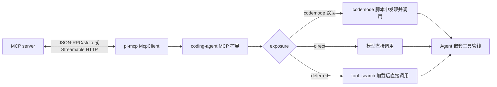

# 12｜MCP 与 Code Mode：外部工具怎样进入 Agent

[返回总目录](README.md) · [上一章](11-终端与运行模式.md) · [下一章](13-Durable与远程体系.md)

MCP 是外部服务向客户端提供工具和资源的协议；Code Mode（工具名 `codemode`）是 Pi 的脚本工具，让模型用一段 JavaScript 组合、筛选其他工具的调用。
二者可以配合，但不是同一层：MCP 负责连接、列出能力与实际远程调用；Code Mode 负责脚本执行、工具发现和结果整理。
当前仓库的编码 Agent 将两者做成内置扩展，底层仍经过 Agent 的工具管线。
[MCP 扩展](https://github.com/earendil-works/pi/blob/6fb2e7815167e6b19006fc526d1a5d0f5f998787/packages/coding-agent/src/extensions/mcp/index.ts) · [Code Mode 扩展](https://github.com/earendil-works/pi/blob/6fb2e7815167e6b19006fc526d1a5d0f5f998787/packages/coding-agent/src/extensions/codemode/index.ts)



## 为什么有两套源码

`packages/mcp` 是通用 MCP 客户端库。
`McpClient.connect()` 建立传输、发 `initialize`、验证协议版本、保存服务端信息/能力/说明并发送 `notifications/initialized`；之后 `listTools()`、`callTool()`、`listResources()` 等走 JSON-RPC 请求。
客户端维护请求 ID、待响应表、超时/取消和连接关闭状态。
这一层不知道当前 Agent 的系统提示或 UI。
[McpClient](https://github.com/earendil-works/pi/blob/6fb2e7815167e6b19006fc526d1a5d0f5f998787/packages/mcp/src/client.ts)

`packages/coding-agent/src/extensions/mcp` 才把配置的 server 连接到当前会话，将 server 工具变为 Pi 工具定义、计算暴露方式、管理 `/mcp` 命令及认证状态，并把结果转成模型消息。
它也为资源注册 `list_mcp_resources`、`list_mcp_resource_templates`、`read_mcp_resource`。
因此“协议支持资源”与“这个 Agent 如何向模型提供资源”要分别看客户端库与扩展。
[扩展入口](https://github.com/earendil-works/pi/blob/6fb2e7815167e6b19006fc526d1a5d0f5f998787/packages/coding-agent/src/extensions/mcp/index.ts) · [工具适配](https://github.com/earendil-works/pi/blob/6fb2e7815167e6b19006fc526d1a5d0f5f998787/packages/coding-agent/src/extensions/mcp/tools.ts) · [资源适配](https://github.com/earendil-works/pi/blob/6fb2e7815167e6b19006fc526d1a5d0f5f998787/packages/coding-agent/src/extensions/mcp/resources.ts)

## 配置与传输先过一遍

用户级配置在 agent 目录的 `mcp.json`，受信任项目可用 `.pi/mcp.json`。
项目同名条目可覆盖用户级条目；只写 `enabled`、`exposure`、`toolExposure` 的项目条目只调整这几项并保留用户级连接字段。
未获项目信任时不读取项目配置。
配置错误会被记录并跳过无效 server，不使其他 server 全部失效。
[配置读取](https://github.com/earendil-works/pi/blob/6fb2e7815167e6b19006fc526d1a5d0f5f998787/packages/coding-agent/src/extensions/mcp/config.ts)

`command` + `args` 选择 stdio，客户端启动一个子进程、通过标准输入输出传 JSON-RPC；`url` 选择 Streamable HTTP，POST 请求可接 JSON 或 SSE 响应。
这里的 SSE 是 HTTP 响应流的一种内容形式，**不等于**支持旧式单独的 MCP SSE transport 配置，旧 `type:"sse"` 会被拒绝。
stdio 的 `command` 是可执行文件、`args` 是参数数组，并非 shell 命令字符串。
[配置说明](https://github.com/earendil-works/pi/blob/6fb2e7815167e6b19006fc526d1a5d0f5f998787/packages/coding-agent/docs/mcp.md) · [stdio 实现](https://github.com/earendil-works/pi/blob/6fb2e7815167e6b19006fc526d1a5d0f5f998787/packages/mcp/src/transports/stdio.ts) · [HTTP 实现](https://github.com/earendil-works/pi/blob/6fb2e7815167e6b19006fc526d1a5d0f5f998787/packages/mcp/src/transports/streamable-http.ts)

HTTP server 没有显式 Authorization header、收到需要认证的响应时可走 OAuth；交互式 `/mcp login` 或 CLI `pi mcp login` 完成授权，凭证保存在 agent 目录的 `mcp-auth.json`。
`/mcp` 还可看连接状态、重连、启停 server 和改暴露方式。
会话会留意外部命令完成的新登录，在后续 turn 重新连接。
个人凭证应放用户级配置；项目配置的某些认证来源被拒绝。
[OAuth 集成](https://github.com/earendil-works/pi/blob/6fb2e7815167e6b19006fc526d1a5d0f5f998787/packages/coding-agent/src/extensions/mcp/oauth.ts) · [配置校验](https://github.com/earendil-works/pi/blob/6fb2e7815167e6b19006fc526d1a5d0f5f998787/packages/coding-agent/src/extensions/mcp/config.ts) · [命令/管理](https://github.com/earendil-works/pi/blob/6fb2e7815167e6b19006fc526d1a5d0f5f998787/packages/coding-agent/src/extensions/mcp/index.ts)

## 暴露方式决定模型怎样找到工具

server 的每个工具会变成 `mcp__<server>__<tool>`。
名称规范化为合法标识，过长或不同原名碰撞时加短后缀。
`toolExposure` 可按具体工具覆盖 server 的 `exposure`，所以同一个 server 可同时提供直接、延迟、脚本内和隐藏工具。
[工具命名](https://github.com/earendil-works/pi/blob/6fb2e7815167e6b19006fc526d1a5d0f5f998787/packages/coding-agent/src/extensions/mcp/tools.ts) · [配置与暴露](https://github.com/earendil-works/pi/blob/6fb2e7815167e6b19006fc526d1a5d0f5f998787/packages/coding-agent/src/extensions/mcp/index.ts)

| 暴露值 | 模型看见什么 | 调用路径 |
|---|---|---|
| `codemode`（默认） | 工具本身不成为直接声明，也不逐个写进 codemode 描述；系统提示中的 `mcp_servers` 介绍 namespace。 | 脚本通过 `searchTools()`、`describeTool()`、`ALL_TOOLS` 找到，再以 `tools.mcp__...()` 调用。 |
| `deferred` | 起初不直接声明；`tool_search` 找到并加载后可在下一次请求直接调用。 | 延迟发现/激活。 |
| `direct` | 像内置工具一样声明给模型，也可由 codemode 调用。 | 模型直接发 `toolCall`。 |
| `hidden` | 不可达。 | 不发起调用。 |

`codemode` 与 `deferred` 工具从技术上可由两种间接机制触达；区别主要是 MCP 扩展自动激活哪一个：默认 `codemode` 暴露会启用 Code Mode（除非 `autoEnableCodemode:false`），`deferred` 暴露会启用 `tool_search`。
若二者都不可用，扩展发警告，不会声称工具已可调用。
`direct` 工具要求首轮请求就声明，因此第一次 prompt 最多等一段启动时间；其他 server 在脚本搜索或工具调用真正需要它们时等待。
[自动激活和等待](https://github.com/earendil-works/pi/blob/6fb2e7815167e6b19006fc526d1a5d0f5f998787/packages/coding-agent/src/extensions/mcp/index.ts)

`mcp_servers` 系统提示段列出启用的间接工具 server、到达方式及一句说明；每次 prompt 开始时按连接状态更新这个段。
它不是把 server 的所有工具 schema 都塞进模型请求。
server 后续发工具列表变化通知时，新增工具可用、撤销工具不可达。
工具进入下一次模型声明还受当前活动工具集合与暴露策略控制。
[系统提示与连接变化](https://github.com/earendil-works/pi/blob/6fb2e7815167e6b19006fc526d1a5d0f5f998787/packages/coding-agent/src/extensions/mcp/index.ts)

## 一次 MCP 工具调用的完整路径

模型若已直接看到 `mcp__docs__search`，发起调用后，Agent 先校验参数并走 `beforeToolCall`；MCP 工具适配器调用对应 server 的 `McpClient.callTool()`，收到 `CallToolResult`，再把其文本、图片等块转成 Pi 模型内容。
MCP `isError` 会让直接调用成为错误工具结果；即使 server 返回结构化内容，模型侧内容和脚本侧去除 `_meta` 的结果仍是不同表示。
扩展 `tool_call`/`tool_result` 处理器（包括权限策略）也覆盖 Code Mode 内的嵌套 MCP 调用。
[客户端调用](https://github.com/earendil-works/pi/blob/6fb2e7815167e6b19006fc526d1a5d0f5f998787/packages/mcp/src/client.ts) · [MCP 适配](https://github.com/earendil-works/pi/blob/6fb2e7815167e6b19006fc526d1a5d0f5f998787/packages/coding-agent/src/extensions/mcp/tools.ts) · [Agent 执行](https://github.com/earendil-works/pi/blob/6fb2e7815167e6b19006fc526d1a5d0f5f998787/packages/agent/src/agent-loop.ts)

模型可见的 MCP 长文本超过 20 KiB 时中间被截去，完整文本保存临时文件并给出路径。
Code Mode 脚本收到未经模型文本截断、但已去除 `_meta` 的 `CallToolResult`，可在脚本里过滤后只输出需要的片段；其中 `content`、`structuredContent`、`isError` 都可检查。
服务端工具报 `isError` 时，脚本调用仍能拿到结果对象并自行处理；这与没有输出 schema 的一般工具发生错误时抛给脚本的行为不同。
[结果适配](https://github.com/earendil-works/pi/blob/6fb2e7815167e6b19006fc526d1a5d0f5f998787/packages/coding-agent/src/extensions/mcp/tools.ts) · [脚本结果转换](https://github.com/earendil-works/pi/blob/6fb2e7815167e6b19006fc526d1a5d0f5f998787/packages/coding-agent/src/extensions/codemode/execute.ts)

## 资源不是工具调用的附属文本

MCP server 可另外列出资源与资源模板。
Pi 的三个资源工具支持按 server 分页、读取 URI；文本和图片进入模型内容，其他二进制存临时文件。
UI 专用的 `ui://` 或 `profile=mcp-app` 资源被略过，因为这里没有 MCP Apps 渲染器。
资源工具的暴露程度取可访问 server 中最宽的一档。
列资源和读资源在暂时性 HTTP 错误后可再试一次；普通工具调用不自动重试，因为服务端可能已执行副作用。
[资源实现](https://github.com/earendil-works/pi/blob/6fb2e7815167e6b19006fc526d1a5d0f5f998787/packages/coding-agent/src/extensions/mcp/resources.ts) · [客户端分页](https://github.com/earendil-works/pi/blob/6fb2e7815167e6b19006fc526d1a5d0f5f998787/packages/mcp/src/client.ts)

## Code Mode 本身怎样运行

`codemode` 是一个扩展注册的工具，初始并不自动成为活动工具；MCP 扩展可按配置激活，用户也可在工具设置中激活。
参数 `code` 是原始 JavaScript 源码，不是 JSON 字符串包着的脚本。
运行时把代码当异步函数体，可用顶层 `await` 与 `return`；首行可写超时/输出预算选项。
脚本在 QuickJS WebAssembly 的 worker 沙箱里执行，没有 Node 文件系统、网络或普通宿主模块访问；它通过暴露的 `tools.*` 桥接实际工具。
[扩展注册](https://github.com/earendil-works/pi/blob/6fb2e7815167e6b19006fc526d1a5d0f5f998787/packages/coding-agent/src/extensions/codemode/index.ts) · [工具定义](https://github.com/earendil-works/pi/blob/6fb2e7815167e6b19006fc526d1a5d0f5f998787/packages/coding-agent/src/extensions/codemode/tool.ts) · [沙箱宿主](https://github.com/earendil-works/pi/blob/6fb2e7815167e6b19006fc526d1a5d0f5f998787/packages/codemode/src/runtime/host.ts)

一个具体脚本可以先 `searchTools("search docs")`，用 `describeTool()` 看参数，再 `await tools.mcp__docs__search({query:"..."})`，最后 `text(result.content[0].text)`。
同一个脚本可并发独立调用或把上一次结果作为下一次参数，但脚本里的代码运行不等于绕过宿主权限：`executeCodemode()` 只把会话上下文提供的可调用工具放进沙箱桥接；嵌套调用经 `ctx.executeTool()`，仍经过工具钩子。
脚本本身不允许再启动另一个 codemode。
[可调用集合](https://github.com/earendil-works/pi/blob/6fb2e7815167e6b19006fc526d1a5d0f5f998787/packages/coding-agent/src/extensions/codemode/tool.ts) · [执行桥接](https://github.com/earendil-works/pi/blob/6fb2e7815167e6b19006fc526d1a5d0f5f998787/packages/coding-agent/src/extensions/codemode/execute.ts)

`text()`、`image()`、`console.log()` 或顶层返回值组成脚本输出；`store()/load()` 在会话分支上保存 JSON 值，只有脚本成功时提交写入。
输出预算超出时存完整输出文件；图片会另存文件并保留模型可用的图片块。
脚本失败返回 `isError:true` 与可见错误文字。
无会话上下文直接调用脚本工具时，不具备可调用工具集合，持久化存储也不会工作。
[执行和输出](https://github.com/earendil-works/pi/blob/6fb2e7815167e6b19006fc526d1a5d0f5f998787/packages/coding-agent/src/extensions/codemode/execute.ts) · [用户文档](https://github.com/earendil-works/pi/blob/6fb2e7815167e6b19006fc526d1a5d0f5f998787/packages/coding-agent/docs/codemode.md)

Code Mode 的 `mode:"on"` 是默认：直接声明的工具仍可直接调用，同时描述中可提供脚本调用提示。
`mode:"only"` 可隐藏活动直接工具的单独声明，让模型经 Code Mode 调用；这是用户可选设置，不是 MCP 或 Agent 核心的固定运行方式。
脚本工具的描述有内联预算，未列出的工具仍可搜索；新 server 连接不会要求把整套工具 schema 重新塞进描述。
[loadout 逻辑](https://github.com/earendil-works/pi/blob/6fb2e7815167e6b19006fc526d1a5d0f5f998787/packages/coding-agent/src/extensions/codemode/tool.ts) · [默认设置](https://github.com/earendil-works/pi/blob/6fb2e7815167e6b19006fc526d1a5d0f5f998787/packages/coding-agent/src/core/settings-defaults.ts)

## 边界与故障如何辨认

MCP 连接失败、需登录、服务器响应错误、工具结果 `isError` 是不同状态。
`/mcp` 或 `pi mcp list` 用于看连接和配置；脚本调用要查看结果对象；直接调用要查看 Agent 的错误工具结果。
`McpClient` 对分页 cursor 重复、超页数、关闭传输中的未决请求有明确错误。
网络掉线后的重连与 OAuth 重新授权属于连接层，不该被解释为 Agent 自己在重做上一轮推理。
[客户端](https://github.com/earendil-works/pi/blob/6fb2e7815167e6b19006fc526d1a5d0f5f998787/packages/mcp/src/client.ts) · [扩展诊断](https://github.com/earendil-works/pi/blob/6fb2e7815167e6b19006fc526d1a5d0f5f998787/packages/coding-agent/src/extensions/mcp/index.ts)

项目级 MCP 配置只在受信任项目读取；工具可调用也不表示内容可信。
MCP server 的输出进入模型上下文，权限和安全边界仍由宿主工具钩子、项目信任与实际执行环境决定。
当前仓库不把 MCP 当作所有工具的统一内部协议：内置 `read/edit/bash` 等直接是 Pi 的工具定义，MCP 是外部能力接入路径。
[项目配置](https://github.com/earendil-works/pi/blob/6fb2e7815167e6b19006fc526d1a5d0f5f998787/packages/coding-agent/src/extensions/mcp/config.ts) · [内置工具](https://github.com/earendil-works/pi/blob/6fb2e7815167e6b19006fc526d1a5d0f5f998787/packages/coding-agent/src/core/tools/index.ts)

## 一个 server、三个工具的暴露示例

假设项目配置一个名为 `docs` 的 server，其默认 `exposure:"codemode"`，而 `toolExposure` 把 `search` 设为 `direct`、`delete` 设为 `hidden`。
连接后，同一个 server 的三个工具不会按同一方式进入模型请求：`search` 可直接声明，普通工具需在脚本里发现，`delete` 不可达。
规则按具体工具求有效暴露，不能只看 server 总值。
[配置类型](https://github.com/earendil-works/pi/blob/6fb2e7815167e6b19006fc526d1a5d0f5f998787/packages/coding-agent/src/core/mcp-servers.ts) · [扩展路由](https://github.com/earendil-works/pi/blob/6fb2e7815167e6b19006fc526d1a5d0f5f998787/packages/coding-agent/src/extensions/mcp/index.ts)

```json
{
  "mcpServers": {
    "docs": {
      "url": "https://example.com/mcp",
      "exposure": "codemode",
      "toolExposure": {
        "search": "direct",
        "delete": "hidden"
      }
    }
  }
}
```

一个名字如 `mcp__docs__search` 是**本地模型工具名**，不是 server 协议里原始的 `search` 名直接拼成 HTTP URL。
适配器把本地名字映回拥有该工具的 server 与原名，随后 `McpClient.callTool()` 发 `tools/call` JSON-RPC。
名称清洗可能把两个不同名字变成同一标识，所以源码遇碰撞加后缀；调用链需使用注册后的确切名字。
[工具名生成](https://github.com/earendil-works/pi/blob/6fb2e7815167e6b19006fc526d1a5d0f5f998787/packages/coding-agent/src/extensions/mcp/tools.ts) · [MCP 客户端](https://github.com/earendil-works/pi/blob/6fb2e7815167e6b19006fc526d1a5d0f5f998787/packages/mcp/src/client.ts)

## 连接等待与重连的时间点

会话启动时，对已启用 server 在后台建立连接。
含 `direct` 工具的 server 要影响首轮模型的工具声明，所以第一条 prompt 会等待它们一段上限；纯 `codemode` 或 `deferred` server 无须阻塞首轮完整工具列表。
脚本若明确提到 `mcp__<server>`，只等相关 server；若调用 `searchTools()` 或枚举 `ALL_TOOLS`，则等所有有关 server。
`tool_search` 和资源工具也需等全部有关 server，直接 MCP 调用只等其所属 server。
[等待策略](https://github.com/earendil-works/pi/blob/6fb2e7815167e6b19006fc526d1a5d0f5f998787/packages/coding-agent/src/extensions/mcp/index.ts)

一个常见时序是：启动时 server 尚未连接，首轮模型仅收到 namespace 说明；稍后 server 连接并公布工具；模型下一次用 Code Mode 搜索时，脚本入口等 server 准备完成，然后把发现的工具经桥接调用。
这解释了为什么系统提示里的 server 摘要和实际可调用工具的时间状态可能不同。
摘要会在后续 prompt 开始时更新，工具连接事件本身不会倒改已经发出的模型请求。
[系统提示更新](https://github.com/earendil-works/pi/blob/6fb2e7815167e6b19006fc526d1a5d0f5f998787/packages/coding-agent/src/extensions/mcp/index.ts)

server 重连时旧传输先关闭、新传输再建立。
扩展在 `tool_call` 钩子中等待“准备好”的 Promise，即使 UI 仍显示先前 connected，也不能直接用正在替换的旧连接。
server 列表变化或扩展注册变化同样会使已撤回工具不可达。
[重连与变更](https://github.com/earendil-works/pi/blob/6fb2e7815167e6b19006fc526d1a5d0f5f998787/packages/coding-agent/src/extensions/mcp/index.ts)

## Code Mode 脚本执行示意

```javascript
const found = await searchTools("find documentation", { namespace: "mcp__docs" });
if (found.length === 0) {
  text("没有可用的文档搜索工具");
} else {
  const help = await describeTool(found[0].name);
  text(help);
}
```

这个脚本只搜索并显示工具定义，没有调用远程工具。
若确实要调用，要根据 `describeTool()` 返回的参数形状写 `tools.<name>({...})`。
脚本返回的文本只在脚本结束/输出阶段进入模型上下文；`console.log()` 也只作为脚本输出的一部分。
多个独立调用可用 `Promise.allSettled()` 聚合，再将结果中必要字段 `text()` 出来，避免每个远程响应全文占据上下文。
[发现全局](https://github.com/earendil-works/pi/blob/6fb2e7815167e6b19006fc526d1a5d0f5f998787/packages/coding-agent/src/extensions/codemode/execute.ts) · [Code Mode 文档](https://github.com/earendil-works/pi/blob/6fb2e7815167e6b19006fc526d1a5d0f5f998787/packages/coding-agent/docs/codemode.md)

`ALL_TOOLS` 和 `describeNamespace()` 是发现入口。
namespace 描述可携带 server 的说明和 instructions，但 server instructions 不自动复制进每一个 MCP 工具描述。
对调用者而言，这使“查到工具参数”和“阅读 server 级使用说明”成为两步；若参数含特殊约束，应同时阅读 namespace。
[发现实现](https://github.com/earendil-works/pi/blob/6fb2e7815167e6b19006fc526d1a5d0f5f998787/packages/coding-agent/src/extensions/codemode/execute.ts)

沙箱与宿主分离：QuickJS 执行脚本，宿主注册可用工具与全局函数，worker 消息桥把脚本请求交还给宿主。
脚本没有直接的 Node 文件系统/网络，但若它调用被允许的 `bash` 或 MCP 工具，那个工具当然可按自身权限操作外部世界。
所谓“沙箱”约束的是脚本直接能做什么，不能替代宿主对可调用工具的权限审查。
[沙箱实现](https://github.com/earendil-works/pi/blob/6fb2e7815167e6b19006fc526d1a5d0f5f998787/packages/codemode/src/runtime/host.ts) · [桥接实现](https://github.com/earendil-works/pi/blob/6fb2e7815167e6b19006fc526d1a5d0f5f998787/packages/coding-agent/src/extensions/codemode/execute.ts)

脚本 `store()` / `load()` 的值随当前会话分支重放；`readCodemodeStore()` 从分支条目计算现值，成功执行后才追加写入条目。
它不是跨所有会话共享的全局数据库，也不等同于 MCP server 的持久存储。
脚本结束时还在运行的嵌套调用会标成取消；脚本失败的 `details.calls` 保留已开始调用的简要状态，供排查哪个内层调用失败。
[分支存储](https://github.com/earendil-works/pi/blob/6fb2e7815167e6b19006fc526d1a5d0f5f998787/packages/coding-agent/src/extensions/codemode/execute.ts)

## 两种错误结果在脚本里为何不同

普通 Pi 工具若没有声明 `outputSchema`，Code Mode 会把其文本结果交给脚本；若工具执行错误，脚本调用抛 `Error`，可由脚本自己的 `try/catch` 处理。
若工具声明了输出 schema 且提供 `structuredContent`，脚本取得那个结构化值。
MCP 适配器对每个工具声明 `CallToolResult` 的输出 schema，因此脚本拿到去除 `_meta` 后的结果对象，包括 `isError`，需要显式检查它；服务器返回 `isError:true` 不会自动让 Promise 拒绝。
[脚本值转换](https://github.com/earendil-works/pi/blob/6fb2e7815167e6b19006fc526d1a5d0f5f998787/packages/coding-agent/src/extensions/codemode/execute.ts) · [MCP 输出 schema](https://github.com/earendil-works/pi/blob/6fb2e7815167e6b19006fc526d1a5d0f5f998787/packages/coding-agent/src/extensions/mcp/tools.ts)

直接调用 MCP 工具时，适配器仍把 `isError:true` 映为 Agent 错误结果。
因此同一次服务器响应在两种入口中的表现不同，但都没有伪造成功：模型直接入口有 `toolResult.isError`，脚本入口有结果对象中的 `isError`。
排查脚本为何输出“成功”时，先看脚本是否忘了检查该字段。
[MCP 结果转换](https://github.com/earendil-works/pi/blob/6fb2e7815167e6b19006fc526d1a5d0f5f998787/packages/coding-agent/src/extensions/mcp/tools.ts)

## 哪些行为是默认、可选或尚未支持

| 行为 | 当前定位 |
|---|---|
| stdio 与 Streamable HTTP 客户端 | 支持的 MCP 传输。 |
| server 工具默认 `codemode` 暴露 | 默认值，可按 server/工具覆盖。 |
| `autoEnableCodemode` | 默认启用条件式激活，可在配置中关闭。 |
| `tool_search` 延迟声明 | `deferred` 暴露的可选路径。 |
| `direct` 直接声明 | 可选，适合小而常用的工具集。 |
| `mode:"only"` | Code Mode 可选工具声明策略。 |
| 旧 MCP SSE transport | 配置明确拒绝。 |
| MCP Apps 的 UI 资源渲染 | 当前资源适配器跳过。 |

这些定位来自当前源码/仓库文档，不意味着任意第三方 server 都已在本机实测。
MCP 的服务器实现、OAuth 元数据和工具 schema 各有差异，遇到具体连接失败仍须读取 `/mcp` 的当前状态与错误。
[MCP 文档](https://github.com/earendil-works/pi/blob/6fb2e7815167e6b19006fc526d1a5d0f5f998787/packages/coding-agent/docs/mcp.md) · [配置解析](https://github.com/earendil-works/pi/blob/6fb2e7815167e6b19006fc526d1a5d0f5f998787/packages/coding-agent/src/extensions/mcp/config.ts)

## 带着问题读源码与测试

1. 从 [mcp/config.ts](https://github.com/earendil-works/pi/blob/6fb2e7815167e6b19006fc526d1a5d0f5f998787/packages/coding-agent/src/extensions/mcp/config.ts) 走到 [mcp/index.ts](https://github.com/earendil-works/pi/blob/6fb2e7815167e6b19006fc526d1a5d0f5f998787/packages/coding-agent/src/extensions/mcp/index.ts)：比较受信任/未受信任项目、同名覆盖及 `autoEnableCodemode`。
2. 在 [mcp/tools.ts](https://github.com/earendil-works/pi/blob/6fb2e7815167e6b19006fc526d1a5d0f5f998787/packages/coding-agent/src/extensions/mcp/tools.ts) 找 `createMcpToolName` 和 `limitMcpContent`，解释同名规范化碰撞及长结果保存路径。
3. 在 [codemode/execute.ts](https://github.com/earendil-works/pi/blob/6fb2e7815167e6b19006fc526d1a5d0f5f998787/packages/coding-agent/src/extensions/codemode/execute.ts) 找 `ctx.executeTool`，再回到 [agent-loop.ts](https://github.com/earendil-works/pi/blob/6fb2e7815167e6b19006fc526d1a5d0f5f998787/packages/agent/src/agent-loop.ts) 的 `runToolCall`，确认嵌套调用仍经参数校验和钩子。
4. 读 [mcp-extension.test.ts](https://github.com/earendil-works/pi/blob/6fb2e7815167e6b19006fc526d1a5d0f5f998787/packages/coding-agent/test/mcp-extension.test.ts) 与 [agent-session-mcp.test.ts](https://github.com/earendil-works/pi/blob/6fb2e7815167e6b19006fc526d1a5d0f5f998787/packages/coding-agent/test/suite/agent-session-mcp.test.ts) 的暴露和会话用例，再读 [agent-session-codemode.test.ts](https://github.com/earendil-works/pi/blob/6fb2e7815167e6b19006fc526d1a5d0f5f998787/packages/coding-agent/test/suite/agent-session-codemode.test.ts) 的脚本调用用例。
5. 用 [packages/mcp/test/client.test.ts](https://github.com/earendil-works/pi/blob/6fb2e7815167e6b19006fc526d1a5d0f5f998787/packages/mcp/test/client.test.ts) 与 [streamable-http.test.ts](https://github.com/earendil-works/pi/blob/6fb2e7815167e6b19006fc526d1a5d0f5f998787/packages/mcp/test/streamable-http.test.ts) 对照协议初始化、工具调用与 HTTP 流，而不把扩展 UI 行为误放到客户端库里。
