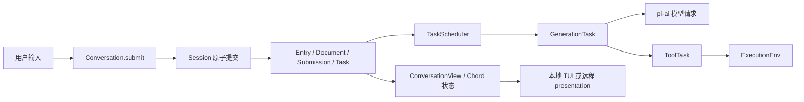
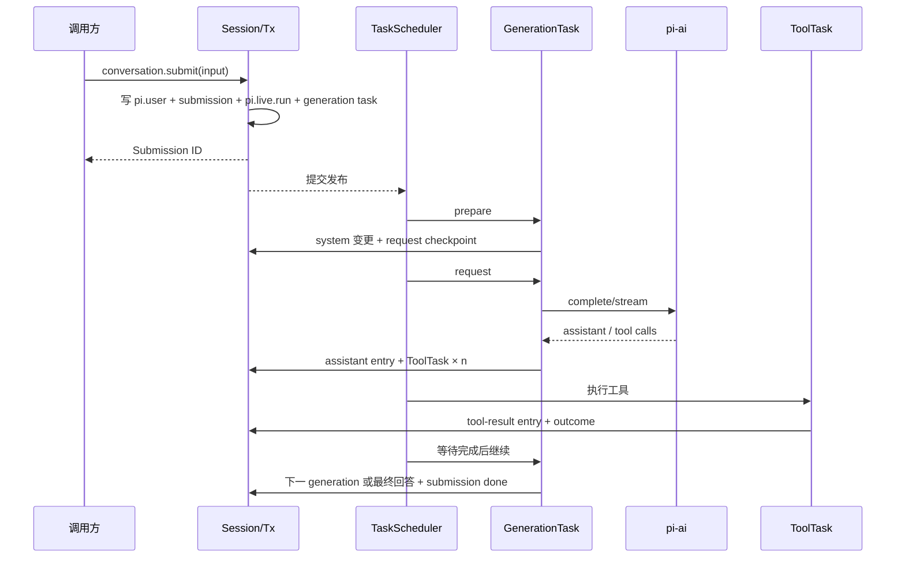
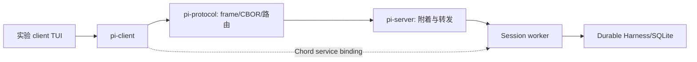
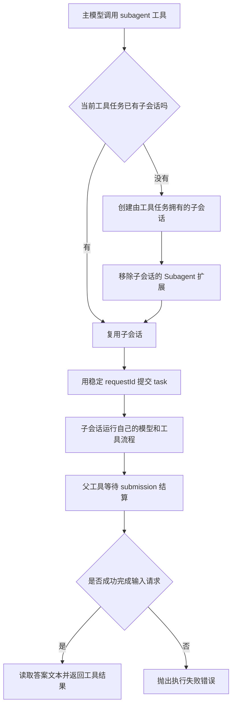

# 13. Durable 与远程体系：从提交记录到可恢复执行

[返回总目录](README.md) · [上一章](12-MCP与CodeMode.md) · [功能索引](14-细节功能索引.md)

> 源码基准：`6fb2e7815167`。本章讨论实验性的 `@earendil-works/pi-durable`、`chord`、`pi-env`、`pi-protocol`、`pi-client`、`pi-server`，以及 coding-agent 的实验接入。日常 `pi` CLI 使用的 [SessionManager](https://github.com/earendil-works/pi/blob/6fb2e7815167e6b19006fc526d1a5d0f5f998787/packages/coding-agent/src/core/session-manager.ts) 是另一条 JSONL 会话路径；不能由本章的 Durable 行为推出默认 CLI 具有任务 checkpoint、SQLite 或 Session worker。

## 13.1 先看四条边界



- **存储边界**：Session 把一批 entry、document、task、submission 变更交给 `Storage.commit()`；只有成功提交后才发布给观察者。[源码](https://github.com/earendil-works/pi/blob/6fb2e7815167e6b19006fc526d1a5d0f5f998787/packages/durable/src/session/session.ts)
- **调度边界**：TaskScheduler 从持久化的任务记录挑选可运行 phase；模型网络请求和工具 I/O 在 Session 的串行提交队列外执行。[源码](https://github.com/earendil-works/pi/blob/6fb2e7815167e6b19006fc526d1a5d0f5f998787/packages/durable/src/harness/scheduler.ts)
- **执行环境边界**：Durable 的 `ExecutionEnv` 抽象文件和命令操作；`NodeExecutionEnv` 在本机，`RemoteExecutionEnv` 通过 SSH 启动的 Rust daemon 在远端。[接口](https://github.com/earendil-works/pi/blob/6fb2e7815167e6b19006fc526d1a5d0f5f998787/packages/durable/src/env/index.ts) · [远程实现](https://github.com/earendil-works/pi/blob/6fb2e7815167e6b19006fc526d1a5d0f5f998787/packages/env/src/remote-env.ts)
- **呈现边界**：Chord 复制已提交视图；实验性的 protocol/client/server 传送路由封套和服务调用。业务服务及其数据形状归 Chord 与 coding-agent，协议包不定义会话业务。[协议说明](https://github.com/earendil-works/pi/blob/6fb2e7815167e6b19006fc526d1a5d0f5f998787/packages/protocol/README.md)

先把几个相似词分开：`Session` 是一次打开的存储内核；`Conversation` 是有 ID 的对话记录；`run` 是一批已放置输入在多次 generation 间共享、到回答或终结时结算的过程，steer 可在边界加入现有 run；`turn` 是一次模型响应及其工具调用；`Task` 是有持久状态的执行单元；`submission` 是宿主交给对话的一次输入或写入请求。这些名词分别对应不同的表和生命周期。[类型总表](https://github.com/earendil-works/pi/blob/6fb2e7815167e6b19006fc526d1a5d0f5f998787/packages/durable/src/types.ts) · [运行交接](https://github.com/earendil-works/pi/blob/6fb2e7815167e6b19006fc526d1a5d0f5f998787/packages/durable/src/harness/generation.ts) · [README](https://github.com/earendil-works/pi/blob/6fb2e7815167e6b19006fc526d1a5d0f5f998787/packages/durable/README.md)

### 两条 JSONL 不同路

默认 coding-agent 的 `SessionManager` 保存树状 `SessionEntry` JSONL，并让 `AgentSession` 继续对话。Durable 也提供名为 `JsonlStorage` 的后端，但那是实现 Durable `Storage` 接口的记录库，仍有任务、文档和 submission；两者不能因为都叫 JSONL 就等同。[默认会话](https://github.com/earendil-works/pi/blob/6fb2e7815167e6b19006fc526d1a5d0f5f998787/packages/coding-agent/src/core/session-manager.ts) · [Durable JSONL](https://github.com/earendil-works/pi/blob/6fb2e7815167e6b19006fc526d1a5d0f5f998787/packages/durable/src/storage/jsonl/storage.ts) · [Durable 存储接口](https://github.com/earendil-works/pi/blob/6fb2e7815167e6b19006fc526d1a5d0f5f998787/packages/durable/src/types.ts)

## 13.2 Session：为什么提交要排成一条线

最小入口是 `createSession(storage)`；完整 agent 入口是 `Harness.open(storage, { models, registry, ... }, context)`。`HarnessImpl` 继承 `SessionImpl`，再装上调度器、提交队列、视图与任务图。[Session](https://github.com/earendil-works/pi/blob/6fb2e7815167e6b19006fc526d1a5d0f5f998787/packages/durable/src/session/session.ts) · [Harness](https://github.com/earendil-works/pi/blob/6fb2e7815167e6b19006fc526d1a5d0f5f998787/packages/durable/src/harness/harness.ts)

一次 `commit(change, context)` 的关键不是“调用回调”本身，而是回调产生的写入要一起成功。`SessionImpl.#tail` 串行安排提交；`Transaction` 先构造候选变更、检查作用域与版本，接着调用存储提交，再采纳缓存并发布 `CommitPublication`。监听器在采纳后收到事件，因此不会看见尚未落盘的草稿。[提交实现](https://github.com/earendil-works/pi/blob/6fb2e7815167e6b19006fc526d1a5d0f5f998787/packages/durable/src/session/session.ts) · [事务实现](https://github.com/earendil-works/pi/blob/6fb2e7815167e6b19006fc526d1a5d0f5f998787/packages/durable/src/session/transaction.ts)

例如接纳一条空闲输入时，`pi.user` entry、`placed` submission、`pi.generation` task 和 `pi.live.run` 属于同一次事务。如果只保存用户文字却没保存执行任务，重启后会出现“看见输入但不会回答”的半成品；原子提交消除了这种中间状态。[接纳代码](https://github.com/earendil-works/pi/blob/6fb2e7815167e6b19006fc526d1a5d0f5f998787/packages/durable/src/harness/submissions.ts) · [运行启动](https://github.com/earendil-works/pi/blob/6fb2e7815167e6b19006fc526d1a5d0f5f998787/packages/durable/src/harness/generation.ts)

`Session.snapshot()` 读文档的已提交版本；`documentState()` 返回 Chord 附着状态；`watchDoc()` 让异步消费者接收提交变更。`snapshotAsOf()` 先确认目标 entry 对指定 conversation 可见，再按该 entry 的 `commitSeq` 读历史文档。这里的“历史”是存储的提交序号，不等于当前模型上下文。[Session](https://github.com/earendil-works/pi/blob/6fb2e7815167e6b19006fc526d1a5d0f5f998787/packages/durable/src/session/session.ts) · [类型](https://github.com/earendil-works/pi/blob/6fb2e7815167e6b19006fc526d1a5d0f5f998787/packages/durable/src/types.ts)

关闭也有顺序：先封住新工作和观察入口，等待已接纳提交/任务收尾，再关存储；清理用去掉调用方取消信号的 Context，以免一次取消把关闭流程截断。[关闭路径](https://github.com/earendil-works/pi/blob/6fb2e7815167e6b19006fc526d1a5d0f5f998787/packages/durable/src/session/session.ts)

### Storage 的三个现成选择

| 后端 | 适合看什么 | 源码 |
| --- | --- | --- |
| `MemoryStorage` | 无持久化文件的测试与示例；进程退出即丢失 | [memory.ts](https://github.com/earendil-works/pi/blob/6fb2e7815167e6b19006fc526d1a5d0f5f998787/packages/durable/src/storage/memory.ts) |
| Node JSONL | 文件型 Durable 存储；逐条记录提交，不是默认 CLI 会话格式 | [jsonl/storage.ts](https://github.com/earendil-works/pi/blob/6fb2e7815167e6b19006fc526d1a5d0f5f998787/packages/durable/src/storage/jsonl/storage.ts) · [jsonl/node.ts](https://github.com/earendil-works/pi/blob/6fb2e7815167e6b19006fc526d1a5d0f5f998787/packages/durable/src/storage/jsonl/node.ts) |
| SQLite | 实验本地 Durable TUI 与 Session worker 的持久化数据库 | [sqlite/storage.ts](https://github.com/earendil-works/pi/blob/6fb2e7815167e6b19006fc526d1a5d0f5f998787/packages/durable/src/storage/sqlite/storage.ts) · [sqlite/node.ts](https://github.com/earendil-works/pi/blob/6fb2e7815167e6b19006fc526d1a5d0f5f998787/packages/durable/src/storage/sqlite/node.ts) |

`Storage` 接口除了 `commit` 与 `close`，还有按 ID 读 conversation、entry、task、submission、document，以及带 cursor 的扫描和按提交点读文档。学习时先读接口，再读一个内存实现，最后看 SQLite 的迁移与查询；不需要先理解每条 SQL。[Storage 类型](https://github.com/earendil-works/pi/blob/6fb2e7815167e6b19006fc526d1a5d0f5f998787/packages/durable/src/types.ts) · [SQLite 迁移](https://github.com/earendil-works/pi/blob/6fb2e7815167e6b19006fc526d1a5d0f5f998787/packages/durable/src/storage/sqlite/migrations.ts) · [一致性测试](https://github.com/earendil-works/pi/blob/6fb2e7815167e6b19006fc526d1a5d0f5f998787/packages/durable/src/testing/storage-conformance.ts)

## 13.3 四类持久对象不是一张“消息表”

### Entry：不可变的对话事实

`EntryRecord` 有 `id`、`conversationId`、`kind`；可选的 `model` 是给模型看的消息数组，`data` 是给应用看的 JSON，`byTaskId` 记录产生它的任务。`head` 可以把活动上下文起点向前移动；`edits` 可省略或替换先前 entry 对模型的贡献，却不删除那条历史。[类型](https://github.com/earendil-works/pi/blob/6fb2e7815167e6b19006fc526d1a5d0f5f998787/packages/durable/src/types.ts) · [内置种类](https://github.com/earendil-works/pi/blob/6fb2e7815167e6b19006fc526d1a5d0f5f998787/packages/durable/src/entries.ts)

内置 kind 包括 `pi.user`、`pi.assistant`、`pi.system`、`pi.tool-result`、`pi.reset` 和 `pi.compaction`。`pi.system` 是系统提示与工具清单的**位置化变更**；`pi.reset` 用 `head: "self"` 开始新上下文；`pi.compaction` 以摘要和第一个保留 entry 的 ID 开始较短的模型上下文。老 entry 留在完整 transcript 里。[entries.ts](https://github.com/earendil-works/pi/blob/6fb2e7815167e6b19006fc526d1a5d0f5f998787/packages/durable/src/entries.ts) · [上下文推导](https://github.com/earendil-works/pi/blob/6fb2e7815167e6b19006fc526d1a5d0f5f998787/packages/durable/src/harness/context.ts)

### Document：与对话并排的结构化状态

`defineDoc()` 指定 `kind`、`version`、`scope`、`history`、`fork`、`initial()`；文档可属于 Session、Conversation 或 Task，也可带 key 形成 family。当前值通过 Chord tracker 草拟和 delta 提交；是否可回看、fork 时复制还是初始化，由定义而非 UI 决定。[文档定义](https://github.com/earendil-works/pi/blob/6fb2e7815167e6b19006fc526d1a5d0f5f998787/packages/durable/src/documents.ts) · [文档类型](https://github.com/earendil-works/pi/blob/6fb2e7815167e6b19006fc526d1a5d0f5f998787/packages/durable/src/types.ts)

| 文档 | 存什么 | 关键位置 |
| --- | --- | --- |
| `pi.agent` | 当前模型、thinking、扩展/工具名字、指令、cwd | [agent.ts](https://github.com/earendil-works/pi/blob/6fb2e7815167e6b19006fc526d1a5d0f5f998787/packages/durable/src/harness/agent.ts) |
| `pi.provider` | 转给 pi-ai 的持久 `sessionId`，供提供商缓存/会话亲和使用 | [provider.ts](https://github.com/earendil-works/pi/blob/6fb2e7815167e6b19006fc526d1a5d0f5f998787/packages/durable/src/harness/provider.ts) |
| `pi.live` | 当前 run 归属、生成 partial、工具进度、压缩进度 | [live.ts](https://github.com/earendil-works/pi/blob/6fb2e7815167e6b19006fc526d1a5d0f5f998787/packages/durable/src/harness/live.ts) |
| `pi.inbox` | 忙碌时排队、等待边界放置的输入或被动写入 | [inbox.ts](https://github.com/earendil-works/pi/blob/6fb2e7815167e6b19006fc526d1a5d0f5f998787/packages/durable/src/harness/inbox.ts) |
| `pi.usage` | 模型与工具用量累计 | [usage.ts](https://github.com/earendil-works/pi/blob/6fb2e7815167e6b19006fc526d1a5d0f5f998787/packages/durable/src/harness/usage.ts) |

不要把 `pi.live.generation.message` 当正式回答：它是已经提交、可恢复显示的流式 partial；最终响应会形成 `pi.assistant` entry，必要时恢复旧 partial 为 aborted 历史。[live.ts](https://github.com/earendil-works/pi/blob/6fb2e7815167e6b19006fc526d1a5d0f5f998787/packages/durable/src/harness/live.ts) · [generation.ts](https://github.com/earendil-works/pi/blob/6fb2e7815167e6b19006fc526d1a5d0f5f998787/packages/durable/src/harness/generation.ts)

### Task：阶段状态和归属

`TaskRecord` 保存 `kind`、定义 `version`、原始 `input`、`conversationId`、可选的父 `owner`、`background`、`abortRequested`、时间戳和 `state`。state 为 `pending`、`running`、`waiting`、`completing`、`terminal`。在前三者中，`checkpoint` 是可序列化的完整续跑点；`waiting` 还保存等待任务 ID 列表和 `failFast`/`allSettled` 策略。`terminal` 的 outcome 可以是 `completed`、`failed`、`aborted`、`orphaned`、`faulted`。[任务类型](https://github.com/earendil-works/pi/blob/6fb2e7815167e6b19006fc526d1a5d0f5f998787/packages/durable/src/types.ts)

`defineTask()` 是定义入口：`initial(input)` 生成起始 checkpoint；`phases` 用 `checkpoint.phase` 选择 handler；可选 `abort` 处理取消。扩展任务的定义代码留在进程 registry，记录里只存名字/版本/JSON checkpoint，所以进程重开必须再次安装相应定义。[defineTask](https://github.com/earendil-works/pi/blob/6fb2e7815167e6b19006fc526d1a5d0f5f998787/packages/durable/src/tasks.ts) · [Registry](https://github.com/earendil-works/pi/blob/6fb2e7815167e6b19006fc526d1a5d0f5f998787/packages/durable/src/harness/registry.ts)

父任务可拥有子任务；任务也可以拥有子 conversation。普通取消和 idle 等待沿归属图传播，但 `background` 改变普通遍历边界。父任务宣布结束时，若普通 owned work 还活着，会先成 `completing`；子工作完成后才成 `terminal`。这防止父任务的结果早于它创建的工作。[调度器](https://github.com/earendil-works/pi/blob/6fb2e7815167e6b19006fc526d1a5d0f5f998787/packages/durable/src/harness/scheduler.ts) · [任务图](https://github.com/earendil-works/pi/blob/6fb2e7815167e6b19006fc526d1a5d0f5f998787/packages/durable/src/harness/task-graph.ts)

### Submission：请求的持久收据

input submission 的路径是 `queued → placed → done / unanswered`；write submission 是 `queued → done / unanswered`。`requestId` 在一个 conversation 内去重：重试同一个 ID 会取得已有 submission，若类型不同则报错。`Submission.wait()` 等终态，取消等待只取消等待者，不自动取消已提交的工作。[类型](https://github.com/earendil-works/pi/blob/6fb2e7815167e6b19006fc526d1a5d0f5f998787/packages/durable/src/types.ts) · [提交与等待](https://github.com/earendil-works/pi/blob/6fb2e7815167e6b19006fc526d1a5d0f5f998787/packages/durable/src/harness/submissions.ts)

## 13.4 一条输入如何变成最终答案



空闲时 `admitSubmission()` 直接追加 user entry、创建 submission 并 `startRun()`。若忙碌，输入按 `whenBusy` 变成 steer/followUp 进入 `pi.inbox`，或 `reject` 抛 `ConversationBusy`。已有排队项目时，新输入也排在其后，避免越队。[submissions.ts](https://github.com/earendil-works/pi/blob/6fb2e7815167e6b19006fc526d1a5d0f5f998787/packages/durable/src/harness/submissions.ts)

`GenerationTask` 的 checkpoint 不是一个“继续”布尔值，而是 `prepare`、`request`、`retry`、`poll`、`tools` 五种 phase。`prepare` 解析模型、agent、设置，推导上下文、渲染 system sections，写位置化 system entry，并把本次模型、thinking、stream options、`cutoff` 固定在 `request` checkpoint。[generation.ts](https://github.com/earendil-works/pi/blob/6fb2e7815167e6b19006fc526d1a5d0f5f998787/packages/durable/src/harness/generation.ts)

`request` 在事务外调用 `ModelRuntime`，以固定 `cutoff` 重新读取消息，流式进度写 `pi.live`，响应分类后记 usage。若提供商返回异步 deferred handle，`poll` 保存 handle 和 `pollAt` 后查询结果；可重试错误进入 `retry`，把绝对时间 `until` 存盘。进程重开后不会无条件重睡完整退避期。[generation.ts](https://github.com/earendil-works/pi/blob/6fb2e7815167e6b19006fc526d1a5d0f5f998787/packages/durable/src/harness/generation.ts)

若 assistant 响应含工具调用，generation 写 assistant entry，并创建独立 `pi.tool` 子任务。并行模式可同时等待一轮子任务；串行模式在 `tools` checkpoint 保存已启动 IDs 和尚未启动的 call IDs，每完成一个再启动下一个。工具轮结束后新建 generation；`pi.live.run.inputs` 在这几次 generation 间交接，最终答案才结算输入。[generation.ts](https://github.com/earendil-works/pi/blob/6fb2e7815167e6b19006fc526d1a5d0f5f998787/packages/durable/src/harness/generation.ts) · [live.ts](https://github.com/earendil-works/pi/blob/6fb2e7815167e6b19006fc526d1a5d0f5f998787/packages/durable/src/harness/live.ts)

若没有可用模型、模型请求最终失败、工具未提供或工具参数无效，源码分别留下终态或带诊断的工具结果；不能把 `Submission` 的 `done` 简化理解为“任何模型响应已结束”。[generation.ts](https://github.com/earendil-works/pi/blob/6fb2e7815167e6b19006fc526d1a5d0f5f998787/packages/durable/src/harness/generation.ts) · [tool.ts](https://github.com/earendil-works/pi/blob/6fb2e7815167e6b19006fc526d1a5d0f5f998787/packages/durable/src/harness/tool.ts)

## 13.5 崩溃恢复的准确承诺

打开 Harness 时，调度器扫描 live task，把旧进程留下的 `running` 改为 `pending`，保留其 checkpoint；随后重建取消传播和 `completing` 结算。`Harness.open()` 本身不派发，`resume()`、提交或等待会启动调度。[scheduler.ts](https://github.com/earendil-works/pi/blob/6fb2e7815167e6b19006fc526d1a5d0f5f998787/packages/durable/src/harness/scheduler.ts) · [harness.ts](https://github.com/earendil-works/pi/blob/6fb2e7815167e6b19006fc526d1a5d0f5f998787/packages/durable/src/harness/harness.ts)

**恢复的是阶段，不是尚未提交的外部副作用的 exactly-once。** 例如模型请求在远端收到、但本地尚未提交响应时进程死掉，重开的 `request` 阶段可能再次发请求；一次 shell 命令也可能在重启前部分执行。因此 task handler 应在必要位置持久化意图/结果；不可逆外部系统还需自己的幂等机制。[scheduler.ts](https://github.com/earendil-works/pi/blob/6fb2e7815167e6b19006fc526d1a5d0f5f998787/packages/durable/src/harness/scheduler.ts) · [示例](https://github.com/earendil-works/pi/blob/6fb2e7815167e6b19006fc526d1a5d0f5f998787/packages/durable/test/examples/13-recovery.ts)

工具把经过修复与校验的最终参数及 `replay` 策略先写进 `execute` checkpoint，然后执行。重开落在 `execute` 时，仅当**记录中的策略和当前工具定义都为** `safe` 才重跑；否则写 `interrupted` 结果，提示可能部分执行。工具的默认策略是 `unsafe`。这是源码中最值得警惕的恢复边界。[ToolTask](https://github.com/earendil-works/pi/blob/6fb2e7815167e6b19006fc526d1a5d0f5f998787/packages/durable/src/harness/tool.ts) · [恢复测试](https://github.com/earendil-works/pi/blob/6fb2e7815167e6b19006fc526d1a5d0f5f998787/packages/durable/test/harness-tools-recovery.test.ts)

工具执行抛错形成可观察的 `tool_error` 诊断；取消会走 abort 结果；缺失工具或无效参数也写工具结果。运行时守卫在真正提交时重新检查该 invocation 是否仍活着、任务是否仍 `running`、是否已有持久取消标记，避免过期异步回调重新写状态。[tool.ts](https://github.com/earendil-works/pi/blob/6fb2e7815167e6b19006fc526d1a5d0f5f998787/packages/durable/src/harness/tool.ts) · [scheduler.ts](https://github.com/earendil-works/pi/blob/6fb2e7815167e6b19006fc526d1a5d0f5f998787/packages/durable/src/harness/scheduler.ts)

任务定义缺失或迁移不可用时，调度器可把它识别为 `orphaned`；未捕获异常、阶段不推进等契约故障可变 `faulted`。这类状态是对故障的记录，而不是静默把任务当作完成。`Harness.inspect()` 给出调度及未结 submission；`taskGraph()` 让 UI 看见活任务、等待和归属。[scheduler.ts](https://github.com/earendil-works/pi/blob/6fb2e7815167e6b19006fc526d1a5d0f5f998787/packages/durable/src/harness/scheduler.ts) · [harness.ts](https://github.com/earendil-works/pi/blob/6fb2e7815167e6b19006fc526d1a5d0f5f998787/packages/durable/src/harness/harness.ts)

## 13.6 收件箱、steering、follow-up 与安全边界

为什么忙碌时不直接追加用户消息？一条 assistant 的工具调用和工具结果属于同一模型轮；中间插入无关消息会破坏请求上下文顺序。`pi.inbox` 先持久化待处理项目，在 `postTools` 或 `final` 边界统一放置。[inbox.ts](https://github.com/earendil-works/pi/blob/6fb2e7815167e6b19006fc526d1a5d0f5f998787/packages/durable/src/harness/inbox.ts)

`postTools` 可取 steer；`final` 还可取 followUp。`steeringMode`/`followUpMode` 决定取队首一条还是全部。被动 write 总是先于选中的用户输入写入；若 write 是 `head: "self"` 的 reset，当前边界提升到 final，让后面的用户输入进入新上下文。已过活动 head 的旧摘要 write 被判为 `stale`，不能把已丢弃上下文重新带回来。[inbox.ts](https://github.com/earendil-works/pi/blob/6fb2e7815167e6b19006fc526d1a5d0f5f998787/packages/durable/src/harness/inbox.ts)

例如：工具运行时提交 steer “先别改文件”，它先是 `queued`；工具结果已提交后，边界追加新的 `pi.user`，后续 generation 才看见它。再如后台摘要在用户 reset 之后才完成，目标 `head` 早于当前范围，submission 终态是 `unanswered/stale`。[inbox.ts](https://github.com/earendil-works/pi/blob/6fb2e7815167e6b19006fc526d1a5d0f5f998787/packages/durable/src/harness/inbox.ts) · [收件箱测试](https://github.com/earendil-works/pi/blob/6fb2e7815167e6b19006fc526d1a5d0f5f998787/packages/durable/test/harness-inbox.test.ts)

`abortSubmission()` 只能真正撤回仍在队列里的输入；已放置、已终结、找不到是不同结果。`Conversation.abort()` 会撤回队列输入、标记作用域内 live task 并等到 idle；默认不跨 background 边界，可显式选择包含它。[submissions.ts](https://github.com/earendil-works/pi/blob/6fb2e7815167e6b19006fc526d1a5d0f5f998787/packages/durable/src/harness/submissions.ts) · [scheduler.ts](https://github.com/earendil-works/pi/blob/6fb2e7815167e6b19006fc526d1a5d0f5f998787/packages/durable/src/harness/scheduler.ts)

## 13.7 上下文推导与压缩

完整 transcript、当前活动 entries、最终发给模型的 messages 是三层。`readContext()` 找当前 head 到 cutoff 的 entries，应用 `edits`，过滤 `error`/`aborted`/`deferred` assistant 贡献，整理工具结果顺序，并把最初 user 后面的首条 system 提到请求开头。原始记录不会因为不进下一次模型请求而消失。[context.ts](https://github.com/earendil-works/pi/blob/6fb2e7815167e6b19006fc526d1a5d0f5f998787/packages/durable/src/harness/context.ts)

压缩是 `pi.compaction` 任务，其 checkpoint 依次处在 `select`、`summarize`、`retry`。`selectCut()` 向前保留大致 `keepRecentTokens` 的近期上下文，并选择不会切断 assistant/tool-result 关系的起点；`summarize` 固定 `tail` 与 `firstKept`，重开后按不可变历史重新构造摘要请求，不把整段大上下文塞进 checkpoint。[compaction.ts](https://github.com/earendil-works/pi/blob/6fb2e7815167e6b19006fc526d1a5d0f5f998787/packages/durable/src/harness/compaction.ts)

`beforeCompact` hook 可以拒绝或提供自己的摘要。默认流程调用模型生成结构化摘要；响应必须有有效文字，失败按策略重试，费用仍记入 `pi.usage`。成功的 `pi.compaction` entry 把摘要作为 user 消息并用 `head: firstKept` 选定后续活动范围。它不是删除历史，也不是改写原 entry。[compaction.ts](https://github.com/earendil-works/pi/blob/6fb2e7815167e6b19006fc526d1a5d0f5f998787/packages/durable/src/harness/compaction.ts)

触发有三种：手动 `conversation.compact()`、接近上下文窗口的阈值、提供商明确报 overflow。阻塞压缩由当前 generation 拥有并等待；后台压缩属于 conversation，结果作为 write submission 在空闲或下一安全边界放置，过期可 `stale`。overflow 的压缩失败会保留原模型错误，而不是无限压缩重试。[generation.ts](https://github.com/earendil-works/pi/blob/6fb2e7815167e6b19006fc526d1a5d0f5f998787/packages/durable/src/harness/generation.ts) · [compaction.ts](https://github.com/earendil-works/pi/blob/6fb2e7815167e6b19006fc526d1a5d0f5f998787/packages/durable/src/harness/compaction.ts)

## 13.8 Registry、Agent 与扩展为何分开存

`pi.agent` 保存模型引用、thinking、扩展/工具名字、instructions、cwd；Registry 保存当前进程安装的实际代码。每次使用时按当前 registry 解析名字，`configure()` 通过一次提交改 per-conversation 状态。默认选择所有已安装扩展；指定选择与 remove 会改变它。新请求的 model/prompt/tools 在 prepare 固定，但后续任务 phase 可能看到更新后的 registry 或 cwd。[agent.ts](https://github.com/earendil-works/pi/blob/6fb2e7815167e6b19006fc526d1a5d0f5f998787/packages/durable/src/harness/agent.ts) · [registry.ts](https://github.com/earendil-works/pi/blob/6fb2e7815167e6b19006fc526d1a5d0f5f998787/packages/durable/src/harness/registry.ts)

扩展可提供 tools、system sections、hooks、wraps 和 tasks。`beforeRequest` 改请求消息；`beforeTool` 可改参数或阻断；`afterTool` 看结果；`beforeCompact` 控制摘要。热重载是同名扩展替换，已开始的 phase 使用自己解析到的快照，下个 phase 或调用才看新定义；重启后宿主仍需重新安装任务实现。[define.ts](https://github.com/earendil-works/pi/blob/6fb2e7815167e6b19006fc526d1a5d0f5f998787/packages/durable/src/harness/define.ts) · [registry.ts](https://github.com/earendil-works/pi/blob/6fb2e7815167e6b19006fc526d1a5d0f5f998787/packages/durable/src/harness/registry.ts)

`ExecutionEnv` 则是工具和 prompt section 的环境，不是宿主的插件清单。`env` 工厂接收 conversation ID、agent cwd 与 committed reader。没提供环境时内置读写/bash 工具会得到错误结果；提供远端环境后，同一套工具可以在远端工作。[HarnessOptions](https://github.com/earendil-works/pi/blob/6fb2e7815167e6b19006fc526d1a5d0f5f998787/packages/durable/src/harness/types.ts) · [内置工具](https://github.com/earendil-works/pi/blob/6fb2e7815167e6b19006fc526d1a5d0f5f998787/packages/durable/src/tools/index.ts)

## 13.9 Chord：状态复制与服务组合

Chord 的 `Context` 是显式传递的取消和附加值载体，`BACKGROUND_CONTEXT` 不携带取消。`awaitWithContext()` 让一个等待者停止等待，却不取消底层 promise；Durable 的 `Submission.wait()` 正是这种语义。`withAbortSignal()` 派生可取消子上下文，`withoutAbortSignal()` 用于必须完成的清理。[Context](https://github.com/earendil-works/pi/blob/6fb2e7815167e6b19006fc526d1a5d0f5f998787/packages/chord/src/context/index.ts)

Chord delta/tracker 对 JSON 状态生成操作，replicated state 向订阅者给快照与后续更新。Durable 的文档和 `ConversationView` 把每次已提交更新映射成这些状态变化；慢消费者积压过多时会收到较新的完整视图而不是无限积累每帧。[delta](https://github.com/earendil-works/pi/blob/6fb2e7815167e6b19006fc526d1a5d0f5f998787/packages/chord/src/delta/index.ts) · [state](https://github.com/earendil-works/pi/blob/6fb2e7815167e6b19006fc526d1a5d0f5f998787/packages/chord/src/services/state.ts) · [Durable view](https://github.com/earendil-works/pi/blob/6fb2e7815167e6b19006fc526d1a5d0f5f998787/packages/durable/src/harness/view.ts)

服务是另一层：`defineService` 是应用持有的类型 token；provider 提供 singleton 或 keyed instance；consumer 经 `ServiceCall` 调用/订阅；`ServiceSlot` 让稳定的代理背后可换实现。`FacetHost` 在 setup/连接/激活时核验依赖，并处理重载与销毁。Chord 的服务语法 `{ serviceId, instance?, member, args }` 不由 `pi-protocol` 解释。[服务类型](https://github.com/earendil-works/pi/blob/6fb2e7815167e6b19006fc526d1a5d0f5f998787/packages/chord/src/types.ts) · [provider](https://github.com/earendil-works/pi/blob/6fb2e7815167e6b19006fc526d1a5d0f5f998787/packages/chord/src/services/provider.ts) · [consumer](https://github.com/earendil-works/pi/blob/6fb2e7815167e6b19006fc526d1a5d0f5f998787/packages/chord/src/services/consumer.ts) · [facet host](https://github.com/earendil-works/pi/blob/6fb2e7815167e6b19006fc526d1a5d0f5f998787/packages/chord/src/facets/host.ts)

插件打包又是第三层：`bundleFacetPackage()` 按 package 配置与约定入口生成独立 facet bundle/manifest；Node loader 校验产物并装载一代实现；host reload 完成切换后才释放旧代。应用选择哪些 facet 放在 server、worker、presentation，Chord 不自行安装包或定义 coding-agent 命令。[bundler](https://github.com/earendil-works/pi/blob/6fb2e7815167e6b19006fc526d1a5d0f5f998787/packages/chord/src/bundler.ts) · [package bundle](https://github.com/earendil-works/pi/blob/6fb2e7815167e6b19006fc526d1a5d0f5f998787/packages/chord/src/node/package.ts) · [loader](https://github.com/earendil-works/pi/blob/6fb2e7815167e6b19006fc526d1a5d0f5f998787/packages/chord/src/node/bundle-loader.ts)

## 13.10 本机与远端执行环境

`NodeExecutionEnv` 实现文件查询/读取/写入、目录分页、命令执行、watch 等 Durable 环境接口。文件方法返回 `Result<T, FileError>`，执行结果区分 stdout/stderr、exit code 等；工具层再把这些结果包装成模型可见的工具结果。[接口](https://github.com/earendil-works/pi/blob/6fb2e7815167e6b19006fc526d1a5d0f5f998787/packages/durable/src/env/index.ts) · [本机实现](https://github.com/earendil-works/pi/blob/6fb2e7815167e6b19006fc526d1a5d0f5f998787/packages/durable/src/env/node.ts)

`@earendil-works/pi-env` 的 `RemoteExecutionEnv` 实现同一接口。`connectSsh()` 探测远端系统，部署与包版本匹配的 `pi-env` Rust daemon，SSH 启动后以 `Connection` 交换请求；`sshConnection()` 可延迟到首次操作。远端支持系统与语义差异由包说明和对照测试界定，不能把远程执行说成复制本地 Node 进程。[env README](https://github.com/earendil-works/pi/blob/6fb2e7815167e6b19006fc526d1a5d0f5f998787/packages/env/README.md) · [SSH](https://github.com/earendil-works/pi/blob/6fb2e7815167e6b19006fc526d1a5d0f5f998787/packages/env/src/ssh.ts) · [远端环境](https://github.com/earendil-works/pi/blob/6fb2e7815167e6b19006fc526d1a5d0f5f998787/packages/env/src/remote-env.ts) · [语义](https://github.com/earendil-works/pi/blob/6fb2e7815167e6b19006fc526d1a5d0f5f998787/packages/env/docs/semantics.md)

SSH 主机密钥必须通过专用 known-hosts 文件核验；首次信任由 `scanHostKey()` 展示指纹，再由持有人带外核对后 `acceptHostKey()`。传输设置禁止代理/端口/环境转发等；凭据与 Durable 存储留在本地。daemon 的 stdin/stdout 协议是版本 1：同步行后，4 字节长度、类型、请求 ID、JSON 长度、JSON 与二进制 payload；它**不是**下节的 CBOR Pi 服务协议。[SSH](https://github.com/earendil-works/pi/blob/6fb2e7815167e6b19006fc526d1a5d0f5f998787/packages/env/src/ssh.ts) · [daemon 协议](https://github.com/earendil-works/pi/blob/6fb2e7815167e6b19006fc526d1a5d0f5f998787/packages/env/docs/protocol.md)

连接丢失时客户端使未完成请求失败，后续操作可启动新 daemon；旧文件 handle 带所属 daemon session，不能错误地复用到新连接。daemon 心跳超时会杀掉自己启动的进程组；执行被取消时发送 cancel。远端 `exec` 也区分 shell 字符串和 argv 数组。[连接](https://github.com/earendil-works/pi/blob/6fb2e7815167e6b19006fc526d1a5d0f5f998787/packages/env/src/connection.ts) · [远端环境](https://github.com/earendil-works/pi/blob/6fb2e7815167e6b19006fc526d1a5d0f5f998787/packages/env/src/remote-env.ts) · [daemon 协议](https://github.com/earendil-works/pi/blob/6fb2e7815167e6b19006fc526d1a5d0f5f998787/packages/env/docs/protocol.md)

## 13.11 远程呈现：protocol、client、server 各负责什么



`pi-protocol` 当前版本是 8。它验证 hello、request、cancel、response、service_update、attachment 封套，以及严格 JSON opaque payload；帧为 4 字节大端长度加一个确定长度 CBOR 项，默认最大 16 MiB。业务 payload 的 service/member/schema 要交由 Chord adapter 校验，协议层没有 `Transcript` 或 `AgentController` 内建知识。[protocol.ts](https://github.com/earendil-works/pi/blob/6fb2e7815167e6b19006fc526d1a5d0f5f998787/packages/protocol/src/protocol.ts) · [framing.ts](https://github.com/earendil-works/pi/blob/6fb2e7815167e6b19006fc526d1a5d0f5f998787/packages/protocol/src/framing.ts) · [README](https://github.com/earendil-works/pi/blob/6fb2e7815167e6b19006fc526d1a5d0f5f998787/packages/protocol/README.md)

server 目标是 `{serverId}`；Session 目标是 `{serverId, sessionId, attachmentId}`。`serverId` 是逻辑身份而非 socket 地址；`attachmentId` 由 server 为本次呈现附着生成，可拒绝切换会话后迟到的帧。管理 attach/detach 的业务结果不承载路由 ID，路由变化另由 `attachment` 控制消息发布。[protocol](https://github.com/earendil-works/pi/blob/6fb2e7815167e6b19006fc526d1a5d0f5f998787/packages/protocol/src/protocol.ts) · [server router](https://github.com/earendil-works/pi/blob/6fb2e7815167e6b19006fc526d1a5d0f5f998787/packages/server/src/session-router.ts)

`pi-client` 管连接、握手核对、请求 ID 对应响应、订阅和断开后的本地失败；应用借 `createClientServiceTransport()` 把路由适配给 Chord。断线不会自动重连/重放：已接纳的远端调用可能仍完成，客户端应 `reconnect()`、重新 attach，并只重试业务上可安全重复的操作。[client.ts](https://github.com/earendil-works/pi/blob/6fb2e7815167e6b19006fc526d1a5d0f5f998787/packages/client/src/client.ts) · [README](https://github.com/earendil-works/pi/blob/6fb2e7815167e6b19006fc526d1a5d0f5f998787/packages/client/README.md)

`pi-server` 核验每个连接的 live attachment，把 server scope 和 Session scope 的 Chord 调用转给对应 host；可以有多个 presentation 附在同一 Session。它只请求应用的 Session resolver 和 worker factory，不把一个 JS `Session` 或 `Harness` 对象搬过进程边界。Unix socket 只是当前 transport preset，不是协议本身。[server.ts](https://github.com/earendil-works/pi/blob/6fb2e7815167e6b19006fc526d1a5d0f5f998787/packages/server/src/server.ts) · [router](https://github.com/earendil-works/pi/blob/6fb2e7815167e6b19006fc526d1a5d0f5f998787/packages/server/src/session-router.ts) · [Unix](https://github.com/earendil-works/pi/blob/6fb2e7815167e6b19006fc526d1a5d0f5f998787/packages/server/src/transports/unix/preset.ts)

这套实验传输没有内建 peer authentication 或授权业务策略；连接端点、目录权限、服务投影和访问控制应由宿主负责。不要将“严格 JSON 校验”误当成“已经授权访问某个工作目录”。[protocol README](https://github.com/earendil-works/pi/blob/6fb2e7815167e6b19006fc526d1a5d0f5f998787/packages/protocol/README.md) · [server README](https://github.com/earendil-works/pi/blob/6fb2e7815167e6b19006fc526d1a5d0f5f998787/packages/server/README.md)

## 13.12 coding-agent 如何接入实验路径

独立本地示例在 `src/experimental/durable/`：`main.ts → openDurable() → SQLite Storage → Harness.open() → root() → TUI`。它复用原 coding-agent 的模型解析、设置、HTTP dispatcher、提示构造和界面组件，真正执行 agent 的却是 Durable Harness。会话目录与锁由 `sessions.ts` 管，`--continue` 选当前目录的新近 session。[入口](https://github.com/earendil-works/pi/blob/6fb2e7815167e6b19006fc526d1a5d0f5f998787/packages/coding-agent/src/experimental/durable/main.ts) · [运行时](https://github.com/earendil-works/pi/blob/6fb2e7815167e6b19006fc526d1a5d0f5f998787/packages/coding-agent/src/experimental/durable/runtime.ts) · [说明](https://github.com/earendil-works/pi/blob/6fb2e7815167e6b19006fc526d1a5d0f5f998787/packages/coding-agent/src/experimental/durable/README.md)

另一实验线是 client/server：`pi client` 通过 client 连接逻辑 server；server 按 Session catalog 找目录并启动/复用 Session worker；worker 打开自己的 SQLite 与 Harness，发布 `AgentController`、`Transcript`、`Models` 等 Chord services；presentation 的 TUI 订阅复制状态并调用 controller。controller 的 `operationId` 对应 Durable submission 或 compaction task，`Transcript.state` 是根 conversation 的 `ConversationView`。[server.ts](https://github.com/earendil-works/pi/blob/6fb2e7815167e6b19006fc526d1a5d0f5f998787/packages/coding-agent/src/experimental/server.ts) · [worker](https://github.com/earendil-works/pi/blob/6fb2e7815167e6b19006fc526d1a5d0f5f998787/packages/coding-agent/src/experimental/session-worker.ts) · [controller contract](https://github.com/earendil-works/pi/blob/6fb2e7815167e6b19006fc526d1a5d0f5f998787/packages/coding-agent/src/experimental/services/agent-controller.ts) · [transcript contract](https://github.com/earendil-works/pi/blob/6fb2e7815167e6b19006fc526d1a5d0f5f998787/packages/coding-agent/src/experimental/services/transcript.ts)

服务分层也有限制：当前实验 services 聚焦根 conversation；旧树导航和 next-run API 没直接照搬；历史 transcript 分页需另用 conversation entries。server 目录里的 `meta.json` 记录 Session 目录信息，`session.sqlite` 保存 Durable 状态；worker lock 保证一个写入拥有者。服务与插件重载机制仍属实验切片，不代表默认 CLI 已迁移。[实验服务说明](https://github.com/earendil-works/pi/blob/6fb2e7815167e6b19006fc526d1a5d0f5f998787/packages/coding-agent/src/experimental/services/README.md) · [catalog](https://github.com/earendil-works/pi/blob/6fb2e7815167e6b19006fc526d1a5d0f5f998787/packages/coding-agent/src/experimental/session-catalog.ts) · [worker manager](https://github.com/earendil-works/pi/blob/6fb2e7815167e6b19006fc526d1a5d0f5f998787/packages/coding-agent/src/experimental/session-worker-manager.ts)

## 13.13 一份“中断在工具调用时”的状态账本

下面用 `read` 工具举例，不预设真实 ID 数值。把持久对象分别放在不同列，才能看清重启时哪些信息仍在、哪些只存在于内存。

| 时间点 | transcript entry | task record | submission / 文档 |
| --- | --- | --- | --- |
| 接纳 “读 README” | `pi.user` | 新 `pi.generation`，checkpoint=`prepare` | input=`placed`；`pi.live.run` 记录输入和 generation task ID |
| 进入模型请求 | 可能追加 `pi.system` | generation checkpoint=`request`，含 model、thinking、stream options、cutoff | `pi.live.generation` 可显示 attempt/partial |
| 模型给出 `read` call | `pi.assistant` 保存 tool call | generation checkpoint=`tools`；创建 `pi.tool` 子任务 | `pi.live.tools` 有 callId、name、taskId、状态 |
| 工具即将执行 | 无新正式 entry | tool checkpoint=`execute`，保存已校验参数和 replay 策略 | 对应 tool slot=`running`，output/details 可分批提交 |
| 工具完成 | `pi.tool-result` | tool=`terminal/completed`；generation 的等待满足 | slot=`done`，正式输出以结果 entry 为准 |
| 下一次模型答复 | 新 `pi.assistant` | 新 generation 接手 run，最后结算 | input=`done` 且 `answer` 指向最终 entry；`pi.live.run` 消失 |

这些不是六个独立 API 返回值，而是同一条执行线上的多次原子提交。[submissions.ts](https://github.com/earendil-works/pi/blob/6fb2e7815167e6b19006fc526d1a5d0f5f998787/packages/durable/src/harness/submissions.ts) · [generation.ts](https://github.com/earendil-works/pi/blob/6fb2e7815167e6b19006fc526d1a5d0f5f998787/packages/durable/src/harness/generation.ts) · [tool.ts](https://github.com/earendil-works/pi/blob/6fb2e7815167e6b19006fc526d1a5d0f5f998787/packages/durable/src/harness/tool.ts) · [live.ts](https://github.com/earendil-works/pi/blob/6fb2e7815167e6b19006fc526d1a5d0f5f998787/packages/durable/src/harness/live.ts)

假设进程在第四行崩溃。第五、六行尚未提交，不能从 partial output 推断工具已完成。`Harness.open()` 将那条旧 `running` task 设为 `pending`；调度器重新派发 `execute`。若这个工具未声明安全重放，它写 `interrupted` 结果，保留“可能部分运行”的事实，让后续模型决定下一步；若明确安全且当前定义仍安全，才清空旧进度并从原参数重跑。[scheduler.ts](https://github.com/earendil-works/pi/blob/6fb2e7815167e6b19006fc526d1a5d0f5f998787/packages/durable/src/harness/scheduler.ts) · [tool.ts](https://github.com/earendil-works/pi/blob/6fb2e7815167e6b19006fc526d1a5d0f5f998787/packages/durable/src/harness/tool.ts)

如果崩溃发生在第二行模型请求期间，模型服务可能已经收到请求、本地却无最终 assistant entry。重开按 `request` checkpoint 再请求，`cutoff` 固定本次消息边界，但无法证明远端没有执行过前次请求。`pi.provider` 的 `sessionId` 保持提供商会话标识，不能替代请求级幂等保证。[generation.ts](https://github.com/earendil-works/pi/blob/6fb2e7815167e6b19006fc526d1a5d0f5f998787/packages/durable/src/harness/generation.ts) · [provider.ts](https://github.com/earendil-works/pi/blob/6fb2e7815167e6b19006fc526d1a5d0f5f998787/packages/durable/src/harness/provider.ts)

如果崩溃发生在第五行之后，则工具结果和 task 终态已是已提交事实；恢复的 generation 等待/下一阶段使用这条结果，而不是仅凭显示层 `pi.live.tools` 重造一个结果。[scheduler.ts](https://github.com/earendil-works/pi/blob/6fb2e7815167e6b19006fc526d1a5d0f5f998787/packages/durable/src/harness/scheduler.ts) · [context.ts](https://github.com/earendil-works/pi/blob/6fb2e7815167e6b19006fc526d1a5d0f5f998787/packages/durable/src/harness/context.ts)

### 三种“取消”也不要混淆

1. 调用者取消 `Submission.wait(context)`：只停止这个 promise 的等待；已经接纳的输入仍可能继续执行。[submissions.ts](https://github.com/earendil-works/pi/blob/6fb2e7815167e6b19006fc526d1a5d0f5f998787/packages/durable/src/harness/submissions.ts) · [Chord context](https://github.com/earendil-works/pi/blob/6fb2e7815167e6b19006fc526d1a5d0f5f998787/packages/chord/src/context/index.ts)
2. 调用 `submission.abort()`：若仍 `queued`，从 inbox 移除并结算；若已 `placed`，返回不同结果，不能抹掉 entry。[submissions.ts](https://github.com/earendil-works/pi/blob/6fb2e7815167e6b19006fc526d1a5d0f5f998787/packages/durable/src/harness/submissions.ts)
3. 调用 `conversation.abort()` 或 `harness.abortTask()`：写持久取消标记、传播到 owned work，并使当前 invocation 的信号结束；下一次恢复仍能看到取消意图。[scheduler.ts](https://github.com/earendil-works/pi/blob/6fb2e7815167e6b19006fc526d1a5d0f5f998787/packages/durable/src/harness/scheduler.ts)

这一区分解释了 API 设计：一个断开的浏览器不能等于用户主动撤销远端已经开始的工作；一条已写入 transcript 的 user entry 也不能当作从未存在。[types.ts](https://github.com/earendil-works/pi/blob/6fb2e7815167e6b19006fc526d1a5d0f5f998787/packages/durable/src/types.ts) · [client README](https://github.com/earendil-works/pi/blob/6fb2e7815167e6b19006fc526d1a5d0f5f998787/packages/client/README.md)

## 13.14 Session 的地址、分叉与所有权

Conversation ID 与 Entry ID 是不同的 branded 数字 ID；根 conversation 的 ID 固定为 `ROOT_CONVERSATION_ID`。`ConversationRecord.parent` 表示 fork 的来源 conversation 和包含式截止 entry；`owner` 则表示谁创建/拥有这条 conversation（task ID 和 conversation ID）。前者用于**继承历史**，后者用于**取消与空闲等待的归属图**，两者不应画成一条边。[types.ts](https://github.com/earendil-works/pi/blob/6fb2e7815167e6b19006fc526d1a5d0f5f998787/packages/durable/src/types.ts) · [forks.ts](https://github.com/earendil-works/pi/blob/6fb2e7815167e6b19006fc526d1a5d0f5f998787/packages/durable/src/session/forks.ts)

`root()` 首次创建根，后续重开找同一个根；`createConversation()` 建独立对话；`fork(at)` 让新对话从父历史某个 entry 开始。fork 的 agent 可以取父对话当时的可回看状态，但正在运行的 `pi.live` 和 inbox 不会直接作为新对话的活任务继承。子 conversation 可由 task 拥有，它的任务活动和父任务结算关系要看 owner，而非 fork parent。[harness.ts](https://github.com/earendil-works/pi/blob/6fb2e7815167e6b19006fc526d1a5d0f5f998787/packages/durable/src/harness/harness.ts) · [agent.ts](https://github.com/earendil-works/pi/blob/6fb2e7815167e6b19006fc526d1a5d0f5f998787/packages/durable/src/harness/agent.ts) · [session forks 测试](https://github.com/earendil-works/pi/blob/6fb2e7815167e6b19006fc526d1a5d0f5f998787/packages/durable/test/session-forks.test.ts)

`snapshotAsOf()` 对 fork 尤其重要：它先确定目标 entry 在子对话可见，再沿该 entry 实际所属 conversation 的地址找历史文档。若只拿子对话 ID 读当前文档，会错误地把 fork 后设置当作 fork 点的设置。[session.ts](https://github.com/earendil-works/pi/blob/6fb2e7815167e6b19006fc526d1a5d0f5f998787/packages/durable/src/session/session.ts) · [forks.ts](https://github.com/earendil-works/pi/blob/6fb2e7815167e6b19006fc526d1a5d0f5f998787/packages/durable/src/session/forks.ts)

`TaskGraphView` 把 conversation/task owner、等待任务和生命周期投影为可订阅图。它是观察与导航线索，不是调度决策本身；调度器使用存储 task record 与归属边来判断待派发、abort、completing、idle。[task-graph.ts](https://github.com/earendil-works/pi/blob/6fb2e7815167e6b19006fc526d1a5d0f5f998787/packages/durable/src/harness/task-graph.ts) · [scheduler.ts](https://github.com/earendil-works/pi/blob/6fb2e7815167e6b19006fc526d1a5d0f5f998787/packages/durable/src/harness/scheduler.ts)

### 一个父子任务例子

```text
root conversation
└─ generation task A
   ├─ tool task B: subagent 调用
   │  └─ child conversation X
   │     └─ generation task C
   └─ tool task D: 另一工具调用
```

若 B 的工具调用创建 X，那么 X 的 `owner.taskId` 指向 B；C 则属于 X。A 等待工具 B/D；B 若声称完成却仍有普通 owned work，可能暂留 `completing`。取消 root 的普通范围沿这张 ownership 图传播，但 background 边界可阻断默认遍历。这个图不表示模型有几个并行会话，也不能从 entry parent 关系直接推出。[task-graph.ts](https://github.com/earendil-works/pi/blob/6fb2e7815167e6b19006fc526d1a5d0f5f998787/packages/durable/src/harness/task-graph.ts) · [scheduler.ts](https://github.com/earendil-works/pi/blob/6fb2e7815167e6b19006fc526d1a5d0f5f998787/packages/durable/src/harness/scheduler.ts) · [子任务示例](https://github.com/earendil-works/pi/blob/6fb2e7815167e6b19006fc526d1a5d0f5f998787/packages/durable/test/examples/24-child-tasks.ts)

## 13.15 文档更新怎样变成远端画面

在 Session 提交一批变更时，`Transaction` 会处理文档 draft，Chord tracker 产生操作，Session 将结果采纳为已提交文档状态。`ConversationViews` 将活动 entry 与 `pi.agent`、`pi.live`、`pi.inbox`、`pi.provider`、`pi.usage` 组合成 `ConversationView`。这就是独立 Durable TUI 和远端 `Transcript` 都能复用的视图。[transaction.ts](https://github.com/earendil-works/pi/blob/6fb2e7815167e6b19006fc526d1a5d0f5f998787/packages/durable/src/session/transaction.ts) · [view.ts](https://github.com/earendil-works/pi/blob/6fb2e7815167e6b19006fc526d1a5d0f5f998787/packages/durable/src/harness/view.ts)

`viewState()` 给出 read-only attached replicated state；`watch()` 给起始 value 与每次提交的 ops。迟到或重连的消费者先取当前快照，之后按次序应用 delta。消费者处理太慢时保留的更新有界，必要时切换到完整最新状态；因此 presentation 必须能处理重置快照，不应假设每个历史中间帧都到达。[view.ts](https://github.com/earendil-works/pi/blob/6fb2e7815167e6b19006fc526d1a5d0f5f998787/packages/durable/src/harness/view.ts) · [Chord state.ts](https://github.com/earendil-works/pi/blob/6fb2e7815167e6b19006fc526d1a5d0f5f998787/packages/chord/src/services/state.ts)

`watchEvents()` 是另一种实验观测口：把提交转换成 coding-agent 风格的 message/tool/compaction 事件，先给 snapshot，再给事件批次。它和 `viewState()` 都来自已提交事实，只是给不同客户端的呈现形状；既不负责推动模型，也不在断线后替客户端补发完整事件历史。[events.ts](https://github.com/earendil-works/pi/blob/6fb2e7815167e6b19006fc526d1a5d0f5f998787/packages/durable/src/harness/events.ts) · [README](https://github.com/earendil-works/pi/blob/6fb2e7815167e6b19006fc526d1a5d0f5f998787/packages/durable/README.md)

一次工具输出会先经过输出缓冲与节流，再以进度更新进入 `pi.live.tools`，最终作为 `pi.tool-result` entry 固化。节流降低状态复制量，却意味着“每个 stdout chunk 一次 UI 事件”不是 API 承诺；读者应在 [output.ts](https://github.com/earendil-works/pi/blob/6fb2e7815167e6b19006fc526d1a5d0f5f998787/packages/durable/src/harness/output.ts) 和 [tool.ts](https://github.com/earendil-works/pi/blob/6fb2e7815167e6b19006fc526d1a5d0f5f998787/packages/durable/src/harness/tool.ts) 之间追这条路径。

## 13.16 异常定位表：从表象回到持久对象

| 表象 | 优先读哪层 | 需要区分什么 |
| --- | --- | --- |
| UI 上有输入，始终没有最终回答 | submission、`pi.live.run`、generation task | 排队、已放置、模型请求失败、任务 fault 是不同状态 |
| 重启后工具结果是 `interrupted` | tool 的 `execute` checkpoint | `unsafe` 策略与真正执行失败不是一回事 |
| 重启后一次请求似乎重复 | generation `request` checkpoint、provider 调用 | 本地已提交状态与远端已接受请求之间的窗口 |
| 摘要生成成功却没替换上下文 | compaction task、write submission、head | 后台结果是否等待边界或因旧 head 变 `stale` |
| 某 task 永远不运行 | registry 定义、版本迁移、等待任务 | `orphaned`、`waiting`、缺失 definition、取消标记 |
| TUI 显示和原始记录不一致 | `ConversationView`、context head/edits | 当前活动上下文与完整 transcript 的区别 |
| 网络客户端调用跑错会话被拒 | protocol target 与 attachment | serverId/sessionId/attachmentId 中哪一个过期 |
| 远端文件 handle 突然失效 | pi-env Connection 与 daemon session | 连接重建不意味着旧 daemon handle 仍有效 |

第一行可从 `harness.inspect()`、`submission.status()` 和 `conversation.viewState()` 交叉查证。若 task 已 `terminal/faulted`，继续等 UI 并不会自动修好根因；要看其 outcome 的 error 与 `onReport`。若 submission `queued`，要看 `pi.inbox` 和当前 run；若 `placed`，要看 run owner 与 generation checkpoint。[harness.ts](https://github.com/earendil-works/pi/blob/6fb2e7815167e6b19006fc526d1a5d0f5f998787/packages/durable/src/harness/harness.ts) · [types.ts](https://github.com/earendil-works/pi/blob/6fb2e7815167e6b19006fc526d1a5d0f5f998787/packages/durable/src/types.ts) · [live.ts](https://github.com/earendil-works/pi/blob/6fb2e7815167e6b19006fc526d1a5d0f5f998787/packages/durable/src/harness/live.ts)

第二行的 `interrupted` 是一条明确的模型可见工具诊断，不是成功结果。选择重跑该工具或由用户确认副作用，是后续 agent/应用层的责任；调度器不会假装旧命令从未运行。[tool.ts](https://github.com/earendil-works/pi/blob/6fb2e7815167e6b19006fc526d1a5d0f5f998787/packages/durable/src/harness/tool.ts)

第三行要配合 provider 的实际幂等能力分析，Durable 只知道自己的 checkpoint 与已提交 entry。第五行还需看 `Registry` 是否重新安装扩展 task，以及版本升高时是否提供迁移；不能靠再次启动 scheduler 补出缺失的 handler。[scheduler.ts](https://github.com/earendil-works/pi/blob/6fb2e7815167e6b19006fc526d1a5d0f5f998787/packages/durable/src/harness/scheduler.ts) · [registry.ts](https://github.com/earendil-works/pi/blob/6fb2e7815167e6b19006fc526d1a5d0f5f998787/packages/durable/src/harness/registry.ts)

### 调度器如何避免“同一任务派发两次”

`#kick()` 只标记 dirty，并通过 microtask 开始 drain；不会在 commit listener 中同步再次 commit。drain 调用 `#reserve()`，它把本轮可运行的任务在**一次 Session 提交**中标成 `running`、创建内存 invocation；只有该提交成功才开始 phase handler。这样两个相近的唤醒不会同时认领同一个 task。[scheduler.ts](https://github.com/earendil-works/pi/blob/6fb2e7815167e6b19006fc526d1a5d0f5f998787/packages/durable/src/harness/scheduler.ts)

`#waitingOn()` 先检查等待依赖。普通 `waiting` 看 `on` 中仍存活的任务；要求 abort 的 owner 要先等普通子工作结束，从下往上处理取消。`completing` 不运行 handler，只等待结算条件。由此可理解为何任务图里一条“等待”边不是死锁的充分证据：需要看对方是否 live、归属是否形成合法等待，以及是否有取消标记。[scheduler.ts](https://github.com/earendil-works/pi/blob/6fb2e7815167e6b19006fc526d1a5d0f5f998787/packages/durable/src/harness/scheduler.ts)

`#resolve()` 用 task `kind` 找当前 registry 定义，并比较记录版本。定义缺失是 `missing_task`；定义比记录旧是 `task_too_old`；定义更新且有 `migrate` 时可转换 input/checkpoint；迁移抛错会报告并暂阻塞。`inspect()` 能把 ready、waiting、blocked 与 running 区分显示。补装/替换扩展后 registry 会唤醒调度器再检查被阻塞任务。[scheduler.ts](https://github.com/earendil-works/pi/blob/6fb2e7815167e6b19006fc526d1a5d0f5f998787/packages/durable/src/harness/scheduler.ts) · [registry.ts](https://github.com/earendil-works/pi/blob/6fb2e7815167e6b19006fc526d1a5d0f5f998787/packages/durable/src/harness/registry.ts)

一次 invocation 可连续运行几个 phase，但每个 phase 前重新回 Session 提交线判断是否已取消、关闭、等待、结束或发生故障。handler 返回后若任务仍想继续而 checkpoint 没变化，调度器会 fault，避免无限空转；phase 的 agent 在本 phase 首次使用时解析一次，下个 phase 可拿到新的 registry/agent 状态。[scheduler.ts](https://github.com/earendil-works/pi/blob/6fb2e7815167e6b19006fc526d1a5d0f5f998787/packages/durable/src/harness/scheduler.ts)

任务运行时的 `runtime.commit()` 并不是直接把旧 record 覆盖进内存。`#gated()` 到达提交线后重新核对 invocation 和最新 task record，再执行变更；若旧异步回调已经被取消、任务已 terminal，提交拒绝。`memo(name,candidate)` 则是 task record 上的 first-writer-wins 小 JSON 值，适合在一个 phase 需要稳定住选择时使用；不可放不可序列化连接或文件 handle。[scheduler.ts](https://github.com/earendil-works/pi/blob/6fb2e7815167e6b19006fc526d1a5d0f5f998787/packages/durable/src/harness/scheduler.ts) · [任务类型](https://github.com/earendil-works/pi/blob/6fb2e7815167e6b19006fc526d1a5d0f5f998787/packages/durable/src/types.ts)

### 存储故障的边界

回调在准备写批时抛错，Transaction 丢弃草稿；`StorageRejected` 明确表示写批无效果。若 storage 以其他错误拒绝，Session 无法确信它究竟写入了多少，因此把自己标记为 poisoned，拒绝后续操作，要求重新打开后从真实存储状态恢复。成功写入但内存 adopt 失败也会 poison；绝不能继续拿落后的缓存对外发布。[session.ts](https://github.com/earendil-works/pi/blob/6fb2e7815167e6b19006fc526d1a5d0f5f998787/packages/durable/src/session/session.ts) · [errors.ts](https://github.com/earendil-works/pi/blob/6fb2e7815167e6b19006fc526d1a5d0f5f998787/packages/durable/src/errors.ts)

`JsonlStorage` 的 Durable 格式包含主 `main.jsonl` commit marker 与 task/document sidecar；重开时核验记录并恢复内存索引，发现损坏会抛 `JsonlCorruptionError`，含糊的提交失败会标 poisoned。这解释了它为什么不是默认 CLI 的会话 JSONL 格式。[jsonl/storage.ts](https://github.com/earendil-works/pi/blob/6fb2e7815167e6b19006fc526d1a5d0f5f998787/packages/durable/src/storage/jsonl/storage.ts)

SQLite 实现把表记录、document revision 和 commit 序号放在关系存储里；Node adapter 使用 `node:sqlite`，可设置 WAL 自动 checkpoint 页数与争用锁等待时间。Durable 的 SQL“checkpoint”若出现在 WAL 参数里，是数据库日志整理概念；task 的 `checkpoint.phase` 是执行续跑位置，二者同名但含义无关。[sqlite/storage.ts](https://github.com/earendil-works/pi/blob/6fb2e7815167e6b19006fc526d1a5d0f5f998787/packages/durable/src/storage/sqlite/storage.ts) · [sqlite/node.ts](https://github.com/earendil-works/pi/blob/6fb2e7815167e6b19006fc526d1a5d0f5f998787/packages/durable/src/storage/sqlite/node.ts)

文档自身也有 base/delta 的状态重建：base 是完整 JSON，delta 是在其上应用的操作；`checkpointWhen` 决定何时生成新的小 base，例如 `pi.inbox` 清空或 `pi.live` 无运行中的 generation/工具时。这个“文档快照”同样不是 task 执行 checkpoint。[documents.ts](https://github.com/earendil-works/pi/blob/6fb2e7815167e6b19006fc526d1a5d0f5f998787/packages/durable/src/documents.ts) · [live.ts](https://github.com/earendil-works/pi/blob/6fb2e7815167e6b19006fc526d1a5d0f5f998787/packages/durable/src/harness/live.ts) · [inbox.ts](https://github.com/earendil-works/pi/blob/6fb2e7815167e6b19006fc526d1a5d0f5f998787/packages/durable/src/harness/inbox.ts)

## 13.17 实验体系的三条“远程”不要混在一起

| 远程对象 | 进程在哪里 | 传输 | 主要问题 |
| --- | --- | --- | --- |
| 远端模型服务 | provider API 在网络另一端 | pi-ai 的 provider HTTP/SDK | 本次请求、重试、deferred、token 用量 |
| 远端执行环境 | Durable worker 本地、Rust daemon 远端 | SSH + pi-env 自定义帧 | 文件与命令在目标机器如何执行 |
| 远端 presentation | Durable Session 在 worker，TUI/client 在另一进程 | Pi protocol CBOR + Chord services | 客户端如何附着会话并看已提交状态 |

例如在实验 client/server 上接一个 SSH `RemoteExecutionEnv`，两套远程可以同时存在：presentation 用 `{serverId, sessionId, attachmentId}` 向 worker 发服务调用，worker 再经 SSH 让 daemon 在目标机读文件。服务协议没有直接操作目标机文件；daemon 也不知道 `Transcript` 或 `AgentController`。[protocol README](https://github.com/earendil-works/pi/blob/6fb2e7815167e6b19006fc526d1a5d0f5f998787/packages/protocol/README.md) · [env README](https://github.com/earendil-works/pi/blob/6fb2e7815167e6b19006fc526d1a5d0f5f998787/packages/env/README.md)

## 13.18 关键配置字段：什么时候读取、影响什么

`HarnessSettings` 属于宿主，不作为 `pi.agent` 文档持久化；`pi.agent` 属于每个 conversation。源码允许 settings 使用 getter，调度到相应位置时再取当前值。对于新手，这比记默认数值更重要：**同一个 run 中不同阶段读取配置的时间不一样**。[types.ts](https://github.com/earendil-works/pi/blob/6fb2e7815167e6b19006fc526d1a5d0f5f998787/packages/durable/src/harness/types.ts) · [agent.ts](https://github.com/earendil-works/pi/blob/6fb2e7815167e6b19006fc526d1a5d0f5f998787/packages/durable/src/harness/agent.ts)

| 设置 | 含义 | 读取时机的关键点 |
| --- | --- | --- |
| `extensions` | 默认选哪些 registry 扩展 | 解析 conversation agent 时 |
| `stream` | provider timeout、headers、metadata、cache retention、deferred 等 | generation prepare 写进 request checkpoint |
| `retry` | agent 层重试次数与延迟 | 响应分类/摘要失败时 |
| `compaction` | 阈值、预留回答空间、近期保留量 | prepare 或 CompactionTask select 时 |
| `progress` | partial 与工具输出提交间隔 | 流式更新期间 |
| `toolExecution` | 默认 parallel 或 sequential | 处理工具轮时；工具自身也可指定模式 |
| `steeringMode` / `followUpMode` | 队列取一条或全取 | 安全边界的 Session 事务中 |
| `contextRetentionMs` | 空闲上下文缓存留存时间 | 调度器惰性清理缓存时 |

`stream.maxRetries` 是 pi-ai 某一次 provider 请求内部的重试选项；`retry.maxRetries` 是 Durable generation 收到可重试错误后重新准备下一次尝试。两层都可能存在，诊断“发了几次请求”时应分别数。[types.ts](https://github.com/earendil-works/pi/blob/6fb2e7815167e6b19006fc526d1a5d0f5f998787/packages/durable/src/harness/types.ts) · [generation.ts](https://github.com/earendil-works/pi/blob/6fb2e7815167e6b19006fc526d1a5d0f5f998787/packages/durable/src/harness/generation.ts)

默认值由 `resolveSettings()` 补全：agent 重试启用、最多 3 次，基础延迟 2 秒；compaction 启用，预留 16384 tokens、近期约保留 20000 tokens、提前 32768 tokens 启后台摘要；进度提交间隔默认 100 ms；工具默认并行；steer 和 follow-up 默认每边界一条；空闲上下文读缓存默认留 10 分钟。这是此源码快照的默认值，不是对未来版本的承诺。[agent.ts](https://github.com/earendil-works/pi/blob/6fb2e7815167e6b19006fc526d1a5d0f5f998787/packages/durable/src/harness/agent.ts)

`CompactionPolicy.reserveTokens` 不是模型输出硬上限，而是阈值计算中给回答保留的空间；`keepRecentTokens` 是摘要时粗略保留原文的量；`backgroundTokens=0` 关闭提前的后台摘要，但不等同关闭手动 compact。`enabled=false` 控制自动阈值/overflow 压缩，manual 路径另行触发。[types.ts](https://github.com/earendil-works/pi/blob/6fb2e7815167e6b19006fc526d1a5d0f5f998787/packages/durable/src/harness/types.ts) · [generation.ts](https://github.com/earendil-works/pi/blob/6fb2e7815167e6b19006fc526d1a5d0f5f998787/packages/durable/src/harness/generation.ts)

`AgentState` 中 `model` 是 `{provider, modelId}`；`extensions` 的数组表示精确选择，`{add,remove}` 表示相对宿主默认编辑；`tools` 数组精确给工具名字，`{remove}` 过滤；`instructions` 在扩展 sections 之后渲染；`cwd` 交给环境工厂。`configure()` 中 `undefined` 是不改字段，`null` 是清回宿主默认。[types.ts](https://github.com/earendil-works/pi/blob/6fb2e7815167e6b19006fc526d1a5d0f5f998787/packages/durable/src/harness/types.ts) · [agent.ts](https://github.com/earendil-works/pi/blob/6fb2e7815167e6b19006fc526d1a5d0f5f998787/packages/durable/src/harness/agent.ts)

为什么不把工具对象或模型实例写进文档？它们包含函数、连接和宿主资源，不是可移植 JSON；持久化名字后重开再通过 registry/models 解析，才有明确的版本迁移与缺失定义边界。[registry.ts](https://github.com/earendil-works/pi/blob/6fb2e7815167e6b19006fc526d1a5d0f5f998787/packages/durable/src/harness/registry.ts) · [types.ts](https://github.com/earendil-works/pi/blob/6fb2e7815167e6b19006fc526d1a5d0f5f998787/packages/durable/src/harness/types.ts)

## 13.19 三个源码示例：从行为反推契约

### 示例 A：计数任务如何续跑

[13-recovery.ts](https://github.com/earendil-works/pi/blob/6fb2e7815167e6b19006fc526d1a5d0f5f998787/packages/durable/test/examples/13-recovery.ts) 定义 `example.ticker`，input 是 `{to}`，checkpoint 是 `{phase:"tick", n}`。每次 tick 先通过 `runtime.memo()` 记录该次数已打印，再进行副作用，最后提交 `n+1` 或 terminal outcome。示例在第 2 次后关闭、重开同一 SQLite，调用 `waitForTask(id)` 启动调度并读结果。

应从例子学到的是“可恢复阶段怎样设计”，而不是“任意外部副作用都恰好一次”。memo 在这里帮示例避免重复打印，但如果副作用本身是远端付款、发邮件等，memo 提交与外部结果仍可能有不可原子化的窗口，需要目标系统自己的幂等键或事务。[示例](https://github.com/earendil-works/pi/blob/6fb2e7815167e6b19006fc526d1a5d0f5f998787/packages/durable/test/examples/13-recovery.ts) · [task runtime](https://github.com/earendil-works/pi/blob/6fb2e7815167e6b19006fc526d1a5d0f5f998787/packages/durable/src/types.ts)

阅读步骤：

1. 找 `defineTask` 的 `initial`，确定第一次运行时 checkpoint 是什么。
2. 找 `phases.tick`，画出“读 memo → 可能打印 → commit 下一状态”的顺序。
3. 找 `tx.createTask()`，确认任务属于哪个 conversation，而不是把它当普通函数调用。
4. 找 `firstRun.close()` 与第二次 `Harness.open()`，确认存储路径相同、registry 再次安装定义。
5. 找 `secondRun.waitForTask()`，确认等待调用会启动调度；只用只读 `getTask()` 不会执行它。

### 示例 B：忙碌收件箱如何保持顺序

[20-inbox.ts](https://github.com/earendil-works/pi/blob/6fb2e7815167e6b19006fc526d1a5d0f5f998787/packages/durable/test/examples/20-inbox.ts) 用 faux provider 暂停第一次回答，同时递交默认 follow-up、显式 steer、passive write，以及一条随后撤回的输入。它还展示 `whenBusy:"reject"` 如何直接拒绝，而不是被排入 inbox。最后释放模型响应，从每条 submission 的终态和 transcript 顺序核对边界行为。

该例将 `followUpMode:"all"` 设为一批取所有，因此最终边界可把多条输入放入同一后继 run；默认模式只取第一条。不要把“按 ID 顺序排队”理解成“所有输入都会进当前模型请求”：是否进入当前/后继 run 由 steer/followUp 与边界决定。[示例](https://github.com/earendil-works/pi/blob/6fb2e7815167e6b19006fc526d1a5d0f5f998787/packages/durable/test/examples/20-inbox.ts) · [inbox.ts](https://github.com/earendil-works/pi/blob/6fb2e7815167e6b19006fc526d1a5d0f5f998787/packages/durable/src/harness/inbox.ts)

阅读步骤：

1. 在 `held` 尚未 release 时查看 `pi.inbox.items`，明确此时只有排队状态。
2. 分别查 `withdrawn.abort()` 和 `whenBusy:"reject"`，一个有持久收据，一个根本未接纳。
3. release 后从 `applyBoundary()` 找“write 先于 user”的规则。
4. 从 `startRun()` 确定后继 run 收下哪些 submission ID。
5. 对照 `root.entries()` 的完整 transcript，避免只看一条最终答案推断过程。

### 示例 C：摘要结束与摘要生效不是同一时刻

[25-compaction.ts](https://github.com/earendil-works/pi/blob/6fb2e7815167e6b19006fc526d1a5d0f5f998787/packages/durable/test/examples/25-compaction.ts) 用小窗口 faux model 演示阈值摘要、忙时手动摘要和 provider overflow。手动 `compact()` 返回的是 task ID；任务成功时，若 conversation 仍忙，结果可能只是 `submissionId`，其 write 要等到边界才成为真正的 `pi.compaction` entry。示例专门先读取摘要 submission 的 `queued`，再释放原回答后等待它放置。[示例](https://github.com/earendil-works/pi/blob/6fb2e7815167e6b19006fc526d1a5d0f5f998787/packages/durable/test/examples/25-compaction.ts) · [compaction.ts](https://github.com/earendil-works/pi/blob/6fb2e7815167e6b19006fc526d1a5d0f5f998787/packages/durable/src/harness/compaction.ts)

阅读步骤：

1. 找 faux model 的 `contextWindow` 与 `settings.compaction`，算出阻塞与后台阈值。
2. 找 `CompactionTask` 的 `selectCut()`，确认摘要保留的近期消息起点。
3. 找 `placeSummary()` 中 owner 有无的分支：直接 append 或 admit write submission。
4. 找 `ContextView.head` 与 `root.entries()` 输出：模型上下文缩短，但旧记录数量仍增加。
5. 找 overflow 模拟，确认压缩后的请求与错误恢复都受 generation 任务状态控制。

这三个示例都在 `packages/durable/test/examples/`，属于可读的演示源码。与断言更密集的 [generation 恢复测试](https://github.com/earendil-works/pi/blob/6fb2e7815167e6b19006fc526d1a5d0f5f998787/packages/durable/test/harness-generation-recovery.test.ts)、[inbox 测试](https://github.com/earendil-works/pi/blob/6fb2e7815167e6b19006fc526d1a5d0f5f998787/packages/durable/test/harness-inbox.test.ts)、[压缩测试](https://github.com/earendil-works/pi/blob/6fb2e7815167e6b19006fc526d1a5d0f5f998787/packages/durable/test/harness-compaction.test.ts) 交叉阅读，可以从演示意图走到精确边界。

## 13.20 学会区分五种 ID

| 标识 | 生命周期 | 典型用途 |
| --- | --- | --- |
| `ConversationId` | 该 Session 的对话记录长期存在 | `root.id`、fork 来源、按对话查询 entries |
| `EntryId` | 一条不可变记录长期存在 | `submission.answer`、`cutoff`、fork `at`、compaction `firstKept` |
| `TaskId` | 一项持久任务长期可查询 | generation/tool/compaction 的 checkpoint 与 terminal outcome |
| `SubmissionId` | 一次接纳请求的持久收据 | 排队、放置、等待、撤回及 requestId 去重 |
| `DocumentId` | 文档 incarnation 的存储地址实体 | 历史版本读取、退休和重建 |

这些类型在 TypeScript 中是 branded number，不能用“数字看起来相同”代替语义；`Seq` 又是一个单独的提交序号，用于历史文档时间点。把 `SubmissionId` 当 `EntryId` 会让“队列中尚未放置的输入”无法表达；把 `TaskId` 当 `ConversationId` 则会错误描述父子工作。[types.ts](https://github.com/earendil-works/pi/blob/6fb2e7815167e6b19006fc526d1a5d0f5f998787/packages/durable/src/types.ts)

在远程协议里还有三种**字符串路由 ID**：`serverId` 是逻辑 server 的 UUIDv4，`sessionId` 是 server catalog 中的 Durable Session，`attachmentId` 是当前连接对该 Session 的 live 附着。它们与上表的内部数字 `ConversationId` 都不同；一个 Session 内可以有多个 conversation，一条 Session 可同时被多个 presentation 附着。[protocol.ts](https://github.com/earendil-works/pi/blob/6fb2e7815167e6b19006fc526d1a5d0f5f998787/packages/protocol/src/protocol.ts) · [server README](https://github.com/earendil-works/pi/blob/6fb2e7815167e6b19006fc526d1a5d0f5f998787/packages/server/README.md)

还有 `requestId` 这个名字会出现在不同层：Durable submission 的 `requestId` 是宿主给一条输入的去重键；Pi protocol 请求封套的 `id` 是传输响应相关键；pi-env 帧里的请求 ID 则只用于 daemon 请求/取消关联。三者不能相互替代，也不保证端到端 exactly-once。[submissions.ts](https://github.com/earendil-works/pi/blob/6fb2e7815167e6b19006fc526d1a5d0f5f998787/packages/durable/src/harness/submissions.ts) · [protocol.ts](https://github.com/earendil-works/pi/blob/6fb2e7815167e6b19006fc526d1a5d0f5f998787/packages/protocol/src/protocol.ts) · [env protocol](https://github.com/earendil-works/pi/blob/6fb2e7815167e6b19006fc526d1a5d0f5f998787/packages/env/docs/protocol.md)

## 13.21 远程附着的生命周期逐步走一遍

下面把一次实验 client 打开已有 Session 的全过程拆开。每一层都只做自己的事；把这条路径读通，比背包名更容易定位“能连接但看不到会话”的故障。[实验服务说明](https://github.com/earendil-works/pi/blob/6fb2e7815167e6b19006fc526d1a5d0f5f998787/packages/coding-agent/src/experimental/services/README.md)

1. **发现物理端点。** Unix discovery 在指定目录枚举 socket，按文件名推导预期 `serverId`，探测 hello。目录路径是本机连接地址；它不是会话 ID。[client/unix.ts](https://github.com/earendil-works/pi/blob/6fb2e7815167e6b19006fc526d1a5d0f5f998787/packages/client/src/unix.ts)
2. **建立 transport。** `createUnixTransportFactory()` 给 client 一条有序字节流；client 发 protocol version 8 的 hello，核对返回的逻辑 `serverId`。不匹配就拒绝，不把本机文件名当服务器身份的充分证明。[client/connection.ts](https://github.com/earendil-works/pi/blob/6fb2e7815167e6b19006fc526d1a5d0f5f998787/packages/client/src/connection.ts) · [client README](https://github.com/earendil-works/pi/blob/6fb2e7815167e6b19006fc526d1a5d0f5f998787/packages/client/README.md)
3. **查询 server 业务服务。** `SessionDirectory` 的列表是 Chord replicated state；`SessionManagement` 创建/附着/解除 Session。二者属于 coding-agent 应用，不是 Pi protocol 的固定消息类型。[server services](https://github.com/earendil-works/pi/blob/6fb2e7815167e6b19006fc526d1a5d0f5f998787/packages/coding-agent/src/experimental/services/server.ts) · [sessions contract](https://github.com/earendil-works/pi/blob/6fb2e7815167e6b19006fc526d1a5d0f5f998787/packages/coding-agent/src/experimental/services/sessions.ts)
4. **查找 Session 元数据。** server 应用用 catalog 中的 `meta.json` 找 `sessionId`、cwd 和目录；公开 server router 只要求 `SessionMetadata.id` 与一个 resolver，不直接规定磁盘布局。[session-catalog.ts](https://github.com/earendil-works/pi/blob/6fb2e7815167e6b19006fc526d1a5d0f5f998787/packages/coding-agent/src/experimental/session-catalog.ts) · [server types.ts](https://github.com/earendil-works/pi/blob/6fb2e7815167e6b19006fc526d1a5d0f5f998787/packages/server/src/types.ts)
5. **获得 worker。** SessionWorkerManager 启动或复用 Session worker；worker 独占 lock、打开 `session.sqlite`、装好模型运行时、Registry、Harness 与插件 host。`Session` 作为 JS 对象始终留在 worker 内。[manager](https://github.com/earendil-works/pi/blob/6fb2e7815167e6b19006fc526d1a5d0f5f998787/packages/coding-agent/src/experimental/session-worker-manager.ts) · [worker](https://github.com/earendil-works/pi/blob/6fb2e7815167e6b19006fc526d1a5d0f5f998787/packages/coding-agent/src/experimental/session-worker.ts)
6. **建立 attachment。** server 为这个 presentation 生成 live `attachmentId`，安装路由，再以独立的 `attachment` 消息通知 client。业务 attach 结果不需要携带路由标识。[server router](https://github.com/earendil-works/pi/blob/6fb2e7815167e6b19006fc526d1a5d0f5f998787/packages/server/src/session-router.ts) · [protocol](https://github.com/earendil-works/pi/blob/6fb2e7815167e6b19006fc526d1a5d0f5f998787/packages/protocol/src/protocol.ts)
7. **绑定 Session services。** client 对完整 `{serverId,sessionId,attachmentId}` 目标发 Chord service call；server 只核对目标、转发给该 worker。`AgentController.prompt()` 在 worker 内提交 Durable input；`Transcript.state` 订阅同一根 conversation 的已提交 view。[client transport](https://github.com/earendil-works/pi/blob/6fb2e7815167e6b19006fc526d1a5d0f5f998787/packages/client/src/transport.ts) · [controller provider](https://github.com/earendil-works/pi/blob/6fb2e7815167e6b19006fc526d1a5d0f5f998787/packages/coding-agent/src/experimental/services/agent-controller-provider.ts) · [transcript provider](https://github.com/earendil-works/pi/blob/6fb2e7815167e6b19006fc526d1a5d0f5f998787/packages/coding-agent/src/experimental/services/transcript-provider.ts)
8. **水合状态。** 订阅先拿 provider snapshot，再释放在水合期间缓冲的更新；后续 Chord delta 依序应用。画面上的局部状态来自已提交视图，不靠 TUI 重构 Harness 内部状态机。[client README](https://github.com/earendil-works/pi/blob/6fb2e7815167e6b19006fc526d1a5d0f5f998787/packages/client/README.md) · [Chord consumer](https://github.com/earendil-works/pi/blob/6fb2e7815167e6b19006fc526d1a5d0f5f998787/packages/chord/src/services/consumer.ts)
9. **切换或断开。** 切换 Session 时 server 发布新的 attachment 路由；旧 attachment ID 的迟到请求被拒。断线使客户端 pending 请求本地失败，但远端已经接纳的调用可能继续完成；server 在 admitted call 收尾后释放该 presentation 的 attachment。[server README](https://github.com/earendil-works/pi/blob/6fb2e7815167e6b19006fc526d1a5d0f5f998787/packages/server/README.md) · [client README](https://github.com/earendil-works/pi/blob/6fb2e7815167e6b19006fc526d1a5d0f5f998787/packages/client/README.md)
10. **worker 退休。** 零个 presentation 并不必然立刻关闭 worker：应用还要看 Harness 是否仍有活任务。正式关闭由 server/worker 的私有生命周期控制，而不是 Pi protocol 中的通用业务 request。[manager](https://github.com/earendil-works/pi/blob/6fb2e7815167e6b19006fc526d1a5d0f5f998787/packages/coding-agent/src/experimental/session-worker-manager.ts) · [server README](https://github.com/earendil-works/pi/blob/6fb2e7815167e6b19006fc526d1a5d0f5f998787/packages/server/README.md)

这十步解释一个常见现象：client 请求超时后重新附着，旧 `AgentController.prompt()` 可能已在 worker 接纳。因此新的 presentation 应先查业务状态或使用业务可去重的标识，而不是把传输请求 ID 当执行幂等键。[client README](https://github.com/earendil-works/pi/blob/6fb2e7815167e6b19006fc526d1a5d0f5f998787/packages/client/README.md) · [AgentController contract](https://github.com/earendil-works/pi/blob/6fb2e7815167e6b19006fc526d1a5d0f5f998787/packages/coding-agent/src/experimental/services/agent-controller.ts)

### Chord service update 与 Pi protocol service_update

`pi-protocol` 的 `service_update` 只有 subscription ID 和 opaque update JSON，它知道“这是一次订阅更新”，不知道某个 state 的 path、keyed instance generation 或业务字段。Chord 的 provider/consumer 负责服务控制语法、snapshot 与 delta 的编码/解码；coding-agent 的服务 token 再决定 `Transcript`、`Models`、`SessionDirectory` 的具体接口。[protocol.ts](https://github.com/earendil-works/pi/blob/6fb2e7815167e6b19006fc526d1a5d0f5f998787/packages/protocol/src/protocol.ts) · [Chord wire.ts](https://github.com/earendil-works/pi/blob/6fb2e7815167e6b19006fc526d1a5d0f5f998787/packages/chord/src/services/wire.ts) · [实验服务](https://github.com/earendil-works/pi/blob/6fb2e7815167e6b19006fc526d1a5d0f5f998787/packages/coding-agent/src/experimental/services/README.md)

例如 `Transcript.state` 传 `ConversationView`，这个 JSON 里可能有 `entries`、`docs["pi.live"]` 等；Pi protocol 仅检查它是否为严格 JSON 并限制帧大小。若 `AgentController.prompt()` 的 `message` 字段缺失，应该由 Chord/应用服务适配器按服务契约拒绝，而不是指望 CBOR decoder 理解 prompt 业务。[transcript.ts](https://github.com/earendil-works/pi/blob/6fb2e7815167e6b19006fc526d1a5d0f5f998787/packages/coding-agent/src/experimental/services/transcript.ts) · [agent-controller.ts](https://github.com/earendil-works/pi/blob/6fb2e7815167e6b19006fc526d1a5d0f5f998787/packages/coding-agent/src/experimental/services/agent-controller.ts)

实验 coordinator 是更外层的稳定端点/进程替换协调器；它不把 Harness、Transcript 或模型请求协议重新定义一遍。server 与 worker 的私有进程控制也不属于公开 Pi protocol 的 `ClientMessage` 联合类型。[coordinator](https://github.com/earendil-works/pi/blob/6fb2e7815167e6b19006fc526d1a5d0f5f998787/packages/coding-agent/src/experimental/coordinator.ts) · [process.ts](https://github.com/earendil-works/pi/blob/6fb2e7815167e6b19006fc526d1a5d0f5f998787/packages/coding-agent/src/experimental/process.ts) · [protocol README](https://github.com/earendil-works/pi/blob/6fb2e7815167e6b19006fc526d1a5d0f5f998787/packages/protocol/README.md)

## 13.22 该看什么测试，才能验证某条理解

以下测试是验证边界的定位图。测试名字比一个泛泛的“Durable 测试已通过”更能说明它到底检验了什么。

| 想验证的结论 | 对应测试 |
| --- | --- |
| 旧 `running` 的 prepare/request/partial/retry/poll 怎样恢复 | [harness-generation-recovery.test.ts](https://github.com/earendil-works/pi/blob/6fb2e7815167e6b19006fc526d1a5d0f5f998787/packages/durable/test/harness-generation-recovery.test.ts) |
| `safe` 重放与 `unsafe` interrupted、工具结果的诊断 | [harness-tools-recovery.test.ts](https://github.com/earendil-works/pi/blob/6fb2e7815167e6b19006fc526d1a5d0f5f998787/packages/durable/test/harness-tools-recovery.test.ts) |
| steer/followUp、reset、stale head 与撤回的边界顺序 | [harness-inbox.test.ts](https://github.com/earendil-works/pi/blob/6fb2e7815167e6b19006fc526d1a5d0f5f998787/packages/durable/test/harness-inbox.test.ts) |
| 背景/阻塞/手动摘要以及旧摘要过期 | [harness-compaction.test.ts](https://github.com/earendil-works/pi/blob/6fb2e7815167e6b19006fc526d1a5d0f5f998787/packages/durable/test/harness-compaction.test.ts) |
| fork 时 as-of/current/initial 文档如何复制 | [session-forks.test.ts](https://github.com/earendil-works/pi/blob/6fb2e7815167e6b19006fc526d1a5d0f5f998787/packages/durable/test/session-forks.test.ts) |
| JSONL 存储损坏与恢复、SQLite 数据读写 | [jsonl-storage.test.ts](https://github.com/earendil-works/pi/blob/6fb2e7815167e6b19006fc526d1a5d0f5f998787/packages/durable/test/jsonl-storage.test.ts) · [sqlite-storage.test.ts](https://github.com/earendil-works/pi/blob/6fb2e7815167e6b19006fc526d1a5d0f5f998787/packages/durable/test/sqlite-storage.test.ts) |
| Chord state 交付、服务生命周期与 facet reload | [state-delivery.test.ts](https://github.com/earendil-works/pi/blob/6fb2e7815167e6b19006fc526d1a5d0f5f998787/packages/chord/test/state-delivery.test.ts) · [services.test.ts](https://github.com/earendil-works/pi/blob/6fb2e7815167e6b19006fc526d1a5d0f5f998787/packages/chord/test/services.test.ts) · [facets.test.ts](https://github.com/earendil-works/pi/blob/6fb2e7815167e6b19006fc526d1a5d0f5f998787/packages/chord/test/facets.test.ts) |
| pi-env 断线、取消、分块传输和环境语义 | [remote.test.ts](https://github.com/earendil-works/pi/blob/6fb2e7815167e6b19006fc526d1a5d0f5f998787/packages/env/test/remote.test.ts) · [conformance.test.ts](https://github.com/earendil-works/pi/blob/6fb2e7815167e6b19006fc526d1a5d0f5f998787/packages/env/test/conformance.test.ts) |
| protocol 封套边界、client 重连、server 路由 | [protocol.test.ts](https://github.com/earendil-works/pi/blob/6fb2e7815167e6b19006fc526d1a5d0f5f998787/packages/protocol/test/protocol.test.ts) · [client.test.ts](https://github.com/earendil-works/pi/blob/6fb2e7815167e6b19006fc526d1a5d0f5f998787/packages/client/test/client.test.ts) · [server.test.ts](https://github.com/earendil-works/pi/blob/6fb2e7815167e6b19006fc526d1a5d0f5f998787/packages/server/test/server.test.ts) |

测试中的 faux provider 可以让状态切在特定时刻，例如已发起请求但尚无 partial，或已有 partial 但尚无最终回答；这种可控切点很适合验证重启行为。它并不能证明真实 provider 的外部请求只发生一次，实际的外部副作用边界仍以代码与提供商契约为准。[恢复测试](https://github.com/earendil-works/pi/blob/6fb2e7815167e6b19006fc526d1a5d0f5f998787/packages/durable/test/harness-generation-recovery.test.ts) · [faux provider](https://github.com/earendil-works/pi/blob/6fb2e7815167e6b19006fc526d1a5d0f5f998787/packages/ai/src/providers/faux.ts)

## 13.23 从 ExecutionEnv 接口看远端语义

`ExecutionEnv` 的 `id` 表示文件命名空间：同一个 id、同一路径应指向同一组文件。Durable 的 `edit`/`write` 用 id 与路径串行化同一文件的变更，避免两个工具调用因并发覆盖彼此。远端环境由宿主给出稳定 id，例如一个容器一枚 id；这不是 daemon 的短命进程 ID。[env interface](https://github.com/earendil-works/pi/blob/6fb2e7815167e6b19006fc526d1a5d0f5f998787/packages/durable/src/env/index.ts) · [file-mutation-queue.ts](https://github.com/earendil-works/pi/blob/6fb2e7815167e6b19006fc526d1a5d0f5f998787/packages/durable/src/tools/file-mutation-queue.ts)

| 接口类别 | 新手应看见的契约 | 相关源码 |
| --- | --- | --- |
| 文件元数据 | `lstat`、`realpath` 等区分路径/文件类型与 FileError | [ExecutionEnv](https://github.com/earendil-works/pi/blob/6fb2e7815167e6b19006fc526d1a5d0f5f998787/packages/durable/src/env/index.ts) · [RemoteExecutionEnv](https://github.com/earendil-works/pi/blob/6fb2e7815167e6b19006fc526d1a5d0f5f998787/packages/env/src/remote-env.ts) |
| 二进制读取 | `openBinaryReader()` 后按 offset/length 读，句柄必须关闭 | [NodeExecutionEnv](https://github.com/earendil-works/pi/blob/6fb2e7815167e6b19006fc526d1a5d0f5f998787/packages/durable/src/env/node.ts) · [远端 reader](https://github.com/earendil-works/pi/blob/6fb2e7815167e6b19006fc526d1a5d0f5f998787/packages/env/src/remote-env.ts) |
| 文本按行读取 | `scanLines` 处理大文件时分段读，不要求整个文件一次进入内存 | [接口](https://github.com/earendil-works/pi/blob/6fb2e7815167e6b19006fc526d1a5d0f5f998787/packages/durable/src/env/index.ts) · [远端协议](https://github.com/earendil-works/pi/blob/6fb2e7815167e6b19006fc526d1a5d0f5f998787/packages/env/docs/protocol.md) |
| 目录读取 | `openDirReader()` 分页，返回条目与继续状态 | [接口](https://github.com/earendil-works/pi/blob/6fb2e7815167e6b19006fc526d1a5d0f5f998787/packages/durable/src/env/index.ts) · [daemon fs](https://github.com/earendil-works/pi/blob/6fb2e7815167e6b19006fc526d1a5d0f5f998787/packages/env/daemon/src/fs.rs) |
| 命令执行 | shell 字符串与 argv 两种模式、输出流来源、超时/取消/退出码 | [接口](https://github.com/earendil-works/pi/blob/6fb2e7815167e6b19006fc526d1a5d0f5f998787/packages/durable/src/env/index.ts) · [daemon exec](https://github.com/earendil-works/pi/blob/6fb2e7815167e6b19006fc526d1a5d0f5f998787/packages/env/daemon/src/exec.rs) |
| 文件观察 | ready/change/error/overflow 等事件与取消 | [watch API](https://github.com/earendil-works/pi/blob/6fb2e7815167e6b19006fc526d1a5d0f5f998787/packages/durable/src/env/index.ts) · [remote watch](https://github.com/earendil-works/pi/blob/6fb2e7815167e6b19006fc526d1a5d0f5f998787/packages/env/src/watch.ts) |
| 清理 | `cleanup()` 收束环境拥有的资源 | [NodeExecutionEnv](https://github.com/earendil-works/pi/blob/6fb2e7815167e6b19006fc526d1a5d0f5f998787/packages/durable/src/env/node.ts) · [RemoteExecutionEnv](https://github.com/earendil-works/pi/blob/6fb2e7815167e6b19006fc526d1a5d0f5f998787/packages/env/src/remote-env.ts) |

远端读大文件会分多个请求并允许一定并发；写大 payload 分 chunk。daemon 协议限制单帧 16 MiB，因此“一个大文件操作”并不等于“一帧”。读 [remote-env.ts](https://github.com/earendil-works/pi/blob/6fb2e7815167e6b19006fc526d1a5d0f5f998787/packages/env/src/remote-env.ts) 的 `readRange()`、分块常量，再看 [remote.test.ts](https://github.com/earendil-works/pi/blob/6fb2e7815167e6b19006fc526d1a5d0f5f998787/packages/env/test/remote.test.ts) 中超过单次传输大小的读写案例，可以验证分块顺序与失败时的语义。

`exec(["git","status",...])` 以 argv 执行，不需要调用者拼接 shell 字符串；`exec("git status")` 则走远端 shell。两条路径在参数转义、环境变量、Windows 上的 Git Bash 行为不同。若调查“本机正常、SSH 远端失败”，应先确认调用者选了哪种形式，再看 SSH 检测出的 OS 与 daemon `hello`。不能从 `RemoteExecutionEnv` 名字推断远端 shell 一定是 Bash。[README](https://github.com/earendil-works/pi/blob/6fb2e7815167e6b19006fc526d1a5d0f5f998787/packages/env/README.md) · [protocol](https://github.com/earendil-works/pi/blob/6fb2e7815167e6b19006fc526d1a5d0f5f998787/packages/env/docs/protocol.md) · [remote-env.ts](https://github.com/earendil-works/pi/blob/6fb2e7815167e6b19006fc526d1a5d0f5f998787/packages/env/src/remote-env.ts)

远端 `Connection` 的 request ID 和 session epoch 用于关联响应并隔离重连后的旧 handle。一个 reader 在连接 A 打开后，即使连接 B 自动恢复，那个 reader 也不能继续把原 handle 数字发给 B，因为 B 的 daemon 可能把同一数字分配给另一文件。源码的 `Handle.session` 检查与 [remote.test.ts](https://github.com/earendil-works/pi/blob/6fb2e7815167e6b19006fc526d1a5d0f5f998787/packages/env/test/remote.test.ts) 的断线测试正是这个边界。[connection.ts](https://github.com/earendil-works/pi/blob/6fb2e7815167e6b19006fc526d1a5d0f5f998787/packages/env/src/connection.ts) · [remote-env.ts](https://github.com/earendil-works/pi/blob/6fb2e7815167e6b19006fc526d1a5d0f5f998787/packages/env/src/remote-env.ts)

### 分层故障例子

假设 client TUI 点了“读文件”，结果报错。至少要看四个层次：

1. Client 与 server 的完整 Session attachment 是否还有效；失效会在服务路由层拒绝。[session-router.ts](https://github.com/earendil-works/pi/blob/6fb2e7815167e6b19006fc526d1a5d0f5f998787/packages/server/src/session-router.ts)
2. Worker 的 `AgentController` 是否成功把 prompt 接纳为 Durable submission；未接纳不会有 `pi.user`。[agent-controller-provider.ts](https://github.com/earendil-works/pi/blob/6fb2e7815167e6b19006fc526d1a5d0f5f998787/packages/coding-agent/src/experimental/services/agent-controller-provider.ts)
3. Generation 是否真的选择并调用 `read`，ToolTask 是否通过参数验证与 hook；错误结果会进入 `pi.tool-result`。[generation.ts](https://github.com/earendil-works/pi/blob/6fb2e7815167e6b19006fc526d1a5d0f5f998787/packages/durable/src/harness/generation.ts) · [tool.ts](https://github.com/earendil-works/pi/blob/6fb2e7815167e6b19006fc526d1a5d0f5f998787/packages/durable/src/harness/tool.ts)
4. 环境工厂是否给了本机或远端 ExecutionEnv；若为远端，再看 SSH 主机密钥、daemon 连接、远端文件错误码。[harness.ts](https://github.com/earendil-works/pi/blob/6fb2e7815167e6b19006fc526d1a5d0f5f998787/packages/durable/src/harness/harness.ts) · [ssh.ts](https://github.com/earendil-works/pi/blob/6fb2e7815167e6b19006fc526d1a5d0f5f998787/packages/env/src/ssh.ts)

只看 TUI 的最终错误文字无法区分四层。读取 `submission.status`、`pi.live`、tool-result diagnostics 和 transport 错误位置，才知道失败发生在哪个边界。[view.ts](https://github.com/earendil-works/pi/blob/6fb2e7815167e6b19006fc526d1a5d0f5f998787/packages/durable/src/harness/view.ts) · [errors.ts](https://github.com/earendil-works/pi/blob/6fb2e7815167e6b19006fc526d1a5d0f5f998787/packages/env/src/errors.ts)

## 13.24 子 agent：普通扩展示例与实验性实现

### 三条路径都有什么，普通 Pi 默认启动哪一条

| 路径 | 子 agent 如何运行 | 是否有真实执行逻辑 | 入口与边界 |
|---|---|---|---|
| 普通 Pi 的 subagent 扩展示例 | 为任务启动独立 Pi 子进程 | 有：真实模型请求、工具执行、结果收集 | 需另外加载扩展和 agent 配置；详见第 10 章第 22 节 |
| `experimental/durable` | 同一 Harness 中创建由工具任务拥有的子 conversation | 有：接入模型运行时、存储和任务调度 | 单独的实验程序，普通 `pi` 不会默认进入这里 |
| `experimental/vacation` | 后台 task 拥有子 conversation，完成后投递报告 | 协作机制真实；search 返回预设数据 | 展示后台执行与恢复，不是联网旅行搜索产品 |

“实验性”表示它是单独的实验入口、接口和功能覆盖需要按该入口评估，不表示文件里只有伪代码。`experimental/durable/runtime.ts` 实际创建 `ModelRuntime`，注册 `Subagent`，通过 SQLite 存储打开 Harness。它复用普通 Pi 的部分配置与界面组件，但不是给普通 agent loop 自动增加一套默认多 agent 系统。[Durable runtime](https://github.com/earendil-works/pi/blob/6fb2e7815167e6b19006fc526d1a5d0f5f998787/packages/coding-agent/src/experimental/durable/runtime.ts) · [普通扩展调用链](10-提示词与扩展机制.md)

### 前台子 agent：一次工具调用如何拥有一个会话

沿 [durable/subagent.ts](https://github.com/earendil-works/pi/blob/6fb2e7815167e6b19006fc526d1a5d0f5f998787/packages/coding-agent/src/experimental/durable/subagent.ts) 阅读，工具参数只有 `task`。它的 `execute(args, api, context)` 做了以下事情：

1. 在提交事务中按当前 `api.taskId` 查找已拥有的子 conversation。存在则复用，这使崩溃后重跑能够找到同一个子会话。
2. 不存在时调用 `tx.createConversation({ ownership: { kind: "task", taskId: api.taskId } })`。子会话从父会话的 agent 配置开始，但不继承父聊天历史；任务应包含必要背景。
3. 从子会话配置移除 `Subagent` 扩展，避免它继续递归委派。继承配置不代表照搬父会话所有能力而不作调整。
4. 用 `api.details({ conversationId: child })` 记录会话标识，再取得子 conversation 的可操作 handle。
5. 提交 `{ type: "input", content: args.task, requestId: "subagent:" + api.taskId }`，随后 `await ...wait(context)` 等待结算。稳定的 requestId 用于重跑时识别同一次提交。
6. 只有 `settled.status === "done"` 且 `settled.type === "input"` 才继续读取答案；否则抛出带状态的错误。
7. `answerText()` 根据答案 entry ID 读取 `AssistantEntry`，提取文本内容，作为父工具结果返回，并附上子 conversation ID。



这里的“前台”指工具要等待子任务答案后才完成，不是终端界面完全不能操作。实验 TUI 的 `/agents` 可以切到子会话查看或引导它，工具调用返回后也可继续与该子会话交谈。取消调用会取消其子工作；主会话取消向下传播依赖第 13.14 节的 ownership 关系。不要把创建独立子 conversation 与 `fork()` 继承聊天历史混为一谈。[实验使用说明](https://github.com/earendil-works/pi/blob/6fb2e7815167e6b19006fc526d1a5d0f5f998787/packages/coding-agent/src/experimental/durable/README.md)

### 后台子 agent：为什么主会话能够先继续

`vacation` 的 `research` 工具采用不同安排：在事务中派生后台 `Research` task，并为它创建子 conversation；工具随即返回“研究已在后台开始”。之后由后台任务提交研究请求并等待完成，再把报告作为主会话的新输入提交，`whenBusy: "followUp"` 让忙碌时按后续输入处理。

```text
主模型调用 research
  → 创建后台任务与它拥有的子会话
  → research 工具先返回，主会话可以继续

后台 Research task
  → 向子会话提交研究任务
  → 等待子会话完成
  → 保存待投递报告的阶段状态
  → 将报告作为新输入投递给主会话
```

任务的 `deliver` / `report` 阶段和稳定 requestId 支持恢复时继续投递流程，避免把“进程重新启动”简单理解为“重新创建一套子 agent”。但示例中的搜索结果来自文件顶部预设的天气、博物馆和列车数据，`sleep` 用于拉开执行时间，便于观察中断与恢复；不能把这个 search 当成真实网页搜索。子会话调度、模型运行与报告回传机制和搜索数据来源应分别判断。[vacation.ts](https://github.com/earendil-works/pi/blob/6fb2e7815167e6b19006fc526d1a5d0f5f998787/packages/coding-agent/src/experimental/vacation/vacation.ts) · [vacation README](https://github.com/earendil-works/pi/blob/6fb2e7815167e6b19006fc526d1a5d0f5f998787/packages/coding-agent/src/experimental/vacation/README.md)

### 使用时需要选对启动入口

若目标是在普通 Pi 中委派代码调查，按第 10 章加载 subagent 扩展即可，不必迁移到 Durable。若目标是学习持久任务、子会话导航和恢复，则从源码仓库按 Durable README 准备依赖与运行环境，再使用其单独入口，例如：

```powershell
node --import ./packages/coding-agent/src/experimental/source-resolver.ts packages/coding-agent/src/experimental/durable/main.ts
```

这个命令来自实验入口的说明，不是“任何只克隆了源码的机器都能直接运行”的承诺。模型认证与配置也须可用；实验入口复用普通 Pi 的认证。普通扩展的多进程调度、Durable 的多会话调度，以及多 agent 是否能同时改同一个文件，是三个不同问题，不能用“支持子 agent”一概替代这些边界。

## 13.25 建议沿四个具体问题读源码

1. **为什么用户提交后不会只存消息、不存运行任务？** 从 [admitSubmission](https://github.com/earendil-works/pi/blob/6fb2e7815167e6b19006fc526d1a5d0f5f998787/packages/durable/src/harness/submissions.ts) 走到 [startRun](https://github.com/earendil-works/pi/blob/6fb2e7815167e6b19006fc526d1a5d0f5f998787/packages/durable/src/harness/generation.ts)、[Transaction](https://github.com/earendil-works/pi/blob/6fb2e7815167e6b19006fc526d1a5d0f5f998787/packages/durable/src/session/transaction.ts)、[Session commit](https://github.com/earendil-works/pi/blob/6fb2e7815167e6b19006fc526d1a5d0f5f998787/packages/durable/src/session/session.ts)。
2. **工具执行到一半断电会怎样？** 读 [ToolTask call/execute](https://github.com/earendil-works/pi/blob/6fb2e7815167e6b19006fc526d1a5d0f5f998787/packages/durable/src/harness/tool.ts)、[scheduler open](https://github.com/earendil-works/pi/blob/6fb2e7815167e6b19006fc526d1a5d0f5f998787/packages/durable/src/harness/scheduler.ts)，再对照 [工具恢复测试](https://github.com/earendil-works/pi/blob/6fb2e7815167e6b19006fc526d1a5d0f5f998787/packages/durable/test/harness-tools-recovery.test.ts)。特别区分 `safe` 重放与 `interrupted` 结果。
3. **压缩为何不会删掉历史？** 读 [EntryRecord 的 head/edits](https://github.com/earendil-works/pi/blob/6fb2e7815167e6b19006fc526d1a5d0f5f998787/packages/durable/src/types.ts)、[readContext](https://github.com/earendil-works/pi/blob/6fb2e7815167e6b19006fc526d1a5d0f5f998787/packages/durable/src/harness/context.ts)、[CompactionTask](https://github.com/earendil-works/pi/blob/6fb2e7815167e6b19006fc526d1a5d0f5f998787/packages/durable/src/harness/compaction.ts)，再看 [压缩测试](https://github.com/earendil-works/pi/blob/6fb2e7815167e6b19006fc526d1a5d0f5f998787/packages/durable/test/harness-compaction.test.ts)。
4. **远端 TUI 为何能看到相同状态？** 从 [ConversationViews](https://github.com/earendil-works/pi/blob/6fb2e7815167e6b19006fc526d1a5d0f5f998787/packages/durable/src/harness/view.ts) 到 [Chord state](https://github.com/earendil-works/pi/blob/6fb2e7815167e6b19006fc526d1a5d0f5f998787/packages/chord/src/services/state.ts)、[Transcript service](https://github.com/earendil-works/pi/blob/6fb2e7815167e6b19006fc526d1a5d0f5f998787/packages/coding-agent/src/experimental/services/transcript.ts)、[client transport](https://github.com/earendil-works/pi/blob/6fb2e7815167e6b19006fc526d1a5d0f5f998787/packages/client/src/transport.ts) 和 [server route](https://github.com/earendil-works/pi/blob/6fb2e7815167e6b19006fc526d1a5d0f5f998787/packages/server/src/session-router.ts)。

读完应能回答三道自测题：`requestId` 与 `attachmentId` 各防什么重复/错路由？一次模型响应跨 `request → tools → 下一次 generation` 时哪些数据在 entry、哪些在 task checkpoint、哪些在 `pi.live`？为什么 `RemoteExecutionEnv` 的 SSH daemon 帧格式和 `pi-protocol` 的 CBOR 帧格式必须分开看？

### 最后用一张证据清单复盘

- 解释“已经提交”时，指向 `Storage.commit()` 成功、Session adopt 和 publication 的顺序。[session.ts](https://github.com/earendil-works/pi/blob/6fb2e7815167e6b19006fc526d1a5d0f5f998787/packages/durable/src/session/session.ts)
- 解释“正在运行”时，说明 `pi.live` 是持久显示/控制状态，task record 的 `running` 才是调度状态。[live.ts](https://github.com/earendil-works/pi/blob/6fb2e7815167e6b19006fc526d1a5d0f5f998787/packages/durable/src/harness/live.ts) · [types.ts](https://github.com/earendil-works/pi/blob/6fb2e7815167e6b19006fc526d1a5d0f5f998787/packages/durable/src/types.ts)
- 解释“可以恢复”时，给出具体 checkpoint phase 和恢复后重派发的 handler。[scheduler.ts](https://github.com/earendil-works/pi/blob/6fb2e7815167e6b19006fc526d1a5d0f5f998787/packages/durable/src/harness/scheduler.ts)
- 解释“不会重复工具副作用”时，检查该工具是否真的声明 `replay: "safe"`，以及外部系统自己的幂等契约；Durable 默认不会作这种保证。[tool.ts](https://github.com/earendil-works/pi/blob/6fb2e7815167e6b19006fc526d1a5d0f5f998787/packages/durable/src/harness/tool.ts)
- 解释“同一对话”时，确认说的是内部 `ConversationId`、外层 Session ID 还是一次 presentation attachment。[types.ts](https://github.com/earendil-works/pi/blob/6fb2e7815167e6b19006fc526d1a5d0f5f998787/packages/durable/src/types.ts) · [protocol.ts](https://github.com/earendil-works/pi/blob/6fb2e7815167e6b19006fc526d1a5d0f5f998787/packages/protocol/src/protocol.ts)
- 解释“历史缩短”时，区分完整 entries、活动 `ContextView.entries` 和真正发给 provider 的 `messages`。[context.ts](https://github.com/earendil-works/pi/blob/6fb2e7815167e6b19006fc526d1a5d0f5f998787/packages/durable/src/harness/context.ts)
- 解释“远程运行”时，写明是 provider 请求、SSH daemon 环境还是 client/server 的 Session 呈现。[env README](https://github.com/earendil-works/pi/blob/6fb2e7815167e6b19006fc526d1a5d0f5f998787/packages/env/README.md) · [protocol README](https://github.com/earendil-works/pi/blob/6fb2e7815167e6b19006fc526d1a5d0f5f998787/packages/protocol/README.md)
