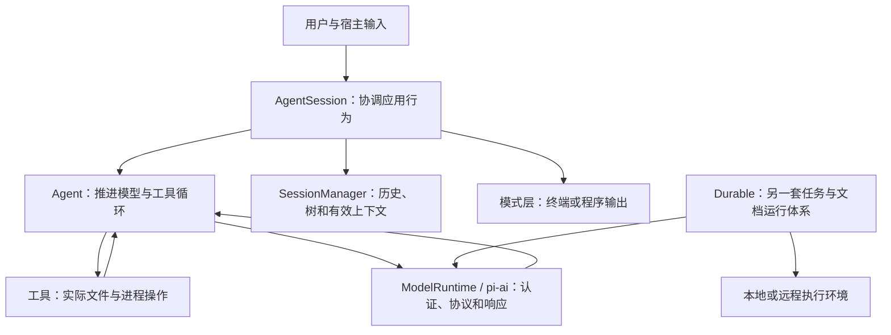

# 从零读懂 Pi Agent：中文源码阅读手册

这份手册对应Pi 上游源码版本 [`6fb2e7815167e6b19006fc526d1a5d0f5f998787`](https://github.com/earendil-works/pi/tree/6fb2e7815167e6b19006fc526d1a5d0f5f998787)，以“一个输入如何成为模型请求、工具执行和可恢复的会话”为主线，再展开配置、扩展、终端、持久任务和远程服务。

适合已经会使用编辑器、但尚不熟悉 TypeScript 或 Agent 架构的读者。术语先解释，再联系具体文件、字段、函数和分支。示意代码与教学场景会明确标注；实际行为以链接到的对应版本实现为依据。源码链接展示上游原文。

JSON 示例中的 `C:\pi-source` 表示 Pi 的安装目录；`C:/pi-json-demo` 和 `C:/pi-skill-demo` 是各示例任务的工作目录。

## 如何开始

第一遍读 01–05 和 08，建立普通请求的完整链路。第二遍读 06–12，理解协议、错误恢复和应用能力。第三遍进入 13 与 16，学习独立的 Durable/远程体系与工程设施。14 用于查找小功能，15 用于检验自己是否已经能独立追踪源码。

默认 CLI 的 JSONL 会话，与 Durable 的任务/文档/checkpoint 体系分别讲解。示例扩展、可选能力和实验入口不会被当作默认 Agent 功能。

## 章节目录

| 章节 | 能回答的问题 |
|---|---|
| [01 · 阅读准备](01-阅读准备.md) | import/type、异步流、事件、取消和泛型怎么看？ |
| [02 · 全仓库地图](02-全仓库地图.md) | 14 个包分别负责什么？先读哪些文件？ |
| [03 · 启动与初始化](03-启动与初始化.md) | cwd、配置、信任、模型、资源和会话如何装配？ |
| [04 · 一条请求的完整旅程](04-一条请求的完整旅程.md) | 输入、模型、工具、显示和持久化如何连接？ |
| [05 · Agent 核心循环](05-Agent核心循环.md) | 多轮、并行工具、steering、follow-up 和停止如何调度？ |
| [06 · 模型与 Provider](06-模型与Provider.md) | 模型目录、认证、协议请求、流事件与路由如何工作？ |
| [07 · 工具系统](07-工具系统.md) | 文件、shell、搜索、参数、截断和嵌套调用如何执行？ |
| [08 · 会话与上下文](08-会话与上下文.md) | 树、分支、JSONL、系统状态与 context edit 如何投影？ |
| [09 · 压缩与错误恢复](09-压缩与错误恢复.md) | token 估算、摘要、溢出、重试、排队和取消怎样处理？ |
| [10 · 提示词与扩展机制](10-提示词与扩展机制.md) | Skills、模板、扩展事件、动态工具和重载怎样连接？ |
| [11 · 终端与运行模式](11-终端与运行模式.md) | TUI、编辑器、渲染、Print、JSON、RPC 与 SDK 有何关系？ |
| [12 · MCP 与 Code Mode](12-MCP与CodeMode.md) | 外部工具怎样发现、暴露、执行和组合？ |
| [13 · Durable 与远程体系](13-Durable与远程体系.md) | 任务怎样持久化、恢复、调度与远程执行？ |
| [14 · 细节功能索引](14-细节功能索引.md) | 配置、命令、环境变量及各类小功能到哪里找？ |
| [15 · 阅读路线与练习](15-阅读路线与练习.md) | 怎样分阶段读、用测试理解边界并独立定位问题？ |
| [16 · 辅助包与工程设施](16-辅助包与工程设施.md) | 遥测、评测、生成数据、打包与发布有什么职责？ |
| [附录 · 全量源码文件导航](附录-全量源码文件导航.md) | 每个包内的实现、类型与入口文件在哪里？ |

## 先记住这张图

图中的箭头表示职责连接。包依赖、启动顺序和运行时调用顺序需要分别看源码，不能由一张图推断所有 imports。

## 阅读时一直区分六件事

1. **原始记录**与**模型有效上下文**：记录可以保留，但请求可以省略。
2. **模型选择**与**实际作答模型**：虚拟路由可能改变每次实际请求。
3. **流式增量**与**最终消息**：能显示不代表已经形成完整工具参数或持久记录。
4. **底层循环结束**与**会话收尾**：重试、压缩和等待工作可能还没结束。
5. **工具注册、直接声明与间接可调用**：三者决定不同的可见性。
6. **应用规则与操作系统隔离**：项目指令、信任和工具提示不自动形成 sandbox。

每章的练习都围绕这些区别展开。遇到陌生函数时先问它读什么、改什么、调用谁以及失败怎样被观察，再继续看细节。
